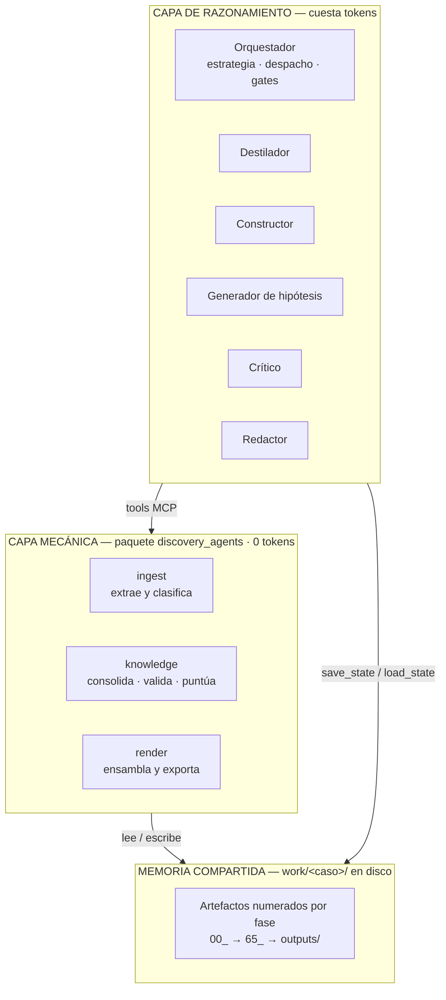
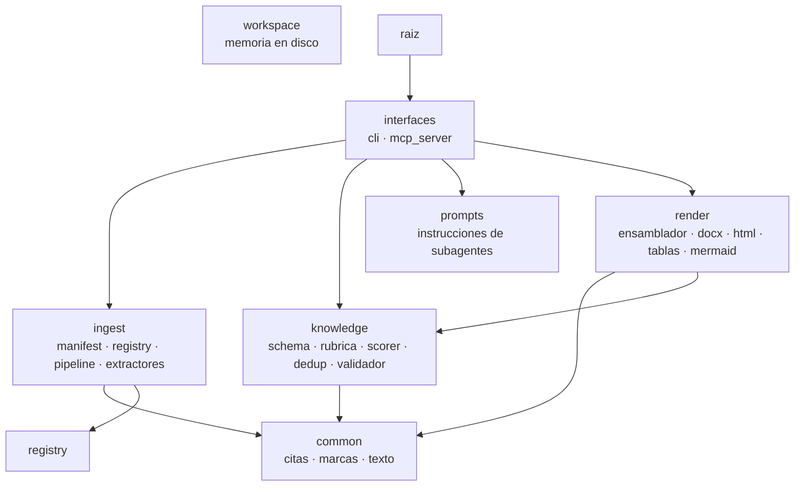
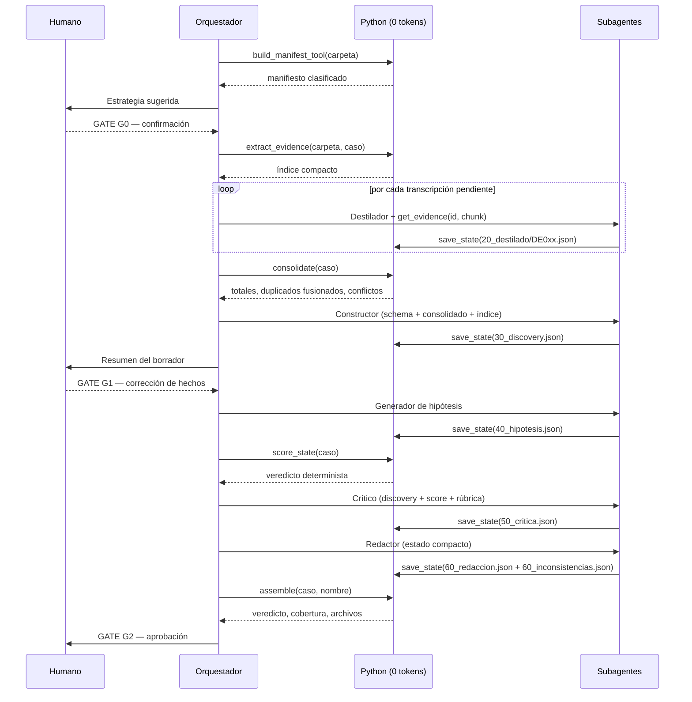
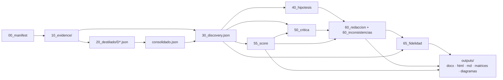

# Blueprint de Reconstrucción — Discovery Agents

**Este documento es la única fuente de verdad necesaria para reconstruir el sistema completo.**
Contiene la arquitectura, los contratos, los algoritmos, el código íntegro de cada módulo, la
plantilla de los entregables, los prompts verbatim, la configuración y la suite de pruebas. No
requiere acceso al repositorio original ni a ningún contexto externo.

> **Los bloques `<!-- BEGIN:x -->` se generan desde el código fuente** mediante
> `python tools/sync_docs.py`, y una prueba automatizada falla si el documento queda
> desincronizado. Copiar miles de líneas a mano garantizaría que el documento envejeciera y que
> quien lo usara reconstruyera una versión inferior sin saberlo. Por eso el Blueprint no puede
> mentir sobre el código: se deriva de él.

Documento complementario: `FILOSOFIA.md` responde *por qué* el sistema está construido así.
Este responde *qué es y cómo reconstruirlo*.

---

## Tabla de contenido

| § | Sección | Contenido |
|---|---|---|
| [1](#1-descripción-del-producto) | Descripción del producto | Qué hace, qué produce, para quién |
| [2](#2-arquitectura-general) | Arquitectura general | Tres capas, reparto Python/IA, decisiones de diseño |
| [3](#3-estructura-del-proyecto) | Estructura del proyecto | Árbol, inventario de módulos, grafo de dependencias |
| [4](#4-modelo-de-datos-y-contratos) | Modelo de datos y contratos | Schema tipado, artefactos de estado, DTOs |
| [5](#5-flujo-de-ejecución) | Flujo de ejecución | Fases F0–F7, gates, grafo de artefactos |
| [6](#6-especificación-funcional-por-componente) | Especificación funcional | Objetivo, E/S, validaciones, errores y ejemplos por función |
| [7](#7-formatos-de-entrada) | Formatos de entrada | 45 extensiones, contrato de extractor, degradación |
| [8](#8-algoritmos-detallados) | Algoritmos detallados | Limpieza, dedup, scoring, fidelidad, conflictos |
| [9](#9-estructura-de-los-entregables) | Estructura de los entregables | Documento Word y Resumen Ejecutivo HTML |
| [10](#10-código-fuente-completo) | **Código fuente completo** | Todos los módulos, íntegros, con metadatos |
| [11](#11-plantilla-del-resumen-ejecutivo) | Plantilla del Resumen Ejecutivo | HTML completo |
| [12](#12-prompts-de-los-subagentes) | Prompts de los subagentes | Verbatim |
| [13](#13-configuración) | Configuración | Dependencias, variables, ficheros del cliente |
| [14](#14-suite-de-pruebas) | Suite de pruebas | Contrato de comportamiento, código completo |
| [15](#15-manejo-de-errores) | Manejo de errores | Política, casos, mensajes |
| [16](#16-procedimiento-de-reconstrucción) | **Procedimiento de reconstrucción** | 16 pasos verificables |
| [17](#17-criterios-de-aceptación) | Criterios de aceptación | Cómo saber que está bien reconstruido |
| [18](#18-extensibilidad) | Extensibilidad | Cómo añadir formatos, campos, secciones, entregables |

---

## 1. Descripción del producto

Discovery Agents convierte **una carpeta de insumos heterogéneos** —actas, transcripciones de
reunión, hojas de cálculo de volumetría, presentaciones, PDF, correos, scripts SQL, diagramas e
imágenes— en **conocimiento consolidado y accionable** sobre un producto de datos, y emite un
veredicto de factibilidad reproducible.

### 1.1 Qué produce

| Entregable | Ruta | Destinatario | Naturaleza |
|---|---|---|---|
| **Documento Word del Discovery** | `work/<caso>/outputs/discovery_final.docx` | Equipo técnico y de negocio | Portada, índice navegable, una sección por tema, matrices en anexos |
| **Resumen Ejecutivo HTML** | `work/<caso>/outputs/resumen_ejecutivo.html` | Comité de liderazgo | Standalone (sin red), imprimible a PDF. **No es una copia del Word**: es la versión que se presenta |
| Documento markdown | `work/<caso>/outputs/discovery_final.md` | Revisión y control de versiones | Mismo contenido que el Word, en texto |
| Reporte de brechas | `work/<caso>/outputs/brechas.md` | Seguimiento | Preguntas pendientes clasificadas |
| Veredicto | `work/<caso>/outputs/veredicto.json` | Integraciones | Resumen legible por máquina |
| Diagramas Mermaid | `work/<caso>/outputs/diagramas/*.md` | Diseño | Flujo de datos, fuentes por servidor, Data Mesh, entidades |
| Matrices | `work/<caso>/outputs/tablas/*.md` | Trazabilidad | 8 matrices auxiliares |

### 1.2 El veredicto

`Go` / `Condicional` / `No-Go`, calculado por una **rúbrica determinista** sobre la información
capturada. Ningún modelo lo decide, de modo que es reproducible y no puede alterarse con un prompt.

### 1.3 Propiedades no negociables del sistema

1. **No inventa.** Cada afirmación factual se ancla a una evidencia rastreable `[E00x]`. Lo que no
   se conoció se declara como pendiente, nunca se rellena por suposición.
2. **No olvida.** El estado vive en disco, no en la ventana de contexto de un modelo.
3. **No se contradice.** Los conflictos entre fuentes se detectan y se declaran; no se resuelven
   en silencio.
4. **No repite.** Cada hecho aparece una sola vez, en la sección donde se explica.
5. **Es barato.** Todo lo calculable se calcula con código; el modelo solo razona.

---

## 2. Arquitectura general

### 2.1 Las tres capas



**Capa de razonamiento.** Un orquestador y cinco subagentes ejecutados por un cliente MCP con
modos de agente. Solo interpretan, sintetizan, detectan inconsistencias y redactan. La
implementación de referencia los define como ficheros en `.github/chatmodes/` (ver §13.3).

**Capa mecánica.** El paquete Python `discovery_agents`. Extrae, limpia, deduplica, consolida,
valida, puntúa, ensambla, dibuja y exporta. Determinista, probado, sin ninguna llamada a un modelo.

**Memoria compartida.** El directorio `work/<caso>/`. El contexto del chat **no es memoria**: cada
fase persiste su resultado y la siguiente lo lee. Esto hace el pipeline reanudable e incremental.

### 2.2 Reparto Python / IA

La regla es: **lo que se puede calcular, no se prompea**. La frontera se mueve en una sola
dirección — cuando una tarea de IA resulta repetible, se promueve a Python; nunca al revés.

| Proceso | Ejecutor | Justificación |
|---|---|---|
| Clasificar insumos, extraer texto | Python | Determinista y verificable. Leer los insumos con el modelo cuesta decenas de miles de tokens y no aporta nada que el código no obtenga. |
| Limpiar transcripciones | Python | Reglas explícitas, auditables y reversibles. |
| Deduplicar lo repetido | Python | Comparar frases es un cálculo, no un juicio. |
| Detectar conflictos numéricos | Python | Aritmética con tolerancia. |
| Validar tipos del schema | Python | Es un contrato, no una opinión. |
| Puntuar y emitir veredicto | Python | Debe ser reproducible y no negociable por quien lo lee. |
| Ensamblar, dibujar, exportar | Python | Plantillas parametrizadas. |
| **Destilar señal de una reunión** | IA económica | Requiere entender lo que se dijo. |
| **Rellenar el schema desde la evidencia** | IA fuerte | Requiere mapear lenguaje natural a estructura tipada. |
| **Proponer hipótesis y arquetipos** | IA fuerte | Requiere criterio estratégico. |
| **Criticar y formular preguntas poderosas** | IA fuerte | Requiere experiencia de consultor. |
| **Redactar la narrativa y detectar contradicciones** | IA fuerte | Es el núcleo intelectual del sistema. |

### 2.3 Patrones arquitectónicos

| Patrón | Dónde | Por qué |
|---|---|---|
| **Blackboard** | `work/<caso>/` | Varios agentes colaboran sin conocerse, escribiendo y leyendo una pizarra común. Elimina el acoplamiento entre fases y hace el pipeline reanudable. |
| **Pipes and Filters** | Fases F0–F7 | Cada fase transforma un artefacto en el siguiente. Un filtro se puede reejecutar sin repetir los anteriores. |
| **Registry / Plugin** | `ingest/registry.py` | Añadir un formato es una entrada en una tabla, no editar tres módulos que pueden discrepar. |
| **Strategy** | `registry.adaptador()` | La extensión del archivo selecciona el algoritmo de extracción en tiempo de ejecución. |
| **Template Method** | `render/entregables.py` | El pipeline de ensamblado es fijo; cada paso es sustituible. |
| **Single Source of Truth** | `prompts/`, `registry.FORMATOS`, `schema.SECCIONES` | Una regla en dos sitios diverge, y la copia más débil acaba ganando. |
| **Graceful Degradation** | Todos los extractores | Una dependencia ausente produce un aviso legible, no una excepción. |

### 2.4 Decisiones de diseño y su razón

| Decisión | Alternativa descartada | Razón |
|---|---|---|
| La evidencia se persiste y se sirve por trozos | Pasar los insumos al modelo | Un caso real de seis reuniones son decenas de miles de tokens por fase; el índice compacto son unos cientos. |
| El veredicto lo calcula una rúbrica | Que lo emita el modelo | Un veredicto que se puede convencer con un prompt no es un veredicto. |
| Documento fusionado (una sección, un cuerpo) | Narrativa + anexo estructurado | Ambos bloques hablan de lo mismo: el lector encuentra dos versiones del mismo hecho y no sabe cuál es la buena. |
| Marcas de ausencia distintas (`PENDIENTE`/`DESCONOCIDO`) | Un solo marcador o campo vacío | La acción correctiva difiere: lo pendiente se decide, lo desconocido se investiga. |
| Estilos Word por código | Plantilla `.docx` binaria | Un binario no se revisa en un diff, no se prueba y nadie se atreve a tocarlo. |
| Plantilla HTML con marcadores de doble llave | Motor de plantillas | Cero dependencias y el entregable es un archivo autónomo verificable. |
| Español en código y documentación | Inglés | Es la lengua del dominio, de los insumos y de los entregables. |

---

## 3. Estructura del proyecto

### 3.1 Árbol del paquete

<!-- BEGIN:arbol -->
```
discovery_agents/
  __init__.py                 7 líneas
  __main__.py                 9 líneas
  py.typed
  workspace.py              148 líneas
  common/
    __init__.py                 6 líneas
    citas.py                   76 líneas
    marcas.py                  30 líneas
    texto.py                  179 líneas
  ingest/
    __init__.py                10 líneas
    manifest.py               134 líneas
    pipeline.py                95 líneas
    registry.py               194 líneas
    extractores/
      __init__.py                50 líneas
      correo.py                 140 líneas
      documentos.py             154 líneas
      embebidos.py               94 líneas
      estructurados.py          231 líneas
      excel.py                  124 líneas
      imagenes.py               103 líneas
      legacy.py                  98 líneas
      presentaciones.py          92 líneas
      transcripcion.py           36 líneas
    transcripciones/
      __init__.py                 1 líneas
      cleaner.py                242 líneas
  interfaces/
    __init__.py                 9 líneas
    cli.py                    169 líneas
    mcp_server.py             194 líneas
  knowledge/
    __init__.py                 1 líneas
    consolidador.py           166 líneas
    dedup.py                  139 líneas
    fidelidad.py              191 líneas
    rubrica.py                119 líneas
    schema.py                 304 líneas
    scorer.py                 194 líneas
    validador.py              152 líneas
  prompts/
    __init__.py                33 líneas
    constructor.md
    critico.md
    destilador.md
    hipotesis.md
    redactor.md
  render/
    __init__.py                 5 líneas
    docx_export.py            525 líneas
    ensamblador.py            570 líneas
    entregables.py            163 líneas
    estilos_word.py           327 líneas
    html_export.py            380 líneas
    mermaid.py                216 líneas
    tablas.py                 166 líneas
    assets/
      executive.html
```
<!-- END:arbol -->

Fuera del paquete:

```
.github/
  copilot-instructions.md      reglas globales de trabajo para el cliente de razonamiento
  chatmodes/                   1 orquestador + 5 subagentes (punteros, no reglas)
.vscode/mcp.json               registro del servidor MCP para el editor
docs/
  BLUEPRINT.md                 este documento
  FILOSOFIA.md                 por qué está construido así
tools/
  sync_docs.py                 regenera los bloques de este documento desde el código
  generar_bundle_databricks.py empaqueta el proyecto para transporte
inputs/<caso>/                 insumos del Discovery (runtime; ignorado por control de versiones)
work/<caso>/                   estado y entregables (runtime; ignorado por control de versiones)
tests/test_core.py             suite completa
requirements.txt
```

### 3.2 Propósito y regla de dependencia de cada capa

| Capa | Pregunta que responde | Responsabilidad | Regla de dependencia |
|---|---|---|---|
| `common/` | ¿Qué vocabulario compartimos? | Citas `[E00x]`, marcas de ausencia, normalización y comparación de texto | **No importa ninguna otra capa.** Si un módulo de aquí necesitara `knowledge/`, no era transversal |
| `workspace.py` | ¿Dónde vive el estado? | Lectura/escritura de artefactos, troceado de evidencia, métricas, lista blanca | Solo stdlib |
| `ingest/` | ¿Qué hay en la carpeta y qué dice? | Clasificación, extracción, limpieza de transcripciones | Importa `common/` y `workspace` |
| `knowledge/` | ¿Qué sabemos y qué tan completo está? | Schema, rúbrica, scoring, fidelidad, deduplicación, validación, consolidación | Importa `common/` y `workspace` |
| `render/` | ¿Cómo se ve? | Ensamblado, Word, HTML, tablas, diagramas | Importa `common/` y `knowledge/` |
| `prompts/` | ¿Cómo razona cada agente? | Instrucciones de subagente como texto versionable | Sin dependencias |
| `interfaces/` | ¿Por dónde se entra? | CLI y servidor MCP | Importa todo lo anterior. **Sin lógica de negocio** |

### 3.3 Inventario completo de módulos

Cada módulo con su propósito, tamaño, dependencias internas y consumidores.

<!-- BEGIN:inventario -->

#### Capa transversal — `common`

> No importa ninguna otra capa del paquete.

| Módulo | Líneas | Propósito | Depende de | Consumido por |
|---|---:|---|---|---|
| `common/__init__.py` | 6 | Utilidades transversales, sin dependencias de otras capas. | — | — |
| `common/citas.py` | 76 | Citas de evidencia `[E00x]` — la unidad de trazabilidad del sistema. | — | `knowledge.fidelidad`, `knowledge.validador`, `render.docx_export`, `render.ensamblador`, `render.html_export`, `render.tablas` |
| `common/marcas.py` | 30 | Marcas de ausencia — el vocabulario con el que el sistema dice "no lo sé". | — | `knowledge.fidelidad`, `knowledge.schema`, `knowledge.scorer`, `knowledge.validador`, `render.docx_export`, `render.ensamblador`, `render.html_export`, `render.tablas` |
| `common/texto.py` | 179 | Normalización y comparación de texto — la base determinista de la deduplicación. | — | `ingest.pipeline`, `knowledge.dedup`, `knowledge.fidelidad`, `render.ensamblador`, `render.tablas` |

#### Memoria compartida — `workspace`

> Solo stdlib. Es un peer de las capas, no pertenece a ninguna.

| Módulo | Líneas | Propósito | Depende de | Consumido por |
|---|---:|---|---|---|
| `workspace.py` | 148 | Workspace de estado en disco — la memoria compartida del ecosistema. | — | — |

#### Capa de ingesta — `ingest`

> Importa `common/` y `workspace`.

| Módulo | Líneas | Propósito | Depende de | Consumido por |
|---|---:|---|---|---|
| `ingest/__init__.py` | 10 | Ingesta: de una carpeta de insumos heterogéneos a evidencia direccionable en disco. | — | — |
| `ingest/extractores/__init__.py` | 50 | Extractores deterministas: leen insumos y devuelven JSON estructurado sin gastar tokens de LLM. | `registry` | `ingest.registry` |
| `ingest/extractores/correo.py` | 140 | Extractor de correo (0 tokens): .eml con la stdlib, .msg de Outlook si hay librería. | `ingest.extractores.documentos` | `ingest.registry` |
| `ingest/extractores/documentos.py` | 154 | Extractor de documentos de texto (0 tokens): Word, PDF, texto plano, CSV/TSV, HTML y RTF. | — | `ingest.extractores.correo`, `ingest.extractores.transcripcion`, `ingest.registry` |
| `ingest/extractores/embebidos.py` | 94 | Imágenes incrustadas dentro de documentos: el hueco de información más grande que había. | `ingest.extractores.imagenes` | `ingest.extractores.presentaciones` |
| `ingest/extractores/estructurados.py` | 231 | Extractor de archivos técnicos (0 tokens): JSON, YAML, XML, SQL/DDL, notebooks, logs, config. | — | `ingest.extractores.imagenes`, `ingest.registry` |
| `ingest/extractores/excel.py` | 124 | Extractor de Excel determinista (0 tokens). | — | `ingest.registry` |
| `ingest/extractores/imagenes.py` | 103 | Extractor de imágenes: diagramas, capturas, fotos de pizarra y SVG exportados. | `ingest.extractores.estructurados` | `ingest.extractores.embebidos`, `ingest.registry` |
| `ingest/extractores/legacy.py` | 98 | Extractor de binarios Office 97-2003 (.xls/.doc/.ppt) por conversión con LibreOffice. | `ingest.registry` | `ingest.registry` |
| `ingest/extractores/presentaciones.py` | 92 | Extractor de PowerPoint determinista (0 tokens). | `ingest.extractores.embebidos` | `ingest.registry` |
| `ingest/extractores/transcripcion.py` | 36 | Adaptador de transcripciones: extraer el texto y limpiarlo sin destruirlo. | `ingest.extractores.documentos`, `ingest.transcripciones.cleaner` | `ingest.registry` |
| `ingest/manifest.py` | 134 | Router/Ingestor determinista. | `ingest.registry` | `ingest.pipeline`, `interfaces.cli`, `interfaces.mcp_server` |
| `ingest/pipeline.py` | 95 | Pipeline determinista de extracción (0 tokens de LLM). | `discovery_agents`, `common.texto`, `ingest.manifest`, `ingest.registry` | `interfaces.cli`, `interfaces.mcp_server` |
| `ingest/registry.py` | 194 | Registro de formatos: el único lugar donde una extensión se asocia a su extractor. | `ingest.extractores`, `ingest.extractores.correo`, `ingest.extractores.documentos`, `ingest.extractores.estructurados`, `ingest.extractores.excel`, `ingest.extractores.imagenes`, `ingest.extractores.legacy`, `ingest.extractores.presentaciones`, `ingest.extractores.transcripcion` | `ingest.extractores.legacy`, `ingest.manifest`, `ingest.pipeline`, `interfaces.cli`, `interfaces.mcp_server` |
| `ingest/transcripciones/__init__.py` | 1 | Limpieza heurística de transcripciones de Teams (0 tokens de LLM). | — | — |
| `ingest/transcripciones/cleaner.py` | 242 | Limpieza NO DESTRUCTIVA de transcripciones (determinista, 0 tokens). | — | `ingest.extractores.transcripcion` |

#### Capa de conocimiento — `knowledge`

> Importa `common/` y `workspace`.

| Módulo | Líneas | Propósito | Depende de | Consumido por |
|---|---:|---|---|---|
| `knowledge/__init__.py` | 1 | Plantilla, rúbrica, ensamblado y scoring del Discovery final. | — | `interfaces.cli`, `interfaces.mcp_server` |
| `knowledge/consolidador.py` | 166 | Consolidador de destilados + detector determinista de conflictos (0 tokens). | `discovery_agents`, `knowledge.dedup` | — |
| `knowledge/dedup.py` | 139 | Deduplicación semántica del destilado (0 tokens). | `common.texto` | `knowledge.consolidador` |
| `knowledge/fidelidad.py` | 191 | Verificador determinista de FIDELIDAD a las fuentes (0 tokens). | `common.citas`, `common.marcas`, `common.texto`, `knowledge.schema` | `render.ensamblador`, `render.entregables` |
| `knowledge/rubrica.py` | 119 | Rúbrica de 'preguntas poderosas' para un Discovery sólido de producto de datos. | — | `interfaces.cli`, `interfaces.mcp_server`, `knowledge.scorer` |
| `knowledge/schema.py` | 304 | Schema/plantilla TIPADA del Discovery final. | `common.marcas` | `interfaces.cli`, `interfaces.mcp_server`, `knowledge.fidelidad`, `knowledge.validador`, `render.docx_export`, `render.ensamblador`, `render.tablas` |
| `knowledge/scorer.py` | 194 | Scoring determinista de completitud + veredicto de factibilidad (0 tokens) — v2 tipado. | `common.marcas`, `knowledge.rubrica` | `interfaces.cli`, `interfaces.mcp_server`, `render.docx_export`, `render.ensamblador`, `render.html_export` |
| `knowledge/validador.py` | 152 | Validación de forma de `30_discovery.json` (0 tokens). | `common.citas`, `common.marcas`, `knowledge.schema` | `interfaces.cli`, `interfaces.mcp_server`, `render.entregables` |

#### Capa de render — `render`

> Importa `common/` y `knowledge/`.

| Módulo | Líneas | Propósito | Depende de | Consumido por |
|---|---:|---|---|---|
| `render/__init__.py` | 5 | Capa de render determinista (0 tokens): tablas/matrices, diagramas Mermaid, Word y HTML. | — | `render.docx_export` |
| `render/docx_export.py` | 525 | Exportación del Discovery a Word (.docx) — v4: documento fusionado, con portada e índice. | `common.citas`, `common.marcas`, `knowledge.schema`, `knowledge.scorer`, `render`, `render.ensamblador`, `render.mermaid`, `render.tablas` | `render.entregables` |
| `render/ensamblador.py` | 570 | Ensamblado determinista del documento final (0 tokens) — v4: documento FUSIONADO. | `common.citas`, `common.marcas`, `common.texto`, `knowledge.fidelidad`, `knowledge.schema`, `knowledge.scorer`, `render.tablas` | `render.docx_export`, `render.entregables` |
| `render/entregables.py` | 163 | Ensamblado unificado de TODOS los entregables (0 tokens) — fuente única de verdad. | `discovery_agents`, `knowledge.fidelidad`, `knowledge.validador`, `render.docx_export`, `render.ensamblador`, `render.html_export`, `render.mermaid`, `render.tablas` | `interfaces.cli`, `interfaces.mcp_server` |
| `render/estilos_word.py` | 327 | Sistema de estilos del documento Word (0 tokens, sin plantilla binaria). | — | — |
| `render/html_export.py` | 380 | Exportador del Resumen Ejecutivo a HTML standalone (0 tokens, sin dependencias externas). | `common.citas`, `common.marcas`, `knowledge.scorer` | `render.entregables` |
| `render/mermaid.py` | 216 | Diagramador determinista: Mermaid desde el schema tipado (0 tokens). | — | `render.docx_export`, `render.entregables` |
| `render/tablas.py` | 166 | Tabulador determinista: matrices e inventarios en markdown desde el schema tipado (0 tokens). | `common.citas`, `common.marcas`, `common.texto`, `knowledge.schema` | `render.docx_export`, `render.ensamblador`, `render.entregables` |

#### Capa de interfaces — `interfaces`

> Importa todas las anteriores. Sin lógica de negocio.

| Módulo | Líneas | Propósito | Depende de | Consumido por |
|---|---:|---|---|---|
| `interfaces/__init__.py` | 9 | Puertas de entrada al motor. Ninguna contiene lógica de negocio. | — | — |
| `interfaces/cli.py` | 169 | CLI determinista para operar el workspace sin MCP ni LLM (Python 3.9+). | `discovery_agents`, `ingest.manifest`, `ingest.pipeline`, `ingest.registry`, `knowledge`, `knowledge.rubrica`, `knowledge.schema`, `knowledge.scorer`, `knowledge.validador`, `render.entregables` | `__main__` |
| `interfaces/mcp_server.py` | 194 | Servidor MCP del ecosistema Discovery Agents — v2 (workspace persistente). | `discovery_agents`, `ingest.manifest`, `ingest.pipeline`, `ingest.registry`, `knowledge`, `knowledge.rubrica`, `knowledge.schema`, `knowledge.scorer`, `knowledge.validador`, `prompts`, `render.entregables` | — |
<!-- END:inventario -->

### 3.4 Grafo de dependencias entre capas

<!-- BEGIN:grafo -->

<!-- END:grafo -->

### 3.5 Convenciones

**Nombres de módulo por responsabilidad, no por tecnología.** `estilos_word.py`, no `docx_utils.py`;
`knowledge/`, no `models/`. El nombre del paquete sigue la misma regla: describe el dominio, no una
de sus dos puertas de entrada.

**Artefactos de estado con prefijo numérico de dos dígitos**, en orden de fase:

```
00_manifest.json → 10_evidence/ → 20_destilado/ → 30_discovery.json → 40_hipotesis.json
   → 50_critica.json → 55_score.json → 60_redaccion.json + 60_inconsistencias.json
   → 65_fidelidad.json → outputs/
```

Los medios pasos (`55`, `65`) son post-procesos deterministas de la fase inmediatamente anterior.

**Identificadores:**

| Elemento | Formato | Ejemplo |
|---|---|---|
| Evidencia | `E` + 3 dígitos con relleno | `E001`, `E042` |
| Segmento de transcripción | `seg-` + 3 dígitos | `seg-014` |
| Destilado | `D` + ID de su evidencia | `DE003.json` |
| Cita en texto | `[E00x]`, `[E00x seg-NNN]`, `[inferencia de E00x]` | `[E003 seg-014]` |

**Un guion bajo inicial marca lo privado.** Si otra capa necesita algo privado, es que debía ser
público o vivir en `common/`.

**Idioma:** español en código, comentarios, prompts, salidas y documentación.

---

## 4. Modelo de datos y contratos

### 4.1 Schema tipado del Discovery — `30_discovery.json`

Es el contrato central del sistema: lo rellena el Constructor y lo consumen el scorer, el
verificador de fidelidad, el ensamblador y ambos exportadores.

<!-- BEGIN:schema -->
```json
{
  "nombre_caso_uso": "",
  "fecha_discovery": "",
  "contexto": "",
  "problematica_actual": "",
  "resumen_ejecutivo": "",
  "necesidad_negocio": "",
  "objetivo": "",
  "valor_esperado": "",
  "beneficio_economico": "",
  "alcance_in": "",
  "alcance_out": "",
  "metricas_exito": "",
  "consumidores": "",
  "frecuencia_latencia": "",
  "logica_negocio": "",
  "calidad_datos": "",
  "datos_sensibles": "",
  "controles_seguridad": "",
  "habilitacion_tecnica": "",
  "costos_finops": "",
  "mensajes_clave": [],
  "casos_uso": [],
  "solicitante": {
    "nombre": "",
    "rol": "",
    "contacto": ""
  },
  "dueno_producto": {
    "nombre": "",
    "rol": "",
    "contacto": ""
  },
  "product_owner": {
    "nombre": "",
    "rol": "",
    "contacto": ""
  },
  "lider_tecnico": {
    "nombre": "",
    "rol": "",
    "contacto": ""
  },
  "equipo_desarrollador": [],
  "expertos_datos": [],
  "expertos_por_pais": [],
  "certificadores": [],
  "fuentes": [],
  "entidades": [],
  "productos_relacionados": [],
  "hallazgos_tecnicos": [],
  "dependencias": [],
  "impedimentos": [],
  "accesos": [],
  "riesgos": [],
  "supuestos": [],
  "restricciones": [],
  "hipotesis": [],
  "arquetipos_datamesh": [],
  "temas_faltantes": [],
  "brechas": "",
  "veredicto": ""
}
```
<!-- END:schema -->

#### 4.1.1 Semántica de los campos

| Grupo | Claves | Tipo | Notas |
|---|---|---|---|
| Identidad | `nombre_caso_uso`, `fecha_discovery`, `contexto`, `problematica_actual` | `str` | `fecha_discovery` la rellena el sistema desde el manifiesto si viene vacía |
| Narrativa | `resumen_ejecutivo`, `necesidad_negocio`, `objetivo`, `valor_esperado`, `beneficio_economico`, `alcance_in`, `alcance_out`, `metricas_exito`, `consumidores`, `frecuencia_latencia`, `logica_negocio`, `calidad_datos`, `datos_sensibles`, `controles_seguridad`, `habilitacion_tecnica`, `costos_finops` | `str` | `beneficio_economico` solo se afirma si contiene una cita `[E00x]` |
| Mensajes | `mensajes_clave` | `List[str]` | 3–5 frases ejecutivas; alimentan el HTML |
| Casos de uso | `casos_uso` | `List[{nombre, descripcion, evidencia}]` | Su número se deriva, no se declara |
| Gobierno (persona) | `solicitante`, `dueno_producto`, `product_owner`, `lider_tecnico` | `{nombre, rol, contacto}` | Solo cuenta si tiene `nombre` real |
| Gobierno (listas) | `equipo_desarrollador`, `expertos_datos`, `expertos_por_pais`, `certificadores` | `List[dict]` | `certificadores[].ambito` admite código de país |
| Datos | `fuentes` | `List[{tabla, esquema, servidor, columnas, librerias, volumetria, frecuencia, sensible, evidencia}]` | La volumetría debe contener dígitos para puntuar |
| Datos | `entidades`, `productos_relacionados`, `hallazgos_tecnicos` | `List[dict]` | Las entidades son un boceto, no el modelo de diseño |
| Gestión | `dependencias`, `impedimentos`, `accesos`, `riesgos`, `supuestos`, `restricciones` | `List[dict]` | `riesgos[].tipo` ∈ `operativo, tecnico, calidad, dependencia, limitacion` |
| Estrategia | `hipotesis`, `arquetipos_datamesh` | `List[dict]` | Las produce el Generador con estas mismas claves |
| Deuda | `temas_faltantes` | `List[{punto, tipo, detalle, impacto, origen, accion_sugerida}]` | El sistema lo completa automáticamente |
| Calculadas | `brechas`, `veredicto` | `str` | El Constructor las deja vacías; las sobrescribe el scorer |

#### 4.1.2 Marcas de ausencia

| Marca | Significado | Acción correctiva | Cuenta en el scoring |
|---|---|---|---|
| `PENDIENTE` | La rúbrica lo pide y el equipo aún debe definirlo | Se **decide** | No |
| `DESCONOCIDO` | No surgió en los insumos; nadie lo mencionó | Se **investiga** | No |
| `[]` | Lista sin elementos | Según el caso | No |

> **Advertencia.** Las dos marcas cuentan igual al puntuar. Si solo se rechazara `PENDIENTE`, un
> Discovery en el que nadie supo responder nada alcanzaría `Go` y el veredicto diría "listo para
> diseñar" sobre un expediente sin información.

### 4.2 Contratos de todos los artefactos de estado

| Artefacto | Productor | Forma | Consumidores |
|---|---|---|---|
| `00_manifest.json` | `ingest.manifest` | `{raiz, caso_de_uso, total_items, por_categoria, por_extractor, items[], advertencias[]}` | `render.entregables` (deriva la fecha) |
| `10_evidence/index.json` | `ingest.pipeline` | `{caso, total_items, items[], fuentes_detectadas[], metricas_eficiencia, advertencias[], nota}` | `workspace`, `knowledge.consolidador`, `knowledge.fidelidad` |
| `10_evidence/E00x_*.json` | `ingest.pipeline` | Registro del extractor + `{id, tipo, categoria, archivo_origen, modificado}`. **Siempre incluye `vista_texto`** | `workspace.get_evidence_chunk` |
| `20_destilado/DE0xx.json` | Destilador (IA) | `{decisiones[], hallazgos[], datos_fuente[], procesos[], reglas[], preguntas_abiertas[], acciones[]}` | `knowledge.consolidador` |
| `20_destilado/consolidado.json` | `knowledge.consolidador` | Lo anterior unido y deduplicado + `conflictos[]` + `fusiones{}` | Constructor, Redactor |
| `30_discovery.json` | Constructor (IA) | El schema de §4.1 | Todo el sistema |
| `40_hipotesis.json` | Generador (IA) | `{hipotesis[], arquetipos_datamesh[]}` | Redactor |
| `50_critica.json` | Crítico (IA) | `{brechas_priorizadas[], ambiguedades[], preguntas_para_proxima_sesion[], recomendacion}` | `render.ensamblador` |
| `55_score.json` | `knowledge.scorer` | `{completitud_total, veredicto, condiciones_para_avanzar[], bloques[], brechas[], n_brechas, umbral_go, umbral_condicional}` | Crítico, Redactor, ambos exportadores |
| `60_redaccion.json` | Redactor (IA) | `{secciones: {slot: prosa}}` | `render.ensamblador`, `render.docx_export` |
| `60_inconsistencias.json` | Redactor (IA) | `{mensajes_clave[], inconsistencias[], vacios_no_capturados_por_rubrica[], preguntas_criticas_adicionales[], decisiones_pendientes[], evaluacion}` | `render.ensamblador`, `render.html_export` |
| `65_fidelidad.json` | `knowledge.fidelidad` | `{cobertura_pct, campos_con_contenido, campos_con_cita, campos_sin_cita[], fuentes_sin_evidencia[], citas_invalidas[], parrafos_sin_cita[], parrafos_redundantes[], ids_evidencia[]}` | Ambos exportadores |
| `_metrics.json` | `workspace.append_metric` | Array de `{fase, ts, ...datos}` | Telemetría |

### 4.3 Lista blanca de escritura

Los agentes solo pueden escribir en los artefactos de su fase. Cualquier otra ruta —incluida
`../fuera.json`— se rechaza con `ValueError`. `outputs/` no está en la lista: lo escribe Python.

```
20_destilado/D<algo>.json
20_destilado/consolidado.json
30_discovery.json
40_hipotesis.json
50_critica.json
55_score.json
60_redaccion.json   |  60_redaccion.md   (el .md se acepta por compatibilidad)
60_inconsistencias.json
```

### 4.4 Ejemplo completo de un artefacto

`20_destilado/DE003.json` producido por el Destilador a partir de una transcripción:

```json
{
  "decisiones": [
    {"decision": "La facturación debe estar disponible al día siguiente del cierre",
     "segmentos": ["seg-003"]}
  ],
  "hallazgos": [
    {"hallazgo": "El cierre mensual toma entre 4 y 6 días hábiles del equipo de Operaciones",
     "segmentos": ["seg-001"]},
    {"hallazgo": "La réplica evita bloqueos en producción", "segmentos": ["seg-006"]}
  ],
  "datos_fuente": [
    {"tabla_o_fuente": "TRX_ADQUIRENCIA", "volumetria": "300 millones", "segmentos": ["seg-001"]}
  ],
  "preguntas_abiertas": [
    {"pregunta": "Quién aprueba el acceso a SQLPROD02", "segmentos": ["seg-004"]}
  ],
  "acciones": [], "procesos": [], "reglas": []
}
```

Tras `consolidate`, cada elemento recibe su `evidencia` (`E003`) y los duplicados se fusionan
uniendo procedencias.

---

## 5. Flujo de ejecución

### 5.1 Fases y gates



| Fase | Ejecutor | Lee | Escribe | Coste |
|---|---|---|---|---|
| **F0** Estrategia | Orquestador | `build_manifest_tool(folder)` | `00_manifest.json` + estrategia | mínimo |
| **G0** | **Humano** | La estrategia | Confirmación | — |
| **F1** Extracción | Python | La carpeta de insumos | `10_evidence/` + índice | **0** |
| **F2** Destilado | IA económica | `get_evidence` por trozos | `20_destilado/DE0xx.json` | bajo |
| **F2b** Consolidación | Python | Los destilados + índice | `20_destilado/consolidado.json` | **0** |
| **F3** Construcción | IA fuerte | índice + consolidado + `get_schema()` | `30_discovery.json` | medio |
| **G1** | **Humano** | Resumen del borrador | Corrección de hechos | — |
| **F4** Hipótesis | IA fuerte | `30_discovery.json` | `40_hipotesis.json` | bajo |
| **F5a** Score | Python | `30_discovery.json` | `55_score.json` | **0** |
| **F5b** Crítica | IA fuerte | discovery + score + rúbrica | `50_critica.json` | medio |
| **F6** Redacción | IA fuerte | 30/40/50/55 + conflictos | `60_redaccion.json`, `60_inconsistencias.json` | medio |
| **F7** Ensamblado | Python | Todo el estado | `outputs/` + `65_fidelidad.json` | **0** |
| **G2** | **Humano** | Veredicto y entregables | Aprobación | — |

> **Por qué existen los gates.** G1 es el más importante: corregir un hecho equivocado antes de
> redactar cuesta una frase; corregirlo después obliga a rehacer el documento, el resumen ejecutivo
> y todas las matrices derivadas.

### 5.2 Grafo de dependencias entre artefactos



### 5.3 Reanudación e incrementalidad

El pipeline es reanudable porque cada fase deja su resultado en disco. `pending_distillation(caso)`
devuelve solo las transcripciones sin destilar, de modo que reejecutar F2 tras añadir una reunión
nueva procesa únicamente esa reunión.

---

## 6. Especificación funcional por componente

Esta sección describe el comportamiento de cada función pública relevante. El código íntegro está
en §10.

### 6.1 `ingest.manifest.build_manifest(folder) -> dict`

| Aspecto | Detalle |
|---|---|
| **Objetivo** | Inventariar y clasificar los insumos sin leer su contenido. |
| **Entrada** | `folder: str` — ruta a la carpeta del caso. |
| **Salida** | `dict` con `raiz, caso_de_uso, total_items, por_categoria, por_extractor, items[], advertencias[]`. |
| **Flujo** | Recorre el árbol; para cada archivo: descarta ruido (`.DS_Store`, `~$*`), resuelve el extractor por extensión desde el registro, promueve a `transcripcion` lo que esté en `transcripciones/`, y recoge metadatos baratos (`tamano_bytes`, `modificado`). |
| **Validaciones** | Carpeta inexistente → manifiesto con `total_items: 0` y una advertencia. Extensión no soportada → advertencia y se omite. Binario legacy sin LibreOffice → advertencia con la conversión sugerida. |
| **Errores** | Ninguno propagado. `OSError` al consultar metadatos → `tamaño 0`, fecha vacía. |
| **Coste** | 0 tokens. No abre ningún archivo. |

**Categoría por subcarpeta:**

| Subcarpeta | Categoría |
|---|---|
| `caso_de_uso/` | `caso_de_uso` |
| `discovery_inicial/` | `discovery_inicial` |
| `discovery_tecnico/` | `discovery_tecnico` |
| `transcripciones/` | `transcripcion` |
| `hallazgos/` | `hallazgo` |
| `fuentes/` | `fuente` |
| `imagenes/` | `imagen` |
| cualquier otra | `sin_clasificar` |

**Ejemplo de salida:**

```json
{
  "raiz": "inputs/mi_caso",
  "caso_de_uso": "mi_caso",
  "total_items": 6,
  "por_categoria": {"fuente": 1, "caso_de_uso": 1, "transcripcion": 2,
                    "discovery_tecnico": 1, "hallazgo": 1},
  "por_extractor": {"excel": 1, "documento": 1, "transcripcion": 2,
                    "estructurado": 1, "correo": 1},
  "items": [
    {"ruta": "inputs/mi_caso/fuentes/inventario.xlsx", "nombre": "inventario.xlsx",
     "categoria": "fuente", "extractor": "excel", "extension": ".xlsx",
     "tamano_bytes": 5417, "modificado": "<ISO 8601 de la última modificación>"}
  ],
  "advertencias": []
}
```

### 6.2 `ingest.pipeline.construir_evidencia(folder, caso="") -> dict`

| Aspecto | Detalle |
|---|---|
| **Objetivo** | Extraer todos los insumos a disco y devolver **solo** un índice compacto. |
| **Entrada** | `folder: str`; `caso: str` opcional (por defecto, el nombre de la carpeta). |
| **Salida** | El índice: `{caso, total_items, items[], fuentes_detectadas[], metricas_eficiencia, advertencias[], nota}`. |
| **Flujo** | Construye el manifiesto y lo persiste → por cada ítem asigna `E{n:03d}`, resuelve el adaptador y lo ejecuta → persiste el registro completo en `10_evidence/` → acumula una fila de índice con el resumen de una línea. |
| **Validaciones** | Cada extracción va en `try/except`: un archivo ilegible añade una advertencia y el pipeline continúa. |
| **Errores** | Ninguno propagado. |
| **Invariante crítica** | El contenido **nunca** entra en el valor de retorno. Una prueba fija que el índice pese menos de 4 000 caracteres. |

### 6.3 `workspace.get_evidence_chunk(caso, evidence_id, chunk=0) -> dict`

| Aspecto | Detalle |
|---|---|
| **Objetivo** | Servir un fragmento de evidencia bajo demanda. |
| **Entrada** | `caso`, `evidence_id` (`E003`), `chunk` (entero, se recorta al rango válido). |
| **Salida** | `{id, chunk, total_chunks, contenido}` — el contenido son 12 000 caracteres de `vista_texto`. |
| **Errores** | ID inexistente → `{"error": "Evidencia E999 no existe. IDs: [...]"}`. Nunca lanza excepción. |

### 6.4 `workspace.save_state(caso, relpath, contenido) -> str`

| Aspecto | Detalle |
|---|---|
| **Objetivo** | Persistir el resultado de una fase de razonamiento. |
| **Validaciones** | Normaliza separadores, quita `/` inicial y comprueba la lista blanca (§4.3). Si el destino es `.json`, valida que el contenido parsee antes de escribir. |
| **Errores** | Ruta fuera de la lista blanca → `ValueError` con la lista de rutas permitidas. JSON inválido → `ValueError`. |

### 6.5 `knowledge.consolidador.consolidar(caso) -> dict`

| Aspecto | Detalle |
|---|---|
| **Objetivo** | Unir los destilados, deduplicar y detectar conflictos numéricos. |
| **Entrada** | `caso: str`. Lee `20_destilado/D*.json` y `10_evidence/index.json`. |
| **Salida** | `{destilados_unidos, totales{}, duplicados_fusionados, conflictos[]}`. Escribe `consolidado.json`. |
| **Flujo** | 1) Une los destilados estampando `evidencia` desde el nombre del archivo. 2) Deduplica cada lista. 3) Cruza volumetrías. 4) Persiste incluyendo `fusiones` para auditar qué se fundió con qué. |
| **Orden crítico** | La deduplicación va **después** de estampar la procedencia (para poder unirla) y **antes** de detectar conflictos (para no comparar dos veces la misma cifra). |

### 6.6 `knowledge.scorer.score_discovery(discovery) -> dict`

| Aspecto | Detalle |
|---|---|
| **Objetivo** | Emitir el veredicto determinista. |
| **Salida** | `{completitud_total, veredicto, condiciones_para_avanzar[], bloques[], n_brechas, brechas[], umbral_go, umbral_condicional}`. |
| **Errores** | Ninguno: un Discovery vacío produce `No-Go` con completitud `0.0`. |

**Fórmula:**

```
completitud_bloque = 100 × (obligatorias respondidas / obligatorias del bloque)
completitud_total  = Σ(completitud_bloque × peso) / Σ(peso)

Go          ⟺ ningún bloque crítico por debajo del 100 % Y completitud_total ≥ 85
No-Go       ⟺ completitud_total < 60 O más de 4 condiciones bloqueantes
Condicional ⟺ en cualquier otro caso
```

**Validadores que impiden inflar el score:**

| Clave | Regla |
|---|---|
| `volumetria` | Todas las fuentes deben traerla y debe contener dígitos — "bastante grande" no cuenta |
| `servidor_origen` | Todas las fuentes deben declarar `servidor` |
| `columnas_fuentes`, `librerias_fuentes` | Todas las fuentes deben traer el campo con dato real |
| Personas (`dueno_producto`, …) | Solo cuenta si `nombre` no está vacío ni es marca de ausencia |
| Listas de personas | Al menos un elemento con `nombre` |

### 6.7 `knowledge.validador.validar_discovery(discovery) -> dict`

| Aspecto | Detalle |
|---|---|
| **Objetivo** | Detectar el fallo silencioso más caro: una lista aplanada a texto. |
| **Salida** | `{valido: bool, errores[], avisos[], claves_desconocidas[]}`. |
| **Severidades** | **Error** → el ensamblado se detiene (estructura rota). **Aviso** → continúa (contenido mejorable). |

**Ejemplo de error detectado:**

```python
d["fuentes"] = "TRX en SQLPROD01, LIQ en SQLPROD02"   # debía ser List[dict]
# → valido: False
# → "'fuentes' debe ser una LISTA y llegó como str. Aplanarla a texto rompe la tabla,
#    el diagrama y la trazabilidad que la usan."
```

> **Advertencia.** Sin esta validación el render no falla: **se vacía**. La tabla de fuentes sale
> sin filas, el diagrama sin nodos y la trazabilidad sin citas, y nadie lo nota hasta leer el
> documento final.

### 6.8 `render.entregables.construir_entregables(caso, caso_de_uso="") -> dict`

| Aspecto | Detalle |
|---|---|
| **Objetivo** | Generar **todos** los entregables. Es el único camino de ensamblado. |
| **Salida** | `{veredicto{}, fidelidad{}, avisos_de_validacion[], secciones_omitidas[], narrativa_incluida, docx_generado, docx_disponible, archivos_generados[]}` o `{error, detalles[], avisos[]}`. |
| **Flujo** | (0) valida forma → (1) deriva la fecha del manifiesto → (2) verifica fidelidad → (3) ensambla el documento → (4) genera diagramas y matrices → (5) exporta Word → (6) exporta HTML → (7) registra métricas. |
| **Invariante** | La CLI y la tool MCP llaman aquí. Si cada interfaz tuviera su pipeline, una acabaría produciendo un entregable inferior sin que nadie lo notara. |

---

## 7. Formatos de entrada

### 7.1 Catálogo completo

<!-- BEGIN:formatos -->
| Extractor | Extensiones | Dependencia opcional |
|---|---|---|
| `correo` | `.eml`, `.msg` | extract-msg |
| `documento` | `.docx`, `.docm`, `.pdf`, `.txt`, `.md`, `.markdown`, `.csv`, `.tsv`, `.rtf`, `.html`, `.htm` | pypdf, python-docx |
| `estructurado` | `.json`, `.yaml`, `.yml`, `.xml`, `.drawio`, `.sql`, `.ddl`, `.toml`, `.ini`, `.cfg`, `.log`, `.ipynb` | — |
| `excel` | `.xlsx`, `.xlsm` | openpyxl |
| `imagen` | `.png`, `.jpg`, `.jpeg`, `.gif`, `.bmp`, `.webp`, `.tif`, `.tiff`, `.heic`, `.heif`, `.svg` | pillow-heif, pytesseract |
| `legacy` | `.xls`, `.doc`, `.ppt` | LibreOffice (soffice) |
| `powerpoint` | `.pptx`, `.pptm` | python-pptx |
| `transcripcion` | `.vtt`, `.srt` | — |

Total: **45 extensiones** soportadas.

| Extensión | Extractor | Descripción |
|---|---|---|
| `.xlsx` | `excel` | Libro de Excel |
| `.xlsm` | `excel` | Libro de Excel con macros |
| `.pptx` | `powerpoint` | Presentación de PowerPoint |
| `.pptm` | `powerpoint` | Presentación de PowerPoint con macros |
| `.docx` | `documento` | Documento de Word |
| `.docm` | `documento` | Documento de Word con macros |
| `.pdf` | `documento` | PDF |
| `.txt` | `documento` | Texto plano |
| `.md` | `documento` | Markdown |
| `.markdown` | `documento` | Markdown |
| `.csv` | `documento` | CSV |
| `.tsv` | `documento` | Valores separados por tabulador |
| `.rtf` | `documento` | Texto enriquecido |
| `.html` | `documento` | Página web / export de Confluence o SharePoint |
| `.htm` | `documento` | Página web |
| `.vtt` | `transcripcion` | Subtítulos WebVTT (Teams) |
| `.srt` | `transcripcion` | Subtítulos SubRip |
| `.png` | `imagen` | Imagen PNG |
| `.jpg` | `imagen` | Imagen JPEG |
| `.jpeg` | `imagen` | Imagen JPEG |
| `.gif` | `imagen` | Imagen GIF |
| `.bmp` | `imagen` | Imagen BMP |
| `.webp` | `imagen` | Imagen WebP |
| `.tif` | `imagen` | Imagen TIFF |
| `.tiff` | `imagen` | Imagen TIFF |
| `.heic` | `imagen` | Foto HEIC (iPhone) |
| `.heif` | `imagen` | Foto HEIF |
| `.svg` | `imagen` | Diagrama SVG (Visio/draw.io exportado) |
| `.json` | `estructurado` | JSON |
| `.yaml` | `estructurado` | YAML |
| `.yml` | `estructurado` | YAML |
| `.xml` | `estructurado` | XML |
| `.drawio` | `estructurado` | Diagrama de draw.io |
| `.sql` | `estructurado` | Script SQL — aporta tablas y esquemas al inventario |
| `.ddl` | `estructurado` | DDL — aporta tablas y esquemas al inventario |
| `.toml` | `estructurado` | Configuración TOML |
| `.ini` | `estructurado` | Configuración INI |
| `.cfg` | `estructurado` | Configuración |
| `.log` | `estructurado` | Bitácora / log |
| `.ipynb` | `estructurado` | Notebook Jupyter |
| `.eml` | `correo` | Correo electrónico (RFC 822) |
| `.msg` | `correo` | Correo de Outlook |
| `.xls` | `legacy` | Excel 97-2003 |
| `.doc` | `legacy` | Word 97-2003 |
| `.ppt` | `legacy` | PowerPoint 97-2003 |
<!-- END:formatos -->

### 7.2 Contrato del adaptador

Todo extractor expone una función con esta firma exacta:

```python
def extraer(ruta: str) -> Tuple[dict, str, dict]:
    """Adaptador del registro."""
```

| Posición | Nombre | Contenido | Obligatorio |
|---|---|---|---|
| 0 | `registro` | Dict que se persiste en `10_evidence/E00x_*.json`. **Debe** incluir `vista_texto`: es lo único que se sirve al modelo, por trozos y bajo demanda. | Sí |
| 1 | `resumen` | Una línea para el índice. Es lo que el orquestador ve del insumo. | Sí |
| 2 | `extras` | Señales para las métricas agregadas: `fuentes`, `car_orig`, `car_limpio`, `es_imagen`, `requiere_vision`. | Sí (puede ser `{}`) |

### 7.3 Política de degradación

Toda dependencia de terceros es **opcional** y se importa **dentro** de la función que la usa,
nunca en la cabecera del módulo. Consecuencias garantizadas:

1. Importar el paquete nunca falla por una librería ausente.
2. Un formato cuya librería falta produce un aviso legible dentro de `vista_texto`
   (p. ej. `[PDF no extraído: instala 'pypdf' para leer informe.pdf]`), no una excepción.
3. Un archivo corrupto añade una advertencia al índice; el resto de los insumos se procesan.

> **Principio.** Un insumo ausente y **declarado** es un dato. Un insumo ausente y **callado** es un
> error que aparecerá en la reunión de presentación.

### 7.4 Cómo añadir un formato

1. Escribir el extractor en `ingest/extractores/` con la función `extraer(ruta)` de §7.2.
2. Añadir una línea a `FORMATOS` en `ingest/registry.py`.
3. Escribir la prueba, **incluida la degradación** cuando falte su dependencia.

No hay paso 4: ni `manifest.py` ni `pipeline.py` necesitan enterarse.

---

## 8. Algoritmos detallados

### 8.1 Limpieza no destructiva de transcripciones

**Objetivo:** quitar el ruido del lenguaje hablado sin alterar el significado.

**Detección de formato** (en orden):

| Formato | Señal | Estructura |
|---|---|---|
| `vtt_teams` | Contiene `<v ` | `<v Nombre>texto</v>` |
| `docx_teams` | ≥2 líneas `Nombre Apellido   0:15` en las primeras 60 | Cabecera con nombre y luego el texto |
| `txt_teams` | ≥2 líneas `0:00:12 Nombre Apellido` en las primeras 60 | Timestamp primero, nombre después |
| `generico` | ninguna de las anteriores | `Hablante: texto` por línea |

**Reglas de limpieza:**

| Regla | Alcance | Ejemplo |
|---|---|---|
| Interjecciones inequívocas (`eh`, `ehm`, `mmm`, `umm`, `ajá`) | Cualquier posición | "entender mmm el flujo" → "entender el flujo" |
| Muletillas ambiguas (`este`, `bueno`, `pues`, `o sea`, `digamos`) | **Solo al inicio de turno Y seguidas de coma** | "Este, la idea…" → "la idea…" · "Este servidor…" **no se toca** |
| Repetición adyacente de palabra | Palabras de 3+ letras | "fuentes fuentes" → "fuentes" |
| Deduplicación de líneas | **Solo adyacente**, igualdad exacta insensible a mayúsculas | — |
| Metadatos de herramienta | Líneas completas | `WEBVTT`, `NOTE`, `00:00:01 --> 00:00:03`, "se unió a la reunión" |

> **Advertencia crítica.** La coma es lo único que distingue la muletilla del uso con significado.
> Sin esa condición, "no es cierto" se convierte en "no es" — invirtiendo el sentido. Por eso la
> lista de muletillas nunca debe incluir palabras con carga léxica (`tipo`, `ya`, `cierto`,
> `verdad`) ni afirmaciones (`sí`, `ok`, `vale`).

**Reversibilidad:** cada segmento conserva su texto `original` junto al limpio. Ninguna decisión de
limpieza es irreversible.

**Normalización de nombres:** se preservan las partículas de los apellidos compuestos
(`de`, `del`, `la`, `van`, `von`, …). Un `.title()` a secas convertiría "Ana de la Cruz" en "Ana De
La Cruz", y ese nombre deformado se propagaría a cada cita del documento.

### 8.2 Deduplicación semántica

**Problema:** un Discovery recorre cinco o seis reuniones y el mismo hecho se enuncia en varias. Un
destilado honesto extrae todas las versiones; sin deduplicar, el documento afirma tres veces lo
mismo con distintas palabras y el lector no sabe si son tres hallazgos o uno.

**Algoritmo:** tres señales combinadas sobre raíces del español.

| Señal | Qué capta | Peso |
|---|---|---|
| Jaccard de tokens significativos | Identidad del hecho, insensible al orden y a la redacción | 0.7 |
| Ratio de secuencia (`difflib`) | Articulación; desempata frases con vocabulario común | 0.3 |
| Contención | Una frase es subconjunto estricto de otra (mín. 3 tokens) → 0.9 | sustituye a la mezcla si es mayor |

**Recortador de raíces (tres pasadas, el orden no es negociable):**

1. Plural: `es`, `os`, `as`, `s`
2. Derivación y conjugación: `amiento`, `aciones`, `cion`, `mente`, `dad`, `ieron`, `ando`, `an`,
   `en`, `ar`, `er`, `ir`, …
3. Vocal final (`a`, `e`, `o`) mientras la raíz conserve más de 3 caracteres

Los participios (`-ado/-ada/-ido/-ida`) se dejan deliberadamente a la pasada de vocales: recortarlos
como sufijo produce `pesada → pes` pero `pesadas → pesad`, y esa asimetría rompe la comparación en
las palabras más comunes.

**Umbral: 0.82.** Calibrado contra los dos errores posibles:

| Error | Gravedad | Ejemplo |
|---|---|---|
| Fundir hechos distintos | **Grave y silencioso** — pierde información | "La tabla TRX tiene 400M" vs "La tabla CATALOGO tiene 400M" (0.68) |
| No fundir una reformulación | Leve y visible | "La réplica evita bloqueos" vs "Las réplicas evitan el bloqueo" (0.975) |

> **Nota de calibración.** Ante la duda, el sistema **prefiere repetir a perder**. Dos frases que
> dicen lo mismo con vocabulario distinto (~0.65) no se fusionan, porque bajar el umbral hasta
> capturarlas fusionaría también tablas diferentes.

**Fusión, no descarte.** Al unir dos ítems se conserva el enunciado más informativo y se **suman**
sus procedencias: el resultado cita las tres reuniones. Un hallazgo respaldado por tres sesiones es
una señal más fuerte, no la misma señal tres veces. Los grupos fundidos quedan en
`consolidado.fusiones`: una fusión que no se puede auditar es indistinguible de una pérdida de datos.

### 8.3 Detección de conflictos numéricos

**Normalización de volumetrías:** `"400,000,000 / año"`, `"400M"`, `"300 millones"`, `"18M/año"` →
`float`. Los separadores de miles se distinguen del decimal por el patrón de agrupación de tres.

**Multiplicadores:** `k`/`mil` = 10³ · `m`/`mm`/`millón` = 10⁶ · `b`/`billón` = 10⁹ (escala corta).

**Cruce:** por nombre de tabla normalizado (sin caracteres no alfanuméricos, en mayúsculas), contra
las volumetrías mencionadas en reunión. Diferencia relativa **> 10 %** → conflicto declarado.

> **Advertencia de implementación.** Una misma tabla se detecta desde varios insumos: la hoja de
> cálculo la trae con volumetría y un script SQL la nombra sin ella. El índice de búsqueda debe
> quedarse con la entrada que **sí** declara volumetría; si la última detección sobrescribe a la
> primera, el detector deja de comparar y **los conflictos desaparecen en silencio** — peor que no
> tener detector, porque el documento afirmaría que no hay contradicciones.

**El sistema no elige un valor.** Declara el conflicto para que lo resuelva quien sabe.

### 8.4 Verificación de fidelidad

Backstop determinista de las reglas anti-invención. Produce `65_fidelidad.json`:

| Comprobación | Criterio | Salida |
|---|---|---|
| Campo con contenido sin cita | Campo `str` del schema con dato y sin `[E00x]` | `campos_sin_cita[]` |
| Cita a evidencia inexistente | ID citado que no está en el índice | `citas_invalidas[]` |
| Fuente sin evidencia | Fuente con `tabla` y `evidencia` ausente | `fuentes_sin_evidencia[]` |
| Párrafo sin anclar | Línea de narrativa ≥ 80 caracteres sin cita | `parrafos_sin_cita[]` |
| Párrafo redundante | Párrafo con similitud ≥ 0.85 respecto a otro anterior | `parrafos_redundantes[]` |

`cobertura_pct = 100 × campos_con_cita / campos_con_contenido`.

**Campos exentos:** `brechas`, `veredicto`, `nombre_caso_uso`, `fecha_discovery` — los calcula o
deriva el sistema, no proceden de un insumo.

**Formas de cita reconocidas:** `[E003]`, `[E003 seg-014]`, `[inferencia de E003]`. El patrón acepta
la referencia en cualquier posición del corchete y no fija el ancho del número: anclarlo al inicio
haría que las inferencias —una forma que el prompt del Constructor exige— contaran como no citadas,
penalizando justamente a quien sigue la regla.

### 8.5 Supresión de secciones vacías

Una sección se imprime si y solo si:

```
tiene prosa asignada
  O alguna de sus claves tiene dato real
  O alguna de sus claves es calculada (prefijo "_")
  O alguna de sus claves está en {riesgos, temas_faltantes}
```

Las dos últimas claves siempre tienen algo que decir: "no se identificaron riesgos" y "no quedaron
temas pendientes" son conclusiones del Discovery, no ausencias de información.

Las secciones suprimidas se recogen en una lista única al cierre del documento. Dieciocho párrafos
que dicen "PENDIENTE" no informan de nada que no informe mejor una lista de lo que falta.

> La regla vive en **una sola función** (`render.ensamblador.tiene_contenido`) que el exportador
> Word importa. Si el markdown y el `.docx` la calcularan por separado, acabarían discrepando sobre
> qué secciones existen y el documento dejaría de ser el mismo en los dos formatos.

---

## 9. Estructura de los entregables

### 9.1 El documento (Word y markdown)

El documento es **fusionado**: cada sección tiene un solo cuerpo —la prosa del Redactor con los
datos estructurados plegados dentro—. No existe un anexo que vuelva a contar lo ya narrado.

<!-- BEGIN:secciones -->

**Parte I — Discovery inicial (negocio)**

| # | Sección | `id` | Slot de prosa | Claves del schema |
|---|---|---|---|---|
| 1 | Contexto y problemática actual | `contexto` | `contexto` | `contexto`, `problematica_actual` |
| 2 | Necesidad, objetivo y alcance | `negocio` | `necesidad` | `casos_uso`, `necesidad_negocio`, `objetivo`, `alcance_in`, `alcance_out` |
| 3 | Beneficios esperados | `beneficios` | `beneficios` | `valor_esperado`, `beneficio_economico`, `metricas_exito`, `consumidores` |
| 4 | Proceso actual y proceso futuro | `proceso` | `proceso` | — |
| 5 | Gobierno del producto de datos | `gobierno` | `gobierno` | `solicitante`, `dueno_producto`, `product_owner`, `lider_tecnico`, `equipo_desarrollador`, `certificadores` |

**Parte II — Discovery técnico (datos y habilitación)**

| # | Sección | `id` | Slot de prosa | Claves del schema |
|---|---|---|---|---|
| 1 | Sistemas fuente y volumetría | `fuentes` | `fuentes` | `fuentes`, `frecuencia_latencia` |
| 2 | Datos, lógica de negocio y calidad | `datos` | `datos` | `logica_negocio`, `calidad_datos`, `entidades` |
| 3 | Datos sensibles y controles de seguridad | `sensibles` | `sensibles` | `datos_sensibles`, `controles_seguridad` |
| 4 | Hallazgos técnicos y productos relacionados | `hallazgos` | `hallazgos` | `hallazgos_tecnicos`, `productos_relacionados` |
| 5 | Expertos técnicos y por país | `expertos` | — | `expertos_datos`, `expertos_por_pais` |
| 6 | Habilitación técnica, dependencias y accesos | `habilitacion` | `habilitacion` | `habilitacion_tecnica`, `dependencias`, `impedimentos`, `accesos` |
| 7 | Restricciones y supuestos | `restricciones` | — | `restricciones`, `supuestos` |
| 8 | Riesgos identificados | `riesgos` | `riesgos` | `riesgos` |
| 9 | Hipótesis de valor y arquetipos DataMesh | `hipotesis` | `hipotesis` | `hipotesis`, `arquetipos_datamesh` |
| 10 | Costos preliminares (FinOps) | `costos` | — | `costos_finops` |

**Cierre — Evaluación, veredicto y temas faltantes**

| # | Sección | `id` | Slot de prosa | Claves del schema |
|---|---|---|---|---|
| 1 | Evaluación de factibilidad y complejidad | `evaluacion` | `evaluacion` | `_completitud_bloques` |
| 2 | Veredicto y recomendación | `veredicto` | `recomendacion` | `_veredicto` |
| 3 | Temas faltantes y deuda técnica | `temas_faltantes` | — | `temas_faltantes` |
| 4 | Cobertura de evidencia | `cobertura` | — | `_cobertura` |
<!-- END:secciones -->

**Composición del `.docx`, en orden:**

1. **Portada** — nombre, fecha, veredicto en color, completitud, cobertura, nº de casos y de fuentes,
   y una nota que explica que el veredicto lo calcula una rúbrica y no un juicio editorial.
2. **Índice** — campo `TOC` nativo, que el procesador de texto actualiza solo.
3. **Resumen ejecutivo** — tesis + mensajes clave, en su propia página.
4. **Parte I — Discovery inicial (negocio)**
5. **Parte II — Discovery técnico (datos y habilitación)**
6. **Cierre — Evaluación, veredicto y temas faltantes**
7. **Información no capturada** — solo si hubo secciones suprimidas.
8. **Anexos** — A: trazabilidad campo→evidencia · B: diagramas (prosa + código Mermaid).

**Reglas de calidad implementadas como código:**

| Regla | Implementación |
|---|---|
| Tabla solo donde gana su espacio | Allowlist `CLAVES_TABLA` = `fuentes`, `riesgos`, `certificadores`, `hallazgos_tecnicos`, más la completitud por bloque. El resto en prosa |
| Beneficio económico gateado por evidencia | Sin cifra citada, se escribe "No cuantificado con evidencia en el Discovery" |
| Riesgos vacíos declarados con precisión | "No se identificaron riesgos… ausencia de evidencia de riesgo, no garantía de su inexistencia" |
| Riesgos agrupados por tipo | Un solo grupo no se encabeza: encabezarlo no clasifica nada |
| Diagramas legibles | Descripción en prosa generada del mismo dato, más el código en el anexo |
| Énfasis preservado | `**negrita**` y `` `código` `` se traducen a formato real, no se descartan |

**Estilos del documento** (definidos por código, sin plantilla binaria):

| Estilo | Uso | Especificación |
|---|---|---|
| `Title` | Portada | Serif 26 pt |
| `Heading 1/2/3` | Partes / secciones / subsecciones | Serif 18 / 14 / 11.5 pt, `keep_with_next` |
| `Normal` | Cuerpo | Sans 10.5 pt, interlineado 1.25 |
| `DiscoveryCuerpo` | Prosa | Sans 10.5 pt |
| `DiscoveryDato` | Bloques de código y valores medidos | Monoespaciada 9 pt |
| `DiscoveryNota` | Notas y ausencias | Sans 9 pt cursiva, gris |
| `DiscoveryCita` | Metadatos de portada | Sans 9 pt gris |

Tablas: cabecera sombreada, repetición de cabecera entre páginas, filetes horizontales y **sin
bordes verticales** — la retícula estorba, la línea guía.

### 9.2 El Resumen Ejecutivo HTML

**No es una copia del documento.** El Word responde "qué encontramos"; el HTML responde "qué
hacemos con lo que encontramos".

| Sección | Contenido | Condicional |
|---|---|---|
| Encabezado | Título, fecha, nº de casos, nº de fuentes, tesis en una frase | siempre |
| Dictamen | Veredicto, nota explicativa, medidores de completitud y cobertura | siempre |
| Indicadores | Factibilidad, complejidad, fuentes, riesgos, brechas | siempre |
| Mensajes clave | Hasta 6, del Redactor o derivados del estado | siempre |
| Condiciones para avanzar | Hasta 6 | solo si las hay |
| Riesgos principales | Hasta 6, ordenados por severidad | siempre |
| Completitud por bloque | Gráfico de barras con umbral de referencia | siempre |
| Beneficio esperado | Valor general y, con evidencia, el económico | solo si hay dato |
| Fuentes de datos | Agrupadas por servidor, marca de datos sensibles | siempre |
| Gobierno del producto | Dueño, PO, líder técnico, solicitante, certificadores | solo si hay roles |
| Temas pendientes | Hasta 7, ordenados por impacto | siempre |

**Restricciones de diseño verificadas por prueba:**

- **Standalone:** todo el CSS y el JS son inline; **cero peticiones de red**. Una prueba comprueba
  que no aparezcan `http://`, `https://`, `<link` ni `cdn`.
- **Sin marcadores sin resolver:** la prueba falla si queda alguno.
- **Datos escapados:** todo valor dinámico pasa por escape HTML.
- **Modo claro y oscuro elegidos, no invertidos**, con `prefers-color-scheme` y anulación por
  `data-theme` en ambos sentidos.
- **Movimiento reducido respetado:** `prefers-reduced-motion` desactiva animaciones.
- **Imprimible:** hoja `@media print` para exportar a PDF ejecutivo.

**Sistema de color.** Neutros con sesgo frío y **una sola variable cromática: el veredicto**, que
tiñe píldora, glifo, medidores, filetes y barras. Los colores de estado están verificados en las
seis comprobaciones de una paleta (banda de luminosidad, piso de croma, separación bajo daltonismo,
piso de visión normal y contraste) en ambos modos:

| Rol | Claro | Oscuro |
|---|---|---|
| Fondo | `#F2F4F3` | `#0E1413` |
| Superficie | `#FFFFFF` | `#161D1C` |
| Tinta | `#141A19` | `#E8EDEB` |
| Grafito | `#5B6664` | `#96A29F` |
| Filete | `#D8DEDB` | `#28312F` |
| Go | `#0E6B42` | `#2E9C7E` |
| Condicional | `#A8730A` | `#C08806` |
| No-Go | `#A32218` | `#C64454` |

**Tipografía:** tres roles — serif de display para el nombre del caso y los títulos, sans de sistema
para el cuerpo, y **monoespaciada con cifras tabulares para todo valor medido**. La monoespaciada
señala "esto se calculó", que es la tesis del sistema.

**El gráfico de completitud por bloque** sigue las reglas de una visualización correcta: barras
horizontales (la forma para comparar magnitudes entre categorías con nombre), serie única en el
color del veredicto, extremos redondeados anclados a la línea base, rejilla recesiva, umbral como
línea de referencia, etiqueta directa en cada barra y **bloques críticos marcados por forma, no por
un segundo color** — para que la lectura no dependa de percibir bien el color.

**Marcadores de la plantilla** (20). Se sustituyen por reemplazo textual directo:

| Marcador | Tipo | Origen |
|---|---|---|
| `TITULO`, `FECHA` | texto | `discovery` |
| `VEREDICTO`, `VEREDICTO_CLASE`, `VEREDICTO_ICONO`, `VEREDICTO_NOTA` | texto/clase | `score` |
| `COMPLETITUD`, `COBERTURA` | número | `score`, `fidelidad` |
| `N_CASOS`, `N_FUENTES` | número | derivados |
| `THESIS` | frase | primer mensaje clave o primera frase del resumen |
| `KPIS`, `MENSAJES`, `RIESGOS`, `BLOQUES`, `FUENTES`, `TEMAS` | bloque HTML | generados |
| `BLOQUE_CONDICIONES`, `BLOQUE_BENEFICIO`, `BLOQUE_GOBIERNO` | sección completa u `""` | condicionales |

---

## 10. Código fuente completo

Cada módulo con su ficha (propósito, API pública, dependencias, consumidores) y su código íntegro.

### 10.1 Capa transversal — `common/`

<!-- BEGIN:codigo_common -->
#### `discovery_agents/common/__init__.py`

**Módulo:** `discovery_agents.common` · **Tamaño:** 6 líneas

| Aspecto | Detalle |
|---|---|
| Propósito | Utilidades transversales, sin dependencias de otras capas. |
| Dependencias internas | ninguna |
| Dependencias externas | solo stdlib |
| Consumido por | nadie (punto de entrada) |

```python
"""Utilidades transversales, sin dependencias de otras capas.

`common/` es la única capa que puede importarse desde cualquier otra. No importa nada del
proyecto: si un módulo de `common/` necesitara `knowledge/` o `render/`, es señal de que la
utilidad no era transversal y pertenece a esa capa.
"""
```

---

#### `discovery_agents/common/citas.py`

**Módulo:** `discovery_agents.common.citas` · **Tamaño:** 76 líneas

| Aspecto | Detalle |
|---|---|
| Propósito | Citas de evidencia `[E00x]` — la unidad de trazabilidad del sistema. |
| Funciones públicas | `tiene_cita(texto) -> bool`, `extraer_citas(texto) -> List[str]`, `id_evidencia(cita) -> Optional[str]`, `ids_citados(texto) -> List[str]`, `sin_citas(texto) -> str` |
| Constantes | `CITA` |
| Dependencias internas | ninguna |
| Dependencias externas | `re`, `typing` |
| Consumido por | `discovery_agents.knowledge.fidelidad`, `discovery_agents.knowledge.validador`, `discovery_agents.render.docx_export`, `discovery_agents.render.ensamblador`, `discovery_agents.render.html_export`, `discovery_agents.render.tablas` |

```python
"""Citas de evidencia `[E00x]` — la unidad de trazabilidad del sistema.

Toda afirmación factual del Discovery debe poder rastrearse hasta el insumo del que salió. Esa
trazabilidad se codifica como una marca en línea dentro del propio texto:

    "La tabla se factura a diario [E002]"          → evidencia E002
    "El corte es a las 23:00 [E003 seg-014]"       → evidencia E003, segmento 14
    "Se procesa por lotes [inferencia de E003]"    → inferencia declarada sobre E003

El patrón vive aquí y en ningún otro sitio. Duplicarlo en cada módulo que lo necesita —ensamblador,
tablas, exportador Word, exportador HTML, verificador de fidelidad— sería multiplicar por cinco las
oportunidades de que una copia se quede atrás.

Dos decisiones del patrón, ambas nacidas de fallos reales:

- Usa `E\\d+` y **no** `E\\d{3}`. El pipeline numera con `f"E{n:03d}"`, así que un caso con más de
  999 insumos produce `E1000`, que el patrón de ancho fijo dejaba de reconocer en silencio: la cita
  se volvía invisible para el verificador y el documento perdía trazabilidad sin avisar.
- Acepta la cita **en cualquier posición del corchete**, no solo al principio. El prompt del
  Constructor manda marcar las deducciones como `[inferencia de E003]`, y un patrón anclado al
  inicio no las reconocía: el sistema pedía una forma de citar que después contaba como no citada,
  y penalizaba justamente al que seguía la regla.
"""
from __future__ import annotations

import re
from typing import List, Optional

# Cita completa dentro de corchetes: captura el contenido sin los corchetes.
# Reconoce `[E003]`, `[E003 seg-006]` y `[inferencia de E003]`.
CITA = re.compile(r"\[([^\]]*\bE\d+[^\]]*)\]")

# Identificador de evidencia dentro de una cita ("E003 seg-006" → "E003"). También reconoce las
# inferencias declaradas ("inferencia de E003"), que citan evidencia real aunque no sean un hecho.
_ID = re.compile(r"E\d+")


def tiene_cita(texto: object) -> bool:
    """True si el texto contiene al menos una cita de evidencia."""
    return bool(CITA.search(str(texto or "")))


def extraer_citas(texto: object) -> List[str]:
    """Devuelve el contenido de cada cita del texto, en orden de aparición.

    >>> extraer_citas("Diario [E002] y por lotes [E003 seg-014]")
    ['E002', 'E003 seg-014']
    """
    return CITA.findall(str(texto or ""))


def id_evidencia(cita: object) -> Optional[str]:
    """Normaliza una cita a su ID de evidencia ('E003 seg-006' → 'E003'); None si no lo tiene."""
    m = _ID.search(str(cita or ""))
    return m.group(0) if m else None


def ids_citados(texto: object) -> List[str]:
    """IDs de evidencia únicos citados en el texto, en orden de aparición (sin duplicados)."""
    vistos: List[str] = []
    for cita in extraer_citas(texto):
        eid = id_evidencia(cita)
        if eid and eid not in vistos:
            vistos.append(eid)
    return vistos


def sin_citas(texto: object) -> str:
    """Texto legible con las marcas `[E00x]` retiradas.

    Lo usa el Resumen Ejecutivo HTML: un líder lee la conclusión, no el aparato de trazabilidad
    (que sigue disponible, íntegro, en el documento Word y en la matriz de trazabilidad).
    """
    limpio = CITA.sub("", str(texto or ""))
    limpio = re.sub(r"\s{2,}", " ", limpio)
    return limpio.strip(" .;,")
```

---

#### `discovery_agents/common/marcas.py`

**Módulo:** `discovery_agents.common.marcas` · **Tamaño:** 30 líneas

| Aspecto | Detalle |
|---|---|
| Propósito | Marcas de ausencia — el vocabulario con el que el sistema dice "no lo sé". |
| Funciones públicas | `es_ausente(texto) -> bool`, `marca_de(texto) -> str` |
| Constantes | `PENDIENTE`, `DESCONOCIDO`, `MARCAS_AUSENCIA` |
| Dependencias internas | ninguna |
| Dependencias externas | solo stdlib |
| Consumido por | `discovery_agents.knowledge.fidelidad`, `discovery_agents.knowledge.schema`, `discovery_agents.knowledge.scorer`, `discovery_agents.knowledge.validador`, `discovery_agents.render.docx_export`, `discovery_agents.render.ensamblador`, `discovery_agents.render.html_export`, `discovery_agents.render.tablas` |

```python
"""Marcas de ausencia — el vocabulario con el que el sistema dice "no lo sé".

Se distinguen a propósito y NO son intercambiables:
  PENDIENTE   → la rúbrica lo pide y el equipo aún debe definirlo (acción pendiente del negocio).
  DESCONOCIDO → no surgió en los insumos, nadie lo mencionó (deuda de información / riesgo futuro).

Ambas cuentan como "sin dato" en el scoring —un Discovery lleno de DESCONOCIDO no puede alcanzar
Go— pero el documento las presenta distinto y el recolector de "Temas faltantes" las clasifica por
tipo, porque la acción correctiva es diferente: PENDIENTE se decide, DESCONOCIDO se investiga.

Vive en `common/` porque la pregunta "¿este valor está vacío?" la hacen todas las capas: el scorer,
el verificador de fidelidad, el ensamblador, el exportador Word y el HTML ejecutivo.
"""
from __future__ import annotations

PENDIENTE = "PENDIENTE"
DESCONOCIDO = "DESCONOCIDO"
MARCAS_AUSENCIA = {PENDIENTE, DESCONOCIDO}


def es_ausente(texto: object) -> bool:
    """True si un valor string está vacío o es una marca de ausencia (PENDIENTE/DESCONOCIDO)."""
    v = str(texto or "").strip()
    return (not v) or v.upper() in MARCAS_AUSENCIA


def marca_de(texto: object) -> str:
    """Devuelve la marca de ausencia del valor ('PENDIENTE'/'DESCONOCIDO') o '' si tiene dato."""
    v = str(texto or "").strip().upper()
    return v if v in MARCAS_AUSENCIA else ""
```

---

#### `discovery_agents/common/texto.py`

**Módulo:** `discovery_agents.common.texto` · **Tamaño:** 179 líneas

| Aspecto | Detalle |
|---|---|
| Propósito | Normalización y comparación de texto — la base determinista de la deduplicación. |
| Funciones públicas | `sin_acentos(texto) -> str`, `normalizar(texto) -> str`, `raiz(palabra) -> str`, `tokens_significativos(texto) -> Set[str]`, `similitud(a, b) -> float`, `slug(nombre, maximo) -> str`, `truncar(texto, maximo) -> str`, `aplanar(valor) -> str`, `parrafos(texto) -> List[str]` |
| Constantes | `STOPWORDS` |
| Dependencias internas | ninguna |
| Dependencias externas | `difflib`, `os`, `re`, `typing`, `unicodedata` |
| Consumido por | `discovery_agents.ingest.pipeline`, `discovery_agents.knowledge.dedup`, `discovery_agents.knowledge.fidelidad`, `discovery_agents.render.ensamblador`, `discovery_agents.render.tablas` |

```python
"""Normalización y comparación de texto — la base determinista de la deduplicación.

Un Discovery real recorre cinco o seis reuniones, y el mismo hecho se dice en varias: "la réplica
evita bloqueos", "hay que replicar para no bloquear producción", "usamos réplica no transaccional
por los bloqueos". Un destilado honesto extrae los tres. Sin este módulo, los tres llegan al
documento y el lector lee tres veces lo mismo.

Comparar textos es un problema de similitud, no de igualdad, y se resuelve con código: no hace
falta un modelo para saber que dos frases dicen lo mismo cuando comparten sus palabras con
contenido. Todo aquí es stdlib pura y determinista — mismo par de textos, mismo resultado, siempre.
"""
from __future__ import annotations

import os
import re
import unicodedata
from difflib import SequenceMatcher
from typing import List, Set

# Palabras vacías del español: no aportan a la identidad semántica de una frase, así que no deben
# inflar el parecido entre dos textos que solo comparten conectores.
STOPWORDS: Set[str] = {
    "a", "al", "algo", "alguna", "algunas", "alguno", "algunos", "ante", "antes", "aquel",
    "aquella", "aquello", "aqui", "asi", "aun", "aunque", "cada", "como", "con", "contra",
    "cual", "cuales", "cuando", "cuanto", "de", "del", "desde", "donde", "dos", "e", "el",
    "ella", "ellas", "ello", "ellos", "en", "entre", "era", "eran", "es", "esa", "esas", "ese",
    "eso", "esos", "esta", "estan", "estas", "este", "esto", "estos", "fue", "fueron", "ha",
    "haber", "hace", "hacer", "hacia", "han", "hasta", "hay", "la", "las", "le", "les", "lo",
    "los", "mas", "me", "mi", "mientras", "muy", "ni", "no", "nos", "o", "otra", "otras",
    "otro", "otros", "para", "pero", "poco", "por", "porque", "que", "quien", "se", "segun",
    "ser", "si", "sin", "sobre", "solo", "son", "su", "sus", "tambien", "tan", "tanto", "te",
    "tiene", "tienen", "todo", "todos", "tras", "un", "una", "uno", "unos", "y", "ya",
}

_NO_ALFANUM = re.compile(r"[^a-z0-9]+")
_ESPACIOS = re.compile(r"\s+")


def sin_acentos(texto: object) -> str:
    """Quita diacríticos preservando la letra base ('réplica' → 'replica')."""
    crudo = unicodedata.normalize("NFD", str(texto or ""))
    return "".join(c for c in crudo if unicodedata.category(c) != "Mn")


def normalizar(texto: object) -> str:
    """Forma canónica para comparar: minúsculas, sin acentos, sin puntuación, espacios colapsados."""
    plano = sin_acentos(texto).lower()
    plano = _NO_ALFANUM.sub(" ", plano)
    return _ESPACIOS.sub(" ", plano).strip()


# El recorte va en tres pasadas, y el orden no es negociable: "facturaciones" tiene que perder
# primero el plural, luego la derivación y solo entonces la vocal. Hacerlo en otro orden deja
# raíces distintas para la misma palabra en singular y en plural, que es justo el error que este
# recortador existe para no cometer.
_PLURALES = ("es", "os", "as", "s")

_DERIVACION = tuple(sorted((
    # derivación nominal
    "amiento", "imiento", "aciones", "iciones", "idades", "ciones",
    "adores", "amente", "adora", "ador", "cion", "sion", "mente", "dad",
    # conjugación verbal
    "ieron", "iendo", "aron", "aban", "ando", "emos", "imos", "amos",
    "aba", "ara", "era", "ian", "an", "en", "on", "ar", "er", "ir",
), key=len, reverse=True))

# Por debajo de esta longitud, recortar deja de distinguir palabras y empieza a confundirlas.
_MINIMO_RAIZ = 3


def raiz(palabra: str) -> str:
    """Raíz aproximada de una palabra en español, por recorte de sufijos.

    El español flexiona mucho, y sin esto la comparación de textos falla en lo más obvio:
    "la réplica evita bloqueos" y "las réplicas evitan el bloqueo" no comparten *ninguna* palabra
    exacta pese a decir lo mismo. Con raíces comparten todas.

    Es un recortador conservador, no un lematizador: no consulta diccionario ni resuelve
    irregulares, y a veces junta dos palabras que no debería. No hace falta que acierte siempre —
    hace falta que **acierte igual cada vez**, porque lo que se compara son dos textos entre sí y
    no una palabra contra la gramática. Un recorte consistentemente imperfecto sigue emparejando
    bien; uno que trata distinto al singular y al plural, no.

    Los participios (-ado/-ada/-ido/-ida) se dejan a la pasada de vocales a propósito: recortarlos
    como sufijo produce "pesada"→"pes" pero "pesadas"→"pesad", y esa asimetría rompe la
    comparación exactamente en las palabras más comunes.
    """
    p = palabra
    for sufijo in _PLURALES:
        if p.endswith(sufijo) and len(p) - len(sufijo) >= _MINIMO_RAIZ:
            p = p[: -len(sufijo)]
            break
    for sufijo in _DERIVACION:
        if p.endswith(sufijo) and len(p) - len(sufijo) >= _MINIMO_RAIZ:
            p = p[: -len(sufijo)]
            break
    # Las vocales finales son casi siempre marca de género o conjugación ("bloqueo"/"bloquear"
    # comparten "bloqu"), así que se recortan hasta llegar a la consonante.
    while len(p) > _MINIMO_RAIZ and p[-1] in "aeo":
        p = p[:-1]
    return p


def tokens_significativos(texto: object) -> Set[str]:
    """Conjunto de raíces con contenido: normalizadas, sin stopwords, de 2+ caracteres.

    Se devuelve un conjunto (no una lista) a propósito: la identidad de un hecho no depende del
    orden en que se enuncie. "La réplica evita bloqueos" y "los bloqueos los evita la réplica"
    son el mismo hecho.
    """
    return {raiz(t) for t in normalizar(texto).split() if len(t) > 1 and t not in STOPWORDS}


def similitud(a: object, b: object) -> float:
    """Parecido semántico aproximado entre dos textos, en [0, 1].

    Combina tres señales, cada una ciega a lo que las otras ven:

    - **Jaccard de tokens significativos** — insensible al orden y a la redacción. Es la señal
      principal: dos frases que comparten sus sustantivos y verbos hablan de lo mismo.
    - **Ratio de secuencia** (`difflib`) — sensible al orden. Desempata los casos en que dos frases
      comparten vocabulario pero lo articulan distinto.
    - **Contención** — cuando una frase es un subconjunto estricto de la otra, la corta no aporta
      nada que la larga no diga ya. Solo se aplica con 3+ tokens, para no fusionar fragmentos.

    No pretende ser una medida semántica verdadera: pretende ser *predecible*. Un umbral que se
    puede probar vale más que un parecido que se puede discutir.
    """
    ta, tb = tokens_significativos(a), tokens_significativos(b)
    if not ta or not tb:
        # Sin tokens con contenido (frases de puros conectores): se cae al texto normalizado.
        na, nb = normalizar(a), normalizar(b)
        return 1.0 if na and na == nb else 0.0

    interseccion = len(ta & tb)
    jaccard = interseccion / len(ta | tb)
    ratio = SequenceMatcher(None, normalizar(a), normalizar(b)).ratio()
    mezcla = 0.7 * jaccard + 0.3 * ratio

    minimo = min(len(ta), len(tb))
    if minimo >= 3:
        contencion = interseccion / minimo
        if contencion == 1.0:
            return max(mezcla, 0.9)
    return mezcla


def slug(nombre: str, maximo: int = 40) -> str:
    """Nombre de archivo seguro derivado de un nombre humano ('Acta 01.docx' → 'acta_01')."""
    base = os.path.splitext(os.path.basename(str(nombre or "")))[0].lower()
    limpio = _NO_ALFANUM.sub("_", sin_acentos(base)).strip("_")
    return limpio[:maximo] or "insumo"


def truncar(texto: object, maximo: int = 120) -> str:
    """Recorta un texto a `maximo` caracteres añadiendo elipsis si se cortó."""
    s = str(texto or "").strip()
    return s if len(s) <= maximo else s[:maximo].rstrip() + "…"


def aplanar(valor: object) -> str:
    """Reduce cualquier valor del schema (str, lista, dict, anidados) a un solo texto plano.

    Sirve para preguntarle algo a un valor sin importar su forma: ¿contiene una cita?, ¿se parece
    a este otro? La estructura tipada se conserva íntegra en el estado; esto es solo una lente
    de lectura sobre ella.
    """
    if isinstance(valor, str):
        return valor
    if isinstance(valor, (list, tuple)):
        return " ".join(aplanar(v) for v in valor)
    if isinstance(valor, dict):
        return " ".join(aplanar(v) for v in valor.values())
    return str(valor if valor is not None else "")


def parrafos(texto: object) -> List[str]:
    """Divide un texto en párrafos no vacíos (separados por línea en blanco o salto simple)."""
    return [p.strip() for p in re.split(r"\n\s*\n|\n", str(texto or "")) if p.strip()]
```
<!-- END:codigo_common -->

### 10.2 Memoria compartida — `workspace.py`

<!-- BEGIN:codigo_workspace -->
#### `discovery_agents/workspace.py`

**Módulo:** `discovery_agents.workspace` · **Tamaño:** 148 líneas

| Aspecto | Detalle |
|---|---|
| Propósito | Workspace de estado en disco — la memoria compartida del ecosistema. |
| Funciones públicas | `work_root() -> str`, `work_dir(caso) -> str`, `save_json(caso, relpath, obj) -> str`, `load_json(caso, relpath) -> Optional[dict]`, `save_text(caso, relpath, texto) -> str`, `load_text(caso, relpath) -> Optional[str]`, `save_state(caso, relpath, contenido) -> str`, `get_evidence_chunk(caso, evidence_id, chunk) -> dict`, `evidencias_sin_destilar(caso) -> List[str]`, `append_metric(caso, fase, datos) -> None` |
| Constantes | `ARCHIVOS_ESTADO_PERMITIDOS`, `CHUNK_CHARS` |
| Dependencias internas | ninguna |
| Dependencias externas | `json`, `os`, `re`, `time`, `typing` |
| Consumido por | nadie (punto de entrada) |

```python
"""Workspace de estado en disco — la memoria compartida del ecosistema.

El contexto del chat NO es memoria: cada fase lee/escribe archivos en `work/<caso>/` a través
del MCP, y el LLM solo ve índices y resúmenes. Esto hace al proceso reanudable, incremental,
trazable (IDs de evidencia citables) y barato en tokens.

Estructura:
    work/<caso>/
    ├─ 00_manifest.json        # inventario clasificado + metadatos
    ├─ 10_evidence/
    │  ├─ index.json           # lo ÚNICO que ve el orquestador (~500 tokens)
    │  └─ E001_<slug>.json     # evidencia completa por insumo, direccionable por ID
    ├─ 20_destilado/           # D<EID>.json por transcripción + consolidado.json
    ├─ 30_discovery.json       # schema tipado rellenado (Constructor)
    ├─ 40_hipotesis.json       # Generador
    ├─ 50_critica.json         # Crítico
    ├─ 55_score.json           # scorer determinista
    ├─ 60_redaccion.md         # narrativa del Redactor Experto
    ├─ 60_inconsistencias.json
    ├─ _metrics.json           # telemetría por fase
    └─ outputs/                # entregables finales (doc, brechas, veredicto, diagramas/, tablas/)
"""
from __future__ import annotations

import json
import os
import re
import time
from typing import List, Optional

# Archivos de estado que los agentes pueden escribir vía MCP (lista blanca).
#
# Es una lista blanca y no una lista negra a propósito: un agente solo puede escribir en los
# casilleros que le corresponden por fase, y cualquier otra ruta —incluida `../fuera.json`— se
# rechaza. Los entregables de `outputs/` no están aquí porque los escribe Python, no el modelo.
#
# `60_redaccion.json` es el contrato actual del Redactor (prosa indexada por sección);
# `60_redaccion.md` se mantiene permitido para no invalidar el trabajo hecho con el contrato
# anterior, que el ensamblador sigue sabiendo leer.
ARCHIVOS_ESTADO_PERMITIDOS = re.compile(
    r"^(20_destilado/D[\w\-]+\.json|20_destilado/consolidado\.json|30_discovery\.json|"
    r"40_hipotesis\.json|50_critica\.json|55_score\.json|"
    r"60_redaccion\.(json|md)|60_inconsistencias\.json)$"
)

CHUNK_CHARS = 12_000  # ~3k tokens por chunk de evidencia


def work_root() -> str:
    return os.environ.get("DISCOVERY_WORK_ROOT", os.path.join(os.getcwd(), "work"))


def work_dir(caso: str) -> str:
    d = os.path.join(work_root(), caso)
    os.makedirs(os.path.join(d, "10_evidence"), exist_ok=True)
    os.makedirs(os.path.join(d, "20_destilado"), exist_ok=True)
    os.makedirs(os.path.join(d, "outputs"), exist_ok=True)
    return d


def save_json(caso: str, relpath: str, obj: object) -> str:
    path = os.path.join(work_dir(caso), relpath)
    os.makedirs(os.path.dirname(path), exist_ok=True)
    with open(path, "w", encoding="utf-8") as fh:
        json.dump(obj, fh, ensure_ascii=False, indent=2)
    return path


def load_json(caso: str, relpath: str) -> Optional[dict]:
    path = os.path.join(work_dir(caso), relpath)
    if not os.path.exists(path):
        return None
    with open(path, "r", encoding="utf-8") as fh:
        return json.load(fh)


def save_text(caso: str, relpath: str, texto: str) -> str:
    path = os.path.join(work_dir(caso), relpath)
    os.makedirs(os.path.dirname(path), exist_ok=True)
    with open(path, "w", encoding="utf-8") as fh:
        fh.write(texto)
    return path


def load_text(caso: str, relpath: str) -> Optional[str]:
    path = os.path.join(work_dir(caso), relpath)
    if not os.path.exists(path):
        return None
    with open(path, "r", encoding="utf-8") as fh:
        return fh.read()


def save_state(caso: str, relpath: str, contenido: str) -> str:
    """Escritura de estado por agentes IA: solo archivos de la lista blanca."""
    relpath = relpath.replace("\\", "/").lstrip("/")
    if not ARCHIVOS_ESTADO_PERMITIDOS.match(relpath):
        raise ValueError(
            f"Archivo de estado no permitido: {relpath}. "
            "Permitidos: 20_destilado/D*.json, 20_destilado/consolidado.json, 30_discovery.json, "
            "40_hipotesis.json, 50_critica.json, 55_score.json, 60_redaccion.md, 60_inconsistencias.json"
        )
    if relpath.endswith(".json"):
        # valida que sea JSON antes de persistir
        return save_json(caso, relpath, json.loads(contenido))
    return save_text(caso, relpath, contenido)


def get_evidence_chunk(caso: str, evidence_id: str, chunk: int = 0) -> dict:
    """Devuelve un fragmento de la vista de texto de una evidencia (contenido bajo demanda)."""
    index = load_json(caso, os.path.join("10_evidence", "index.json")) or {}
    item = next((i for i in index.get("items", []) if i["id"] == evidence_id), None)
    if item is None:
        return {"error": f"Evidencia {evidence_id} no existe. IDs: "
                         f"{[i['id'] for i in index.get('items', [])]}"}
    registro = load_json(caso, os.path.join("10_evidence", item["archivo_evidencia"]))
    vista = registro.get("vista_texto", "") if registro else ""
    total = max(1, (len(vista) + CHUNK_CHARS - 1) // CHUNK_CHARS)
    chunk = max(0, min(chunk, total - 1))
    return {
        "id": evidence_id,
        "chunk": chunk,
        "total_chunks": total,
        "contenido": vista[chunk * CHUNK_CHARS:(chunk + 1) * CHUNK_CHARS],
    }


def evidencias_sin_destilar(caso: str) -> List[str]:
    """IDs de transcripciones que aún no tienen destilado D<ID>.json (procesamiento incremental)."""
    index = load_json(caso, os.path.join("10_evidence", "index.json")) or {}
    pendientes = []
    for item in index.get("items", []):
        if item.get("tipo") != "transcripcion":
            continue
        if load_json(caso, os.path.join("20_destilado", f"D{item['id']}.json")) is None:
            pendientes.append(item["id"])
    return pendientes


def append_metric(caso: str, fase: str, datos: dict) -> None:
    """Telemetría ligera por fase (para medir el ahorro real de tokens)."""
    path = os.path.join(work_dir(caso), "_metrics.json")
    metricas = []
    if os.path.exists(path):
        with open(path, "r", encoding="utf-8") as fh:
            metricas = json.load(fh)
    metricas.append({"fase": fase, "ts": time.strftime("%Y-%m-%dT%H:%M:%S"), **datos})
    with open(path, "w", encoding="utf-8") as fh:
        json.dump(metricas, fh, ensure_ascii=False, indent=2)
```
<!-- END:codigo_workspace -->

### 10.3 Capa de ingesta — `ingest/`

<!-- BEGIN:codigo_ingest -->
#### `discovery_agents/ingest/__init__.py`

**Módulo:** `discovery_agents.ingest` · **Tamaño:** 10 líneas

| Aspecto | Detalle |
|---|---|
| Propósito | Ingesta: de una carpeta de insumos heterogéneos a evidencia direccionable en disco. |
| Dependencias internas | ninguna |
| Dependencias externas | solo stdlib |
| Consumido por | nadie (punto de entrada) |

```python
"""Ingesta: de una carpeta de insumos heterogéneos a evidencia direccionable en disco.

Es la capa que hace posible la economía de tokens del sistema. Ningún byte de un insumo entra al
contexto de un modelo por defecto: se clasifica (`manifest`), se extrae a `10_evidence/`
(`pipeline`) y solo se devuelve un índice compacto. El contenido se pide después, por trozos y
solo el que se va a razonar.

`registry` es el punto único donde una extensión se asocia a su extractor: añadir un formato es
añadir una entrada, no editar tres archivos.
"""
```

---

#### `discovery_agents/ingest/extractores/__init__.py`

**Módulo:** `discovery_agents.ingest.extractores` · **Tamaño:** 50 líneas

| Aspecto | Detalle |
|---|---|
| Propósito | Extractores deterministas: leen insumos y devuelven JSON estructurado sin gastar tokens de LLM. |
| Funciones públicas | `disponibilidad() -> Dict[str, dict]` |
| Dependencias internas | `discovery_agents.registry` |
| Dependencias externas | `importlib`, `typing` |
| Consumido por | `discovery_agents.ingest.registry` |

```python
"""Extractores deterministas: leen insumos y devuelven JSON estructurado sin gastar tokens de LLM.

Cada módulo expone `extraer(ruta) -> (registro, resumen, extras)` — el contrato que documenta
`ingest/registry.py`— además de su función de extracción cruda, útil por separado y en pruebas.

Todas las dependencias de terceros son **opcionales**: se importan dentro de la función que las
usa, no en la cabecera del módulo. Un entorno sin `python-pptx` debe poder procesar Excel, y un
archivo que no se puede leer debe producir un aviso en el índice, no tumbar la extracción entera.
"""
from __future__ import annotations

from typing import Dict

# Dependencia opcional → para qué sirve cuando está.
_OPCIONALES = {
    "openpyxl": "leer .xlsx/.xlsm",
    "docx": "leer .docx (python-docx)",
    "pptx": "leer .pptx (python-pptx)",
    "pypdf": "leer .pdf",
    "pytesseract": "OCR de imágenes (requiere además el binario tesseract)",
    "PIL": "abrir imágenes para OCR (Pillow)",
    "pillow_heif": "abrir fotos .heic/.heif",
    "yaml": "leer .yaml/.yml (PyYAML)",
    "extract_msg": "leer correos .msg de Outlook",
}


def disponibilidad() -> Dict[str, dict]:
    """Qué dependencias opcionales están instaladas ahora mismo, y para qué sirve cada una.

    Se consulta en tiempo de ejecución para que el informe refleje el entorno real y no una lista
    escrita a mano que envejece.
    """
    from importlib import import_module

    informe: Dict[str, dict] = {}
    for modulo, proposito in _OPCIONALES.items():
        try:
            import_module(modulo)
            instalado = True
        except ImportError:
            instalado = False
        informe[modulo] = {"instalado": instalado, "habilita": proposito}

    from ..registry import soffice_ruta
    informe["libreoffice"] = {
        "instalado": bool(soffice_ruta()),
        "habilita": "convertir .xls/.doc/.ppt legacy al vuelo",
    }
    return informe
```

---

#### `discovery_agents/ingest/extractores/correo.py`

**Módulo:** `discovery_agents.ingest.extractores.correo` · **Tamaño:** 140 líneas

| Aspecto | Detalle |
|---|---|
| Propósito | Extractor de correo (0 tokens): .eml con la stdlib, .msg de Outlook si hay librería. |
| Funciones públicas | `extract_email(path) -> dict`, `extraer(ruta) -> Tuple[dict, str, dict]` |
| Dependencias internas | `discovery_agents.ingest.extractores.documentos` |
| Dependencias externas | `email`, `email.parser`, `extract_msg`, `os`, `re`, `typing` |
| Consumido por | `discovery_agents.ingest.registry` |

```python
"""Extractor de correo (0 tokens): .eml con la stdlib, .msg de Outlook si hay librería.

En un Discovery real, buena parte de los acuerdos no está en la transcripción de la reunión sino
en el correo posterior que los confirma: quién aprueba el acceso, qué servidor quedó, cuál es la
fecha de corte. Ese hilo es evidencia citable como cualquier otra.

Del correo interesa su **cabecera** tanto como su cuerpo: `De`, `Para` y `Fecha` son precisamente
los datos de gobierno que la rúbrica pregunta (quién es el dueño, quién certifica), y llegan aquí
ya estructurados, sin que nadie tenga que inferirlos.
"""
from __future__ import annotations

import os
import re
from email import policy
from email.parser import BytesParser
from typing import List, Tuple

_CITA_PREVIA = re.compile(r"^\s*>+")                 # línea del hilo citado
_SEPARADOR_HILO = re.compile(
    r"^\s*(-{3,}\s*(mensaje original|original message|forwarded message)|"
    r"de:\s|from:\s|el .{5,60} escribió:|on .{5,60} wrote:)",
    re.I | re.M,
)


def extract_email(path: str) -> dict:
    """Extrae cabeceras y cuerpo en texto plano de un correo."""
    ext = os.path.splitext(path)[1].lower()
    if ext == ".msg":
        return _msg(path)
    return _eml(path)


def _eml(path: str) -> dict:
    with open(path, "rb") as fh:
        mensaje = BytesParser(policy=policy.default).parse(fh)

    cuerpo = ""
    if mensaje.is_multipart():
        parte = mensaje.get_body(preferencelist=("plain", "html"))
        if parte is not None:
            cuerpo = parte.get_content()
            if parte.get_content_subtype() == "html":
                cuerpo = _texto_de_html(cuerpo)
    else:
        cuerpo = mensaje.get_content()

    adjuntos = [p.get_filename() for p in mensaje.iter_attachments() if p.get_filename()]
    return _componer(
        path,
        de=str(mensaje.get("From", "")),
        para=str(mensaje.get("To", "")),
        cc=str(mensaje.get("Cc", "")),
        fecha=str(mensaje.get("Date", "")),
        asunto=str(mensaje.get("Subject", "")),
        cuerpo=cuerpo,
        adjuntos=adjuntos,
    )


def _msg(path: str) -> dict:
    try:
        import extract_msg  # dependencia opcional
    except ImportError:
        nombre = os.path.basename(path)
        return _componer(
            path, de="", para="", cc="", fecha="", asunto=nombre,
            cuerpo=f"[.msg no extraído: instala 'extract-msg' para leer {nombre}]",
            adjuntos=[],
        )
    with extract_msg.Message(path) as m:
        return _componer(
            path,
            de=str(m.sender or ""), para=str(m.to or ""), cc=str(m.cc or ""),
            fecha=str(m.date or ""), asunto=str(m.subject or ""),
            cuerpo=str(m.body or ""),
            adjuntos=[a.longFilename or a.shortFilename or "" for a in (m.attachments or [])],
        )


def _componer(path: str, de: str, para: str, cc: str, fecha: str, asunto: str,
              cuerpo: str, adjuntos: List[str]) -> dict:
    limpio = _cuerpo_util(cuerpo)
    cabecera = [f"Asunto: {asunto}", f"De: {de}", f"Para: {para}"]
    if cc.strip():
        cabecera.append(f"CC: {cc}")
    cabecera.append(f"Fecha: {fecha}")
    if adjuntos:
        cabecera.append("Adjuntos: " + ", ".join(a for a in adjuntos if a))
    return {
        "archivo": path,
        "de": de, "para": para, "cc": cc, "fecha": fecha, "asunto": asunto,
        "adjuntos": [a for a in adjuntos if a],
        "cuerpo": limpio,
        "texto": "\n".join(cabecera) + "\n\n" + limpio,
    }


def _cuerpo_util(cuerpo: str) -> str:
    """Se queda con el mensaje nuevo y descarta el hilo citado.

    Un hilo de diez respuestas repite el mismo texto diez veces. Conservarlo entero no añade
    información y sí multiplica lo que después hay que deduplicar.
    """
    texto = str(cuerpo or "").replace("\r\n", "\n")
    corte = _SEPARADOR_HILO.search(texto)
    if corte and corte.start() > 0:
        texto = texto[:corte.start()]
    # Las líneas citadas con `>` son el mensaje de otro, ya recogido en su propio correo. Se
    # descartan enteras: desmarcarlas las convertiría en texto propio y duplicaría el contenido,
    # que es exactamente lo que este recorte existe para evitar.
    lineas = [ln.rstrip() for ln in texto.splitlines() if not _CITA_PREVIA.match(ln)]
    return "\n".join(ln for ln in lineas if ln.strip())


def _texto_de_html(html_crudo: str) -> str:
    from .documentos import _TextoDeHtml

    parser = _TextoDeHtml()
    parser.feed(html_crudo)
    crudo = " ".join(parser.trozos)
    return "\n".join(ln.strip() for ln in crudo.split("\n") if ln.strip())


def extraer(ruta: str) -> Tuple[dict, str, dict]:
    """Adaptador del registro."""
    data = extract_email(ruta)
    registro = {
        "de": data["de"], "para": data["para"], "cc": data["cc"],
        "fecha_correo": data["fecha"], "asunto": data["asunto"],
        "adjuntos": data["adjuntos"],
        "vista_texto": data["texto"],
    }
    remitente = data["de"] or "remitente desconocido"
    asunto = data["asunto"] or "(sin asunto)"
    resumen = f"Correo de {remitente}: {asunto}"
    if data["adjuntos"]:
        resumen += f" ({len(data['adjuntos'])} adjunto(s))"
    return registro, resumen, {}
```

---

#### `discovery_agents/ingest/extractores/documentos.py`

**Módulo:** `discovery_agents.ingest.extractores.documentos` · **Tamaño:** 154 líneas

| Aspecto | Detalle |
|---|---|
| Propósito | Extractor de documentos de texto (0 tokens): Word, PDF, texto plano, CSV/TSV, HTML y RTF. |
| Funciones públicas | `extract_document(path) -> dict`, `extraer(ruta) -> Tuple[dict, str, dict]` |
| Dependencias internas | ninguna |
| Dependencias externas | `PyPDF2`, `csv`, `docx`, `html.parser`, `os`, `pypdf`, `re`, `typing` |
| Consumido por | `discovery_agents.ingest.extractores.correo`, `discovery_agents.ingest.extractores.transcripcion`, `discovery_agents.ingest.registry` |

```python
"""Extractor de documentos de texto (0 tokens): Word, PDF, texto plano, CSV/TSV, HTML y RTF.

Devuelve el texto plano y los párrafos. No interpreta: solo extrae. La interpretación semántica
la hace un subagente después, y solo sobre el trozo que vaya a razonar.

Las tablas de un .docx se aplanan a `a | b | c` porque en la práctica muchas actas y minutas de
reunión llegan como tablas, y perder su contenido sería perder la reunión entera.
"""
from __future__ import annotations

import os
import re
from html.parser import HTMLParser
from typing import List, Tuple


def extract_document(path: str) -> dict:
    ext = os.path.splitext(path)[1].lower()
    if ext in (".docx", ".docm"):
        parrafos = _docx(path)
    elif ext in (".csv", ".tsv"):
        parrafos = _csv(path)
    elif ext in (".html", ".htm"):
        parrafos = _html(path)
    elif ext == ".rtf":
        parrafos = _rtf(path)
    elif ext == ".pdf":
        parrafos = _pdf(path)
    else:
        # .txt, .md, .markdown, .vtt, .srt y cualquier texto sin tratamiento especial.
        parrafos = _texto_plano(path)
    texto = "\n".join(parrafos)
    return {
        "archivo": path,
        "n_parrafos": len(parrafos),
        "n_caracteres": len(texto),
        "parrafos": parrafos,
        "texto": texto,
    }


def _docx(path: str) -> List[str]:
    import docx  # python-docx
    doc = docx.Document(path)
    parrafos = [p.text.strip() for p in doc.paragraphs if p.text and p.text.strip()]
    # Tablas del docx (a veces las transcripciones/actas vienen en tablas).
    for tabla in doc.tables:
        for fila in tabla.rows:
            celdas = [c.text.strip() for c in fila.cells if c.text and c.text.strip()]
            if celdas:
                parrafos.append(" | ".join(celdas))
    return parrafos


def _texto_plano(path: str) -> List[str]:
    with open(path, "r", encoding="utf-8", errors="replace") as fh:
        return [ln.strip() for ln in fh if ln.strip()]


def _csv(path: str) -> List[str]:
    """CSV → filas como 'a | b | c' (misma convención que las tablas de .docx)."""
    import csv
    parrafos: List[str] = []
    with open(path, "r", encoding="utf-8", errors="replace", newline="") as fh:
        muestra = fh.read(2048)
        fh.seek(0)
        try:
            dialecto = csv.Sniffer().sniff(muestra, delimiters=",;\t|")
        except csv.Error:
            dialecto = csv.excel
        for fila in csv.reader(fh, dialecto):
            celdas = [c.strip() for c in fila if c and c.strip()]
            if celdas:
                parrafos.append(" | ".join(celdas))
    return parrafos


def _pdf(path: str) -> List[str]:
    try:
        from pypdf import PdfReader  # dependencia opcional
    except ImportError:
        try:
            from PyPDF2 import PdfReader  # fallback
        except ImportError:
            return [f"[PDF no extraído: instala 'pypdf' para leer {os.path.basename(path)}]"]
    reader = PdfReader(path)
    parrafos: List[str] = []
    for page in reader.pages:
        texto = page.extract_text() or ""
        parrafos.extend([ln.strip() for ln in texto.splitlines() if ln.strip()])
    return parrafos


class _TextoDeHtml(HTMLParser):
    """Extrae el texto visible de un HTML descartando script, style y marcado.

    Se usa `html.parser` de la stdlib en vez de BeautifulSoup: un export de Confluence o
    SharePoint no justifica una dependencia, y aquí solo se necesita el texto.
    """

    _INVISIBLES = {"script", "style", "head", "meta", "link", "noscript"}
    _BLOQUES = {"p", "div", "br", "li", "tr", "h1", "h2", "h3", "h4", "h5", "h6", "section"}

    def __init__(self) -> None:
        super().__init__(convert_charrefs=True)
        self.trozos: List[str] = []
        self._omitir = 0

    def handle_starttag(self, tag, attrs):
        if tag in self._INVISIBLES:
            self._omitir += 1
        elif tag in self._BLOQUES:
            self.trozos.append("\n")
        elif tag == "td":
            self.trozos.append(" | ")

    def handle_endtag(self, tag):
        if tag in self._INVISIBLES and self._omitir:
            self._omitir -= 1
        elif tag in self._BLOQUES:
            self.trozos.append("\n")

    def handle_data(self, data):
        if not self._omitir and data.strip():
            self.trozos.append(data.strip())


def _html(path: str) -> List[str]:
    with open(path, "r", encoding="utf-8", errors="replace") as fh:
        parser = _TextoDeHtml()
        parser.feed(fh.read())
    crudo = " ".join(parser.trozos)
    lineas = [re.sub(r"\s{2,}", " ", ln).strip(" |") for ln in crudo.split("\n")]
    return [ln for ln in lineas if ln]


# RTF: grupos de control {\...}, palabras de control \xx y escapes \'hh de la codificación.
_RTF_CONTROL = re.compile(r"\\[a-z]+-?\d*\s?|[{}]|\\'[0-9a-f]{2}", re.I)


def _rtf(path: str) -> List[str]:
    """RTF → texto. Descarta el marcado sin librería: para un acta basta y sobra."""
    with open(path, "r", encoding="utf-8", errors="replace") as fh:
        crudo = fh.read()
    texto = _RTF_CONTROL.sub(" ", crudo)
    return [ln.strip() for ln in re.split(r"\n|\\par", texto) if ln.strip()]


def extraer(ruta: str) -> Tuple[dict, str, dict]:
    """Adaptador del registro."""
    doc = extract_document(ruta)
    registro = {"n_parrafos": doc["n_parrafos"], "vista_texto": doc["texto"]}
    resumen = f"Documento: {doc['n_parrafos']} párrafos, {doc['n_caracteres']} chars"
    return registro, resumen, {}
```

---

#### `discovery_agents/ingest/extractores/embebidos.py`

**Módulo:** `discovery_agents.ingest.extractores.embebidos` · **Tamaño:** 94 líneas

| Aspecto | Detalle |
|---|---|
| Propósito | Imágenes incrustadas dentro de documentos: el hueco de información más grande que había. |
| Funciones públicas | `listar_incrustadas(path) -> List[str]`, `ocr_de_incrustadas(path) -> Dict[str, object]` |
| Dependencias internas | `discovery_agents.ingest.extractores.imagenes` |
| Dependencias externas | `os`, `shutil`, `tempfile`, `typing`, `zipfile` |
| Consumido por | `discovery_agents.ingest.extractores.presentaciones` |

```python
"""Imágenes incrustadas dentro de documentos: el hueco de información más grande que había.

Un `.pptx` de arquitectura son ocho diapositivas cuyo contenido real es **una imagen por
diapositiva**. El extractor de PowerPoint las contaba (`imagenes_embebidas: 8`) y ahí terminaba
todo: nadie las abría, nadie las leía, y el diagrama de arquitectura —muchas veces el insumo más
denso del Discovery— no llegaba al documento final. Lo mismo con los pantallazos pegados en un
acta de Word.

Aquí se sacan y se enrutan por el mismo camino que cualquier imagen suelta: OCR local si se puede,
y bandera `requiere_vision_llm` solo para las que el OCR no resolvió. La regla de economía se
mantiene intacta —al modelo de visión van las imágenes que hacen falta, no todas— pero ahora
también alcanza a las que estaban escondidas.

`.pptx` y `.docx` son archivos ZIP con las imágenes en `ppt/media/` y `word/media/`, así que esto
no necesita ninguna librería: `zipfile` de la stdlib basta.
"""
from __future__ import annotations

import os
import tempfile
import zipfile
from typing import Dict, List

# Dónde guarda cada formato OOXML sus medios incrustados.
_CARPETAS_MEDIA = ("ppt/media/", "word/media/", "xl/media/")

# Extensiones de imagen que vale la pena pasar por OCR. Los `.emf`/`.wmf` son vectoriales de
# Windows y ninguna librería del entorno los rasteriza, así que se omiten a propósito.
_IMAGENES = {".png", ".jpg", ".jpeg", ".gif", ".bmp", ".webp", ".tif", ".tiff"}

# Los iconos de plantilla y las viñetas producen ruido de OCR sin aportar nada.
_MINIMO_BYTES = 12_000


def listar_incrustadas(path: str) -> List[str]:
    """Nombres de las imágenes incrustadas relevantes dentro de un documento OOXML."""
    if not zipfile.is_zipfile(path):
        return []
    try:
        with zipfile.ZipFile(path) as z:
            return [
                info.filename for info in z.infolist()
                if info.filename.startswith(_CARPETAS_MEDIA)
                and os.path.splitext(info.filename)[1].lower() in _IMAGENES
                and info.file_size >= _MINIMO_BYTES
            ]
    except (zipfile.BadZipFile, OSError):
        return []


def ocr_de_incrustadas(path: str) -> Dict[str, object]:
    """Extrae y aplica OCR a las imágenes incrustadas de un documento.

    Returns:
        {texto, n_imagenes, n_con_texto, requieren_vision: [nombres]}
        `requieren_vision` nombra las imágenes que el OCR no resolvió, para que el orquestador
        decida si mandarlas al modelo de visión: son las únicas que costarían tokens.
    """
    from .imagenes import ocr_de_archivo

    nombres = listar_incrustadas(path)
    if not nombres:
        return {"texto": "", "n_imagenes": 0, "n_con_texto": 0, "requieren_vision": []}

    trozos: List[str] = []
    requieren_vision: List[str] = []
    con_texto = 0
    temporal = tempfile.mkdtemp(prefix="discovery_media_")
    try:
        with zipfile.ZipFile(path) as z:
            for nombre in nombres:
                destino = os.path.join(temporal, os.path.basename(nombre))
                try:
                    with z.open(nombre) as origen, open(destino, "wb") as salida:
                        salida.write(origen.read())
                except (KeyError, OSError):
                    continue
                texto = ocr_de_archivo(destino)
                etiqueta = os.path.basename(nombre)
                if texto and len(texto.strip()) >= 20:
                    con_texto += 1
                    trozos.append(f"[Imagen incrustada: {etiqueta}]\n{texto.strip()}")
                else:
                    requieren_vision.append(etiqueta)
    finally:
        import shutil
        shutil.rmtree(temporal, ignore_errors=True)

    return {
        "texto": "\n\n".join(trozos),
        "n_imagenes": len(nombres),
        "n_con_texto": con_texto,
        "requieren_vision": requieren_vision,
    }
```

---

#### `discovery_agents/ingest/extractores/estructurados.py`

**Módulo:** `discovery_agents.ingest.extractores.estructurados` · **Tamaño:** 231 líneas

| Aspecto | Detalle |
|---|---|
| Propósito | Extractor de archivos técnicos (0 tokens): JSON, YAML, XML, SQL/DDL, notebooks, logs, config. |
| Funciones públicas | `extract_estructurado(path) -> dict`, `extraer(ruta) -> Tuple[dict, str, dict]` |
| Dependencias internas | ninguna |
| Dependencias externas | `json`, `os`, `re`, `typing`, `yaml` |
| Consumido por | `discovery_agents.ingest.extractores.imagenes`, `discovery_agents.ingest.registry` |

```python
"""Extractor de archivos técnicos (0 tokens): JSON, YAML, XML, SQL/DDL, notebooks, logs, config.

Estos insumos aparecen en todo Discovery técnico —el DDL de las tablas de origen, el `config.yaml`
del pipeline actual, el `.drawio` del diagrama de arquitectura— y hasta ahora se descartaban con
un "extensión no soportada".

El principio aquí es **resumir por estructura, no volcar el contenido**. Un JSON de 20.000 líneas
no aporta 20.000 líneas de información: aporta su forma. Volcarlo crudo llenaría el contexto del
modelo con ruido repetido, que es exactamente lo que este sistema existe para evitar. Así que de
un JSON se extrae su árbol de claves con valores de muestra, y de un SQL, las tablas que toca.

El SQL merece mención aparte: es la única fuente de insumo que declara **con precisión** qué tablas
y esquemas participan. Lo que se detecta aquí entra a `fuentes_detectadas` y llega al índice, igual
que las tablas de un Excel de volumetría — pero con la certeza de estar leyendo el código real y
no la transcripción de alguien nombrándolas de memoria.
"""
from __future__ import annotations

import json
import os
import re
from typing import Dict, List, Tuple

# Límites de la vista estructural. Un árbol más profundo o más ancho que esto describe la forma
# igual de bien y ocupa mucho menos.
#
# La profundidad se cuenta por nivel de anidamiento, y una lista de objetos consume dos niveles
# (la lista y su elemento), así que un `config.yaml` corriente —sección → lista → objeto → campo—
# necesita seis para llegar a los valores. Con menos, el árbol se corta justo donde estaba el dato.
_MAX_PROFUNDIDAD = 6
_MAX_HIJOS = 12
_MAX_MUESTRA = 80

# --- SQL -------------------------------------------------------------------------------------
# Se buscan los tres lugares donde un script nombra una tabla. El patrón admite el calificador
# opcional de base de datos y esquema (`BD.dbo.TABLA`) y comillas/corchetes de cualquier motor.
_IDENT = r'[\[\"`]?(\w+)[\]\"`]?'
_TABLA_SQL = re.compile(
    r"\b(?:from|join|into|update|create\s+table|create\s+or\s+replace\s+table|merge\s+into)\s+"
    rf"(?:{_IDENT}\.)?(?:{_IDENT}\.)?{_IDENT}",
    re.I,
)
_COMENTARIO_SQL = re.compile(r"--[^\n]*|/\*.*?\*/", re.S)
# Ruido habitual: subconsultas y CTEs que no son tablas físicas.
_NO_TABLAS = {"select", "values", "dual", "lateral", "unnest", "table"}


def extract_estructurado(path: str) -> dict:
    """Extrae la ESTRUCTURA de un archivo técnico. Nunca vuelca el contenido completo."""
    ext = os.path.splitext(path)[1].lower()
    crudo = _leer(path)

    if ext in (".sql", ".ddl"):
        tablas = _tablas_sql(crudo)
        return {
            "archivo": path, "formato": "sql",
            "fuentes_detectadas": tablas,
            "vista_texto": _vista_sql(crudo, tablas),
            "resumen": f"SQL: {len(tablas)} tabla(s) referenciada(s)",
        }

    if ext == ".ipynb":
        celdas = _celdas_notebook(crudo)
        return {
            "archivo": path, "formato": "notebook", "fuentes_detectadas": [],
            "vista_texto": "\n\n".join(celdas),
            "resumen": f"Notebook: {len(celdas)} celda(s) con contenido",
        }

    if ext in (".json",):
        return _desde_datos(path, "json", _parsear_json(crudo))

    if ext in (".yaml", ".yml"):
        return _desde_datos(path, "yaml", _parsear_yaml(crudo))

    if ext in (".xml", ".drawio"):
        etiquetas = _textos_xml(crudo)
        return {
            "archivo": path, "formato": "xml", "fuentes_detectadas": [],
            "vista_texto": "\n".join(etiquetas),
            "resumen": f"XML/diagrama: {len(etiquetas)} etiqueta(s) de texto",
        }

    # .log, .ini, .cfg, .toml → texto tal cual; su valor está en las líneas, no en un árbol.
    lineas = [ln.strip() for ln in crudo.splitlines() if ln.strip()]
    return {
        "archivo": path, "formato": ext.lstrip("."), "fuentes_detectadas": [],
        "vista_texto": "\n".join(lineas),
        "resumen": f"Archivo técnico ({ext.lstrip('.')}): {len(lineas)} líneas",
    }


def _leer(path: str) -> str:
    with open(path, "r", encoding="utf-8", errors="replace") as fh:
        return fh.read()


def _parsear_json(crudo: str):
    try:
        return json.loads(crudo)
    except (ValueError, TypeError):
        return None


def _parsear_yaml(crudo: str):
    try:
        import yaml  # dependencia opcional
    except ImportError:
        return None
    try:
        return yaml.safe_load(crudo)
    except Exception:  # noqa: BLE001 — un YAML inválido es un aviso, no una caída
        return None


def _desde_datos(path: str, formato: str, datos: object) -> dict:
    if datos is None:
        crudo = _leer(path)
        return {
            "archivo": path, "formato": formato, "fuentes_detectadas": [],
            "vista_texto": crudo[:4000],
            "resumen": f"{formato.upper()} no parseable: se conserva el texto crudo",
        }
    lineas = _arbol(datos)
    return {
        "archivo": path, "formato": formato, "fuentes_detectadas": [],
        "vista_texto": "\n".join(lineas),
        "resumen": f"{formato.upper()}: {len(lineas)} nodo(s) de estructura",
    }


def _arbol(datos: object, prefijo: str = "", nivel: int = 0) -> List[str]:
    """Árbol de claves con valores de muestra. La forma del dato, no el dato."""
    if nivel >= _MAX_PROFUNDIDAD:
        return [f"{prefijo}: …"]
    lineas: List[str] = []

    if isinstance(datos, dict):
        for i, (clave, valor) in enumerate(datos.items()):
            if i >= _MAX_HIJOS:
                lineas.append(f"{prefijo}.… ({len(datos) - _MAX_HIJOS} claves más)")
                break
            lineas.extend(_arbol(valor, f"{prefijo}.{clave}" if prefijo else str(clave), nivel + 1))
    elif isinstance(datos, list):
        if not datos:
            lineas.append(f"{prefijo}: []")
        else:
            # Una lista homogénea se describe con su primer elemento y su longitud.
            lineas.append(f"{prefijo}[] ({len(datos)} elementos)")
            lineas.extend(_arbol(datos[0], f"{prefijo}[0]", nivel + 1))
    else:
        muestra = str(datos)
        if len(muestra) > _MAX_MUESTRA:
            muestra = muestra[:_MAX_MUESTRA] + "…"
        lineas.append(f"{prefijo}: {muestra}")
    return lineas


def _tablas_sql(crudo: str) -> List[Dict[str, str]]:
    """Tablas referenciadas por el script, con su esquema y base de datos si vienen calificados."""
    sin_comentarios = _COMENTARIO_SQL.sub(" ", crudo)
    vistas: Dict[str, Dict[str, str]] = {}
    for m in _TABLA_SQL.finditer(sin_comentarios):
        primero, segundo, tercero = m.group(1), m.group(2), m.group(3)
        # El último grupo es siempre la tabla; los previos, sus calificadores.
        partes = [p for p in (primero, segundo, tercero) if p]
        tabla = partes[-1]
        if not tabla or tabla.lower() in _NO_TABLAS:
            continue
        registro: Dict[str, str] = {"tabla": tabla, "origen_deteccion": "sql"}
        if len(partes) >= 2:
            registro["esquema"] = partes[-2]
        if len(partes) >= 3:
            registro["base_datos"] = partes[-3]
        vistas.setdefault(tabla.upper(), registro)
    return list(vistas.values())


def _vista_sql(crudo: str, tablas: List[Dict[str, str]]) -> str:
    """El script íntegro precedido de su inventario: el SQL en sí es evidencia citable."""
    cabecera = "== Tablas referenciadas ==\n" + "\n".join(
        " · " + " . ".join(filter(None, (t.get("base_datos"), t.get("esquema"), t["tabla"])))
        for t in tablas
    ) if tablas else "== Sin tablas detectadas =="
    return f"{cabecera}\n\n== Script ==\n{crudo}"


def _celdas_notebook(crudo: str) -> List[str]:
    """Celdas de markdown y de código de un notebook, en orden y etiquetadas."""
    datos = _parsear_json(crudo)
    if not isinstance(datos, dict):
        return []
    salida: List[str] = []
    for i, celda in enumerate(datos.get("cells", []), start=1):
        if not isinstance(celda, dict):
            continue
        fuente = celda.get("source", [])
        texto = ("".join(fuente) if isinstance(fuente, list) else str(fuente)).strip()
        if texto:
            salida.append(f"[Celda {i} · {celda.get('cell_type', 'code')}]\n{texto}")
    return salida


# Nodos de texto de un XML/drawio: `<mxCell value="Servidor SQL">` y `<text>contenido</text>`.
_ATRIBUTO_TEXTO = re.compile(r'(?:value|label|name)\s*=\s*"([^"]{2,})"', re.I)
_TEXTO_NODO = re.compile(r">([^<>]{2,})<")
_ENTIDAD = re.compile(r"&(?:amp|lt|gt|quot|#39|apos);")


def _textos_xml(crudo: str) -> List[str]:
    """Etiquetas legibles de un XML o de un diagrama draw.io, sin duplicados y en orden."""
    candidatos = _ATRIBUTO_TEXTO.findall(crudo) + _TEXTO_NODO.findall(crudo)
    vistos: List[str] = []
    for c in candidatos:
        limpio = _ENTIDAD.sub(" ", c)
        limpio = re.sub(r"<[^>]+>", " ", limpio)
        limpio = re.sub(r"\s{2,}", " ", limpio).strip()
        if len(limpio) > 1 and limpio not in vistos:
            vistos.append(limpio)
    return vistos


def extraer(ruta: str) -> Tuple[dict, str, dict]:
    """Adaptador del registro."""
    data = extract_estructurado(ruta)
    registro = {
        "formato_detectado": data["formato"],
        "fuentes_detectadas": data["fuentes_detectadas"],
        "vista_texto": data["vista_texto"],
    }
    return registro, data["resumen"], {"fuentes": data["fuentes_detectadas"]}
```

---

#### `discovery_agents/ingest/extractores/excel.py`

**Módulo:** `discovery_agents.ingest.extractores.excel` · **Tamaño:** 124 líneas

| Aspecto | Detalle |
|---|---|
| Propósito | Extractor de Excel determinista (0 tokens). |
| Funciones públicas | `extract_excel(path) -> dict`, `extraer(ruta) -> Tuple[dict, str, dict]` |
| Constantes | `ENCABEZADOS_FUENTE` |
| Dependencias internas | ninguna |
| Dependencias externas | `openpyxl`, `re`, `typing` |
| Consumido por | `discovery_agents.ingest.registry` |

```python
"""Extractor de Excel determinista (0 tokens).

Reutiliza el patrón openpyxl ya probado en el proyecto de Flujo de Dominios. Extrae celdas no
vacías y, de forma heurística, detecta tablas de FUENTES/VOLUMETRÍA que son el insumo clave del
Discovery técnico (tablas, servidor de origen, volumetría, campos).
"""
from __future__ import annotations

import re
from typing import Dict, List, Optional, Tuple

# Palabras clave de encabezado → campo canónico de una fila de "fuente de datos".
ENCABEZADOS_FUENTE = {
    "tabla": ["tabla", "table", "objeto", "entidad"],
    "esquema": ["esquema", "schema"],
    "base_datos": ["base de datos", "database", "bd", "db", "catalogo", "catálogo"],
    "servidor": ["servidor", "server", "origen", "instancia", "host"],
    "volumetria": ["volumetria", "volumetría", "volumen", "registros", "filas", "rows", "conteo"],
    "frecuencia": ["frecuencia", "actualizacion", "actualización", "periodicidad", "latencia"],
    "campos": ["campos", "columnas", "fields", "atributos"],
    "sensible": ["sensible", "privado", "pii", "confidencial", "regulado"],
    "descripcion": ["descripcion", "descripción", "detalle", "comentario"],
}


def _norm(s: object) -> str:
    return re.sub(r"\s+", " ", str(s).strip().lower()) if s is not None else ""


def _mapear_encabezados(fila: List[object]) -> Optional[Dict[int, str]]:
    """Si la fila parece un encabezado de tabla de fuentes, devuelve {col_idx: campo_canonico}."""
    mapa: Dict[int, str] = {}
    for idx, val in enumerate(fila):
        texto = _norm(val)
        if not texto:
            continue
        for canonico, claves in ENCABEZADOS_FUENTE.items():
            if any(k in texto for k in claves):
                mapa[idx] = canonico
                break
    # Consideramos encabezado válido si reconoce al menos "tabla" + otro campo.
    if "tabla" in mapa.values() and len(mapa) >= 2:
        return mapa
    return None


def extract_excel(path: str) -> dict:
    """Extrae contenido estructurado de un Excel.

    Returns dict con:
      - hojas: [{nombre, max_fila, max_col, celdas:[{coord, valor}]}]
      - fuentes_detectadas: [{tabla, servidor, volumetria, ...}] (heurístico)
    """
    import openpyxl  # dependencia opcional: se resuelve al usarla, no al importar el módulo

    wb = openpyxl.load_workbook(path, data_only=True, read_only=True)
    hojas: List[dict] = []
    fuentes: List[dict] = []

    for ws in wb.worksheets:
        celdas: List[dict] = []
        filas_matriz: List[List[object]] = []
        for row in ws.iter_rows():
            fila_vals = [c.value for c in row]
            filas_matriz.append(fila_vals)
            for c in row:
                if c.value is not None and str(c.value).strip() != "":
                    celdas.append({"coord": c.coordinate, "valor": str(c.value).strip()})
        hojas.append({
            "nombre": ws.title,
            "max_fila": ws.max_row,
            "max_col": ws.max_column,
            "celdas": celdas,
        })
        fuentes.extend(_detectar_fuentes(ws.title, filas_matriz))

    wb.close()
    return {"archivo": path, "hojas": hojas, "fuentes_detectadas": fuentes}


def _detectar_fuentes(hoja: str, filas: List[List[object]]) -> List[dict]:
    """Recorre filas buscando un encabezado de tabla de fuentes y mapea las filas siguientes."""
    encontrados: List[dict] = []
    mapa: Optional[Dict[int, str]] = None
    for fila in filas:
        if mapa is None:
            mapa = _mapear_encabezados(fila)
            continue
        # Fila vacía corta la tabla.
        if all((v is None or str(v).strip() == "") for v in fila):
            mapa = None
            continue
        registro: Dict[str, str] = {"hoja": hoja}
        for col_idx, campo in mapa.items():
            if col_idx < len(fila) and fila[col_idx] is not None:
                valor = str(fila[col_idx]).strip()
                if valor:
                    registro[campo] = valor
        if registro.get("tabla"):
            encontrados.append(registro)
    return encontrados


def extraer(ruta: str) -> Tuple[dict, str, dict]:
    """Adaptador del registro. Las fuentes detectadas suben al índice: son pequeñas y valiosísimas."""
    data = extract_excel(ruta)
    fuentes = data["fuentes_detectadas"]
    registro = {
        "hojas": [{"nombre": h["nombre"], "n_celdas": len(h["celdas"])} for h in data["hojas"]],
        "celdas_por_hoja": {h["nombre"]: h["celdas"] for h in data["hojas"]},
        "fuentes_detectadas": fuentes,
        "vista_texto": _vista_texto(data),
    }
    resumen = f"Excel: {len(fuentes)} fuentes detectadas en {len(data['hojas'])} hoja(s)"
    return registro, resumen, {"fuentes": fuentes}


def _vista_texto(data: dict) -> str:
    """Vista compacta del libro para servirla por trozos: una celda por línea, agrupada por hoja."""
    lineas: List[str] = []
    for hoja in data["hojas"]:
        lineas.append(f"== Hoja: {hoja['nombre']} ==")
        lineas.extend(f"{c['coord']}={c['valor']}" for c in hoja["celdas"])
    return "\n".join(lineas)
```

---

#### `discovery_agents/ingest/extractores/imagenes.py`

**Módulo:** `discovery_agents.ingest.extractores.imagenes` · **Tamaño:** 103 líneas

| Aspecto | Detalle |
|---|---|
| Propósito | Extractor de imágenes: diagramas, capturas, fotos de pizarra y SVG exportados. |
| Funciones públicas | `extract_image(path) -> dict`, `ocr_de_archivo(path) -> Optional[str]`, `extraer(ruta) -> Tuple[dict, str, dict]` |
| Dependencias internas | `discovery_agents.ingest.extractores.estructurados` |
| Dependencias externas | `PIL`, `os`, `pillow_heif`, `pytesseract`, `typing` |
| Consumido por | `discovery_agents.ingest.extractores.embebidos`, `discovery_agents.ingest.registry` |

```python
"""Extractor de imágenes: diagramas, capturas, fotos de pizarra y SVG exportados.

Estrategia de eficiencia de tokens, en dos escalones:
  1. OCR local con pytesseract (0 tokens). Resuelve la mayoría de capturas y diagramas.
  2. Solo si el OCR no dio texto útil, la imagen se marca `requiere_vision_llm` para que el
     orquestador la mande al modelo de visión — que es caro, y por eso no lo recibe todo.

El SVG es un caso aparte y afortunado: es XML, así que su texto se lee directamente sin OCR ni
dependencias. Un diagrama de Visio o draw.io exportado a SVG entrega sus etiquetas íntegras y
exactas, sin el margen de error que siempre tiene reconocer caracteres en un mapa de bits.
"""
from __future__ import annotations

import os
from typing import Optional, Tuple

# Por debajo de este umbral el OCR no encontró texto aprovechable y hace falta el modelo de visión.
_MINIMO_TEXTO_UTIL = 20


def extract_image(path: str) -> dict:
    nombre = os.path.basename(path)
    ext = os.path.splitext(path)[1].lower()

    if ext == ".svg":
        texto = _texto_svg(path)
        return {
            "archivo": path, "nombre": nombre, "texto_ocr": texto,
            "ocr_disponible": True, "requiere_vision_llm": False,
            "nota": "SVG: texto leído del XML, sin OCR ni pérdida de exactitud.",
        }

    texto_ocr = ocr_de_archivo(path)
    requiere_vision = texto_ocr is None or len(texto_ocr.strip()) < _MINIMO_TEXTO_UTIL
    return {
        "archivo": path,
        "nombre": nombre,
        "texto_ocr": texto_ocr or "",
        "ocr_disponible": texto_ocr is not None,
        # Bandera para el orquestador: solo estas imágenes pasan al modelo de visión.
        "requiere_vision_llm": requiere_vision,
        "nota": (
            "OCR insuficiente: enviar al subagente de visión."
            if requiere_vision else
            "OCR suficiente: no requiere modelo de visión (ahorra tokens)."
        ),
    }


def ocr_de_archivo(path: str) -> Optional[str]:
    """Texto reconocido en una imagen, o None si el OCR no está disponible o falló.

    Es pública porque el extractor de imágenes incrustadas (`embebidos.py`) la reutiliza: el OCR
    debe comportarse igual venga la imagen de un archivo suelto o de dentro de un .pptx.
    """
    try:
        import pytesseract  # dependencia opcional
        from PIL import Image
    except ImportError:
        return None

    try:
        _habilitar_heic()
        with Image.open(path) as img:
            return pytesseract.image_to_string(img, lang="spa+eng")
    except Exception:  # noqa: BLE001 — falta el binario de tesseract, formato corrupto, etc.
        return None


def _habilitar_heic() -> None:
    """Registra el decodificador HEIC en Pillow si `pillow-heif` está instalado."""
    try:
        import pillow_heif  # dependencia opcional (fotos de iPhone)
    except ImportError:
        return
    try:
        pillow_heif.register_heif_opener()
    except Exception:  # noqa: BLE001 — ya registrado o versión incompatible
        pass


def _texto_svg(path: str) -> str:
    """Etiquetas de texto de un SVG, leídas de su XML."""
    from .estructurados import _textos_xml

    with open(path, "r", encoding="utf-8", errors="replace") as fh:
        return "\n".join(_textos_xml(fh.read()))


def extraer(ruta: str) -> Tuple[dict, str, dict]:
    """Adaptador del registro."""
    data = extract_image(ruta)
    registro = {
        "ocr_disponible": data["ocr_disponible"],
        "requiere_vision_llm": data["requiere_vision_llm"],
        "nota": data["nota"],
        "vista_texto": data["texto_ocr"],
    }
    resumen = ("Imagen: REQUIERE visión LLM (OCR insuficiente)" if data["requiere_vision_llm"]
               else "Imagen: texto extraído sin costo de tokens")
    return registro, resumen, {
        "es_imagen": 1, "requiere_vision": int(data["requiere_vision_llm"]),
    }
```

---

#### `discovery_agents/ingest/extractores/legacy.py`

**Módulo:** `discovery_agents.ingest.extractores.legacy` · **Tamaño:** 98 líneas

| Aspecto | Detalle |
|---|---|
| Propósito | Extractor de binarios Office 97-2003 (.xls/.doc/.ppt) por conversión con LibreOffice. |
| Clases | `ConversionNoDisponible` |
| Funciones públicas | `convertir(ruta) -> str`, `extraer(ruta) -> Tuple[dict, str, dict]` |
| Dependencias internas | `discovery_agents.ingest.registry` |
| Dependencias externas | `os`, `shutil`, `subprocess`, `tempfile`, `typing` |
| Consumido por | `discovery_agents.ingest.registry` |

```python
"""Extractor de binarios Office 97-2003 (.xls/.doc/.ppt) por conversión con LibreOffice.

`openpyxl`, `python-docx` y `python-pptx` solo entienden los formatos OOXML modernos. Un `.xls` de
2011 con la volumetría histórica de las tablas es un insumo perfectamente válido de un Discovery, y
hasta ahora se rechazaba con un aviso pidiéndole al usuario que lo reguardara a mano.

Si LibreOffice está instalado, aquí se convierte al vuelo a un directorio temporal y se procesa con
el extractor moderno que corresponda. Si no está, se conserva el aviso de antes: **degradar con
gracia es preferible a fallar**, y el aviso viaja en el índice para que el orquestador lo declare
en la estrategia en vez de que el dato desaparezca en silencio.

La conversión es a un temporal, nunca junto al original: los insumos del usuario no se tocan.
"""
from __future__ import annotations

import os
import shutil
import subprocess
import tempfile
from typing import Tuple

from ..registry import EQUIVALENTE_MODERNO, soffice_ruta

# A qué formato moderno convierte cada legacy, y qué extractor lo procesa después.
_DESTINO = {
    ".xls": ("xlsx", "excel"),
    ".doc": ("docx", "documento"),
    ".ppt": ("pptx", "powerpoint"),
}

# LibreOffice arranca una JVM en frío; 120 s cubre un arranque lento sin colgar el pipeline.
_TIMEOUT_S = 120


class ConversionNoDisponible(RuntimeError):
    """LibreOffice no está instalado: el insumo no puede leerse en este entorno."""


def convertir(ruta: str) -> str:
    """Convierte un binario legacy a su equivalente moderno y devuelve la ruta temporal.

    Raises:
        ConversionNoDisponible: si no hay LibreOffice.
        RuntimeError: si la conversión falla o no produce archivo.
    """
    ext = os.path.splitext(ruta)[1].lower()
    if ext not in _DESTINO:
        raise ValueError(f"No es un formato legacy conocido: {ext}")

    soffice = soffice_ruta()
    if not soffice:
        raise ConversionNoDisponible(
            f"{EQUIVALENTE_MODERNO.get(ext, ext)}. Instala LibreOffice para convertirlo "
            f"automáticamente, o vuelve a guardar el archivo en formato moderno."
        )

    destino_ext, _ = _DESTINO[ext]
    temporal = tempfile.mkdtemp(prefix="discovery_legacy_")
    try:
        resultado = subprocess.run(
            [soffice, "--headless", "--norestore", "--convert-to", destino_ext,
             "--outdir", temporal, os.path.abspath(ruta)],
            capture_output=True, timeout=_TIMEOUT_S, check=False,
        )
        esperado = os.path.join(
            temporal, os.path.splitext(os.path.basename(ruta))[0] + "." + destino_ext)
        if not os.path.exists(esperado):
            detalle = (resultado.stderr or resultado.stdout or b"").decode("utf-8", "replace")
            raise RuntimeError(f"LibreOffice no produjo la conversión de {os.path.basename(ruta)}. "
                               f"{detalle.strip()[:200]}")
        return esperado
    except subprocess.TimeoutExpired as exc:
        shutil.rmtree(temporal, ignore_errors=True)
        raise RuntimeError(
            f"La conversión de {os.path.basename(ruta)} superó {_TIMEOUT_S}s.") from exc
    except Exception:
        shutil.rmtree(temporal, ignore_errors=True)
        raise


def extraer(ruta: str) -> Tuple[dict, str, dict]:
    """Adaptador del registro: convierte y delega en el extractor moderno."""
    from ..registry import adaptador

    ext = os.path.splitext(ruta)[1].lower()
    _, extractor_destino = _DESTINO[ext]
    convertido = convertir(ruta)
    temporal = os.path.dirname(convertido)
    try:
        registro, resumen, extras = adaptador(extractor_destino)(convertido)
    finally:
        shutil.rmtree(temporal, ignore_errors=True)

    # Se deja constancia de que este registro nació de una conversión: si algo se ve raro más
    # adelante, la explicación está aquí y no hay que adivinarla.
    registro["convertido_desde"] = ext
    registro["tipo_efectivo"] = extractor_destino
    return registro, f"{resumen} (convertido desde {ext} con LibreOffice)", extras
```

---

#### `discovery_agents/ingest/extractores/presentaciones.py`

**Módulo:** `discovery_agents.ingest.extractores.presentaciones` · **Tamaño:** 92 líneas

| Aspecto | Detalle |
|---|---|
| Propósito | Extractor de PowerPoint determinista (0 tokens). |
| Funciones públicas | `extract_pptx(path) -> dict`, `extraer(ruta) -> Tuple[dict, str, dict]` |
| Dependencias internas | `discovery_agents.ingest.extractores.embebidos` |
| Dependencias externas | `os`, `pptx`, `typing` |
| Consumido por | `discovery_agents.ingest.registry` |

```python
"""Extractor de PowerPoint determinista (0 tokens).

Extrae texto de shapes, tablas y notas del orador, **y también el de las imágenes incrustadas**.
Esto último importa más de lo que parece: una presentación de arquitectura suele ser una imagen
por diapositiva, de modo que un extractor que solo lee cajas de texto devuelve un archivo casi
vacío de un insumo que en realidad es de los más densos del Discovery.

Degrada con gracia: sin `python-pptx` devuelve un aviso en lugar de fallar, y sin OCR las
imágenes quedan marcadas para el modelo de visión en vez de perderse.
"""
from __future__ import annotations

import os
from typing import List, Tuple

from .embebidos import ocr_de_incrustadas


def extract_pptx(path: str) -> dict:
    try:
        from pptx import Presentation  # python-pptx, dependencia opcional
    except ImportError:
        return {
            "archivo": path, "n_diapositivas": 0, "diapositivas": [],
            "texto": f"[PPTX no extraído: instala 'python-pptx' para leer {os.path.basename(path)}]",
            "imagenes_embebidas": 0,
        }

    prs = Presentation(path)
    diapositivas: List[dict] = []
    imagenes = 0
    for n, slide in enumerate(prs.slides, start=1):
        textos: List[str] = []
        for shape in slide.shapes:
            if shape.shape_type == 13:  # PICTURE
                imagenes += 1
            if getattr(shape, "has_text_frame", False) and shape.text_frame.text.strip():
                textos.append(shape.text_frame.text.strip())
            if getattr(shape, "has_table", False):
                for fila in shape.table.rows:
                    celdas = [c.text.strip() for c in fila.cells if c.text.strip()]
                    if celdas:
                        textos.append(" | ".join(celdas))
        notas = ""
        if slide.has_notes_slide and slide.notes_slide.notes_text_frame:
            notas = slide.notes_slide.notes_text_frame.text.strip()
        diapositivas.append({"n": n, "texto": "\n".join(textos), "notas": notas})

    texto = "\n\n".join(
        f"[Diapositiva {d['n']}]\n{d['texto']}" + (f"\n[Notas] {d['notas']}" if d["notas"] else "")
        for d in diapositivas if d["texto"] or d["notas"]
    )

    # El contenido de las imágenes incrustadas se anexa al final, etiquetado, para que se pueda
    # citar igual que el resto pero sin confundirse con el texto que sí estaba en las cajas.
    incrustadas = ocr_de_incrustadas(path)
    if incrustadas["texto"]:
        texto = (texto + "\n\n== Texto de imágenes incrustadas ==\n\n"
                 + str(incrustadas["texto"])).strip()

    return {
        "archivo": path,
        "n_diapositivas": len(diapositivas),
        "diapositivas": diapositivas,
        "texto": texto,
        "imagenes_embebidas": max(imagenes, int(incrustadas["n_imagenes"])),
        "imagenes_leidas_por_ocr": int(incrustadas["n_con_texto"]),
        "imagenes_para_vision": list(incrustadas["requieren_vision"]),
    }


def extraer(ruta: str) -> Tuple[dict, str, dict]:
    """Adaptador del registro."""
    data = extract_pptx(ruta)
    para_vision = data.get("imagenes_para_vision", [])
    registro = {
        "n_diapositivas": data["n_diapositivas"],
        "diapositivas": data["diapositivas"],
        "imagenes_embebidas": data["imagenes_embebidas"],
        "imagenes_leidas_por_ocr": data.get("imagenes_leidas_por_ocr", 0),
        "imagenes_para_vision": para_vision,
        "vista_texto": data["texto"],
    }
    resumen = (f"PowerPoint: {data['n_diapositivas']} diapositivas, "
               f"{data['imagenes_embebidas']} imágenes embebidas")
    if data.get("imagenes_leidas_por_ocr"):
        resumen += f" ({data['imagenes_leidas_por_ocr']} leídas por OCR)"
    if para_vision:
        resumen += f", {len(para_vision)} requieren visión LLM"
    return registro, resumen, {
        "es_imagen": data["imagenes_embebidas"], "requiere_vision": len(para_vision),
    }
```

---

#### `discovery_agents/ingest/extractores/transcripcion.py`

**Módulo:** `discovery_agents.ingest.extractores.transcripcion` · **Tamaño:** 36 líneas

| Aspecto | Detalle |
|---|---|
| Propósito | Adaptador de transcripciones: extraer el texto y limpiarlo sin destruirlo. |
| Funciones públicas | `extraer(ruta) -> Tuple[dict, str, dict]` |
| Dependencias internas | `discovery_agents.ingest.extractores.documentos`, `discovery_agents.ingest.transcripciones.cleaner` |
| Dependencias externas | `typing` |
| Consumido por | `discovery_agents.ingest.registry` |

```python
"""Adaptador de transcripciones: extraer el texto y limpiarlo sin destruirlo.

Une los dos pasos que una transcripción necesita —sacarla de su envoltorio (.vtt, .docx, .txt) y
limpiarla— porque para el resto del sistema son uno solo: un insumo de tipo `transcripcion` es
siempre texto ya segmentado y atribuido a su hablante.

La limpieza vive en `transcripciones/cleaner.py` y es deliberadamente conservadora: cada segmento
conserva su texto original junto al limpio, de modo que ninguna decisión de limpieza sea
irreversible. Ver la nota de diseño de ese módulo.
"""
from __future__ import annotations

from typing import Tuple

from ..transcripciones.cleaner import clean_transcript
from .documentos import extract_document


def extraer(ruta: str) -> Tuple[dict, str, dict]:
    """Adaptador del registro."""
    doc = extract_document(ruta)
    limpio = clean_transcript(doc["texto"])
    registro = {
        "formato_detectado": limpio["formato_detectado"],
        "hablantes": limpio["hablantes"],
        "segmentos": limpio["segmentos"],       # incluye id + original: la limpieza es reversible
        "reduccion_pct": limpio["reduccion_pct"],
        "vista_texto": limpio["texto_limpio"],
    }
    resumen = (f"Transcripción ({limpio['formato_detectado']}): {limpio['n_segmentos']} segmentos, "
               f"hablantes: {', '.join(limpio['hablantes'][:4])}, "
               f"reducción {limpio['reduccion_pct']}%")
    return registro, resumen, {
        "car_orig": limpio["caracteres_original"],
        "car_limpio": limpio["caracteres_limpio"],
    }
```

---

#### `discovery_agents/ingest/manifest.py`

**Módulo:** `discovery_agents.ingest.manifest` · **Tamaño:** 134 líneas

| Aspecto | Detalle |
|---|---|
| Propósito | Router/Ingestor determinista. |
| Clases | `ItemInsumo`, `Manifiesto` |
| Funciones públicas | `build_manifest(folder) -> dict` |
| Constantes | `CATEGORIA_POR_CARPETA` |
| Dependencias internas | `discovery_agents.ingest.registry` |
| Dependencias externas | `dataclasses`, `os`, `time`, `typing` |
| Consumido por | `discovery_agents.ingest.pipeline`, `discovery_agents.interfaces.cli`, `discovery_agents.interfaces.mcp_server` |

```python
"""Router/Ingestor determinista.

Escanea la carpeta de insumos del caso de uso, clasifica cada archivo por (subcarpeta + extensión)
y produce un manifiesto JSON. NO lee el contenido de los archivos: solo metadatos baratos, para
que el orquestador pueda proponer su estrategia sin gastar un solo token.

La tabla de extensiones vive en `registry.py`, no aquí: clasificar y procesar deben mirar la misma
lista o acabarán discrepando (clasificando algo que nadie sabe procesar, o al revés).
"""
from __future__ import annotations

import os
import time
from dataclasses import asdict, dataclass, field
from typing import Dict, List

from .registry import EQUIVALENTE_MODERNO, es_ignorable, extractor_de, soffice_ruta


def _iso(epoch: float) -> str:
    return time.strftime("%Y-%m-%dT%H:%M:%S", time.localtime(epoch))

# Subcarpetas convenidas → categoría semántica del insumo.
CATEGORIA_POR_CARPETA: Dict[str, str] = {
    "caso_de_uso": "caso_de_uso",
    "discovery_inicial": "discovery_inicial",
    "discovery_tecnico": "discovery_tecnico",
    "transcripciones": "transcripcion",
    "hallazgos": "hallazgo",
    "fuentes": "fuente",
    "imagenes": "imagen",
}


@dataclass
class ItemInsumo:
    ruta: str
    nombre: str
    categoria: str          # de qué subcarpeta proviene
    extractor: str          # qué extractor aplicarle
    extension: str
    tamano_bytes: int
    modificado: str = ""    # mtime ISO — metadato para trazabilidad e incrementalidad


@dataclass
class Manifiesto:
    raiz: str
    caso_de_uso: str
    total_items: int
    por_categoria: Dict[str, int] = field(default_factory=dict)
    por_extractor: Dict[str, int] = field(default_factory=dict)
    items: List[ItemInsumo] = field(default_factory=list)
    advertencias: List[str] = field(default_factory=list)

    def to_dict(self) -> dict:
        d = asdict(self)
        return d


def build_manifest(folder: str) -> dict:
    """Construye el manifiesto de la carpeta de insumos. Determinista, 0 tokens.

    Args:
        folder: ruta a inputs/<caso_de_uso>/
    Returns:
        dict serializable con el inventario clasificado de insumos.
    """
    raiz = os.path.abspath(folder)
    caso = os.path.basename(raiz.rstrip(os.sep))
    items: List[ItemInsumo] = []
    advertencias: List[str] = []

    if not os.path.isdir(raiz):
        return Manifiesto(
            raiz=raiz, caso_de_uso=caso, total_items=0,
            advertencias=[f"La carpeta no existe: {raiz}"],
        ).to_dict()

    # LibreOffice se consulta una sola vez por manifiesto: decide si los binarios legacy son
    # insumos procesables o solo un aviso.
    hay_soffice = bool(soffice_ruta())

    for dirpath, _dirnames, filenames in os.walk(raiz):
        # categoría = primera subcarpeta bajo la raíz
        rel = os.path.relpath(dirpath, raiz)
        top = rel.split(os.sep)[0] if rel != "." else ""
        categoria = CATEGORIA_POR_CARPETA.get(top, "sin_clasificar")
        for nombre in filenames:
            if es_ignorable(nombre):
                continue
            ruta = os.path.join(dirpath, nombre)
            ext = os.path.splitext(nombre)[1].lower()
            extractor = extractor_de(ext)
            if not extractor:
                advertencias.append(f"Extensión no soportada, se ignora: {nombre}")
                continue
            if extractor == "legacy" and not hay_soffice:
                # Sin LibreOffice el binario no se puede abrir. Se avisa en vez de fingir que se
                # procesó: un insumo perdido en silencio es peor que un insumo declarado ausente.
                advertencias.append(
                    f"Formato binario legacy no legible, se omite: {nombre} "
                    f"({EQUIVALENTE_MODERNO.get(ext, ext)}). Instala LibreOffice para convertirlo "
                    f"automáticamente.")
                continue
            # Un .docx o .txt dentro de transcripciones/ es una transcripción, no un documento:
            # la carpeta declara la intención mejor que la extensión.
            if categoria == "transcripcion" and extractor == "documento":
                extractor = "transcripcion"
            try:
                st = os.stat(ruta)
                tam, mod = st.st_size, _iso(st.st_mtime)
            except OSError:
                tam, mod = 0, ""
            items.append(ItemInsumo(
                ruta=ruta, nombre=nombre, categoria=categoria,
                extractor=extractor, extension=ext, tamano_bytes=tam, modificado=mod,
            ))

    por_categoria: Dict[str, int] = {}
    por_extractor: Dict[str, int] = {}
    for it in items:
        por_categoria[it.categoria] = por_categoria.get(it.categoria, 0) + 1
        por_extractor[it.extractor] = por_extractor.get(it.extractor, 0) + 1

    if not items:
        advertencias.append("No se encontraron insumos procesables en la carpeta.")

    return Manifiesto(
        raiz=raiz, caso_de_uso=caso, total_items=len(items),
        por_categoria=por_categoria, por_extractor=por_extractor,
        items=items, advertencias=advertencias,
    ).to_dict()
```

---

#### `discovery_agents/ingest/pipeline.py`

**Módulo:** `discovery_agents.ingest.pipeline` · **Tamaño:** 95 líneas

| Aspecto | Detalle |
|---|---|
| Propósito | Pipeline determinista de extracción (0 tokens de LLM). |
| Funciones públicas | `construir_evidencia(folder, caso) -> dict` |
| Dependencias internas | `discovery_agents`, `discovery_agents.common.texto`, `discovery_agents.ingest.manifest`, `discovery_agents.ingest.registry` |
| Dependencias externas | `os`, `typing` |
| Consumido por | `discovery_agents.interfaces.cli`, `discovery_agents.interfaces.mcp_server` |

```python
"""Pipeline determinista de extracción (0 tokens de LLM).

Regla central: la evidencia NUNCA viaja por el contexto del modelo. Cada insumo se extrae a un registro con ID (`E001`, `E002`, ...) persistido en
`work/<caso>/10_evidence/`, y lo único que se devuelve (y que el LLM ve) es el ÍNDICE compacto
con resúmenes de una línea. El contenido se pide bajo demanda con `workspace.get_evidence_chunk`.

Las funciones aquí NO usan el SDK de MCP: corren en cualquier Python 3.9+.
"""
from __future__ import annotations

import os
from typing import List

from .. import workspace
from ..common.texto import slug
from .manifest import build_manifest
from .registry import adaptador


def construir_evidencia(folder: str, caso: str = "") -> dict:
    """Extrae todos los insumos, persiste la evidencia por ID y devuelve el índice compacto.

    Args:
        folder: ruta a inputs/<caso_de_uso>/
        caso: nombre del caso en el workspace (default: nombre de la carpeta).
    Returns:
        Índice compacto (~500 tokens): items con id/tipo/resumen, fuentes_detectadas agregadas
        (pequeñas y de alto valor), métricas de eficiencia y advertencias.
    """
    manifiesto = build_manifest(folder)
    caso = caso or manifiesto["caso_de_uso"]
    workspace.save_json(caso, "00_manifest.json", manifiesto)

    items_index: List[dict] = []
    fuentes_detectadas: List[dict] = []
    advertencias: List[str] = list(manifiesto["advertencias"])
    car_orig = car_limpio = 0
    n_vision = n_imagenes = 0

    for n, item in enumerate(manifiesto["items"], start=1):
        eid = f"E{n:03d}"
        try:
            registro, resumen, extra = adaptador(item["extractor"])(item["ruta"])
        except Exception as exc:  # noqa: BLE001 — un archivo malo no tumba el pipeline
            advertencias.append(f"Error procesando {item['nombre']}: {exc}")
            continue

        registro.update({
            "id": eid,
            "tipo": item["extractor"],
            "categoria": item["categoria"],
            "archivo_origen": item["ruta"],
            "modificado": item.get("modificado", ""),
        })
        archivo_evidencia = f"{eid}_{slug(item['nombre'])}.json"
        workspace.save_json(caso, os.path.join("10_evidence", archivo_evidencia), registro)

        items_index.append({
            "id": eid,
            "tipo": item["extractor"],
            "categoria": item["categoria"],
            "origen": item["nombre"],
            "archivo_evidencia": archivo_evidencia,
            "resumen": resumen,
            "chars_vista": len(registro.get("vista_texto", "")),
        })

        fuentes_detectadas.extend(extra.get("fuentes", []))
        car_orig += extra.get("car_orig", 0)
        car_limpio += extra.get("car_limpio", 0)
        n_imagenes += extra.get("es_imagen", 0)
        n_vision += extra.get("requiere_vision", 0)

    metricas = {
        "transcripciones_caracteres_original": car_orig,
        "transcripciones_caracteres_limpio": car_limpio,
        "transcripciones_reduccion_pct": round(100 * (1 - car_limpio / car_orig), 1) if car_orig else 0.0,
        "imagenes_que_requieren_vision_llm": n_vision,
        "imagenes_resueltas_por_ocr": n_imagenes - n_vision,
    }

    index = {
        "caso": caso,
        "total_items": len(items_index),
        "items": items_index,
        "fuentes_detectadas": fuentes_detectadas,   # pequeñas y de alto valor: van en el índice
        "metricas_eficiencia": metricas,
        "advertencias": advertencias,
        "nota": "Contenido bajo demanda con get_evidence(caso, id, chunk). No releer archivos crudos.",
    }
    workspace.save_json(caso, os.path.join("10_evidence", "index.json"), index)
    workspace.append_metric(caso, "extraccion", {
        "items": len(items_index), **metricas,
    })
    return index
```

---

#### `discovery_agents/ingest/registry.py`

**Módulo:** `discovery_agents.ingest.registry` · **Tamaño:** 194 líneas

| Aspecto | Detalle |
|---|---|
| Propósito | Registro de formatos: el único lugar donde una extensión se asocia a su extractor. |
| Clases | `Formato` |
| Funciones públicas | `extractor_de(extension) -> str`, `es_ignorable(nombre) -> bool`, `soffice_ruta() -> Optional[str]`, `adaptador(extractor) -> Adaptador`, `formatos_soportados() -> dict` |
| Constantes | `FORMATOS`, `EQUIVALENTE_MODERNO`, `EXTENSION_A_EXTRACTOR`, `IGNORAR`, `PREFIJOS_IGNORADOS` |
| Dependencias internas | `discovery_agents.ingest.extractores`, `discovery_agents.ingest.extractores.correo`, `discovery_agents.ingest.extractores.documentos`, `discovery_agents.ingest.extractores.estructurados`, `discovery_agents.ingest.extractores.excel`, `discovery_agents.ingest.extractores.imagenes`, `discovery_agents.ingest.extractores.legacy`, `discovery_agents.ingest.extractores.presentaciones`, `discovery_agents.ingest.extractores.transcripcion` |
| Dependencias externas | `os`, `shutil`, `typing` |
| Consumido por | `discovery_agents.ingest.extractores.legacy`, `discovery_agents.ingest.manifest`, `discovery_agents.ingest.pipeline`, `discovery_agents.interfaces.cli`, `discovery_agents.interfaces.mcp_server` |

```python
"""Registro de formatos: el único lugar donde una extensión se asocia a su extractor.

Existe una sola tabla y la leen tanto la clasificación (`manifest.py`) como el despacho
(`pipeline.py`). Si cada uno tuviera la suya, añadir un formato exigiría tocar ambas y bastaría un
descuido para que una clasificara algo que la otra no sabe procesar.

**Cómo añadir un formato nuevo** (el contrato de extensibilidad del sistema):

1. Escribe el extractor en `extractores/` con una función `extraer(ruta) -> (registro, resumen, extras)`.
2. Añade una línea a `FORMATOS`.
3. Escribe la prueba, incluida la degradación cuando falte su dependencia.

No hay paso 4: ni `manifest.py` ni `pipeline.py` necesitan enterarse.

**Contrato del adaptador** — toda función `extraer` devuelve la misma tripleta:
    registro  dict que se persiste en `10_evidence/E00x_*.json`. DEBE traer `vista_texto`:
              es lo único que se le sirve al modelo, por trozos y bajo demanda.
    resumen   una línea para el índice. Es lo que el orquestador ve del insumo.
    extras    señales para las métricas agregadas (`fuentes`, `car_orig`, `es_imagen`, …).

Las dependencias opcionales se resuelven dentro de cada extractor, nunca aquí: importar este
módulo nunca debe fallar por una librería ausente.
"""
from __future__ import annotations

import os
import shutil
from typing import Callable, Dict, List, NamedTuple, Optional, Tuple

# Firma del adaptador: ruta del archivo → (registro, resumen, extras)
Adaptador = Callable[[str], Tuple[dict, str, dict]]


class Formato(NamedTuple):
    """Una extensión soportada y cómo se procesa."""
    extension: str
    extractor: str        # categoría semántica; también el `tipo` de la evidencia resultante
    descripcion: str
    requiere: str = ""    # dependencia opcional; "" si es stdlib pura


# ---------------------------------------------------------------------------------------------
# Tabla de formatos. El orden importa solo para la legibilidad del informe `formatos`.
# ---------------------------------------------------------------------------------------------
FORMATOS: List[Formato] = [
    # — hojas de cálculo: la fuente estructurada por excelencia del Discovery —
    Formato(".xlsx", "excel", "Libro de Excel", "openpyxl"),
    Formato(".xlsm", "excel", "Libro de Excel con macros", "openpyxl"),

    # — presentaciones —
    Formato(".pptx", "powerpoint", "Presentación de PowerPoint", "python-pptx"),
    Formato(".pptm", "powerpoint", "Presentación de PowerPoint con macros", "python-pptx"),

    # — documentos de texto —
    Formato(".docx", "documento", "Documento de Word", "python-docx"),
    Formato(".docm", "documento", "Documento de Word con macros", "python-docx"),
    Formato(".pdf", "documento", "PDF", "pypdf"),
    Formato(".txt", "documento", "Texto plano"),
    Formato(".md", "documento", "Markdown"),
    Formato(".markdown", "documento", "Markdown"),
    Formato(".csv", "documento", "CSV"),
    Formato(".tsv", "documento", "Valores separados por tabulador"),
    Formato(".rtf", "documento", "Texto enriquecido"),
    Formato(".html", "documento", "Página web / export de Confluence o SharePoint"),
    Formato(".htm", "documento", "Página web"),

    # — transcripciones de reunión —
    Formato(".vtt", "transcripcion", "Subtítulos WebVTT (Teams)"),
    Formato(".srt", "transcripcion", "Subtítulos SubRip"),

    # — imágenes y diagramas —
    Formato(".png", "imagen", "Imagen PNG", "pytesseract"),
    Formato(".jpg", "imagen", "Imagen JPEG", "pytesseract"),
    Formato(".jpeg", "imagen", "Imagen JPEG", "pytesseract"),
    Formato(".gif", "imagen", "Imagen GIF", "pytesseract"),
    Formato(".bmp", "imagen", "Imagen BMP", "pytesseract"),
    Formato(".webp", "imagen", "Imagen WebP", "pytesseract"),
    Formato(".tif", "imagen", "Imagen TIFF", "pytesseract"),
    Formato(".tiff", "imagen", "Imagen TIFF", "pytesseract"),
    Formato(".heic", "imagen", "Foto HEIC (iPhone)", "pillow-heif"),
    Formato(".heif", "imagen", "Foto HEIF", "pillow-heif"),
    Formato(".svg", "imagen", "Diagrama SVG (Visio/draw.io exportado)"),

    # — archivos técnicos: se resumen por su ESTRUCTURA, no se vuelcan crudos —
    Formato(".json", "estructurado", "JSON"),
    Formato(".yaml", "estructurado", "YAML"),
    Formato(".yml", "estructurado", "YAML"),
    Formato(".xml", "estructurado", "XML"),
    Formato(".drawio", "estructurado", "Diagrama de draw.io"),
    Formato(".sql", "estructurado", "Script SQL — aporta tablas y esquemas al inventario"),
    Formato(".ddl", "estructurado", "DDL — aporta tablas y esquemas al inventario"),
    Formato(".toml", "estructurado", "Configuración TOML"),
    Formato(".ini", "estructurado", "Configuración INI"),
    Formato(".cfg", "estructurado", "Configuración"),
    Formato(".log", "estructurado", "Bitácora / log"),
    Formato(".ipynb", "estructurado", "Notebook Jupyter"),

    # — correo: donde suelen quedar los acuerdos del Discovery —
    Formato(".eml", "correo", "Correo electrónico (RFC 822)"),
    Formato(".msg", "correo", "Correo de Outlook", "extract-msg"),

    # — binarios legacy: se convierten al vuelo si hay LibreOffice —
    Formato(".xls", "legacy", "Excel 97-2003", "LibreOffice (soffice)"),
    Formato(".doc", "legacy", "Word 97-2003", "LibreOffice (soffice)"),
    Formato(".ppt", "legacy", "PowerPoint 97-2003", "LibreOffice (soffice)"),
]

# Cómo se llamaba el formato moderno equivalente, para el aviso cuando no hay LibreOffice.
EQUIVALENTE_MODERNO: Dict[str, str] = {
    ".xls": "Excel 97-2003 → guardar como .xlsx",
    ".doc": "Word 97-2003 → guardar como .docx",
    ".ppt": "PowerPoint 97-2003 → guardar como .pptx",
}

EXTENSION_A_EXTRACTOR: Dict[str, str] = {f.extension: f.extractor for f in FORMATOS}

# Archivos que nunca son insumos: metadatos del sistema operativo y bloqueos de Office.
IGNORAR = {".ds_store", "thumbs.db", "desktop.ini", ".gitkeep"}
PREFIJOS_IGNORADOS = ("~$",)


def extractor_de(extension: str) -> str:
    """Categoría de extractor para una extensión ('.docx' → 'documento'); '' si no se soporta."""
    return EXTENSION_A_EXTRACTOR.get(str(extension or "").lower(), "")


def es_ignorable(nombre: str) -> bool:
    """True si el archivo es ruido del sistema y no un insumo del Discovery."""
    bajo = str(nombre or "").lower()
    return bajo in IGNORAR or bajo.startswith(PREFIJOS_IGNORADOS)


def soffice_ruta() -> Optional[str]:
    """Ruta al binario de LibreOffice si está disponible; None si no.

    Se consulta en tiempo de ejecución, no de importación: instalar LibreOffice no debería
    obligar a reiniciar nada, y su ausencia no debe romper el arranque.
    """
    for candidato in ("soffice", "libreoffice"):
        ruta = shutil.which(candidato)
        if ruta:
            return ruta
    # Instalación estándar de macOS, que no queda en el PATH.
    mac = "/Applications/LibreOffice.app/Contents/MacOS/soffice"
    return mac if os.path.exists(mac) else None


def adaptador(extractor: str) -> Adaptador:
    """Resuelve el adaptador de una categoría de extractor.

    La importación es perezosa a propósito: cada extractor arrastra sus dependencias opcionales, y
    un entorno sin `python-pptx` debe poder procesar Excel sin tropezar al importar el registro.
    """
    if extractor == "excel":
        from .extractores.excel import extraer
    elif extractor == "powerpoint":
        from .extractores.presentaciones import extraer
    elif extractor == "documento":
        from .extractores.documentos import extraer
    elif extractor == "transcripcion":
        from .extractores.transcripcion import extraer
    elif extractor == "imagen":
        from .extractores.imagenes import extraer
    elif extractor == "estructurado":
        from .extractores.estructurados import extraer
    elif extractor == "correo":
        from .extractores.correo import extraer
    elif extractor == "legacy":
        from .extractores.legacy import extraer
    else:
        raise ValueError(
            f"Extractor desconocido: {extractor!r}. "
            f"Categorías registradas: {sorted({f.extractor for f in FORMATOS})}"
        )
    return extraer


def formatos_soportados() -> dict:
    """Informe legible de qué se puede ingerir hoy y con qué dependencias. 0 tokens."""
    from .extractores import disponibilidad

    por_extractor: Dict[str, dict] = {}
    for f in FORMATOS:
        entrada = por_extractor.setdefault(f.extractor, {"extensiones": [], "requiere": []})
        entrada["extensiones"].append(f.extension)
        if f.requiere and f.requiere not in entrada["requiere"]:
            entrada["requiere"].append(f.requiere)
    return {
        "total_extensiones": len(FORMATOS),
        "por_extractor": por_extractor,
        "dependencias_opcionales": disponibilidad(),
        "nota": ("Las dependencias ausentes degradan con gracia: el insumo se registra con un aviso "
                 "en vez de romper la extracción."),
    }
```

---

#### `discovery_agents/ingest/transcripciones/__init__.py`

**Módulo:** `discovery_agents.ingest.transcripciones` · **Tamaño:** 1 líneas

| Aspecto | Detalle |
|---|---|
| Propósito | Limpieza heurística de transcripciones de Teams (0 tokens de LLM). |
| Dependencias internas | ninguna |
| Dependencias externas | solo stdlib |
| Consumido por | nadie (punto de entrada) |

```python
"""Limpieza heurística de transcripciones de Teams (0 tokens de LLM)."""
```

---

#### `discovery_agents/ingest/transcripciones/cleaner.py`

**Módulo:** `discovery_agents.ingest.transcripciones.cleaner` · **Tamaño:** 242 líneas

| Aspecto | Detalle |
|---|---|
| Propósito | Limpieza NO DESTRUCTIVA de transcripciones (determinista, 0 tokens). |
| Funciones públicas | `clean_transcript(text) -> dict` |
| Dependencias internas | ninguna |
| Dependencias externas | `collections`, `re`, `typing` |
| Consumido por | `discovery_agents.ingest.extractores.transcripcion` |

```python
"""Limpieza NO DESTRUCTIVA de transcripciones (determinista, 0 tokens).

Principios (ver docs/REVISION_INTEGRAL.md, hallazgos H1/H2):
1. **Nunca dañar contenido.** Solo se eliminan interjecciones inequívocas ("eh", "mmm", "ajá").
   Las muletillas ambiguas que también son palabras con significado ("este", "tipo", "ya",
   "cierto", "bueno", "pues", "verdad", "o sea") SOLO se quitan al inicio de la intervención,
   jamás dentro de la frase: "este servidor", "tipo de datos" y "no es cierto" quedan intactos.
2. **El original siempre queda accesible**: cada segmento conserva `original` y un `id` estable
   para auditoría y para que el destilador pida el texto crudo ante ambigüedad.
3. **Dedupe solo adyacente**: únicamente glitches de la transcripción automática (misma línea
   repetida consecutiva). Nunca deduplicación global ni semántica.
4. **Formatos reales de Teams soportados**: VTT con tags `<v Hablante>`, transcripción .docx de
   Teams ("Nombre Apellido   0:15" en línea propia) y texto genérico "Hablante: texto".
"""
from __future__ import annotations

import re
from collections import OrderedDict
from typing import Dict, List, Optional, Tuple

# --- Líneas que se descartan completas (metadatos de la herramienta, no habla humana) ---------
_DESCARTAR = [
    re.compile(r"^\s*WEBVTT", re.I),
    re.compile(r"^\s*NOTE\b", re.I),
    re.compile(r"^\s*\d+\s*$"),                                   # índice de cue (.srt)
    re.compile(r"^\s*[\d:.,]+\s*-->\s*[\d:.,]+"),                 # 00:00:01.000 --> 00:00:03.000
    re.compile(r"se (unió|unio|ha unido|salió|salio) a la reunión", re.I),
    re.compile(r"(joined|left) the meeting", re.I),
    re.compile(r"comenzó la transcripción|grabación (iniciada|detenida)", re.I),
]

# --- Interjecciones INEQUÍVOCAS: seguras de eliminar en cualquier posición -------------------
# (Solo sonidos sin significado léxico en español. NO incluir: este, tipo, ya, cierto, bueno,
#  pues, verdad, o sea, digamos, como que — son palabras con significado; ver H1.)
_INTERJECCIONES = re.compile(r"\b(eh+|ehm+|em+|mmm+|umm+|uh+|ajá|aja)\b[,]?\s*", re.I)

# --- Muletillas ambiguas: SOLO al inicio de la intervención Y seguidas de coma ----------------
# La coma es lo que distingue la muletilla ("Este, la idea es...") del uso con significado
# ("Este servidor es...", "Bueno saber que..."). Sin coma, NO se toca.
# Nunca incluir afirmaciones (sí, ok, vale, correcto): son respuestas, no relleno.
_MULETILLAS_INICIO = re.compile(
    r"^(?:(?:eh|em|este|bueno|pues|o sea|digamos|a ver)\s*,\s*)+",
    re.I,
)

# --- Timestamp inline tipo "[00:01:23]" o "(0:12)" al inicio de línea -------------------------
_TS_INLINE = re.compile(r"^\s*[\[(]?\d{1,2}:\d{2}(:\d{2})?([.,]\d+)?[\])]?\s*")

# --- Hablante en formato genérico: "Nombre Apellido:" ------------------------------------------
_HABLANTE_GENERICO = re.compile(r"^\s*([A-ZÁÉÍÓÚÑ][\wÁÉÍÓÚÑáéíóúñ.'\- ]{1,40})\s*[:：]\s*")

# --- Formato VTT de Teams: <v Carlos Vega>texto</v> -------------------------------------------
_VTT_TEAMS = re.compile(r"<v\s+([^>]+)>(.*?)(?:</v>|$)", re.S)

# --- Formato .docx de Teams: línea "Nombre Apellido   0:15" (nombre + timestamp, sin texto) ----
_DOCX_TEAMS_CABECERA = re.compile(
    r"^\s*([A-ZÁÉÍÓÚÑ][\wÁÉÍÓÚÑáéíóúñ.'\- ]{1,50}?)\s{1,}\(?(\d{1,2}:\d{2}(?::\d{2})?)\)?\s*$"
)

# --- Formato .txt de Teams: línea "0:00:12 Nombre Apellido" (timestamp PRIMERO, luego el nombre)
# Es el orden inverso al del .docx y aparece en la exportación a texto plano. Sin este parser, el
# nombre se leía como si fuera parte de lo dicho y la intervención quedaba sin atribuir — que es la
# forma más silenciosa de perder trazabilidad: el texto está, pero ya no se sabe quién lo dijo.
_TXT_TEAMS_CABECERA = re.compile(
    r"^\s*\(?(\d{1,2}:\d{2}(?::\d{2})?)\)?\s+"
    r"([A-ZÁÉÍÓÚÑ][\wÁÉÍÓÚÑáéíóúñ.'\-]*(?:\s+[A-ZÁÉÍÓÚÑ][\wÁÉÍÓÚÑáéíóúñ.'\-]*){0,4})\s*$"
)


def clean_transcript(text: str) -> dict:
    """Limpia una transcripción preservando el original por segmento.

    Returns dict con:
      - formato_detectado: vtt_teams | docx_teams | generico
      - segmentos: [{id, hablante, texto, original}]
      - hablantes, texto_limpio, n_segmentos
      - caracteres_original / caracteres_limpio / reduccion_pct (métrica de ahorro)
    """
    original_len = len(text)
    formato, crudos = _parsear(text)
    segmentos: List[Dict[str, str]] = []

    for hablante, bruto in crudos:
        limpio = _limpiar_texto(bruto)
        if not limpio:
            continue
        # Consolida con el segmento previo si es el mismo hablante.
        if segmentos and segmentos[-1]["hablante"] == hablante:
            # Dedupe SOLO adyacente: glitch típico de la transcripción automática.
            if limpio.lower() == segmentos[-1]["_ultimo"].lower():
                continue
            segmentos[-1]["texto"] = (segmentos[-1]["texto"] + " " + limpio).strip()
            segmentos[-1]["original"] = (segmentos[-1]["original"] + " " + bruto.strip()).strip()
            segmentos[-1]["_ultimo"] = limpio
        else:
            segmentos.append({
                "id": f"seg-{len(segmentos) + 1:03d}",
                "hablante": hablante,
                "texto": limpio,
                "original": bruto.strip(),
                "_ultimo": limpio,
            })

    for s in segmentos:
        s.pop("_ultimo", None)

    hablantes = list(OrderedDict((s["hablante"], None) for s in segmentos).keys())
    texto_limpio = "\n".join(f"[{s['id']}] {s['hablante']}: {s['texto']}" for s in segmentos)
    reduccion = 0.0 if original_len == 0 else round(100 * (1 - len(texto_limpio) / original_len), 1)

    return {
        "formato_detectado": formato,
        "segmentos": segmentos,
        "hablantes": hablantes,
        "texto_limpio": texto_limpio,
        "n_segmentos": len(segmentos),
        "caracteres_original": original_len,
        "caracteres_limpio": len(texto_limpio),
        "reduccion_pct": reduccion,
    }


# ---------------------------------------------------------------------------------------------
# Parsers por formato → lista de (hablante, texto_bruto)
# ---------------------------------------------------------------------------------------------
def _parsear(text: str) -> Tuple[str, List[Tuple[str, str]]]:
    if "<v " in text:
        return "vtt_teams", _parse_vtt_teams(text)
    if _parece_docx_teams(text):
        return "docx_teams", _parse_docx_teams(text)
    if _parece_txt_teams(text):
        return "txt_teams", _parse_txt_teams(text)
    return "generico", _parse_generico(text)


def _parse_vtt_teams(text: str) -> List[Tuple[str, str]]:
    """VTT de Teams: el hablante viene en tags <v Nombre>texto</v> dentro de cada cue."""
    pares: List[Tuple[str, str]] = []
    for linea in text.splitlines():
        if any(p.search(linea) for p in _DESCARTAR):
            continue
        for m in _VTT_TEAMS.finditer(linea):
            hablante = _norm_hablante(m.group(1))
            contenido = m.group(2).strip()
            if contenido:
                pares.append((hablante, contenido))
    return pares


def _parece_docx_teams(text: str) -> bool:
    """Heurística: ≥2 líneas con formato 'Nombre Apellido   0:15' delatan el .docx de Teams."""
    hits = sum(1 for ln in text.splitlines()[:60] if _DOCX_TEAMS_CABECERA.match(ln))
    return hits >= 2


def _parse_docx_teams(text: str) -> List[Tuple[str, str]]:
    """Transcripción .docx de Teams: cabecera 'Nombre   0:15' y el texto en las líneas siguientes."""
    pares: List[Tuple[str, str]] = []
    hablante_actual = "Desconocido"
    for linea in text.splitlines():
        if not linea.strip() or any(p.search(linea) for p in _DESCARTAR):
            continue
        m = _DOCX_TEAMS_CABECERA.match(linea)
        if m:
            hablante_actual = _norm_hablante(m.group(1))
            continue  # la cabecera no lleva texto: el timestamp NO se filtra al contenido
        pares.append((hablante_actual, linea.strip()))
    return pares


def _parece_txt_teams(text: str) -> bool:
    """Heurística: ≥2 líneas con formato '0:00:12 Nombre Apellido' delatan el .txt de Teams."""
    hits = sum(1 for ln in text.splitlines()[:60] if _TXT_TEAMS_CABECERA.match(ln))
    return hits >= 2


def _parse_txt_teams(text: str) -> List[Tuple[str, str]]:
    """Transcripción .txt de Teams: cabecera '0:00:12 Nombre' y el texto en las líneas siguientes."""
    pares: List[Tuple[str, str]] = []
    hablante_actual = "Desconocido"
    for linea in text.splitlines():
        if not linea.strip() or any(p.search(linea) for p in _DESCARTAR):
            continue
        m = _TXT_TEAMS_CABECERA.match(linea)
        if m:
            hablante_actual = _norm_hablante(m.group(2))
            continue   # la cabecera no lleva texto: el timestamp NO se filtra al contenido
        pares.append((hablante_actual, linea.strip()))
    return pares


def _parse_generico(text: str) -> List[Tuple[str, str]]:
    """Texto plano genérico: 'Hablante: texto' por línea, con timestamps inline opcionales."""
    pares: List[Tuple[str, str]] = []
    hablante_actual = "Desconocido"
    for linea in text.splitlines():
        if not linea.strip() or any(p.search(linea) for p in _DESCARTAR):
            continue
        linea = _TS_INLINE.sub("", linea)
        m = _HABLANTE_GENERICO.match(linea)
        if m:
            hablante_actual = _norm_hablante(m.group(1))
            linea = linea[m.end():]
        if linea.strip():
            pares.append((hablante_actual, linea.strip()))
    return pares


# ---------------------------------------------------------------------------------------------
# Limpieza de texto (conservadora)
# ---------------------------------------------------------------------------------------------
def _limpiar_texto(s: str) -> str:
    s = _INTERJECCIONES.sub("", s)          # interjecciones inequívocas: en cualquier posición
    s = _MULETILLAS_INICIO.sub("", s)       # muletillas ambiguas: SOLO al inicio de intervención
    s = re.sub(r"\b(\w{3,})( \1\b)+", r"\1", s, flags=re.I)  # palabra (≥3 letras) repetida adyacente
    s = re.sub(r"\s{2,}", " ", s)
    s = re.sub(r"\s+([,.;:])", r"\1", s)
    s = re.sub(r"[,;]\s*([.!?])", r"\1", s)  # ",." residual tras quitar una interjección final
    return s.strip(" ,-")


# Partículas que van en minúscula dentro de un apellido compuesto.
_PARTICULAS = {"de", "del", "la", "las", "los", "y", "da", "das", "do", "dos", "van", "von", "di"}


def _norm_hablante(nombre: str) -> str:
    """Normaliza el nombre de un hablante preservando las partículas de los apellidos.

    `.title()` a secas convertía "Ana de la Cruz" en "Ana De La Cruz", y ese nombre deformado se
    propagaba a cada cita `[E00x seg-NNN]` del documento final. Un nombre mal escrito en la
    trazabilidad es un error pequeño que se ve en todas las páginas.
    """
    limpio = re.sub(r"\s+", " ", str(nombre or "")).strip()
    if not limpio:
        return "Desconocido"
    palabras = []
    for i, palabra in enumerate(limpio.split(" ")):
        if i > 0 and palabra.lower() in _PARTICULAS:
            palabras.append(palabra.lower())
        else:
            palabras.append(palabra[:1].upper() + palabra[1:].lower() if palabra else palabra)
    return " ".join(palabras)
```
<!-- END:codigo_ingest -->

### 10.4 Capa de conocimiento — `knowledge/`

<!-- BEGIN:codigo_knowledge -->
#### `discovery_agents/knowledge/__init__.py`

**Módulo:** `discovery_agents.knowledge` · **Tamaño:** 1 líneas

| Aspecto | Detalle |
|---|---|
| Propósito | Plantilla, rúbrica, ensamblado y scoring del Discovery final. |
| Dependencias internas | ninguna |
| Dependencias externas | solo stdlib |
| Consumido por | `discovery_agents.interfaces.cli`, `discovery_agents.interfaces.mcp_server` |

```python
"""Plantilla, rúbrica, ensamblado y scoring del Discovery final."""
```

---

#### `discovery_agents/knowledge/consolidador.py`

**Módulo:** `discovery_agents.knowledge.consolidador` · **Tamaño:** 166 líneas

| Aspecto | Detalle |
|---|---|
| Propósito | Consolidador de destilados + detector determinista de conflictos (0 tokens). |
| Funciones públicas | `parse_volumen(texto) -> Optional[float]`, `detectar_conflictos(fuentes_excel, datos_reunion) -> List[dict]`, `consolidar(caso) -> dict` |
| Constantes | `TOLERANCIA` |
| Dependencias internas | `discovery_agents`, `discovery_agents.knowledge.dedup` |
| Dependencias externas | `os`, `re`, `typing` |
| Consumido por | nadie (punto de entrada) |

```python
"""Consolidador de destilados + detector determinista de conflictos (0 tokens).

Une los destilados por transcripción (20_destilado/D*.json) en un consolidado único y detecta
CONTRADICCIONES NUMÉRICAS entre fuentes de evidencia: p. ej. el Excel dice que TRX_ADQUIRENCIA
tiene 400M registros/año pero en la reunión se dijo "300 millones". Python localiza el conflicto
y se lo entrega al Redactor Experto ya identificado — el LLM solo razona sobre los conflictos,
no busca agujas en el pajar.
"""
from __future__ import annotations

import os
import re
from typing import Dict, List, Optional

from .. import workspace
from .dedup import deduplicar

# Umbral relativo para considerar dos volúmenes "en conflicto".
TOLERANCIA = 0.10  # 10%

_MULT = {
    "k": 1e3, "mil": 1e3, "miles": 1e3,
    "m": 1e6, "mm": 1e6, "millon": 1e6, "millón": 1e6, "millones": 1e6,
    "b": 1e9, "billon": 1e9, "billón": 1e9, "billones": 1e9,  # escala corta usada en datos
}

_NUM = re.compile(
    r"(\d{1,3}(?:[.,]\d{3})+|\d+(?:[.,]\d+)?)\s*"
    r"(k|m|mm|b|mil(?:es)?|millon(?:es)?|millón|billon(?:es)?|billón)?\b",
    re.I,
)


def parse_volumen(texto: object) -> Optional[float]:
    """Convierte expresiones de volumetría a número: '400,000,000', '400M', '300 millones', '18M/año'."""
    if texto is None:
        return None
    s = str(texto).strip().lower()
    m = _NUM.search(s)
    if not m:
        return None
    bruto, sufijo = m.group(1), (m.group(2) or "").lower()
    # separadores de miles: si hay grupos de 3, los separadores son miles; si no, decimal
    if re.fullmatch(r"\d{1,3}(?:[.,]\d{3})+", bruto):
        valor = float(re.sub(r"[.,]", "", bruto))
    else:
        valor = float(bruto.replace(",", "."))
    return valor * _MULT.get(sufijo, 1.0)


def _norm_tabla(nombre: object) -> str:
    return re.sub(r"[^A-Z0-9]", "", str(nombre or "").upper())


def _indexar_por_tabla(fuentes: List[dict]) -> Dict[str, dict]:
    """Indexa las fuentes por nombre de tabla, quedándose con la que SÍ declara volumetría.

    Una misma tabla se detecta desde varios insumos: el Excel de inventario la trae con su
    volumetría y un script SQL la nombra sin ella. Con un índice ingenuo, la última detección
    sobrescribía a la primera y la volumetría se perdía — con lo que el detector de conflictos
    dejaba de comparar y **los conflictos desaparecían en silencio**, que es peor que no tener
    detector: el documento afirmaría que no hay contradicciones.
    """
    indice: Dict[str, dict] = {}
    for f in fuentes:
        clave = _norm_tabla(f.get("tabla"))
        if not clave:
            continue
        previa = indice.get(clave)
        if previa is None:
            indice[clave] = f
            continue
        # Gana la entrada con volumetría parseable; si ambas la tienen, gana la primera vista.
        if parse_volumen(previa.get("volumetria")) is None and \
                parse_volumen(f.get("volumetria")) is not None:
            indice[clave] = f
    return indice


def detectar_conflictos(fuentes_excel: List[dict], datos_reunion: List[dict]) -> List[dict]:
    """Cruza volumetrías del Excel contra lo dicho en reuniones (destilado `datos_fuente`).

    Args:
        fuentes_excel: [{tabla, volumetria, ...}] del extractor de Excel.
        datos_reunion: [{tabla_o_fuente, volumetria, evidencia?}] de los destilados.
    Returns:
        [{tabla, valor_excel, valor_reunion, diferencia_pct, detalle}]
    """
    conflictos: List[dict] = []
    excel_por_tabla = _indexar_por_tabla(fuentes_excel)

    for dato in datos_reunion:
        clave = _norm_tabla(dato.get("tabla_o_fuente"))
        if not clave or clave not in excel_por_tabla:
            continue
        v_excel = parse_volumen(excel_por_tabla[clave].get("volumetria"))
        v_reunion = parse_volumen(dato.get("volumetria"))
        if v_excel is None or v_reunion is None or v_excel == 0:
            continue
        diff = abs(v_excel - v_reunion) / v_excel
        if diff > TOLERANCIA:
            conflictos.append({
                "tabla": excel_por_tabla[clave].get("tabla"),
                "valor_excel": excel_por_tabla[clave].get("volumetria"),
                "valor_reunion": dato.get("volumetria"),
                "evidencia_reunion": dato.get("evidencia", ""),
                "diferencia_pct": round(diff * 100, 1),
                "detalle": "La volumetría del Excel y la mencionada en reunión difieren; "
                           "confirmar con el experto de datos cuál es la vigente.",
            })
    return conflictos


def consolidar(caso: str) -> dict:
    """Une todos los destilados D*.json + detecta conflictos contra fuentes del índice.

    Escribe 20_destilado/consolidado.json y devuelve un resumen compacto.
    """
    destilado_dir = os.path.join(workspace.work_dir(caso), "20_destilado")
    consolidado: Dict[str, list] = {
        "decisiones": [], "hallazgos": [], "datos_fuente": [],
        "preguntas_abiertas": [], "acciones": [], "procesos": [], "reglas": [],
    }
    archivos = sorted(
        f for f in os.listdir(destilado_dir)
        if f.startswith("D") and f.endswith(".json") and f != "consolidado.json"
    )
    for nombre in archivos:
        d = workspace.load_json(caso, os.path.join("20_destilado", nombre)) or {}
        origen = nombre[1:].replace(".json", "")  # DE003.json → E003
        for clave in consolidado:
            for item in d.get(clave, []):
                if isinstance(item, dict):
                    item.setdefault("evidencia", origen)
                consolidado[clave].append(item)

    # Deduplicación semántica: lo que se dijo en tres reuniones es un hecho, no tres hechos.
    # Se hace DESPUÉS de estampar la procedencia para que la fusión pueda unirla en vez de
    # perderla, y ANTES de detectar conflictos para no comparar dos veces la misma cifra.
    duplicados = 0
    grupos_fundidos: Dict[str, list] = {}
    for clave, items in consolidado.items():
        resultado = deduplicar(items)
        consolidado[clave] = resultado["items"]
        duplicados += int(resultado["fusionados"])
        if resultado["grupos"]:
            grupos_fundidos[clave] = resultado["grupos"]

    index = workspace.load_json(caso, os.path.join("10_evidence", "index.json")) or {}
    conflictos = detectar_conflictos(
        index.get("fuentes_detectadas", []), consolidado["datos_fuente"]
    )
    consolidado["conflictos"] = conflictos
    # Qué se fundió con qué queda por escrito: una fusión auditable no es una pérdida de datos.
    consolidado["fusiones"] = grupos_fundidos
    workspace.save_json(caso, os.path.join("20_destilado", "consolidado.json"), consolidado)
    workspace.append_metric(caso, "consolidacion", {
        "destilados": len(archivos), "conflictos": len(conflictos),
        "duplicados_fusionados": duplicados,
    })
    return {
        "destilados_unidos": len(archivos),
        "totales": {k: len(v) for k, v in consolidado.items() if isinstance(v, list)},
        "duplicados_fusionados": duplicados,
        "conflictos": conflictos,
    }
```

---

#### `discovery_agents/knowledge/dedup.py`

**Módulo:** `discovery_agents.knowledge.dedup` · **Tamaño:** 139 líneas

| Aspecto | Detalle |
|---|---|
| Propósito | Deduplicación semántica del destilado (0 tokens). |
| Funciones públicas | `texto_de(item) -> str`, `deduplicar(items, umbral) -> Dict[str, object]` |
| Constantes | `UMBRAL` |
| Dependencias internas | `discovery_agents.common.texto` |
| Dependencias externas | `typing` |
| Consumido por | `discovery_agents.knowledge.consolidador` |

```python
"""Deduplicación semántica del destilado (0 tokens).

El problema, en concreto: un Discovery recorre cinco reuniones y en tres de ellas alguien dice que
hay que replicar la base para no bloquear producción. El destilador, haciendo bien su trabajo,
extrae el hallazgo las tres veces. Sin este módulo, el documento final lo afirma tres veces con
distintas palabras, y el lector no sabe si son tres hallazgos o uno.

**Fusionar no es descartar.** Cuando dos ítems dicen lo mismo, se conserva el enunciado más
informativo y se **unen** sus procedencias: el resultado cita las tres reuniones. La trazabilidad
no se pierde en la deduplicación, se concentra — y un hallazgo respaldado por tres sesiones es una
señal más fuerte que el mismo hallazgo repetido tres veces.

Todo es determinista: mismos ítems, mismo resultado. Comparar frases es un problema resoluble con
código, y lo que se puede calcular no se prompea.
"""
from __future__ import annotations

from typing import Dict, List, Optional, Sequence

from ..common.texto import similitud

# Por encima de este parecido, dos ítems se consideran el mismo hecho.
#
# El valor sale de calibrar contra los dos errores posibles. Más bajo funde hechos distintos que
# comparten vocabulario ("la tabla TRX tiene 400M" y "la tabla LIQ tiene 400M"), que es el error
# grave: pierde información y nadie lo nota. Más alto deja pasar reformulaciones evidentes, que es
# el error leve: se ve en el documento y se corrige. Ante la duda, el sistema prefiere repetir a
# perder.
UMBRAL = 0.82

# Campos que acumulan procedencia y por tanto se unen en vez de sobrescribirse al fusionar.
_CAMPOS_PROCEDENCIA = ("segmentos", "evidencia", "evidencias", "origen", "fuentes")

# Por dónde buscar el enunciado de un ítem, en orden de preferencia.
_CAMPOS_TEXTO = ("descripcion", "hallazgo", "decision", "texto", "punto", "regla", "proceso",
                 "pregunta", "accion", "enunciado", "detalle", "nombre")


def texto_de(item: object) -> str:
    """Enunciado comparable de un ítem del destilado, venga con la forma que venga."""
    if isinstance(item, str):
        return item
    if not isinstance(item, dict):
        return str(item or "")
    for campo in _CAMPOS_TEXTO:
        valor = item.get(campo)
        if isinstance(valor, str) and valor.strip():
            return valor
    # Sin campo conocido: se compara por todos sus valores de texto.
    return " ".join(str(v) for v in item.values() if isinstance(v, str))


def deduplicar(items: Sequence[object], umbral: float = UMBRAL) -> Dict[str, object]:
    """Funde los ítems que dicen lo mismo, uniendo sus procedencias.

    Returns:
        {"items": [...], "fusionados": int, "grupos": [[texto, ...], ...]}
        `grupos` deja por escrito qué se fundió con qué: una fusión que no se puede auditar es
        indistinguible de una pérdida de datos.
    """
    resultado: List[object] = []
    textos: List[str] = []
    grupos: List[List[str]] = []
    fusionados = 0

    for item in items:
        texto = texto_de(item).strip()
        if not texto:
            resultado.append(item)
            textos.append("")
            grupos.append([])
            continue

        indice = _indice_equivalente(texto, textos, umbral)
        if indice is None:
            resultado.append(item)
            textos.append(texto)
            grupos.append([texto])
            continue

        resultado[indice] = _fusionar(resultado[indice], item)
        textos[indice] = texto_de(resultado[indice])
        grupos[indice].append(texto)
        fusionados += 1

    return {
        "items": resultado,
        "fusionados": fusionados,
        "grupos": [g for g in grupos if len(g) > 1],
    }


def _indice_equivalente(texto: str, previos: List[str], umbral: float) -> Optional[int]:
    """Índice del ítem previo más parecido por encima del umbral, o None."""
    mejor_idx, mejor_puntaje = None, umbral
    for i, previo in enumerate(previos):
        if not previo:
            continue
        puntaje = similitud(texto, previo)
        if puntaje >= mejor_puntaje:
            mejor_idx, mejor_puntaje = i, puntaje
    return mejor_idx


def _fusionar(base: object, otro: object) -> object:
    """Funde dos ítems equivalentes conservando la mayor cantidad de información de ambos."""
    if not isinstance(base, dict) or not isinstance(otro, dict):
        # Ítems de texto suelto: gana el más largo, que es el más específico.
        return base if len(texto_de(base)) >= len(texto_de(otro)) else otro

    # El enunciado más largo suele ser el más preciso ("réplica" vs "réplica no transaccional").
    principal, secundario = ((base, otro) if len(texto_de(base)) >= len(texto_de(otro))
                             else (otro, base))
    fundido = dict(principal)

    for clave, valor in secundario.items():
        if clave in _CAMPOS_PROCEDENCIA:
            fundido[clave] = _unir(fundido.get(clave), valor)
        elif not str(fundido.get(clave, "")).strip():
            # El secundario rellena lo que al principal le faltaba.
            fundido[clave] = valor
    return fundido


def _unir(a: object, b: object) -> object:
    """Une dos procedencias sin duplicar y preservando el orden de aparición."""
    def como_lista(v: object) -> List[object]:
        if v is None or v == "":
            return []
        return list(v) if isinstance(v, (list, tuple)) else [v]

    salida: List[object] = []
    for elemento in como_lista(a) + como_lista(b):
        if elemento not in salida:
            salida.append(elemento)
    # Si ambos venían como cadena suelta, se devuelve cadena para no cambiarle el tipo al campo.
    if isinstance(a, str) and isinstance(b, str):
        return ", ".join(str(e) for e in salida)
    return salida
```

---

#### `discovery_agents/knowledge/fidelidad.py`

**Módulo:** `discovery_agents.knowledge.fidelidad` · **Tamaño:** 191 líneas

| Aspecto | Detalle |
|---|---|
| Propósito | Verificador determinista de FIDELIDAD a las fuentes (0 tokens). |
| Funciones públicas | `verificar_fidelidad(discovery, redaccion_md, index) -> dict`, `seccion_cobertura_md(fid) -> str` |
| Dependencias internas | `discovery_agents.common.citas`, `discovery_agents.common.marcas`, `discovery_agents.common.texto`, `discovery_agents.knowledge.schema` |
| Dependencias externas | `re`, `typing` |
| Consumido por | `discovery_agents.render.ensamblador`, `discovery_agents.render.entregables` |

```python
"""Verificador determinista de FIDELIDAD a las fuentes (0 tokens).

El agente documentador no debe inventar: todo dato del discovery y toda afirmación de la
narrativa deben poder rastrearse a una evidencia `[E00x]` realmente existente. Este módulo NO
usa LLM — comprueba con regex y los IDs del índice de evidencia:

  - Campos de texto con contenido pero SIN cita de evidencia.
  - Citas a evidencias que no existen (IDs inválidos).
  - Fuentes sin `evidencia` declarada.
  - Párrafos de la narrativa que afirman hechos sin citar.

Produce un reporte (`65_fidelidad.json`) y una sección "Cobertura de evidencia" para el
documento, de modo que el lector sepa exactamente qué está respaldado y qué no.
"""
from __future__ import annotations

import re
from typing import Dict, List, Optional, Set

from ..common.citas import CITA, id_evidencia
from ..common.marcas import es_ausente
from ..common.texto import aplanar
from .schema import ETIQUETAS, _SCHEMA_BASE

# Campos de texto que NO requieren cita (identificadores/computados por el sistema).
_EXENTOS = {"brechas", "veredicto", "nombre_caso_uso", "fecha_discovery"}
# Longitud mínima para considerar que un párrafo de la narrativa "afirma" algo verificable.
_MIN_PARRAFO = 80


def _id_evidencia(cita: str) -> str:
    """Normaliza 'E003 seg-006' → 'E003' para validar contra el índice."""
    m = re.match(r"(E\d{3})", cita.strip())
    return m.group(1) if m else cita.strip()


def _ids_validos(index: Optional[dict]) -> Optional[Set[str]]:
    if not index:
        return None
    return {str(i.get("id", "")).strip() for i in index.get("items", []) if i.get("id")}


def verificar_fidelidad(discovery: dict, redaccion_md: Optional[str] = None,
                        index: Optional[dict] = None) -> dict:
    """Devuelve el reporte de fidelidad del discovery + narrativa frente a la evidencia."""
    ids = _ids_validos(index)
    campos_sin_cita: List[str] = []
    citas_invalidas: List[dict] = []
    con_contenido = con_cita = 0

    for clave, defecto in _SCHEMA_BASE.items():
        if clave in _EXENTOS or not isinstance(defecto, str):
            continue
        valor = str(discovery.get(clave, "") or "")
        if es_ausente(valor):
            continue
        con_contenido += 1
        citas = CITA.findall(valor)
        if citas:
            con_cita += 1
            if ids is not None:
                for c in citas:
                    if _id_evidencia(c) not in ids:
                        citas_invalidas.append({"campo": ETIQUETAS.get(clave, clave), "cita": c})
        else:
            campos_sin_cita.append(ETIQUETAS.get(clave, clave))

    # Fuentes sin evidencia declarada (cada tabla a la nube debe citar su origen).
    fuentes_sin_evidencia: List[str] = []
    for f in discovery.get("fuentes", []):
        if isinstance(f, dict) and str(f.get("tabla", "")).strip() and not CITA.findall(
                aplanar(f.get("evidencia", "")) + " " + str(f.get("evidencia", ""))):
            if es_ausente(f.get("evidencia", "")):
                fuentes_sin_evidencia.append(str(f.get("tabla")).strip())

    # Validar también IDs citados en las fuentes contra el índice.
    if ids is not None:
        for f in discovery.get("fuentes", []):
            if not isinstance(f, dict):
                continue
            for c in CITA.findall(aplanar(f)):
                if _id_evidencia(c) not in ids:
                    citas_invalidas.append({"campo": f"Fuente {f.get('tabla', '?')}", "cita": c})

    parrafos_sin_cita = _parrafos_sin_cita(redaccion_md)
    parrafos_redundantes = _parrafos_redundantes(redaccion_md)

    cobertura_pct = round(100 * con_cita / con_contenido, 1) if con_contenido else 100.0
    return {
        "cobertura_pct": cobertura_pct,
        "campos_con_contenido": con_contenido,
        "campos_con_cita": con_cita,
        "campos_sin_cita": campos_sin_cita,
        "fuentes_sin_evidencia": fuentes_sin_evidencia,
        "citas_invalidas": citas_invalidas,
        "parrafos_sin_cita": parrafos_sin_cita,
        "parrafos_redundantes": parrafos_redundantes,
        "ids_evidencia": sorted(ids) if ids is not None else [],
    }


def _parrafos_sin_cita(redaccion_md: Optional[str]) -> List[str]:
    """Párrafos de la narrativa que afirman hechos (texto largo) sin citar evidencia."""
    if not redaccion_md:
        return []
    fuera: List[str] = []
    en_codigo = False
    for linea in redaccion_md.splitlines():
        s = linea.strip()
        if s.startswith("```"):
            en_codigo = not en_codigo
            continue
        if en_codigo or not s:
            continue
        if s[0] in "#->|*" or s.startswith(("- ", "* ")):
            continue
        if len(s) >= _MIN_PARRAFO and not CITA.findall(s):
            fuera.append(s[:120] + ("…" if len(s) > 120 else ""))
    return fuera


def _parrafos_redundantes(redaccion_md: Optional[str]) -> List[dict]:
    """Párrafos que repiten lo que ya dijo otro párrafo de la narrativa.

    La estructura fusionada del documento evita que un mismo DATO aparezca dos veces, pero no
    puede evitar que el Redactor cuente dos veces la misma HISTORIA —el riesgo de bloqueos
    explicado en «Riesgos» y otra vez en «Habilitación técnica»—. Eso solo se ve leyendo, y leer
    es justo lo que un verificador determinista puede hacer sin cansarse.

    No se corrige automáticamente: se reporta. Decidir cuál de las dos versiones sobra es una
    decisión editorial, y el sistema no toma decisiones editoriales sobre el texto de otro.
    """
    if not redaccion_md:
        return []
    from ..common.texto import similitud

    candidatos: List[str] = []
    en_codigo = False
    for linea in redaccion_md.splitlines():
        s = linea.strip()
        if s.startswith("```"):
            en_codigo = not en_codigo
            continue
        if en_codigo or not s or s[0] in "#->|*":
            continue
        if len(s) >= _MIN_PARRAFO:
            candidatos.append(s)

    repetidos: List[dict] = []
    for i, actual in enumerate(candidatos):
        for previo in candidatos[:i]:
            if similitud(actual, previo) >= 0.85:
                repetidos.append({
                    "parrafo": actual[:120] + ("…" if len(actual) > 120 else ""),
                    "repite": previo[:120] + ("…" if len(previo) > 120 else ""),
                })
                break
    return repetidos


def _icono(pct: float) -> str:
    return "🟢" if pct >= 90 else "🟡" if pct >= 70 else "🔴"


def seccion_cobertura_md(fid: dict) -> str:
    """Render markdown de la sección 'Cobertura de evidencia' para el documento."""
    pct = fid.get("cobertura_pct", 0.0)
    out: List[str] = [
        f"> {_icono(pct)} **Cobertura de evidencia: {pct}%** "
        f"({fid.get('campos_con_cita', 0)}/{fid.get('campos_con_contenido', 0)} campos con cita "
        f"`[E00x]`).", ""]
    sin = fid.get("campos_sin_cita", [])
    if sin:
        out.append("**Campos con contenido pero sin cita de evidencia:**")
        out.extend(f"- {c}" for c in sin)
        out.append("")
    if fid.get("fuentes_sin_evidencia"):
        out.append("**Fuentes sin evidencia declarada:** "
                   + ", ".join(fid["fuentes_sin_evidencia"]))
        out.append("")
    if fid.get("citas_invalidas"):
        out.append("**Citas a evidencias inexistentes (revisar):**")
        out.extend(f"- {c['campo']}: `[{c['cita']}]`" for c in fid["citas_invalidas"])
        out.append("")
    n_parr = len(fid.get("parrafos_sin_cita", []))
    if n_parr:
        out.append(f"**Párrafos de la narrativa sin cita:** {n_parr} "
                   "(afirmaciones que deberían anclarse a evidencia).")
    if not sin and not fid.get("citas_invalidas") and not fid.get("fuentes_sin_evidencia") and not n_parr:
        out.append("_Todo el contenido con datos está respaldado por evidencia citada._")
    return "\n".join(out).strip() + "\n"
```

---

#### `discovery_agents/knowledge/rubrica.py`

**Módulo:** `discovery_agents.knowledge.rubrica` · **Tamaño:** 119 líneas

| Aspecto | Detalle |
|---|---|
| Propósito | Rúbrica de 'preguntas poderosas' para un Discovery sólido de producto de datos. |
| Clases | `Pregunta`, `Bloque` |
| Funciones públicas | `rubrica_serializable() -> dict` |
| Constantes | `RUBRICA` |
| Dependencias internas | ninguna |
| Dependencias externas | `dataclasses`, `typing` |
| Consumido por | `discovery_agents.interfaces.cli`, `discovery_agents.interfaces.mcp_server`, `discovery_agents.knowledge.scorer` |

```python
"""Rúbrica de 'preguntas poderosas' para un Discovery sólido de producto de datos.

Es la fuente de verdad que usan: (1) el subagente Crítico para detectar brechas y generar
preguntas pendientes, y (2) el scorer determinista para calcular completitud y veredicto.

Cada bloque tiene un peso y un flag `critico`: un bloque crítico incompleto fuerza veredicto
distinto de "Go". Cada pregunta mapea a una `clave` del schema del Discovery (template.py) para
poder evaluar automáticamente si fue respondida.
"""
from __future__ import annotations

from dataclasses import dataclass, field
from typing import List


@dataclass
class Pregunta:
    clave: str          # campo del schema que la responde
    texto: str
    obligatoria: bool = True


@dataclass
class Bloque:
    id: str
    titulo: str
    peso: int
    critico: bool
    preguntas: List[Pregunta] = field(default_factory=list)


RUBRICA: List[Bloque] = [
    Bloque(
        id="negocio", titulo="Negocio / Caso de uso", peso=20, critico=True,
        preguntas=[
            Pregunta("nombre_caso_uso", "¿Cuál es el nombre del caso de uso?"),
            Pregunta("contexto", "¿En qué contexto de negocio surge el caso?", obligatoria=False),
            Pregunta("problematica_actual", "¿Cuál es la problemática actual que se vive hoy?", obligatoria=False),
            Pregunta("casos_uso", "¿Cuáles y cuántos casos de uso cubre el Discovery?", obligatoria=False),
            Pregunta("necesidad_negocio", "¿Cuál es el problema de negocio concreto que resuelve?"),
            Pregunta("objetivo", "¿Cuál es el objetivo del caso de uso?"),
            Pregunta("valor_esperado", "¿Cuál es el beneficio de atender el caso / valor esperado y su prioridad?"),
            Pregunta("alcance_in", "¿Cuál es el alcance incluido?"),
            Pregunta("alcance_out", "¿Qué queda explícitamente fuera del alcance?"),
            Pregunta("metricas_exito", "¿Cuáles son las métricas de éxito / KPIs y cómo se medirán?"),
            Pregunta("consumidores", "¿Quiénes son los consumidores y cómo consumirán el producto?"),
        ],
    ),
    Bloque(
        id="roles", titulo="Gobierno / Roles", peso=15, critico=True,
        preguntas=[
            Pregunta("solicitante", "¿Quién es el solicitante del caso de uso?"),
            Pregunta("dueno_producto", "¿Quién es el dueño final del producto de datos?"),
            Pregunta("product_owner", "¿Quién es el Product Owner (PO) del producto de datos?"),
            Pregunta("lider_tecnico", "¿Quién es el líder técnico de la solución?", obligatoria=False),
            Pregunta("equipo_desarrollador", "¿Quiénes conforman el equipo desarrollador y sus roles?"),
            Pregunta("expertos_datos", "¿Quiénes son los expertos técnicos / del dato y sus contactos?"),
            Pregunta("expertos_por_pais", "¿Quiénes son los expertos por país?", obligatoria=False),
            Pregunta("certificadores", "¿Quiénes certifican el producto de datos (regional y por país)?", obligatoria=False),
        ],
    ),
    Bloque(
        id="fuentes", titulo="Fuentes y datos", peso=22, critico=True,
        preguntas=[
            Pregunta("fuentes", "¿Cuáles son las fuentes / tablas a llevar a la nube?"),
            Pregunta("servidor_origen", "¿En qué servidor/origen están (on-premise/cloud)?"),
            Pregunta("columnas_fuentes", "¿Cuáles son las columnas necesarias por fuente?"),
            Pregunta("librerias_fuentes", "¿Qué librerías / drivers se requieren para las fuentes origen?", obligatoria=False),
            Pregunta("volumetria", "¿Cuál es la volumetría de cada tabla/insumo (al menos 1 año)?"),
            Pregunta("frecuencia_latencia", "¿Cuál es la frecuencia de actualización / latencia requerida?"),
            Pregunta("logica_negocio", "¿Cuál es la lógica de negocio a nivel de queries (cómo se construye el dato)?"),
            Pregunta("calidad_datos", "¿Qué se sabe de la calidad de los datos y sus limitaciones?", obligatoria=False),
            Pregunta("datos_sensibles", "¿Existen datos sensibles/privados/regulados?"),
        ],
    ),
    Bloque(
        id="habilitacion", titulo="Técnico / Habilitación", peso=18, critico=True,
        preguntas=[
            Pregunta("habilitacion_tecnica", "¿Qué se debe habilitar para poner el producto en línea (replicación anti-bloqueo, Data Factory, accesos, mancomunación, códigos)?"),
            Pregunta("dependencias", "¿Cuáles son las dependencias internas/externas y los accesos requeridos?"),
            Pregunta("hallazgos_tecnicos", "¿Qué hallazgos técnicos relevantes surgieron en el Discovery?", obligatoria=False),
            Pregunta("costos_finops", "¿Hay estimación de costos (FinOps)?", obligatoria=False),
        ],
    ),
    Bloque(
        id="hipotesis", titulo="Hipótesis y valor", peso=15, critico=False,
        preguntas=[
            Pregunta("hipotesis", "¿Cuáles son las hipótesis del producto y sus criterios de validación?"),
            Pregunta("arquetipos_datamesh", "¿Qué arquetipos DataMesh adicionales podría habilitar (facturación, plazos, etc.)?"),
            Pregunta("productos_relacionados", "¿Qué productos de datos relacionados o dependientes existen?", obligatoria=False),
        ],
    ),
    Bloque(
        id="riesgos", titulo="Riesgos y factibilidad", peso=10, critico=True,
        preguntas=[
            Pregunta("impedimentos", "¿Cuáles son los impedimentos abiertos y su plan/responsable?"),
            Pregunta("riesgos", "¿Cuáles son los riesgos abiertos?", obligatoria=False),
            Pregunta("supuestos", "¿Qué supuestos se están asumiendo y quién los validará?", obligatoria=False),
            Pregunta("restricciones", "¿Qué restricciones (técnicas, regulatorias, de negocio) limitan la solución?", obligatoria=False),
        ],
    ),
]


def rubrica_serializable() -> dict:
    """Devuelve la rúbrica como dict (para exponerla como recurso MCP cacheable)."""
    return {
        "bloques": [
            {
                "id": b.id, "titulo": b.titulo, "peso": b.peso, "critico": b.critico,
                "preguntas": [
                    {"clave": p.clave, "texto": p.texto, "obligatoria": p.obligatoria}
                    for p in b.preguntas
                ],
            }
            for b in RUBRICA
        ],
        "peso_total": sum(b.peso for b in RUBRICA),
    }
```

---

#### `discovery_agents/knowledge/schema.py`

**Módulo:** `discovery_agents.knowledge.schema` · **Tamaño:** 304 líneas

| Aspecto | Detalle |
|---|---|
| Propósito | Schema/plantilla TIPADA del Discovery final. |
| Funciones públicas | `render_como_tabla(clave) -> bool`, `schema_vacio() -> Dict[str, object]` |
| Constantes | `COLUMNAS_PREFERIDAS`, `CLAVES_TABLA`, `SECCIONES`, `PARTES`, `ORDEN_PARTES`, `SLOTS_NARRATIVA`, `ETIQUETAS`, `TIPOS_RIESGO`, `ETIQUETA_TIPO_RIESGO` |
| Dependencias internas | `discovery_agents.common.marcas` |
| Dependencias externas | `copy`, `typing` |
| Consumido por | `discovery_agents.interfaces.cli`, `discovery_agents.interfaces.mcp_server`, `discovery_agents.knowledge.fidelidad`, `discovery_agents.knowledge.validador`, `discovery_agents.render.docx_export`, `discovery_agents.render.ensamblador`, `discovery_agents.render.tablas` |

```python
"""Schema/plantilla TIPADA del Discovery final.

La estructura extraída viaja como datos hasta el render final: fuentes, roles, riesgos,
dependencias e hipótesis son listas/objetos, no texto plano. Esto habilita tablas, diagramas,
matrices y validación automática. El Constructor rellena exactamente estas claves; lo no
encontrado queda vacío o "PENDIENTE" — nunca se inventa.

Cubre las tres familias de información que un Discovery empresarial debe capturar: identidad
(casos de uso, fecha, contexto, problemática), gobierno (dueño, PO, líder técnico, expertos,
certificadores) y técnica (fuentes, hallazgos, productos relacionados, beneficio económico con
evidencia). El allowlist `CLAVES_TABLA` mantiene el documento narrativo-first: solo un conjunto
curado de claves se dibuja como tabla.
"""
from __future__ import annotations

from copy import deepcopy
from typing import Dict, List

# Las marcas de ausencia viven en common/ porque las consultan todas las capas. Se re-exportan
# aquí para que quien importa el schema tenga a mano su vocabulario de "sin dato".
from ..common.marcas import (  # noqa: F401  (re-export deliberado)
    DESCONOCIDO, MARCAS_AUSENCIA, PENDIENTE, es_ausente,
)


# ---------------------------------------------------------------------------------------------
# Schema tipado: claves → valor por defecto (str | dict | list).
# Nota: `servidor_origen` y `volumetria` de la rúbrica YA NO son campos propios: se evalúan
# desde fuentes[] (cada fuente trae servidor y volumetría). Ver scorer.VALIDADORES.
# ---------------------------------------------------------------------------------------------
_SCHEMA_BASE: Dict[str, object] = {
    # — identidad del caso (strings) —
    "nombre_caso_uso": "",     # nombre del Discovery / caso principal (título del documento)
    "fecha_discovery": "",     # la rellena Python desde el manifiesto (rango de fechas de insumos)
    "contexto": "",            # contexto de negocio en el que surge el caso
    "problematica_actual": "",  # qué duele hoy (distinto de la necesidad/objetivo)
    # — narrativa (strings) —
    "resumen_ejecutivo": "",
    "necesidad_negocio": "",
    "objetivo": "",
    "valor_esperado": "",       # beneficio general esperado
    "beneficio_economico": "",  # beneficio monetario — SOLO si hay evidencia [E00x] (regla en render)
    "alcance_in": "",
    "alcance_out": "",
    "metricas_exito": "",
    "consumidores": "",
    "frecuencia_latencia": "",
    "logica_negocio": "",
    "calidad_datos": "",
    "datos_sensibles": "",
    "controles_seguridad": "",
    "habilitacion_tecnica": "",
    "costos_finops": "",
    # — mensajes clave para el Resumen Ejecutivo HTML (los aporta el Redactor; 3-5 bullets) —
    "mensajes_clave": [],       # ["mensaje ejecutivo 1", ...]
    # — casos de uso (lista; el número se deriva) —
    "casos_uso": [],            # [{nombre, descripcion, evidencia}] — el caso puede cubrir varios
    # — personas / gobierno (objetos / listas de objetos) —
    "solicitante": {"nombre": "", "rol": "", "contacto": ""},
    "dueno_producto": {"nombre": "", "rol": "", "contacto": ""},
    "product_owner": {"nombre": "", "rol": "", "contacto": ""},     # PO del producto de datos
    "lider_tecnico": {"nombre": "", "rol": "", "contacto": ""},     # líder técnico de la solución
    "equipo_desarrollador": [],  # [{nombre, rol, contacto}] — equipo que construye el producto
    "expertos_datos": [],     # [{nombre, especialidad, contacto}]
    "expertos_por_pais": [],  # [{nombre, pais, especialidad, contacto}]
    "certificadores": [],     # [{nombre, ambito}]  ambito: REG|CRI|SAL|PAN|GTM|HND|NIC
    # — datos (listas de objetos) —
    # fuentes: cada tabla a llevar a la nube, con servidor origen, columnas necesarias y librerías.
    "fuentes": [],            # [{tabla, esquema, servidor, columnas, librerias, volumetria, frecuencia, sensible, evidencia}]
    "entidades": [],          # [{nombre, descripcion, relaciones}]  (boceto preliminar, no diseño)
    "productos_relacionados": [],  # [{nombre, relacion, evidencia}] — otros productos de datos ligados
    "hallazgos_tecnicos": [],      # [{hallazgo, impacto, evidencia}] — descubrimientos técnicos del discovery
    # — gestión (listas de objetos) —
    "dependencias": [],       # [{descripcion, tipo, responsable, estado}]
    "impedimentos": [],       # [{descripcion, responsable, plan, estado}]
    "accesos": [],            # [{recurso, solicitado_a, estado}]
    # riesgos: `tipo` los clasifica para que el documento pueda agruparlos y para que se note
    # cuando una categoría entera está vacía (un Discovery sin ningún riesgo técnico es un dato).
    "riesgos": [],            # [{descripcion, tipo, severidad, impacto, responsable, evidencia}]
    "supuestos": [],          # [{descripcion, validado_por}]
    "restricciones": [],      # [{descripcion, origen}]  origen: tecnica|regulatoria|negocio
    # — estrategia (listas de objetos) —
    "hipotesis": [],          # [{enunciado, criterio_validacion, experimento}]
    "arquetipos_datamesh": [],  # [{nombre, dominio, valor_de_negocio, reutiliza_fuentes}]
    # — temas faltantes / deuda técnica (el Constructor puede aportar; el sistema los completa) —
    "temas_faltantes": [],    # [{punto, tipo, detalle, impacto, origen, accion_sugerida}]
    # — calculadas por el sistema (el Constructor las deja vacías) —
    "brechas": "",
    "veredicto": "",
}

# Columnas preferidas al renderizar tablas (orden estable y legible).
COLUMNAS_PREFERIDAS: Dict[str, List[str]] = {
    "casos_uso": ["nombre", "descripcion", "evidencia"],
    "fuentes": ["tabla", "esquema", "servidor", "columnas", "librerias", "volumetria",
                "frecuencia", "sensible", "evidencia"],
    "equipo_desarrollador": ["nombre", "rol", "contacto"],
    "expertos_datos": ["nombre", "especialidad", "contacto"],
    "expertos_por_pais": ["nombre", "pais", "especialidad", "contacto"],
    "certificadores": ["nombre", "ambito"],
    "entidades": ["nombre", "descripcion", "relaciones"],
    "productos_relacionados": ["nombre", "relacion", "evidencia"],
    "hallazgos_tecnicos": ["hallazgo", "impacto", "evidencia"],
    "dependencias": ["descripcion", "tipo", "responsable", "estado"],
    "impedimentos": ["descripcion", "responsable", "plan", "estado"],
    "accesos": ["recurso", "solicitado_a", "estado"],
    "riesgos": ["descripcion", "tipo", "severidad", "impacto", "responsable"],
    "supuestos": ["descripcion", "validado_por"],
    "restricciones": ["descripcion", "origen"],
    "hipotesis": ["enunciado", "criterio_validacion", "experimento"],
    "arquetipos_datamesh": ["nombre", "dominio", "valor_de_negocio", "reutiliza_fuentes"],
    "temas_faltantes": ["punto", "tipo", "impacto", "detalle", "accion_sugerida"],
}

# ---------------------------------------------------------------------------------------------
# RENDER_HINT — narrativa-first: qué claves de tipo lista MERECEN una tabla en el documento.
# El principio del usuario: "no saturar de tablas; la mayoría en texto estructurado". Solo las
# claves aquí listadas se dibujan como tabla (aportan valor real); el resto de las listas se
# renderiza como prosa/bullets legibles. Ver render.tablas.render_clave(..., forzar_tabla).
# ---------------------------------------------------------------------------------------------
CLAVES_TABLA: set = {
    "fuentes",            # inventario técnico: una tabla es la forma correcta
    "riesgos",            # matriz de riesgos con severidad
    "certificadores",     # gobierno: quién certifica y en qué ámbito/país
    "hallazgos_tecnicos",  # hallazgos con impacto y evidencia
}


def render_como_tabla(clave: str) -> bool:
    """True si la clave (lista de objetos) debe renderizarse como tabla; si no, como prosa."""
    return clave in CLAVES_TABLA


# ---------------------------------------------------------------------------------------------
# SECCIONES — el esqueleto del documento, en su forma FUSIONADA.
#
# La alternativa —narrativa en un bloque y anexo estructurado en otro— hace que el documento hable
# dos veces de cada cosa: los riesgos en la prosa y otra vez en la tabla de riesgos, las fuentes en
# el relato y otra vez en el inventario. El lector acaba sin saber cuál de las dos versiones es la
# buena.
#
# Aquí cada sección tiene UN SOLO cuerpo: la prosa que le corresponde y, dentro de ella, los
# datos estructurados que la sostienen. Un hecho aparece una vez, en el lugar donde se explica.
# Las matrices completas quedan en los anexos, que es donde se consultan y no donde se lee.
#
# Campos de una sección:
#   id         identificador estable (lo usan el ensamblador, el .docx y las pruebas)
#   titulo     encabezado visible
#   parte      "negocio" | "tecnico" | "cierre" → agrupa en las tres partes del documento
#   narrativa  slot de prosa que el Redactor rellena en 60_redaccion.json; "" si es solo datos
#   claves     claves del schema que se pliegan dentro de esta sección
#
# Las claves que empiezan por "_" son calculadas por el sistema, no vienen del Constructor.
# ---------------------------------------------------------------------------------------------
SECCIONES: List[Dict[str, object]] = [
    # ----- Parte I · Negocio -----
    {"id": "contexto", "titulo": "Contexto y problemática actual", "parte": "negocio",
     "narrativa": "contexto", "claves": ["contexto", "problematica_actual"]},
    {"id": "negocio", "titulo": "Necesidad, objetivo y alcance", "parte": "negocio",
     "narrativa": "necesidad",
     "claves": ["casos_uso", "necesidad_negocio", "objetivo", "alcance_in", "alcance_out"]},
    {"id": "beneficios", "titulo": "Beneficios esperados", "parte": "negocio",
     "narrativa": "beneficios",
     "claves": ["valor_esperado", "beneficio_economico", "metricas_exito", "consumidores"]},
    {"id": "proceso", "titulo": "Proceso actual y proceso futuro", "parte": "negocio",
     "narrativa": "proceso", "claves": []},
    {"id": "gobierno", "titulo": "Gobierno del producto de datos", "parte": "negocio",
     "narrativa": "gobierno",
     "claves": ["solicitante", "dueno_producto", "product_owner", "lider_tecnico",
                "equipo_desarrollador", "certificadores"]},
    # ----- Parte II · Técnico -----
    {"id": "fuentes", "titulo": "Sistemas fuente y volumetría", "parte": "tecnico",
     "narrativa": "fuentes", "claves": ["fuentes", "frecuencia_latencia"]},
    {"id": "datos", "titulo": "Datos, lógica de negocio y calidad", "parte": "tecnico",
     "narrativa": "datos", "claves": ["logica_negocio", "calidad_datos", "entidades"]},
    {"id": "sensibles", "titulo": "Datos sensibles y controles de seguridad", "parte": "tecnico",
     "narrativa": "sensibles", "claves": ["datos_sensibles", "controles_seguridad"]},
    {"id": "hallazgos", "titulo": "Hallazgos técnicos y productos relacionados", "parte": "tecnico",
     "narrativa": "hallazgos", "claves": ["hallazgos_tecnicos", "productos_relacionados"]},
    {"id": "expertos", "titulo": "Expertos técnicos y por país", "parte": "tecnico",
     "narrativa": "", "claves": ["expertos_datos", "expertos_por_pais"]},
    {"id": "habilitacion", "titulo": "Habilitación técnica, dependencias y accesos",
     "parte": "tecnico", "narrativa": "habilitacion",
     "claves": ["habilitacion_tecnica", "dependencias", "impedimentos", "accesos"]},
    {"id": "restricciones", "titulo": "Restricciones y supuestos", "parte": "tecnico",
     "narrativa": "", "claves": ["restricciones", "supuestos"]},
    {"id": "riesgos", "titulo": "Riesgos identificados", "parte": "tecnico",
     "narrativa": "riesgos", "claves": ["riesgos"]},
    {"id": "hipotesis", "titulo": "Hipótesis de valor y arquetipos DataMesh", "parte": "tecnico",
     "narrativa": "hipotesis", "claves": ["hipotesis", "arquetipos_datamesh"]},
    {"id": "costos", "titulo": "Costos preliminares (FinOps)", "parte": "tecnico",
     "narrativa": "", "claves": ["costos_finops"]},
    # ----- Cierre · Evaluación y veredicto -----
    {"id": "evaluacion", "titulo": "Evaluación de factibilidad y complejidad", "parte": "cierre",
     "narrativa": "evaluacion", "claves": ["_completitud_bloques"]},
    {"id": "veredicto", "titulo": "Veredicto y recomendación", "parte": "cierre",
     "narrativa": "recomendacion", "claves": ["_veredicto"]},
    {"id": "temas_faltantes", "titulo": "Temas faltantes y deuda técnica", "parte": "cierre",
     "narrativa": "", "claves": ["temas_faltantes"]},
    {"id": "cobertura", "titulo": "Cobertura de evidencia", "parte": "cierre",
     "narrativa": "", "claves": ["_cobertura"]},
]

# Orden de las partes y su encabezado en el documento.
PARTES = {
    "negocio": "Parte I — Discovery inicial (negocio)",
    "tecnico": "Parte II — Discovery técnico (datos y habilitación)",
    "cierre": "Cierre — Evaluación, veredicto y temas faltantes",
}
ORDEN_PARTES = ["negocio", "tecnico", "cierre"]

# Slots de prosa que el Redactor rellena en `60_redaccion.json`, con lo que se espera de cada uno.
# Es el contrato entre el Redactor y el documento: un slot que el Redactor no escriba deja su
# sección con los datos estructurados solamente, y uno que escriba de más no tiene dónde ir.
SLOTS_NARRATIVA: Dict[str, str] = {
    "contexto": "Qué duele hoy, a quién y desde cuándo.",
    "necesidad": "Qué debe resolver el producto de datos y hasta dónde llega su alcance.",
    "beneficios": "Qué mejora y cómo se medirá. El beneficio económico solo con cifra citada.",
    "proceso": "Cómo se resuelve hoy (as-is) y cómo funcionará con el producto (to-be).",
    "gobierno": "Quién decide, quién construye y quién certifica.",
    "fuentes": "Qué sistemas participan, por qué esas tablas y qué implica su volumetría.",
    "datos": "La lógica de negocio en lenguaje claro y el estado de calidad de los datos.",
    "sensibles": "Qué datos son sensibles o regulados y qué controles exigen.",
    "hallazgos": "Qué se descubrió en el Discovery que cambia el diseño o el esfuerzo.",
    "habilitacion": "Qué debe existir para estar en línea y de quién depende.",
    "riesgos": "Qué puede salir mal, con qué severidad y qué impacto en la factibilidad.",
    "hipotesis": "Qué valor adicional es plausible y cómo se validaría.",
    "evaluacion": "Factibilidad y complejidad (talla S/M/L/XL) con su justificación.",
    "recomendacion": "La recomendación profesional, alineada al veredicto determinista.",
}

ETIQUETAS: Dict[str, str] = {
    "nombre_caso_uso": "Nombre del Discovery / caso de uso",
    "fecha_discovery": "Fecha del Discovery",
    "contexto": "Contexto",
    "problematica_actual": "Problemática actual",
    "resumen_ejecutivo": "Resumen ejecutivo",
    "necesidad_negocio": "Problema de negocio / necesidad que resuelve",
    "objetivo": "Objetivo del caso de uso",
    "valor_esperado": "Beneficio general / valor esperado y prioridad",
    "beneficio_economico": "Beneficio económico o monetario",
    "alcance_in": "Alcance incluido",
    "alcance_out": "Alcance excluido",
    "metricas_exito": "Métricas de éxito / KPIs",
    "consumidores": "Consumidores y forma de consumo",
    "casos_uso": "Casos de uso cubiertos",
    "solicitante": "Solicitante del caso de uso",
    "dueno_producto": "Dueño final del producto de datos",
    "product_owner": "Product Owner (PO)",
    "lider_tecnico": "Líder técnico",
    "equipo_desarrollador": "Equipo desarrollador (roles)",
    "expertos_datos": "Expertos técnicos / del dato",
    "expertos_por_pais": "Expertos por país",
    "certificadores": "Certificadores del producto de datos",
    "fuentes": "Fuentes / tablas a llevar a la nube",
    "servidor_origen": "Servidor / origen (on-premise/cloud)",
    "volumetria": "Volumetría por tabla (≥1 año)",
    "columnas": "Columnas necesarias",
    "librerias": "Librerías / drivers de origen",
    "frecuencia_latencia": "Frecuencia de actualización / latencia",
    "logica_negocio": "Lógica de negocio a nivel de queries",
    "calidad_datos": "Calidad de datos y limitaciones",
    "entidades": "Entidades preliminares (boceto, no diseño)",
    "productos_relacionados": "Productos de datos relacionados",
    "hallazgos_tecnicos": "Hallazgos técnicos",
    "datos_sensibles": "Datos sensibles / privados / regulados",
    "controles_seguridad": "Controles de seguridad requeridos",
    "habilitacion_tecnica": "Habilitación para estar en línea",
    "dependencias": "Dependencias internas/externas",
    "impedimentos": "Impedimentos abiertos",
    "accesos": "Accesos requeridos",
    "hipotesis": "Hipótesis del producto",
    "arquetipos_datamesh": "Arquetipos DataMesh adicionales",
    "costos_finops": "Estimación de costos (FinOps)",
    "riesgos": "Riesgos identificados",
    "supuestos": "Supuestos",
    "restricciones": "Restricciones",
    "temas_faltantes": "Temas faltantes y deuda técnica",
    "brechas": "Brechas y preguntas pendientes",
    "veredicto": "Veredicto de factibilidad",
    "mensajes_clave": "Mensajes clave",
    # Calculadas por el sistema (no las rellena el Constructor).
    "_veredicto": "Veredicto de factibilidad",
    "_cobertura": "Cobertura de evidencia",
    "_completitud_bloques": "Completitud por bloque de la rúbrica",
}

# Tipos de riesgo que el documento reconoce y agrupa. Si una categoría no tiene riesgos, el
# documento lo dice: "no se identificaron" es información, y muy distinta de "no se preguntó".
TIPOS_RIESGO = ["operativo", "tecnico", "calidad", "dependencia", "limitacion"]

ETIQUETA_TIPO_RIESGO = {
    "operativo": "Operativos",
    "tecnico": "Técnicos",
    "calidad": "De calidad de datos",
    "dependencia": "De dependencias",
    "limitacion": "Limitaciones",
    "": "Sin clasificar",
}


def schema_vacio() -> Dict[str, object]:
    """Devuelve el schema tipado con valores por defecto (contrato para el Constructor)."""
    return deepcopy(_SCHEMA_BASE)
```

---

#### `discovery_agents/knowledge/scorer.py`

**Módulo:** `discovery_agents.knowledge.scorer` · **Tamaño:** 194 líneas

| Aspecto | Detalle |
|---|---|
| Propósito | Scoring determinista de completitud + veredicto de factibilidad (0 tokens) — v2 tipado. |
| Funciones públicas | `score_discovery(discovery) -> dict` |
| Constantes | `UMBRAL_GO`, `UMBRAL_CONDICIONAL`, `VALIDADORES` |
| Dependencias internas | `discovery_agents.common.marcas`, `discovery_agents.knowledge.rubrica` |
| Dependencias externas | `re`, `typing` |
| Consumido por | `discovery_agents.interfaces.cli`, `discovery_agents.interfaces.mcp_server`, `discovery_agents.render.docx_export`, `discovery_agents.render.ensamblador`, `discovery_agents.render.html_export` |

```python
"""Scoring determinista de completitud + veredicto de factibilidad (0 tokens) — v2 tipado.

Además de "no vacío", cada clave crítica tiene un VALIDADOR por
tipo que verifica calidad mínima verificable:
  - `volumetria`: TODAS las fuentes deben traer volumetría con números (no "mucho").
  - `servidor_origen`: todas las fuentes deben indicar servidor/origen.
  - personas: deben traer nombre real, no solo un string cualquiera.
Así el score no se puede "engañar" rellenando texto. El veredicto sigue siendo reproducible
y auditable: no depende del criterio variable de un LLM.
"""
from __future__ import annotations

import re
from typing import Callable, Dict, List

from ..common.marcas import es_ausente
from .rubrica import RUBRICA, Bloque

# Umbrales de completitud total.
UMBRAL_GO = 85
UMBRAL_CONDICIONAL = 60


# ---------------------------------------------------------------------------------------------
# Evaluación genérica por tipo + validadores específicos por clave
# ---------------------------------------------------------------------------------------------
def _no_vacio(valor: object) -> bool:
    """Regla genérica: string con dato real; lista con ítems; dict con algún valor.

    "Con dato real" significa que no está vacío **ni es una marca de ausencia**. Las dos marcas
    cuentan igual: si solo se rechazara `PENDIENTE` y se dejara pasar `DESCONOCIDO`, un Discovery
    en el que nadie supo responder nada puntuaría como completo y podría alcanzar **Go** —el
    veredicto diría "listo para diseñar" sobre un expediente sin información.

    Un dato que no se conoce no es un dato: cuenta como brecha, aparece en Temas faltantes y
    empuja el veredicto hacia abajo, que es justo lo que debe pasar.
    """
    if valor is None:
        return False
    if isinstance(valor, str):
        return not es_ausente(valor)
    if isinstance(valor, list):
        return any(_no_vacio(x) for x in valor)
    if isinstance(valor, dict):
        return any(_no_vacio(x) for x in valor.values())
    return bool(valor)


def _fuentes_validas(d: dict) -> List[dict]:
    f = d.get("fuentes")
    if not isinstance(f, list):
        return []
    return [x for x in f if isinstance(x, dict) and str(x.get("tabla", "")).strip()]


def _v_fuentes(d: dict) -> bool:
    return len(_fuentes_validas(d)) > 0


def _v_servidor_origen(d: dict) -> bool:
    fuentes = _fuentes_validas(d)
    return bool(fuentes) and all(str(f.get("servidor", "")).strip() for f in fuentes)


def _v_volumetria(d: dict) -> bool:
    """Volumetría real: cada fuente debe traerla y debe contener números."""
    fuentes = _fuentes_validas(d)
    return bool(fuentes) and all(
        re.search(r"\d", str(f.get("volumetria", ""))) for f in fuentes
    )


def _campo_fuente_no_vacio(campo: str) -> Callable[[dict], bool]:
    """Validador derivado de fuentes[]: TODAS las fuentes deben traer `campo` con contenido."""
    def chequear(d: dict) -> bool:
        fuentes = _fuentes_validas(d)
        return bool(fuentes) and all(_no_vacio(f.get(campo)) for f in fuentes)
    return chequear


def _v_persona(clave: str) -> Callable[[dict], bool]:
    def chequear(d: dict) -> bool:
        p = d.get(clave)
        if isinstance(p, dict):
            # Un rol solo cuenta si tiene una persona detrás: sin nombre no hay a quién preguntarle.
            return not es_ausente(p.get("nombre"))
        return _no_vacio(p)  # tolera string legado
    return chequear


def _v_lista_personas(clave: str) -> Callable[[dict], bool]:
    def chequear(d: dict) -> bool:
        lst = d.get(clave)
        if isinstance(lst, list):
            return any(isinstance(x, dict) and str(x.get("nombre", "")).strip() for x in lst)
        return _no_vacio(lst)
    return chequear


# clave de la rúbrica → validador específico (default: _no_vacio sobre discovery[clave])
VALIDADORES: Dict[str, Callable[[dict], bool]] = {
    "fuentes": _v_fuentes,
    "servidor_origen": _v_servidor_origen,           # derivada de fuentes[] — no es campo propio
    "volumetria": _v_volumetria,                     # derivada de fuentes[] — no es campo propio
    "columnas_fuentes": _campo_fuente_no_vacio("columnas"),   # columnas necesarias por fuente
    "librerias_fuentes": _campo_fuente_no_vacio("librerias"), # librerías/drivers por fuente
    "solicitante": _v_persona("solicitante"),
    "dueno_producto": _v_persona("dueno_producto"),
    "product_owner": _v_persona("product_owner"),
    "lider_tecnico": _v_persona("lider_tecnico"),
    "equipo_desarrollador": _v_lista_personas("equipo_desarrollador"),
    "expertos_datos": _v_lista_personas("expertos_datos"),
    "expertos_por_pais": _v_lista_personas("expertos_por_pais"),
    "certificadores": _v_lista_personas("certificadores"),
}


def _respondida(clave: str, discovery: dict) -> bool:
    validador = VALIDADORES.get(clave)
    if validador is not None:
        return validador(discovery)
    return _no_vacio(discovery.get(clave))


# ---------------------------------------------------------------------------------------------
# Score y veredicto
# ---------------------------------------------------------------------------------------------
def _evaluar_bloque(b: Bloque, discovery: dict) -> dict:
    obligatorias = [p for p in b.preguntas if p.obligatoria]
    base = obligatorias or b.preguntas
    respondidas_oblig = [p for p in base if _respondida(p.clave, discovery)]
    todas_resp = [p for p in b.preguntas if _respondida(p.clave, discovery)]
    completitud = round(100 * len(respondidas_oblig) / len(base), 1) if base else 100.0
    pendientes = [
        {"clave": p.clave, "pregunta": p.texto, "obligatoria": p.obligatoria}
        for p in b.preguntas if not _respondida(p.clave, discovery)
    ]
    return {
        "id": b.id,
        "titulo": b.titulo,
        "peso": b.peso,
        "critico": b.critico,
        "completitud": completitud,
        "respondidas": len(todas_resp),
        "total_preguntas": len(b.preguntas),
        "pendientes": pendientes,
    }


def score_discovery(discovery: dict) -> dict:
    """Calcula completitud, brechas y veredicto a partir del discovery tipado rellenado."""
    bloques = [_evaluar_bloque(b, discovery) for b in RUBRICA]
    peso_total = sum(b["peso"] for b in bloques) or 1
    completitud_total = round(
        sum(b["completitud"] * b["peso"] for b in bloques) / peso_total, 1
    )

    criticos_incompletos = [b for b in bloques if b["critico"] and b["completitud"] < 100]
    brechas: List[dict] = []
    for b in bloques:
        for p in b["pendientes"]:
            brechas.append({
                "bloque": b["titulo"],
                "critico": b["critico"],
                "obligatoria": p["obligatoria"],
                "pregunta": p["pregunta"],
                "clave": p["clave"],
            })

    veredicto, condiciones = _veredicto(completitud_total, criticos_incompletos, brechas)

    return {
        "completitud_total": completitud_total,
        "veredicto": veredicto,
        "condiciones_para_avanzar": condiciones,
        "bloques": bloques,
        "n_brechas": len(brechas),
        "brechas": brechas,
        "umbral_go": UMBRAL_GO,
        "umbral_condicional": UMBRAL_CONDICIONAL,
    }


def _veredicto(total: float, criticos_incompletos: List[dict], brechas: List[dict]):
    condiciones: List[str] = []
    for br in brechas:
        if br["critico"] and br["obligatoria"]:
            condiciones.append(f"[{br['bloque']}] {br['pregunta']}")

    if not criticos_incompletos and total >= UMBRAL_GO:
        return "Go", []
    if total < UMBRAL_CONDICIONAL or len(condiciones) > 4:
        return "No-Go", condiciones
    return "Condicional", condiciones
```

---

#### `discovery_agents/knowledge/validador.py`

**Módulo:** `discovery_agents.knowledge.validador` · **Tamaño:** 152 líneas

| Aspecto | Detalle |
|---|---|
| Propósito | Validación de forma de `30_discovery.json` (0 tokens). |
| Funciones públicas | `validar_discovery(discovery) -> dict` |
| Constantes | `CLAVE_OBLIGATORIA` |
| Dependencias internas | `discovery_agents.common.citas`, `discovery_agents.common.marcas`, `discovery_agents.knowledge.schema` |
| Dependencias externas | `typing` |
| Consumido por | `discovery_agents.interfaces.cli`, `discovery_agents.interfaces.mcp_server`, `discovery_agents.render.entregables` |

```python
"""Validación de forma de `30_discovery.json` (0 tokens).

`save_state` comprueba que el archivo sea JSON válido, y hasta ahí llegaba la garantía. Pero un
JSON perfectamente válido puede violar el contrato del schema de la peor manera posible: si el
Constructor aplana `fuentes` a un párrafo de texto en vez de dejarlo como lista de objetos, el
documento no falla — **degrada en silencio**. La tabla de fuentes sale vacía, el diagrama de flujo
sale vacío, la matriz de trazabilidad sale vacía, y nadie se entera hasta que alguien lee el Word y
se pregunta dónde están las tablas.

Ese es exactamente el modo de fallo que este módulo convierte en un error visible. El principio:
**una pérdida de información entre subagentes tiene que doler de inmediato, no al final.**

Se distinguen dos severidades:
  errores → el ensamblado se detiene. La estructura está rota y el entregable saldría mutilado.
  avisos  → el ensamblado sigue. Es contenido mejorable, no estructura rota.
"""
from __future__ import annotations

from typing import Dict, List

from ..common.citas import tiene_cita
from ..common.marcas import es_ausente
from .schema import _SCHEMA_BASE

# Claves de cada lista de objetos cuya ausencia deja el ítem inservible para el render.
CLAVE_OBLIGATORIA: Dict[str, str] = {
    "casos_uso": "nombre",
    "fuentes": "tabla",
    "entidades": "nombre",
    "productos_relacionados": "nombre",
    "hallazgos_tecnicos": "hallazgo",
    "dependencias": "descripcion",
    "impedimentos": "descripcion",
    "accesos": "recurso",
    "riesgos": "descripcion",
    "supuestos": "descripcion",
    "restricciones": "descripcion",
    "hipotesis": "enunciado",
    "arquetipos_datamesh": "nombre",
    "temas_faltantes": "punto",
    "equipo_desarrollador": "nombre",
    "expertos_datos": "nombre",
    "expertos_por_pais": "nombre",
    "certificadores": "nombre",
}

# Listas de texto suelto: sus elementos son cadenas, no objetos.
_LISTAS_DE_TEXTO = {"mensajes_clave"}


def validar_discovery(discovery: object) -> dict:
    """Comprueba que el Discovery respete el contrato tipado del schema.

    Returns:
        {"valido": bool, "errores": [...], "avisos": [...], "claves_desconocidas": [...]}
    """
    errores: List[str] = []
    avisos: List[str] = []
    desconocidas: List[str] = []

    if not isinstance(discovery, dict):
        return {"valido": False, "errores": [f"El Discovery debe ser un objeto JSON, no "
                                             f"{type(discovery).__name__}."],
                "avisos": [], "claves_desconocidas": []}

    for clave in discovery:
        if clave not in _SCHEMA_BASE:
            desconocidas.append(clave)

    for clave, esperado in _SCHEMA_BASE.items():
        if clave not in discovery:
            avisos.append(f"Falta la clave '{clave}' del schema; se asumirá vacía.")
            continue
        valor = discovery[clave]

        if isinstance(esperado, str):
            if not isinstance(valor, str):
                errores.append(
                    f"'{clave}' debe ser texto y llegó como {type(valor).__name__}. "
                    f"El Constructor debe respetar los tipos del schema.")
        elif isinstance(esperado, dict):
            _validar_persona(clave, valor, errores)
        elif isinstance(esperado, list):
            _validar_lista(clave, valor, errores, avisos)

    _avisos_de_contenido(discovery, avisos)

    return {
        "valido": not errores,
        "errores": errores,
        "avisos": avisos,
        "claves_desconocidas": desconocidas,
    }


def _validar_persona(clave: str, valor: object, errores: List[str]) -> None:
    if not isinstance(valor, dict):
        errores.append(
            f"'{clave}' debe ser un objeto {{nombre, rol, contacto}} y llegó como "
            f"{type(valor).__name__}. Aplanar un rol a texto pierde el contacto y el cargo.")


def _validar_lista(clave: str, valor: object, errores: List[str], avisos: List[str]) -> None:
    if not isinstance(valor, list):
        errores.append(
            f"'{clave}' debe ser una LISTA y llegó como {type(valor).__name__}. "
            f"Aplanarla a texto rompe la tabla, el diagrama y la trazabilidad que la usan.")
        return

    if clave in _LISTAS_DE_TEXTO:
        for i, item in enumerate(valor):
            if not isinstance(item, str):
                errores.append(f"'{clave}[{i}]' debe ser texto y llegó como "
                               f"{type(item).__name__}.")
        return

    obligatoria = CLAVE_OBLIGATORIA.get(clave)
    for i, item in enumerate(valor):
        if not isinstance(item, dict):
            errores.append(
                f"'{clave}[{i}]' debe ser un objeto con las claves del schema y llegó como "
                f"{type(item).__name__}.")
            continue
        if obligatoria and es_ausente(item.get(obligatoria)):
            avisos.append(
                f"'{clave}[{i}]' no tiene '{obligatoria}': el ítem no se podrá renderizar ni citar.")


def _avisos_de_contenido(discovery: dict, avisos: List[str]) -> None:
    """Señales de calidad que no rompen la estructura pero degradan el entregable."""
    # El veredicto lo calcula el scorer; que venga escrito indica que un modelo intentó decidirlo.
    for calculada in ("brechas", "veredicto"):
        if str(discovery.get(calculada, "")).strip():
            avisos.append(
                f"'{calculada}' viene rellenada, pero la calcula el scorer determinista. "
                f"Se sobrescribirá al ensamblar.")

    # El beneficio económico sin cifra citada es la afirmación más peligrosa de un Discovery.
    beneficio = discovery.get("beneficio_economico", "")
    if not es_ausente(beneficio) and not tiene_cita(beneficio):
        avisos.append(
            "'beneficio_economico' afirma un beneficio sin evidencia [E00x]: el documento lo "
            "marcará como no cuantificado en lugar de afirmarlo.")

    fuentes = discovery.get("fuentes")
    if isinstance(fuentes, list):
        sin_servidor = [f.get("tabla") for f in fuentes
                        if isinstance(f, dict) and es_ausente(f.get("servidor"))]
        if sin_servidor:
            avisos.append(
                "Fuentes sin servidor de origen: " + ", ".join(str(t) for t in sin_servidor[:5])
                + ". El diagrama de flujo las agrupará como 'Servidor por definir'.")
```
<!-- END:codigo_knowledge -->

### 10.5 Capa de render — `render/`

<!-- BEGIN:codigo_render -->
#### `discovery_agents/render/__init__.py`

**Módulo:** `discovery_agents.render` · **Tamaño:** 5 líneas

| Aspecto | Detalle |
|---|---|
| Propósito | Capa de render determinista (0 tokens): tablas/matrices, diagramas Mermaid, Word y HTML. |
| Dependencias internas | ninguna |
| Dependencias externas | solo stdlib |
| Consumido por | `discovery_agents.render.docx_export` |

```python
"""Capa de render determinista (0 tokens): tablas/matrices, diagramas Mermaid, Word y HTML.

La IA decide el CONTENIDO (listas de objetos en el estado); estos módulos deciden el DIBUJO.
Ningún módulo aquí usa LLM: son plantillas parametrizadas que convierten el schema tipado en
entregables (markdown, .docx, .html)."""
```

---

#### `discovery_agents/render/docx_export.py`

**Módulo:** `discovery_agents.render.docx_export` · **Tamaño:** 525 líneas

| Aspecto | Detalle |
|---|---|
| Propósito | Exportación del Discovery a Word (.docx) — v4: documento fusionado, con portada e índice. |
| Funciones públicas | `docx_disponible() -> bool`, `exportar_docx(path, discovery, caso, score, redaccion, fidelidad, diagramas, secciones_omitidas) -> Optional[str]` |
| Dependencias internas | `discovery_agents.common.citas`, `discovery_agents.common.marcas`, `discovery_agents.knowledge.schema`, `discovery_agents.knowledge.scorer`, `discovery_agents.render`, `discovery_agents.render.ensamblador`, `discovery_agents.render.mermaid`, `discovery_agents.render.tablas` |
| Dependencias externas | `docx`, `docx.shared`, `os`, `re`, `typing` |
| Consumido por | `discovery_agents.render.entregables` |

```python
"""Exportación del Discovery a Word (.docx) — v4: documento fusionado, con portada e índice.

Es el entregable principal del sistema y hasta ahora era el peor presentado: sin portada, sin
índice, sin encabezado ni numeración, con la tipografía por defecto y con el contenido dicho dos
veces (la narrativa arriba, el mismo contenido otra vez en el anexo estructurado).

Esta versión arma **el mismo documento fusionado que define `render/ensamblador.py`** —una sección,
un cuerpo— y le da la forma que corresponde a un documento que se lleva a un comité: portada con el
veredicto, índice navegable, estilos propios, tablas con filete y cabecera repetida, y anexos donde
viven las matrices completas.

Dos decisiones que merecen explicación:

- **Los diagramas se describen en palabras, además de en código.** Mermaid no se renderiza dentro
  de un `.docx`: pegar el fuente deja al lector con veinte líneas de `flowchart LR` que no le dicen
  nada. Cada diagrama va acompañado de su lectura en prosa, generada del mismo dato —así no puede
  contradecirlo—, y el código queda en el anexo para quien quiera reproducirlo.
- **El markdown inline se convierte, no se borra.** `**negrita**` y `` `código` `` se traducen a
  formato real de Word: si se descartaran, el énfasis que el Redactor puso deliberadamente
  desaparecería justo en el entregable que se presenta.

Degrada con gracia: sin `python-docx` devuelve None y el resto de los entregables se generan igual.
"""
from __future__ import annotations

import os
import re
from typing import Dict, List, Optional

from ..common.citas import tiene_cita
from ..common.marcas import es_ausente
from ..knowledge.schema import (COLUMNAS_PREFERIDAS, ETIQUETA_TIPO_RIESGO, ETIQUETAS, ORDEN_PARTES,
                                PARTES, PENDIENTE, SECCIONES, TIPOS_RIESGO, render_como_tabla)
from ..knowledge.scorer import score_discovery
from . import estilos_word
from .ensamblador import _slots_de_prosa, tiene_contenido
from .mermaid import describir_diagrama

_SIN_BENEFICIO = "No cuantificado con evidencia en el Discovery."


def docx_disponible() -> bool:
    try:
        import docx  # noqa: F401
        return True
    except ImportError:
        return False


def exportar_docx(path: str, discovery: dict, caso: str = "", score: Optional[dict] = None,
                  redaccion: Optional[dict] = None, fidelidad: Optional[dict] = None,
                  diagramas: Optional[Dict[str, str]] = None,
                  secciones_omitidas: Optional[List[str]] = None) -> Optional[str]:
    """Escribe el documento Word y devuelve su ruta, o None si falta `python-docx`."""
    if not docx_disponible():
        return None

    from docx import Document

    score = score or score_discovery(discovery)
    fidelidad = fidelidad or {}
    prosa = _slots_de_prosa(redaccion)
    titulo = caso or str(discovery.get("nombre_caso_uso") or "Producto de datos")

    doc = Document()
    estilos_word.preparar_documento(doc, titulo_encabezado=f"Discovery — {titulo}")

    fecha = str(discovery.get("fecha_discovery", "")).strip()
    estilos_word.portada(
        doc, titulo=titulo, fecha="" if es_ausente(fecha) else fecha,
        veredicto=score["veredicto"], completitud=score["completitud_total"],
        cobertura=fidelidad.get("cobertura_pct", 0),
        n_casos=_n_casos(discovery), n_fuentes=len(_fuentes_validas(discovery)),
    )
    estilos_word.indice(doc)

    _resumen_ejecutivo(doc, discovery, score)

    for parte in ORDEN_PARTES:
        secciones = [s for s in SECCIONES if s["parte"] == parte]
        cuerpos = [s for s in secciones if tiene_contenido(s, discovery, prosa)]
        if not cuerpos:
            continue
        doc.add_heading(PARTES[parte], level=1)
        for seccion in cuerpos:
            doc.add_heading(str(seccion["titulo"]), level=2)
            _cuerpo_seccion(doc, seccion, discovery, score, fidelidad, prosa)

    if secciones_omitidas:
        _no_capturado(doc, secciones_omitidas)

    _anexos(doc, discovery, diagramas or {})

    os.makedirs(os.path.dirname(path) or ".", exist_ok=True)
    doc.save(path)
    return path


# ---------------------------------------------------------------------------------------------
# Secciones
#
# La regla de "qué sección merece imprimirse" vive en `ensamblador.tiene_contenido` y se importa
# desde allí: si el markdown y el .docx la calcularan cada uno por su lado, acabarían discrepando
# sobre qué secciones existen, y el documento dejaría de ser el mismo en los dos formatos.
# ---------------------------------------------------------------------------------------------
def _cuerpo_seccion(doc, seccion: dict, discovery: dict, score: dict,
                    fidelidad: dict, prosa: Dict[str, str]) -> None:
    texto = prosa.get(str(seccion.get("narrativa") or ""), "").strip()
    if texto:
        _md_a_docx(doc, texto)

    for clave in seccion["claves"]:
        _agregar_clave(doc, clave, discovery, score, fidelidad, ya_narrado=bool(texto))


def _agregar_clave(doc, clave: str, discovery: dict, score: dict, fidelidad: dict,
                   ya_narrado: bool) -> None:
    if clave == "_veredicto":
        _veredicto_docx(doc, score)
        return
    if clave == "_cobertura":
        _cobertura_docx(doc, fidelidad)
        return
    if clave == "_completitud_bloques":
        _bloques_docx(doc, score)
        return
    if clave == "riesgos":
        _riesgos_docx(doc, discovery.get("riesgos"))
        return
    if clave == "temas_faltantes":
        _temas_docx(doc, discovery.get("temas_faltantes"))
        return

    valor = discovery.get(clave)
    etiqueta = ETIQUETAS.get(clave, clave)

    if clave == "beneficio_economico":
        if es_ausente(valor) or not tiene_cita(valor):
            _campo_texto(doc, etiqueta, _SIN_BENEFICIO, ausente=True)
        else:
            _campo_texto(doc, etiqueta, str(valor))
        return

    if isinstance(valor, str):
        if es_ausente(valor):
            if not ya_narrado:
                _campo_texto(doc, etiqueta, PENDIENTE, ausente=True)
        else:
            _campo_texto(doc, etiqueta, valor)
        return

    if isinstance(valor, dict):
        persona = _persona_str(valor)
        if persona:
            _campo_texto(doc, etiqueta, persona)
        return

    if isinstance(valor, list) and valor:
        filas = [v for v in valor if isinstance(v, dict)
                 and any(str(x).strip() for x in v.values())]
        if filas:
            _subtitulo(doc, etiqueta)
            if render_como_tabla(clave):
                estilos_word.tabla(doc, filas, COLUMNAS_PREFERIDAS.get(clave), ETIQUETAS)
            else:
                _lista_objetos(doc, clave, filas)
        elif all(isinstance(v, str) for v in valor):
            _subtitulo(doc, etiqueta)
            for v in valor:
                if str(v).strip():
                    doc.add_paragraph(str(v).strip(), style="List Bullet")


def _riesgos_docx(doc, riesgos: object) -> None:
    """Riesgos agrupados por tipo; si no hay, se dice con precisión."""
    validos = [r for r in (riesgos or []) if isinstance(r, dict)
               and not es_ausente(r.get("descripcion"))]
    if not validos:
        parrafo = doc.add_paragraph(style="DiscoveryNota")
        parrafo.add_run(
            "No se identificaron riesgos durante el Discovery. Ausencia de evidencia de riesgo, "
            "no garantía de su inexistencia.")
        return

    por_tipo: Dict[str, List[dict]] = {}
    for r in validos:
        tipo = str(r.get("tipo", "")).strip().lower()
        por_tipo.setdefault(tipo if tipo in TIPOS_RIESGO else "", []).append(r)

    orden = [t for t in TIPOS_RIESGO if t in por_tipo] + ([""] if "" in por_tipo else [])
    for tipo in orden:
        _subtitulo(doc, ETIQUETA_TIPO_RIESGO[tipo])
        estilos_word.tabla(doc, por_tipo[tipo], COLUMNAS_PREFERIDAS.get("riesgos"), ETIQUETAS)


def _temas_docx(doc, temas: object) -> None:
    """Temas faltantes agrupados por impacto; si no hay ninguno, se dice explícitamente."""
    lista = [t for t in (temas or []) if isinstance(t, dict) and str(t.get("punto", "")).strip()]
    if not lista:
        doc.add_paragraph(
            "El Discovery respondió todas las preguntas de la rúbrica y no dejó supuestos sin "
            "validar: no hay temas faltantes ni deuda técnica registrada.", style="DiscoveryNota")
        return

    grupos = [("Bloqueante", "Bloqueantes"), ("Recomendado", "Recomendados"),
              ("Opcional", "Opcionales")]
    clasificados = {impacto for impacto, _ in grupos}
    for impacto, titulo in grupos:
        grupo = [t for t in lista if str(t.get("impacto", "")) == impacto]
        if grupo:
            _subtitulo(doc, titulo)
            _bullets_temas(doc, grupo)
    resto = [t for t in lista if str(t.get("impacto", "")) not in clasificados]
    if resto:
        _subtitulo(doc, "Otros temas abiertos")
        _bullets_temas(doc, resto)


def _bullets_temas(doc, temas: List[dict]) -> None:
    for t in temas:
        parrafo = doc.add_paragraph(style="List Bullet")
        parrafo.add_run(str(t["punto"])).bold = True
        extras = [str(t.get(k, "")).strip() for k in ("detalle", "accion_sugerida")]
        extras = [x for x in extras if x and not es_ausente(x)]
        if extras:
            parrafo.add_run(" — " + " · ".join(extras))
        origen = str(t.get("origen", "")).strip()
        if origen:
            parrafo.add_run(f" (detectado por: {origen})").italic = True


def _bloques_docx(doc, score: dict) -> None:
    filas = [{
        "bloque": b["titulo"],
        "completitud": f"{b['completitud']}%",
        "peso": f"{b['peso']}%",
        "critico": "Sí" if b["critico"] else "No",
        "pendientes": str(len(b["pendientes"])),
    } for b in score.get("bloques", [])]
    if filas:
        estilos_word.tabla(doc, filas, ["bloque", "completitud", "peso", "critico", "pendientes"],
                           {"critico": "Crítico", "pendientes": "Preguntas pendientes"})


def _veredicto_docx(doc, score: dict) -> None:
    from docx.shared import Pt, RGBColor

    parrafo = doc.add_paragraph()
    run = parrafo.add_run(
        f"Veredicto: {score['veredicto']} · Completitud {score['completitud_total']}% · "
        f"{score['n_brechas']} brecha(s)")
    run.font.bold = True
    run.font.size = Pt(11)
    run.font.color.rgb = RGBColor.from_string(
        estilos_word.COLOR_VEREDICTO.get(score["veredicto"], estilos_word.PALETA["condicional"]))

    condiciones = score.get("condiciones_para_avanzar") or []
    if condiciones:
        _subtitulo(doc, "Condiciones para avanzar")
        for c in condiciones:
            doc.add_paragraph(str(c), style="List Bullet")
    else:
        doc.add_paragraph("Sin condiciones bloqueantes pendientes.", style="DiscoveryNota")

    brechas = score.get("brechas") or []
    if brechas:
        _subtitulo(doc, "Preguntas pendientes de la rúbrica")
        for b in brechas:
            marca = ("[BLOQUEANTE] " if b["critico"] and b["obligatoria"]
                     else "[Recomendada] " if b["obligatoria"] else "[Opcional] ")
            doc.add_paragraph(f"{marca}[{b['bloque']}] {b['pregunta']}", style="List Bullet")


def _cobertura_docx(doc, fidelidad: dict) -> None:
    if not fidelidad:
        return
    _campo_texto(doc, "Cobertura de citas", f"{fidelidad.get('cobertura_pct', 0)}% "
                 f"({fidelidad.get('campos_con_cita', 0)} de "
                 f"{fidelidad.get('campos_con_contenido', 0)} campos con evidencia)")
    for etiqueta, valores in (
        ("Campos sin cita", fidelidad.get("campos_sin_cita") or []),
        ("Fuentes sin evidencia", fidelidad.get("fuentes_sin_evidencia") or []),
    ):
        if valores:
            _campo_texto(doc, etiqueta, ", ".join(str(v) for v in valores))
    invalidas = fidelidad.get("citas_invalidas") or []
    if invalidas:
        _campo_texto(doc, "Citas que no corresponden a ninguna evidencia",
                     ", ".join(f"{c.get('campo')}: {c.get('cita')}" for c in invalidas))
    sin_cita = fidelidad.get("parrafos_sin_cita") or []
    if sin_cita:
        _campo_texto(doc, "Párrafos de la narrativa sin cita", str(len(sin_cita)))
    redundantes = fidelidad.get("parrafos_redundantes") or []
    if redundantes:
        _campo_texto(doc, "Párrafos que repiten contenido de otra sección", str(len(redundantes)))


def _resumen_ejecutivo(doc, discovery: dict, score: dict) -> None:
    texto = str(discovery.get("resumen_ejecutivo") or "").strip()
    mensajes = [m for m in (discovery.get("mensajes_clave") or []) if str(m).strip()]
    if es_ausente(texto) and not mensajes:
        return
    doc.add_heading("Resumen ejecutivo", level=1)
    if not es_ausente(texto):
        _md_a_docx(doc, texto)
    if mensajes:
        _subtitulo(doc, "Mensajes clave")
        for m in mensajes:
            doc.add_paragraph(str(m), style="List Bullet")
    estilos_word.salto_de_pagina(doc)


def _no_capturado(doc, omitidas: List[str]) -> None:
    doc.add_heading("Información no capturada en este Discovery", level=1)
    doc.add_paragraph(
        "Las siguientes secciones no se incluyen porque no se obtuvo información para ninguno de "
        "sus campos. Cada una está registrada como brecha en «Temas faltantes y deuda técnica».",
        style="DiscoveryNota")
    for titulo in omitidas:
        doc.add_paragraph(titulo, style="List Bullet")


# ---------------------------------------------------------------------------------------------
# Anexos
# ---------------------------------------------------------------------------------------------
def _anexos(doc, discovery: dict, diagramas: Dict[str, str]) -> None:
    """Las matrices completas y los diagramas: material de consulta, no de lectura."""
    estilos_word.salto_de_pagina(doc)
    doc.add_heading("Anexos", level=1)

    doc.add_heading("Anexo A — Trazabilidad de la evidencia", level=2)
    doc.add_paragraph(
        "Qué insumo respalda cada campo del Discovery. Los identificadores [E00x] corresponden al "
        "índice de evidencia del caso.", style="DiscoveryNota")
    from .tablas import filas_trazabilidad
    filas = filas_trazabilidad(discovery)
    if filas:
        estilos_word.tabla(doc, filas, ["campo", "evidencias"],
                           {"campo": "Campo", "evidencias": "Evidencias"})
    else:
        doc.add_paragraph("Sin citas de evidencia registradas.", style="DiscoveryNota")

    if diagramas:
        doc.add_heading("Anexo B — Diagramas", level=2)
        for nombre, contenido in diagramas.items():
            titulo = nombre.replace(".md", "").replace("_", " ").capitalize()
            doc.add_heading(titulo, level=3)
            lectura = describir_diagrama(nombre, discovery)
            if lectura:
                doc.add_paragraph(lectura)
            _bloque_codigo(doc, _solo_mermaid(contenido))


# ---------------------------------------------------------------------------------------------
# Primitivas de render
# ---------------------------------------------------------------------------------------------
def _subtitulo(doc, texto: str) -> None:
    doc.add_heading(texto, level=3)


def _campo_texto(doc, etiqueta: str, valor: str, ausente: bool = False) -> None:
    parrafo = doc.add_paragraph()
    marca = parrafo.add_run(f"{etiqueta}: ")
    marca.bold = True
    if ausente:
        run = parrafo.add_run(valor)
        run.italic = True
    else:
        _runs_con_formato(parrafo, valor)


def _lista_objetos(doc, clave: str, filas: List[dict]) -> None:
    """Lista de objetos como prosa: el primer campo encabeza y el resto lo matiza."""
    columnas = COLUMNAS_PREFERIDAS.get(clave) or list(filas[0].keys())
    cabeza = columnas[0]
    for fila in filas:
        parrafo = doc.add_paragraph(style="List Bullet")
        titular = str(fila.get(cabeza, "")).strip()
        if titular:
            run = parrafo.add_run(titular)
            run.bold = True
        detalles = []
        for columna in columnas[1:]:
            valor = fila.get(columna)
            if isinstance(valor, (list, tuple)):
                valor = ", ".join(str(v) for v in valor)
            valor = str(valor or "").strip()
            if valor and not es_ausente(valor) and columna != "evidencia":
                detalles.append(f"{ETIQUETAS.get(columna, columna.capitalize())}: {valor}")
        if detalles:
            parrafo.add_run(" — " + " · ".join(detalles))
        evidencia = str(fila.get("evidencia", "")).strip()
        if evidencia:
            cita = parrafo.add_run(f"  {evidencia}")
            cita.italic = True


def _persona_str(p: dict) -> str:
    nombre = str(p.get("nombre", "")).strip()
    if es_ausente(nombre):
        return ""
    rol = str(p.get("rol", "")).strip()
    contacto = str(p.get("contacto", "")).strip()
    salida = nombre
    if rol and not es_ausente(rol):
        salida += f" ({rol})"
    if contacto and not es_ausente(contacto):
        salida += f" — {contacto}"
    return salida


def _fuentes_validas(discovery: dict) -> List[dict]:
    return [f for f in discovery.get("fuentes", [])
            if isinstance(f, dict) and str(f.get("tabla", "")).strip()]


def _n_casos(discovery: dict) -> int:
    casos = [c for c in discovery.get("casos_uso", [])
             if isinstance(c, dict) and str(c.get("nombre", "")).strip()]
    return len(casos) or 1


# ---------------------------------------------------------------------------------------------
# Conversor Markdown → docx (subset que usa la prosa del Redactor)
# ---------------------------------------------------------------------------------------------
_INLINE = re.compile(r"(\*\*.+?\*\*|`.+?`|\*.+?\*)")


def _runs_con_formato(parrafo, texto: str) -> None:
    """Traduce el markdown inline a formato real de Word en vez de borrarlo.

    El conversor anterior eliminaba `**negrita**` y `` `código` ``, de modo que el énfasis que el
    Redactor había puesto deliberadamente desaparecía justo en el entregable que se presenta.
    """
    from docx.shared import Pt

    for trozo in _INLINE.split(texto):
        if not trozo:
            continue
        if trozo.startswith("**") and trozo.endswith("**") and len(trozo) > 4:
            parrafo.add_run(trozo[2:-2]).bold = True
        elif trozo.startswith("`") and trozo.endswith("`") and len(trozo) > 2:
            run = parrafo.add_run(trozo[1:-1])
            run.font.name = estilos_word.FUENTE_DATO
            run.font.size = Pt(9.5)
        elif trozo.startswith("*") and trozo.endswith("*") and len(trozo) > 2:
            parrafo.add_run(trozo[1:-1]).italic = True
        else:
            parrafo.add_run(trozo)


def _md_a_docx(doc, md: str) -> None:
    lineas = md.splitlines()
    i = 0
    en_codigo = False
    buffer_codigo: List[str] = []
    while i < len(lineas):
        linea = lineas[i]
        s = linea.strip()
        if s.startswith("```"):
            if en_codigo:
                _bloque_codigo(doc, "\n".join(buffer_codigo))
                buffer_codigo = []
            en_codigo = not en_codigo
            i += 1
            continue
        if en_codigo:
            buffer_codigo.append(linea)
            i += 1
            continue
        if not s:
            i += 1
            continue
        if s.startswith("#"):
            nivel = min(len(s) - len(s.lstrip("#")), 3)
            doc.add_heading(s.lstrip("#").strip(), level=max(3, nivel + 2))
            i += 1
            continue
        if s.startswith(("- ", "* ")):
            parrafo = doc.add_paragraph(style="List Bullet")
            _runs_con_formato(parrafo, s[2:].strip())
            i += 1
            continue
        if s.startswith(">"):
            parrafo = doc.add_paragraph(style="DiscoveryNota")
            parrafo.add_run(s.lstrip(">").strip())
            i += 1
            continue
        if s.startswith("|"):
            bloque = []
            while i < len(lineas) and lineas[i].strip().startswith("|"):
                bloque.append(lineas[i].strip())
                i += 1
            _tabla_md_a_docx(doc, bloque)
            continue
        parrafo = doc.add_paragraph()
        _runs_con_formato(parrafo, s)
        i += 1


def _tabla_md_a_docx(doc, bloque: List[str]) -> None:
    filas = []
    for fila in bloque:
        celdas = [c.strip() for c in fila.strip().strip("|").split("|")]
        if all(set(c) <= {"-", ":", " "} for c in celdas):  # fila separadora ---
            continue
        filas.append(celdas)
    if not filas:
        return
    columnas = filas[0]
    registros = [dict(zip(columnas, fila)) for fila in filas[1:]]
    if registros:
        estilos_word.tabla(doc, registros, columnas)


def _bloque_codigo(doc, texto: str) -> None:
    if not texto.strip():
        return
    parrafo = doc.add_paragraph(style="DiscoveryDato")
    parrafo.add_run(texto.strip())


def _solo_mermaid(md: str) -> str:
    m = re.search(r"```mermaid\n(.*?)```", md, re.DOTALL)
    return m.group(1).strip() if m else md.strip()
```

---

#### `discovery_agents/render/ensamblador.py`

**Módulo:** `discovery_agents.render.ensamblador` · **Tamaño:** 570 líneas

| Aspecto | Detalle |
|---|---|
| Propósito | Ensamblado determinista del documento final (0 tokens) — v4: documento FUSIONADO. |
| Funciones públicas | `ensamblar_discovery(discovery, caso_de_uso, redaccion, inconsistencias, fidelidad, critica) -> dict`, `con_dato(valor) -> bool`, `tiene_contenido(seccion, discovery, prosa) -> bool`, `recolectar_temas_faltantes(score, discovery, inconsistencias, critica) -> List[dict]` |
| Constantes | `CLAVES_SIEMPRE_PRESENTES` |
| Dependencias internas | `discovery_agents.common.citas`, `discovery_agents.common.marcas`, `discovery_agents.common.texto`, `discovery_agents.knowledge.fidelidad`, `discovery_agents.knowledge.schema`, `discovery_agents.knowledge.scorer`, `discovery_agents.render.tablas` |
| Dependencias externas | `typing` |
| Consumido por | `discovery_agents.render.docx_export`, `discovery_agents.render.entregables` |

```python
"""Ensamblado determinista del documento final (0 tokens) — v4: documento FUSIONADO.

El documento es **fusionado**, y esa decisión es estructural. La alternativa —narrativa primero y
un anexo con la información estructurada después— hace que ambos bloques hablen de lo mismo: los
riesgos aparecen en la prosa y otra vez en la tabla de riesgos, las fuentes en el relato y otra vez
en el inventario. El documento se alarga, se repite y, peor, ante dos versiones del mismo hecho no
hay forma de saber cuál es la buena.

Aquí cada sección tiene **un solo cuerpo**: la prosa que le toca y, debajo, los datos
estructurados que la sostienen. Un hecho aparece una vez, en el lugar donde se explica. Las
matrices completas viven en los anexos, que es donde se consultan y no donde se lee.

Tres reglas hacen el trabajo, y las tres son código y no instrucciones a un modelo:

1. **Una sección, un cuerpo.** El esqueleto lo declara `knowledge/schema.SECCIONES`, donde cada
   sección dice qué slot de prosa le corresponde y qué claves del schema se pliegan dentro.
2. **Las secciones vacías no se imprimen.** Una sección sin prosa y con todas sus claves ausentes
   se recoge en una única lista al cierre. Dieciocho párrafos que dicen "PENDIENTE" no informan de
   nada que no informe mejor una lista de lo que falta.
3. **Tabla solo donde gana su espacio.** Lo decide el allowlist `CLAVES_TABLA`; el resto de las
   listas se redacta como prosa.

El LLM no interviene aquí: solo se formatea y se cruzan datos ya producidos.
"""
from __future__ import annotations

from typing import Dict, List, Optional

from ..common.citas import tiene_cita
from ..common.marcas import es_ausente
from ..knowledge.fidelidad import seccion_cobertura_md
from ..knowledge.schema import (ETIQUETA_TIPO_RIESGO, ETIQUETAS, ORDEN_PARTES, PARTES, SECCIONES,
                                TIPOS_RIESGO)
from ..knowledge.scorer import score_discovery
from .tablas import render_clave

_SIN_BENEFICIO = "No cuantificado con evidencia en el Discovery."


def ensamblar_discovery(discovery: Dict[str, object], caso_de_uso: str = "",
                        redaccion: Optional[dict] = None,
                        inconsistencias: Optional[dict] = None,
                        fidelidad: Optional[dict] = None,
                        critica: Optional[dict] = None) -> dict:
    """Arma el documento fusionado y todos los datos derivados.

    Args:
        discovery: `30_discovery.json` ya rellenado por el Constructor.
        caso_de_uso: título del documento.
        redaccion: prosa por sección, `{"secciones": {slot: texto}}` (60_redaccion.json).
        inconsistencias: control intelectual del Redactor (60_inconsistencias.json).
        fidelidad: informe del verificador de citas (65_fidelidad.json).
        critica: brechas priorizadas del Crítico (50_critica.json).

    Returns:
        {markdown, brechas_markdown, veredicto, score, temas_faltantes, secciones_omitidas}
    """
    score = score_discovery(discovery)
    d = dict(discovery)

    temas = _dedup_temas(recolectar_temas_faltantes(score, d, inconsistencias, critica))
    d["temas_faltantes"] = temas

    prosa = _slots_de_prosa(redaccion)
    titulo = caso_de_uso or str(d.get("nombre_caso_uso") or "Producto de datos")

    partes: List[str] = [f"# Discovery — {titulo}\n", _badge_veredicto(score), ""]
    partes.extend(_resumen_ejecutivo(d, score, prosa))

    omitidas: List[str] = []
    for parte in ORDEN_PARTES:
        secciones_parte = [s for s in SECCIONES if s["parte"] == parte]
        cuerpos = []
        for seccion in secciones_parte:
            if not tiene_contenido(seccion, d, prosa):
                omitidas.append(str(seccion["titulo"]))
                continue
            cuerpo = _render_seccion(seccion, d, score, fidelidad, prosa)
            if cuerpo is None:
                # Una sección calculada que no produjo nada (p. ej. cobertura sin informe de
                # fidelidad) se salta en silencio: no es información que faltara capturar.
                if not _es_calculada(seccion):
                    omitidas.append(str(seccion["titulo"]))
                continue
            cuerpos.append(cuerpo)
        if cuerpos:
            partes.append(f"# {PARTES[parte]}\n")
            partes.extend(cuerpos)

    if omitidas:
        partes.append(_bloque_no_capturado(omitidas))

    return {
        "markdown": "\n".join(partes).rstrip() + "\n",
        "brechas_markdown": _reporte_brechas(score, titulo),
        "veredicto": {
            "caso_de_uso": titulo,
            "veredicto": score["veredicto"],
            "completitud_total": score["completitud_total"],
            "condiciones_para_avanzar": score["condiciones_para_avanzar"],
            "n_brechas": score["n_brechas"],
            "n_temas_faltantes": len(temas),
            "bloques": [{"titulo": b["titulo"], "completitud": b["completitud"],
                         "critico": b["critico"]} for b in score["bloques"]],
        },
        "score": score,
        "temas_faltantes": temas,
        "secciones_omitidas": omitidas,
    }


# ---------------------------------------------------------------------------------------------
# Prosa del Redactor
# ---------------------------------------------------------------------------------------------
# Encabezados que el Redactor usaba en el formato .md antiguo → slot equivalente. Sirve para que
# un `60_redaccion.md` de antes siga produciendo un documento correcto: el contrato cambió, pero
# el trabajo ya hecho con el contrato viejo no se tira.
_ENCABEZADO_A_SLOT = {
    "contexto y problema de negocio": "contexto",
    "contexto": "contexto",
    "proceso actual": "proceso",
    "proceso actual (as-is)": "proceso",
    "proceso futuro": "proceso",
    "proceso futuro (to-be)": "proceso",
    "sistemas y fuentes participantes": "fuentes",
    "datos y transformaciones clave": "datos",
    "dependencias y habilitaciones": "habilitacion",
    "riesgos": "riesgos",
    "decisiones pendientes": "recomendacion",
    "evaluacion de factibilidad y complejidad": "evaluacion",
    "evaluación de factibilidad y complejidad": "evaluacion",
    "evaluación de factibilidad": "evaluacion",
    "recomendacion profesional": "recomendacion",
    "recomendación profesional": "recomendacion",
}


def _slots_de_prosa(redaccion: Optional[object]) -> Dict[str, str]:
    """Normaliza la redacción a `{slot: prosa}` venga como JSON nuevo o como markdown antiguo."""
    if not redaccion:
        return {}
    if isinstance(redaccion, dict):
        # Contrato anterior: un único markdown que hay que repartir por sus encabezados.
        if "markdown" in redaccion:
            return _slots_desde_markdown(str(redaccion["markdown"]))
        secciones = redaccion.get("secciones", redaccion)
        if not isinstance(secciones, dict):
            return {}
        return {str(k): str(v).strip() for k, v in secciones.items()
                if isinstance(v, str) and v.strip()}
    return _slots_desde_markdown(str(redaccion))


def _slots_desde_markdown(md: str) -> Dict[str, str]:
    """Reparte un `60_redaccion.md` en slots usando sus encabezados `##`."""
    slots: Dict[str, str] = {}
    actual = ""
    cuerpo: List[str] = []

    def cerrar() -> None:
        if actual and cuerpo:
            texto = "\n".join(cuerpo).strip()
            if texto:
                slots[actual] = (slots.get(actual, "") + "\n\n" + texto).strip()

    for linea in md.splitlines():
        if linea.lstrip().startswith("#"):
            cerrar()
            cuerpo = []
            titulo = linea.lstrip("#").strip().lower().rstrip(".")
            actual = _ENCABEZADO_A_SLOT.get(titulo, "")
            if not actual:
                # Encabezado desconocido: su prosa se conserva bajo el contexto para no perderla.
                actual = "contexto"
        else:
            cuerpo.append(linea)
    cerrar()
    return slots


# ---------------------------------------------------------------------------------------------
# Render de una sección fusionada
# ---------------------------------------------------------------------------------------------
# Claves que siempre tienen algo que decir, incluso vacías: "no se identificaron riesgos" y "no
# quedaron temas pendientes" son conclusiones del Discovery, no ausencias de información.
CLAVES_SIEMPRE_PRESENTES = {"riesgos", "temas_faltantes"}


def con_dato(valor: object) -> bool:
    """True si el valor aporta información real (ni vacío ni marca de ausencia)."""
    if isinstance(valor, str):
        return not es_ausente(valor)
    if isinstance(valor, list):
        return any(con_dato(v) for v in valor)
    if isinstance(valor, dict):
        return any(con_dato(v) for v in valor.values())
    return bool(valor)


def tiene_contenido(seccion: dict, discovery: dict, prosa: Dict[str, str]) -> bool:
    """Si una sección merece imprimirse.

    Es la regla que evita el documento lleno de "PENDIENTE": una sección sin prosa y con todas sus
    claves ausentes no informa de nada que no informe mejor la lista de lo que falta. Vive aquí y
    la importa el exportador Word, para que el markdown y el .docx no puedan discrepar sobre qué
    secciones existen.
    """
    if prosa.get(str(seccion.get("narrativa") or ""), "").strip():
        return True
    for clave in seccion["claves"]:
        if str(clave).startswith("_") or clave in CLAVES_SIEMPRE_PRESENTES:
            return True
        if con_dato(discovery.get(clave)):
            return True
    return False


def _es_calculada(seccion: dict) -> bool:
    """Secciones cuyo contenido lo calcula el sistema (veredicto, cobertura, completitud)."""
    return all(str(c).startswith("_") for c in seccion["claves"]) and bool(seccion["claves"])


def _render_seccion(seccion: dict, d: dict, score: dict, fidelidad: Optional[dict],
                    prosa: Dict[str, str]) -> Optional[str]:
    """Cuerpo markdown de una sección, o None si no hay nada que decir en ella."""
    slot = str(seccion.get("narrativa") or "")
    texto = prosa.get(slot, "").strip()
    bloques: List[str] = []

    if texto:
        bloques.append(texto)

    for clave in seccion["claves"]:
        fragmento = _render_clave(clave, d, score, fidelidad, ya_narrado=bool(texto))
        if fragmento:
            bloques.append(fragmento)

    if not bloques:
        return None
    return f"## {seccion['titulo']}\n\n" + "\n\n".join(bloques) + "\n"


def _render_clave(clave: str, d: dict, score: dict, fidelidad: Optional[dict],
                  ya_narrado: bool) -> str:
    """Render de una clave dentro de su sección. Devuelve '' si no aporta nada."""
    if clave == "_veredicto":
        return _veredicto_inline(score)
    if clave == "_cobertura":
        # Sin informe de fidelidad no hay nada que reportar; imprimir "0%" afirmaría que no hay
        # evidencia cuando en realidad no se midió.
        return seccion_cobertura_md(fidelidad) if fidelidad else ""
    if clave == "_completitud_bloques":
        return _tabla_bloques(score)
    if clave == "riesgos":
        return _riesgos_md(d.get("riesgos"))
    if clave == "temas_faltantes":
        return _temas_md(d.get("temas_faltantes"))

    valor = d.get(clave)

    if clave == "beneficio_economico":
        # Afirmar un beneficio monetario sin cifra citada es la afirmación más costosa que puede
        # colarse en un Discovery: se convierte en presupuesto. Sin evidencia, se declara ausente.
        if es_ausente(valor) or not tiene_cita(valor):
            return f"**{ETIQUETAS[clave]}:** _{_SIN_BENEFICIO}_"
        return f"**{ETIQUETAS[clave]}:** {valor}"

    if isinstance(valor, str):
        if es_ausente(valor):
            # Un "PENDIENTE" suelto no informa cuando la prosa ya explicó la sección; sí informa
            # cuando la sección no tiene más contenido que sus campos.
            return "" if ya_narrado else f"**{ETIQUETAS.get(clave, clave)}:** _PENDIENTE_"
        return f"**{ETIQUETAS.get(clave, clave)}:** {valor}"

    if isinstance(valor, dict):
        persona = _persona_str(valor)
        return f"**{ETIQUETAS.get(clave, clave)}:** {persona}" if persona else ""

    if isinstance(valor, list) and valor:
        cuerpo = render_clave(clave, valor)
        return f"**{ETIQUETAS.get(clave, clave)}**\n\n{cuerpo}" if cuerpo.strip() else ""

    return ""


def _persona_str(p: dict) -> str:
    nombre = str(p.get("nombre", "")).strip()
    if es_ausente(nombre):
        return ""
    rol = str(p.get("rol", "")).strip()
    contacto = str(p.get("contacto", "")).strip()
    salida = nombre
    if rol and not es_ausente(rol):
        salida += f" ({rol})"
    if contacto and not es_ausente(contacto):
        salida += f" — {contacto}"
    return salida


def _riesgos_md(riesgos: object) -> str:
    """Riesgos agrupados por tipo. Si no hay, se dice — y se dice con precisión."""
    validos = [r for r in (riesgos or []) if isinstance(r, dict)
               and not es_ausente(r.get("descripcion"))]
    if not validos:
        # La distinción importa: el Discovery no encontró riesgos, que no es lo mismo que afirmar
        # que no los hay. Escribir la diferencia evita que el silencio se lea como garantía.
        return ("_No se identificaron riesgos durante el Discovery. Ausencia de evidencia de "
                "riesgo, no garantía de su inexistencia._")

    por_tipo = _riesgos_por_tipo(validos)
    if len(por_tipo) == 1:
        # Con un solo grupo, encabezarlo no clasifica nada: solo añade una línea.
        return render_clave("riesgos", validos, forzar_tabla=True)

    partes: List[str] = []
    for tipo, riesgos_del_tipo in por_tipo.items():
        partes.append(f"**{ETIQUETA_TIPO_RIESGO[tipo]}**\n\n"
                      + render_clave("riesgos", riesgos_del_tipo, forzar_tabla=True))
    return "\n\n".join(partes)


def _riesgos_por_tipo(riesgos: List[dict]) -> Dict[str, List[dict]]:
    """Agrupa por tipo respetando el orden declarado, con los sin clasificar al final."""
    agrupados: Dict[str, List[dict]] = {}
    for r in riesgos:
        tipo = str(r.get("tipo", "")).strip().lower()
        agrupados.setdefault(tipo if tipo in TIPOS_RIESGO else "", []).append(r)
    orden = [t for t in TIPOS_RIESGO if t in agrupados] + ([""] if "" in agrupados else [])
    return {t: agrupados[t] for t in orden}


def _temas_md(temas: object) -> str:
    """Temas faltantes agrupados por impacto; si no hay ninguno, se dice explícitamente."""
    lista = [t for t in (temas or []) if isinstance(t, dict) and str(t.get("punto", "")).strip()]
    if not lista:
        return ("_El Discovery respondió todas las preguntas de la rúbrica y no dejó supuestos sin "
                "validar: no hay temas faltantes ni deuda técnica registrada._")

    partes: List[str] = []
    for impacto, titulo in (("Bloqueante", "Bloqueantes"), ("Recomendado", "Recomendados"),
                            ("Opcional", "Opcionales")):
        grupo = [t for t in lista if str(t.get("impacto", "")) == impacto]
        if grupo:
            partes.append(f"**{titulo}**\n\n" + _temas_bullets(grupo))
    resto = [t for t in lista
             if str(t.get("impacto", "")) not in ("Bloqueante", "Recomendado", "Opcional")]
    if resto:
        partes.append("**Otros temas abiertos**\n\n" + _temas_bullets(resto))
    return "\n\n".join(partes)


def _temas_bullets(temas: List[dict]) -> str:
    lineas: List[str] = []
    for t in temas:
        linea = f"- **{t['punto']}**"
        detalle = str(t.get("detalle", "")).strip()
        accion = str(t.get("accion_sugerida", "")).strip()
        extras = [x for x in (detalle, accion) if x and not es_ausente(x)]
        if extras:
            linea += " — " + " · ".join(extras)
        origen = str(t.get("origen", "")).strip()
        if origen:
            linea += f" _(detectado por: {origen})_"
        lineas.append(linea)
    return "\n".join(lineas)


def _tabla_bloques(score: dict) -> str:
    """Completitud por bloque de la rúbrica: una tabla que sí gana su espacio."""
    filas = [{
        "bloque": b["titulo"],
        "completitud": f"{b['completitud']}%",
        "peso": f"{b['peso']}%",
        "critico": "Sí" if b["critico"] else "No",
        "pendientes": len(b["pendientes"]),
    } for b in score.get("bloques", [])]
    if not filas:
        return ""
    from .tablas import tabla_md
    return tabla_md(filas, ["bloque", "completitud", "peso", "critico", "pendientes"])


def _resumen_ejecutivo(d: dict, score: dict, prosa: Dict[str, str]) -> List[str]:
    """Resumen ejecutivo: lo que hay que retener si solo se lee una página."""
    bloques: List[str] = []
    texto = str(d.get("resumen_ejecutivo") or "").strip()
    mensajes = [m for m in (d.get("mensajes_clave") or []) if str(m).strip()]

    if es_ausente(texto) and not mensajes:
        return bloques

    bloques.append("## Resumen ejecutivo\n")
    if not es_ausente(texto):
        bloques.append(texto + "\n")
    if mensajes:
        bloques.append("**Mensajes clave**\n")
        bloques.extend(f"- {m}" for m in mensajes)
        bloques.append("")
    return bloques


def _bloque_no_capturado(omitidas: List[str]) -> str:
    """Lo que el Discovery no llegó a cubrir, en una lista y no en 18 párrafos vacíos."""
    return ("## Información no capturada en este Discovery\n\n"
            "Las siguientes secciones no se incluyen porque no se obtuvo información para "
            "ninguno de sus campos. Cada una está registrada como brecha en «Temas faltantes y "
            "deuda técnica».\n\n"
            + "\n".join(f"- {t}" for t in omitidas) + "\n")


# ---------------------------------------------------------------------------------------------
# Recolector determinista de "Temas faltantes / deuda técnica"
# ---------------------------------------------------------------------------------------------
def recolectar_temas_faltantes(score: dict, discovery: dict,
                               inconsistencias: Optional[dict],
                               critica: Optional[dict] = None) -> List[dict]:
    """Reúne todo lo que NO se conoció, de las cuatro fuentes que lo saben.

    Brechas de la rúbrica (determinista), vacíos y decisiones pendientes del Redactor, brechas
    priorizadas del Crítico, y supuestos que nadie validó. Así, si falta cualquier punto —incluido
    el alcance o el objetivo— aparece aquí sin que nadie tenga que acordarse de anotarlo.
    """
    temas: List[dict] = []

    for br in score.get("brechas", []):
        if br["obligatoria"]:
            tipo = "falta_dato"
            impacto = "Bloqueante" if br["critico"] else "Recomendado"
        else:
            tipo = "desconocido"
            impacto = "Opcional"
        temas.append({
            "punto": br["pregunta"], "tipo": tipo, "impacto": impacto,
            "detalle": f"Bloque: {br['bloque']}", "origen": "rúbrica",
            "accion_sugerida": "Responder en la próxima sesión de discovery",
        })

    inc = inconsistencias or {}
    for v in inc.get("vacios_no_capturados_por_rubrica", []):
        temas.append({"punto": str(v), "tipo": "desconocido", "impacto": "",
                      "detalle": "No capturado por la rúbrica", "origen": "redactor",
                      "accion_sugerida": ""})
    for q in inc.get("preguntas_criticas_adicionales", []):
        temas.append({"punto": str(q), "tipo": "desconocido", "impacto": "",
                      "detalle": "Pregunta crítica adicional del experto", "origen": "redactor",
                      "accion_sugerida": ""})
    for dec in inc.get("decisiones_pendientes", []):
        if isinstance(dec, dict):
            temas.append({"punto": dec.get("decision", ""), "tipo": "decision_pendiente",
                          "impacto": dec.get("urgencia", ""), "detalle": "Decisión pendiente",
                          "origen": "redactor",
                          "accion_sugerida": f"Decisor sugerido: {dec.get('decisor_sugerido', '')}"})

    # El Crítico producía `50_critica.json` y ningún módulo lo leía: su trabajo —las preguntas
    # poderosas, que son lo más valioso que aporta— no llegaba al documento. Ahora sí.
    crit = critica or {}
    for br in crit.get("brechas_priorizadas", []):
        if not isinstance(br, dict):
            continue
        temas.append({
            "punto": str(br.get("pregunta_poderosa") or br.get("que_falta") or ""),
            "tipo": "pregunta_poderosa",
            "impacto": _impacto_de_severidad(br.get("severidad")),
            "detalle": str(br.get("por_que_importa") or f"Bloque: {br.get('bloque', '')}"),
            "origen": "crítico",
            "accion_sugerida": "Plantear en la próxima sesión de discovery",
        })
    for q in crit.get("preguntas_para_proxima_sesion", []):
        temas.append({"punto": str(q), "tipo": "pregunta_poderosa", "impacto": "",
                      "detalle": "Pregunta para la próxima sesión", "origen": "crítico",
                      "accion_sugerida": ""})
    for amb in crit.get("ambiguedades", []):
        punto = amb.get("descripcion", "") if isinstance(amb, dict) else str(amb)
        temas.append({"punto": str(punto), "tipo": "ambiguedad", "impacto": "",
                      "detalle": "Ambigüedad detectada en la revisión", "origen": "crítico",
                      "accion_sugerida": "Precisar con el equipo"})

    for s in discovery.get("supuestos", []):
        if isinstance(s, dict) and es_ausente(s.get("validado_por")):
            temas.append({"punto": s.get("descripcion", ""), "tipo": "supuesto_no_validado",
                          "impacto": "", "detalle": "Supuesto asumido sin validar",
                          "origen": "discovery", "accion_sugerida": "Validar con el responsable"})

    return [t for t in temas if str(t.get("punto", "")).strip()]


def _impacto_de_severidad(severidad: object) -> str:
    return {"alta": "Bloqueante", "media": "Recomendado", "baja": "Opcional"}.get(
        str(severidad or "").strip().lower(), "")


def _dedup_temas(temas: List[dict]) -> List[dict]:
    """Un mismo vacío detectado por la rúbrica, el Redactor y el Crítico es un vacío, no tres.

    Se compara por similitud y no por igualdad exacta: las tres fuentes describen lo mismo con
    palabras distintas, que es precisamente el caso que una comparación exacta no atrapa.
    """
    from ..common.texto import similitud

    salida: List[dict] = []
    for t in temas:
        punto = str(t.get("punto", "")).strip()
        if not punto:
            continue
        gemelo = next((s for s in salida if similitud(punto, s.get("punto", "")) >= 0.85), None)
        if gemelo is None:
            salida.append(t)
            continue
        # Se conserva el registro más severo y se anota que varias fuentes lo señalaron: una
        # brecha vista por la rúbrica y por el Crítico es más urgente, no menos.
        if _peso_impacto(t.get("impacto")) < _peso_impacto(gemelo.get("impacto")):
            gemelo.update({k: v for k, v in t.items() if v})
        origenes = {gemelo.get("origen", ""), t.get("origen", "")} - {""}
        gemelo["origen"] = " · ".join(sorted(origenes))
    return salida


def _peso_impacto(impacto: object) -> int:
    return {"Bloqueante": 0, "Recomendado": 1, "Opcional": 2}.get(str(impacto or ""), 3)


# ---------------------------------------------------------------------------------------------
# Render de badges/bloques
# ---------------------------------------------------------------------------------------------
def _badge_veredicto(score: dict) -> str:
    v = score["veredicto"]
    icono = {"Go": "✅", "Condicional": "🟡", "No-Go": "⛔"}.get(v, "•")
    return (f"> {icono} **Veredicto: {v}** · Completitud: {score['completitud_total']}% · "
            f"Brechas: {score['n_brechas']}")


def _veredicto_inline(score: dict) -> str:
    out = [_badge_veredicto(score), ""]
    cond = score["condiciones_para_avanzar"]
    if cond:
        out.append("**Condiciones para avanzar:**")
        out.extend(f"- {c}" for c in cond)
    else:
        out.append("_Sin condiciones bloqueantes pendientes._")
    out.append("")
    out.append(_brechas_inline(score))
    return "\n".join(out)


def _brechas_inline(score: dict) -> str:
    if not score["brechas"]:
        return "_Sin brechas: el discovery responde todas las preguntas de la rúbrica._\n"
    out: List[str] = ["**Brechas y preguntas pendientes:**"]
    for br in score["brechas"]:
        sev = "🔴" if (br["critico"] and br["obligatoria"]) else "🟠" if br["obligatoria"] else "⚪"
        out.append(f"- {sev} [{br['bloque']}] {br['pregunta']}")
    return "\n".join(out) + "\n"


def _reporte_brechas(score: dict, titulo: str) -> str:
    out = [f"# Brechas y preguntas poderosas pendientes — {titulo}\n",
           _badge_veredicto(score), ""]
    if not score["brechas"]:
        out.append("_Sin brechas pendientes._")
        return "\n".join(out) + "\n"
    criticas = [b for b in score["brechas"] if b["critico"] and b["obligatoria"]]
    otras = [b for b in score["brechas"] if not (b["critico"] and b["obligatoria"])]
    if criticas:
        out.append("## 🔴 Bloqueantes (responder antes de avanzar)\n")
        out.extend(f"- [{b['bloque']}] {b['pregunta']}" for b in criticas)
        out.append("")
    if otras:
        out.append("## 🟠 Recomendadas\n")
        out.extend(f"- [{b['bloque']}] {b['pregunta']}" for b in otras)
    return "\n".join(out) + "\n"
```

---

#### `discovery_agents/render/entregables.py`

**Módulo:** `discovery_agents.render.entregables` · **Tamaño:** 163 líneas

| Aspecto | Detalle |
|---|---|
| Propósito | Ensamblado unificado de TODOS los entregables (0 tokens) — fuente única de verdad. |
| Funciones públicas | `construir_entregables(caso, caso_de_uso) -> dict` |
| Dependencias internas | `discovery_agents`, `discovery_agents.knowledge.fidelidad`, `discovery_agents.knowledge.validador`, `discovery_agents.render.docx_export`, `discovery_agents.render.ensamblador`, `discovery_agents.render.html_export`, `discovery_agents.render.mermaid`, `discovery_agents.render.tablas` |
| Dependencias externas | `os`, `typing` |
| Consumido por | `discovery_agents.interfaces.cli`, `discovery_agents.interfaces.mcp_server` |

```python
"""Ensamblado unificado de TODOS los entregables (0 tokens) — fuente única de verdad.

Esta función es el ÚNICO camino de ensamblado: la CLI y la tool MCP la llaman por igual y por
tanto no pueden divergir. Si cada interfaz tuviera su propio pipeline, una de las dos acabaría
produciendo un entregable inferior sin que nadie lo notara. Pasos:

  1. Rellena `fecha_discovery` desde el manifiesto (determinista) si el Constructor la dejó vacía.
  2. Verifica fidelidad (citas [E00x] reales contra el índice) → 65_fidelidad.json.
  3. Ensambla el documento (md + brechas + veredicto + score + temas faltantes).
  4. Genera diagramas Mermaid y matrices auxiliares.
  5. Exporta el documento Word (.docx) — narrativa-first.
  6. Exporta el Resumen Ejecutivo HTML standalone.

Devuelve un resumen compacto (veredicto, fidelidad, archivos). El contenido NO viaja por el chat.
"""
from __future__ import annotations

import os
from typing import Optional

from .. import workspace
from .ensamblador import ensamblar_discovery
from ..knowledge.fidelidad import verificar_fidelidad
from ..knowledge.validador import validar_discovery
from .docx_export import docx_disponible, exportar_docx
from .html_export import exportar_html
from .mermaid import generar_diagramas
from .tablas import generar_tablas


def construir_entregables(caso: str, caso_de_uso: str = "") -> dict:
    """Genera todos los entregables en work/<caso>/outputs/. Fuente única para CLI y MCP.

    Returns:
        {veredicto, fidelidad, narrativa_incluida, docx_generado, archivos_generados: [...]}
        o {error: "..."} si falta el discovery.
    """
    discovery = workspace.load_json(caso, "30_discovery.json")
    if discovery is None:
        return {"error": "No existe 30_discovery.json: el Constructor debe correr primero."}

    # (0) Validación de forma. Un Discovery con `fuentes` aplanado a texto no falla al renderizar:
    # produce un documento sin tabla de fuentes, sin diagrama y sin trazabilidad, y nadie se entera
    # hasta que alguien lo lee. Mejor detenerse aquí con un mensaje que diga exactamente qué pasó.
    informe = validar_discovery(discovery)
    if not informe["valido"]:
        return {
            "error": "El Discovery no respeta el contrato tipado del schema; corrígelo y reintenta.",
            "detalles": informe["errores"],
            "avisos": informe["avisos"],
        }

    caso_de_uso = caso_de_uso or discovery.get("nombre_caso_uso") or caso
    redaccion = _cargar_redaccion(caso)
    inconsistencias = workspace.load_json(caso, "60_inconsistencias.json")
    critica = workspace.load_json(caso, "50_critica.json")
    index = workspace.load_json(caso, os.path.join("10_evidence", "index.json"))

    # (1) Fecha del Discovery: la rellena Python desde el manifiesto si no vino del Constructor.
    if not str(discovery.get("fecha_discovery", "")).strip():
        fecha = _fecha_desde_manifest(caso)
        if fecha:
            discovery["fecha_discovery"] = fecha

    # Mensajes clave del Resumen Ejecutivo: el Redactor puede aportarlos en 60_inconsistencias.json.
    if not discovery.get("mensajes_clave") and isinstance(inconsistencias, dict):
        msgs = inconsistencias.get("mensajes_clave")
        if msgs:
            discovery["mensajes_clave"] = msgs

    # (2) Fidelidad (sin inventar): citas reales contra el índice de evidencia.
    fidelidad = verificar_fidelidad(discovery, _prosa_plana(redaccion), index)
    workspace.save_json(caso, "65_fidelidad.json", fidelidad)

    # (3) Ensamblado del documento (markdown + brechas + veredicto + score + temas faltantes).
    resultado = ensamblar_discovery(discovery, caso_de_uso=caso_de_uso, redaccion=redaccion,
                                    inconsistencias=inconsistencias, fidelidad=fidelidad,
                                    critica=critica)
    discovery["temas_faltantes"] = resultado["temas_faltantes"]  # que los artefactos lo reflejen
    score = resultado["score"]

    generados = []
    generados.append(workspace.save_text(caso, "outputs/discovery_final.md", resultado["markdown"]))
    generados.append(workspace.save_text(caso, "outputs/brechas.md", resultado["brechas_markdown"]))
    generados.append(workspace.save_json(caso, "outputs/veredicto.json", resultado["veredicto"]))
    workspace.save_json(caso, "55_score.json", score)

    # (4) Diagramas + matrices.
    diagramas = generar_diagramas(discovery, caso_de_uso)
    for nombre, contenido in diagramas.items():
        generados.append(workspace.save_text(caso, os.path.join("outputs", "diagramas", nombre), contenido))
    for nombre, contenido in generar_tablas(discovery, inconsistencias).items():
        generados.append(workspace.save_text(caso, os.path.join("outputs", "tablas", nombre), contenido))

    # (5) Word (.docx) — degrada con gracia si falta python-docx.
    docx_path = os.path.join(workspace.work_dir(caso), "outputs", "discovery_final.docx")
    docx_ok = exportar_docx(docx_path, discovery, caso=caso_de_uso, score=score,
                            redaccion=redaccion, fidelidad=fidelidad, diagramas=diagramas,
                            secciones_omitidas=resultado["secciones_omitidas"])
    if docx_ok:
        generados.append(docx_path)

    # (6) Resumen Ejecutivo HTML standalone (stdlib puro: siempre disponible).
    html_path = os.path.join(workspace.work_dir(caso), "outputs", "resumen_ejecutivo.html")
    generados.append(exportar_html(html_path, discovery, caso=caso_de_uso, score=score,
                                   fidelidad=fidelidad, inconsistencias=inconsistencias))

    workspace.append_metric(caso, "ensamblado", {
        "archivos": len(generados), "docx": bool(docx_ok), "html": True,
        "cobertura_pct": fidelidad.get("cobertura_pct", 0),
    })

    return {
        "veredicto": resultado["veredicto"],
        "fidelidad": {"cobertura_pct": fidelidad.get("cobertura_pct", 0)},
        "avisos_de_validacion": informe["avisos"],
        "secciones_omitidas": resultado["secciones_omitidas"],
        "narrativa_incluida": bool(redaccion),
        "docx_generado": bool(docx_ok),
        "docx_disponible": docx_disponible(),
        "archivos_generados": generados,
    }


def _cargar_redaccion(caso: str) -> Optional[dict]:
    """Prosa del Redactor, con el contrato actual o con el anterior.

    El contrato vigente es `60_redaccion.json`, que indexa la prosa por sección para que el
    ensamblador pueda fusionarla con los datos de esa misma sección. Un `60_redaccion.md` de antes
    se sigue aceptando y se reparte por sus encabezados: cambiar el contrato no debe invalidar el
    trabajo ya hecho.
    """
    datos = workspace.load_json(caso, "60_redaccion.json")
    if isinstance(datos, dict):
        return datos
    md = workspace.load_text(caso, "60_redaccion.md")
    return {"markdown": md} if md else None


def _prosa_plana(redaccion: Optional[dict]) -> str:
    """Toda la prosa concatenada, para que el verificador de fidelidad la audite de una vez."""
    if not redaccion:
        return ""
    if "markdown" in redaccion:
        return str(redaccion["markdown"])
    secciones = redaccion.get("secciones", redaccion)
    return "\n\n".join(str(v) for v in secciones.values() if isinstance(v, str))


def _fecha_desde_manifest(caso: str) -> str:
    """Deriva la fecha del Discovery del manifiesto: rango de fechas de modificación de insumos.

    Determinista y sin tokens. Formatea 'YYYY-MM-DD' o 'YYYY-MM-DD a YYYY-MM-DD' si abarca varios días.
    """
    manifest = workspace.load_json(caso, "00_manifest.json")
    if not manifest:
        return ""
    fechas = sorted({str(it.get("modificado", ""))[:10]
                     for it in manifest.get("items", []) if str(it.get("modificado", "")).strip()})
    fechas = [f for f in fechas if f]
    if not fechas:
        return ""
    return fechas[-1] if len(fechas) == 1 else f"{fechas[0]} a {fechas[-1]}"
```

---

#### `discovery_agents/render/estilos_word.py`

**Módulo:** `discovery_agents.render.estilos_word` · **Tamaño:** 327 líneas

| Aspecto | Detalle |
|---|---|
| Propósito | Sistema de estilos del documento Word (0 tokens, sin plantilla binaria). |
| Funciones públicas | `preparar_documento(doc, titulo_encabezado) -> None`, `indice(doc, titulo) -> None`, `salto_de_pagina(doc) -> None`, `portada(doc, titulo, fecha, veredicto, completitud, cobertura, n_casos, n_fuentes) -> None`, `tabla(doc, filas, columnas, etiquetas)` |
| Constantes | `PALETA`, `COLOR_VEREDICTO`, `FUENTE_TITULO`, `FUENTE_CUERPO`, `FUENTE_DATO` |
| Dependencias internas | ninguna |
| Dependencias externas | `docx.enum.style`, `docx.enum.text`, `docx.oxml`, `docx.oxml.ns`, `docx.shared`, `typing` |
| Consumido por | nadie (punto de entrada) |

```python
"""Sistema de estilos del documento Word (0 tokens, sin plantilla binaria).

El Word se generaba con `Document()` a secas: Calibri 11 por defecto, sin portada, sin índice, sin
encabezado, sin numeración de páginas y con las tablas en un estilo prestado. Era el entregable
principal del sistema y el peor presentado de todos — un documento que se lleva a un comité no
puede parecer un volcado.

Aquí los estilos se construyen **por código y no desde un .docx de plantilla**. La diferencia
importa: un binario de plantilla no se puede revisar en un diff, no se puede probar y se convierte
en un archivo que nadie se atreve a tocar. Un módulo de estilos se lee, se versiona y se prueba.

La paleta es la misma del Resumen Ejecutivo HTML, para que los dos entregables del Discovery se
reconozcan como piezas de la misma familia. Como allá, el único color con carga es el del
veredicto; todo lo demás son tintas y filetes.
"""
from __future__ import annotations

from typing import List, Optional

# Paleta compartida con el Resumen Ejecutivo HTML. Neutros con sesgo frío —elegidos, no heredados—
# y una sola variable cromática: el veredicto.
PALETA = {
    "tinta": "141A19",       # casi negro con sesgo verde-pizarra
    "grafito": "606B69",     # texto secundario
    "filete": "DDE2E0",      # líneas de tabla
    "fondo_cabecera": "F2F4F3",
    "go": "1F6B4A",
    "condicional": "9A6516",
    "nogo": "93332B",
}

COLOR_VEREDICTO = {"Go": PALETA["go"], "Condicional": PALETA["condicional"],
                   "No-Go": PALETA["nogo"]}

# Tipografías: serif para títulos (registro de dictamen), sans para el cuerpo, mono para los datos
# medidos. Se eligen familias presentes por defecto en Word en Windows y macOS: incrustar una
# tipografía de marca haría el archivo pesado y dependiente de una licencia.
FUENTE_TITULO = "Georgia"
FUENTE_CUERPO = "Calibri"
FUENTE_DATO = "Consolas"

_ESTILOS_PROPIOS = "DiscoveryCuerpo", "DiscoveryDato", "DiscoveryNota", "DiscoveryCita"


def preparar_documento(doc, titulo_encabezado: str = "") -> None:
    """Define estilos, márgenes, encabezado y pie del documento."""
    from docx.enum.text import WD_ALIGN_PARAGRAPH
    from docx.shared import Cm, Pt, RGBColor

    for seccion in doc.sections:
        seccion.top_margin = Cm(2.4)
        seccion.bottom_margin = Cm(2.2)
        seccion.left_margin = Cm(2.6)
        seccion.right_margin = Cm(2.6)

    normal = doc.styles["Normal"]
    normal.font.name = FUENTE_CUERPO
    normal.font.size = Pt(10.5)
    normal.font.color.rgb = RGBColor.from_string(PALETA["tinta"])
    normal.paragraph_format.space_after = Pt(8)
    normal.paragraph_format.line_spacing = 1.25

    _estilo_titulo(doc, "Title", 26, PALETA["tinta"], espacio_antes=0, espacio_despues=6)
    _estilo_titulo(doc, "Heading 1", 18, PALETA["tinta"], espacio_antes=22, espacio_despues=8)
    _estilo_titulo(doc, "Heading 2", 14, PALETA["tinta"], espacio_antes=16, espacio_despues=6)
    _estilo_titulo(doc, "Heading 3", 11.5, PALETA["grafito"], espacio_antes=12, espacio_despues=4)

    _crear_estilo(doc, "DiscoveryCuerpo", FUENTE_CUERPO, 10.5, PALETA["tinta"])
    _crear_estilo(doc, "DiscoveryDato", FUENTE_DATO, 9, PALETA["tinta"])
    _crear_estilo(doc, "DiscoveryNota", FUENTE_CUERPO, 9, PALETA["grafito"], cursiva=True)
    _crear_estilo(doc, "DiscoveryCita", FUENTE_CUERPO, 9, PALETA["grafito"])

    if titulo_encabezado:
        cabecera = doc.sections[0].header.paragraphs[0]
        cabecera.text = titulo_encabezado
        cabecera.alignment = WD_ALIGN_PARAGRAPH.RIGHT
        for run in cabecera.runs:
            run.font.size = Pt(8)
            run.font.color.rgb = RGBColor.from_string(PALETA["grafito"])
            run.font.name = FUENTE_CUERPO

    _pie_con_paginas(doc)


def _estilo_titulo(doc, nombre: str, tamano: float, color: str,
                   espacio_antes: float, espacio_despues: float) -> None:
    from docx.shared import Pt, RGBColor

    try:
        estilo = doc.styles[nombre]
    except KeyError:  # pragma: no cover — plantilla sin ese estilo predefinido
        return
    estilo.font.name = FUENTE_TITULO
    estilo.font.size = Pt(tamano)
    estilo.font.bold = nombre != "Title"
    estilo.font.color.rgb = RGBColor.from_string(color)
    estilo.paragraph_format.space_before = Pt(espacio_antes)
    estilo.paragraph_format.space_after = Pt(espacio_despues)
    # Un encabezado nunca debe quedar solo al final de una página.
    estilo.paragraph_format.keep_with_next = True


def _crear_estilo(doc, nombre: str, fuente: str, tamano: float, color: str,
                  cursiva: bool = False) -> None:
    from docx.enum.style import WD_STYLE_TYPE
    from docx.shared import Pt, RGBColor

    if nombre in [s.name for s in doc.styles]:
        estilo = doc.styles[nombre]
    else:
        estilo = doc.styles.add_style(nombre, WD_STYLE_TYPE.PARAGRAPH)
    estilo.font.name = fuente
    estilo.font.size = Pt(tamano)
    estilo.font.italic = cursiva
    estilo.font.color.rgb = RGBColor.from_string(color)
    estilo.paragraph_format.space_after = Pt(6)


# ---------------------------------------------------------------------------------------------
# Campos de Word (página, total de páginas, índice)
# ---------------------------------------------------------------------------------------------
def _campo(parrafo, instruccion: str, texto_provisional: str = "") -> None:
    """Inserta un campo de Word (`PAGE`, `NUMPAGES`, `TOC`, …) en el párrafo.

    python-docx no tiene API para campos, así que se construye el XML a mano. Un campo, a
    diferencia de un texto, se recalcula al abrir el documento: por eso el índice sigue siendo
    correcto aunque el documento crezca, y la numeración de páginas no hay que mantenerla.
    """
    from docx.oxml.ns import qn
    from docx.oxml import OxmlElement

    inicio = OxmlElement("w:fldChar")
    inicio.set(qn("w:fldCharType"), "begin")
    inicio.set(qn("w:dirty"), "true")

    instr = OxmlElement("w:instrText")
    instr.set(qn("xml:space"), "preserve")
    instr.text = instruccion

    separador = OxmlElement("w:fldChar")
    separador.set(qn("w:fldCharType"), "separate")

    provisional = OxmlElement("w:t")
    provisional.text = texto_provisional

    fin = OxmlElement("w:fldChar")
    fin.set(qn("w:fldCharType"), "end")

    run = parrafo.add_run()._r
    for elemento in (inicio, instr, separador, provisional, fin):
        run.append(elemento)


def _pie_con_paginas(doc) -> None:
    from docx.enum.text import WD_ALIGN_PARAGRAPH
    from docx.shared import Pt, RGBColor

    pie = doc.sections[0].footer.paragraphs[0]
    pie.alignment = WD_ALIGN_PARAGRAPH.CENTER
    pie.add_run("Página ")
    _campo(pie, "PAGE", "1")
    pie.add_run(" de ")
    _campo(pie, "NUMPAGES", "1")
    for run in pie.runs:
        run.font.size = Pt(8)
        run.font.color.rgb = RGBColor.from_string(PALETA["grafito"])
        run.font.name = FUENTE_CUERPO


def indice(doc, titulo: str = "Contenido") -> None:
    """Inserta una tabla de contenido navegable que Word actualiza sola."""
    from docx.shared import Pt, RGBColor

    encabezado = doc.add_paragraph(titulo, style="Heading 1")
    encabezado.paragraph_format.space_before = Pt(0)
    parrafo = doc.add_paragraph()
    _campo(parrafo, r'TOC \o "1-3" \h \z \u',
           "Haz clic derecho aquí y elige «Actualizar campos» para generar el índice.")
    for run in parrafo.runs:
        run.font.size = Pt(9)
        run.font.color.rgb = RGBColor.from_string(PALETA["grafito"])
    salto_de_pagina(doc)


def salto_de_pagina(doc) -> None:
    from docx.enum.text import WD_BREAK

    doc.add_paragraph().add_run().add_break(WD_BREAK.PAGE)


# ---------------------------------------------------------------------------------------------
# Portada
# ---------------------------------------------------------------------------------------------
def portada(doc, titulo: str, fecha: str, veredicto: str, completitud: object,
            cobertura: object, n_casos: int, n_fuentes: int) -> None:
    """Portada del Discovery: qué es, de cuándo, y en qué estado llega."""
    from docx.enum.text import WD_ALIGN_PARAGRAPH
    from docx.shared import Pt, RGBColor

    espaciador = doc.add_paragraph()
    espaciador.paragraph_format.space_after = Pt(90)

    eyebrow = doc.add_paragraph()
    run = eyebrow.add_run("DISCOVERY DE PRODUCTO DE DATOS")
    run.font.size = Pt(9)
    run.font.bold = True
    run.font.name = FUENTE_CUERPO
    run.font.color.rgb = RGBColor.from_string(PALETA["grafito"])
    eyebrow.paragraph_format.space_after = Pt(4)

    encabezado = doc.add_paragraph(titulo, style="Title")
    encabezado.paragraph_format.space_after = Pt(10)

    if fecha:
        linea = doc.add_paragraph(style="DiscoveryNota")
        linea.add_run(f"Fecha del Discovery: {fecha}")

    # El veredicto en portada: es lo que el lector busca primero y no debería tener que ir a
    # buscarlo al final.
    dictamen = doc.add_paragraph()
    dictamen.paragraph_format.space_before = Pt(18)
    marca = dictamen.add_run(f"Veredicto: {veredicto}")
    marca.font.size = Pt(15)
    marca.font.bold = True
    marca.font.name = FUENTE_TITULO
    marca.font.color.rgb = RGBColor.from_string(
        COLOR_VEREDICTO.get(veredicto, PALETA["condicional"]))

    medidas = doc.add_paragraph(style="DiscoveryCita")
    medidas.add_run(
        f"Completitud {completitud}%  ·  Cobertura de evidencia {cobertura}%  ·  "
        f"{n_casos} caso(s) de uso  ·  {n_fuentes} fuente(s) de datos")

    nota = doc.add_paragraph(style="DiscoveryNota")
    nota.add_run(
        "El veredicto lo calcula una rúbrica determinista sobre la información capturada, no un "
        "juicio editorial. Cada afirmación factual de este documento cita el insumo del que "
        "procede.")
    nota.alignment = WD_ALIGN_PARAGRAPH.LEFT

    salto_de_pagina(doc)


# ---------------------------------------------------------------------------------------------
# Tablas
# ---------------------------------------------------------------------------------------------
def tabla(doc, filas: List[dict], columnas: Optional[List[str]] = None,
          etiquetas: Optional[dict] = None):
    """Tabla con cabecera sombreada, filetes horizontales y repetición de cabecera entre páginas."""
    from docx.shared import Pt, RGBColor

    if not filas:
        return None
    if not columnas:
        columnas = []
        for fila in filas:
            for clave in fila:
                if clave not in columnas:
                    columnas.append(clave)

    tbl = doc.add_table(rows=1, cols=len(columnas))
    tbl.autofit = True
    _sin_bordes_verticales(tbl)

    cabecera = tbl.rows[0]
    _repetir_cabecera(cabecera)
    for i, columna in enumerate(columnas):
        celda = cabecera.cells[i]
        etiqueta = (etiquetas or {}).get(columna, columna.replace("_", " ").capitalize())
        celda.text = ""
        run = celda.paragraphs[0].add_run(etiqueta)
        run.font.bold = True
        run.font.size = Pt(9)
        run.font.name = FUENTE_CUERPO
        run.font.color.rgb = RGBColor.from_string(PALETA["tinta"])
        _sombrear(celda, PALETA["fondo_cabecera"])

    for fila in filas:
        celdas = tbl.add_row().cells
        for i, columna in enumerate(columnas):
            valor = fila.get(columna, "")
            if isinstance(valor, (list, tuple)):
                valor = ", ".join(str(v) for v in valor)
            texto = str(valor or "").strip() or "—"
            celdas[i].text = ""
            run = celdas[i].paragraphs[0].add_run(texto)
            run.font.size = Pt(9)
            run.font.name = FUENTE_CUERPO
    return tbl


def _repetir_cabecera(fila) -> None:
    """Marca la fila como cabecera para que Word la repita en cada página que ocupe la tabla."""
    from docx.oxml.ns import qn
    from docx.oxml import OxmlElement

    propiedades = fila._tr.get_or_add_trPr()
    marca = OxmlElement("w:tblHeader")
    marca.set(qn("w:val"), "true")
    propiedades.append(marca)


def _sombrear(celda, color_hex: str) -> None:
    from docx.oxml.ns import qn
    from docx.oxml import OxmlElement

    sombra = OxmlElement("w:shd")
    sombra.set(qn("w:val"), "clear")
    sombra.set(qn("w:fill"), color_hex)
    celda._tc.get_or_add_tcPr().append(sombra)


def _sin_bordes_verticales(tbl) -> None:
    """Filetes horizontales finos y ningún borde vertical: la retícula estorba, la línea guía."""
    from docx.oxml.ns import qn
    from docx.oxml import OxmlElement

    propiedades = tbl._tbl.tblPr
    bordes = OxmlElement("w:tblBorders")
    for lado, ancho in (("top", 4), ("bottom", 4), ("insideH", 2),
                        ("left", 0), ("right", 0), ("insideV", 0)):
        elemento = OxmlElement(f"w:{lado}")
        elemento.set(qn("w:val"), "single" if ancho else "none")
        elemento.set(qn("w:sz"), str(ancho))
        elemento.set(qn("w:color"), PALETA["filete"])
        bordes.append(elemento)
    propiedades.append(bordes)
```

---

#### `discovery_agents/render/html_export.py`

**Módulo:** `discovery_agents.render.html_export` · **Tamaño:** 380 líneas

| Aspecto | Detalle |
|---|---|
| Propósito | Exportador del Resumen Ejecutivo a HTML standalone (0 tokens, sin dependencias externas). |
| Funciones públicas | `cargar_plantilla() -> str`, `render_html(discovery, caso, score, fidelidad, inconsistencias) -> str`, `exportar_html(path, discovery, caso, score, fidelidad, inconsistencias) -> str` |
| Dependencias internas | `discovery_agents.common.citas`, `discovery_agents.common.marcas`, `discovery_agents.knowledge.scorer` |
| Dependencias externas | `html`, `os`, `re`, `typing` |
| Consumido por | `discovery_agents.render.entregables` |

```python
"""Exportador del Resumen Ejecutivo a HTML standalone (0 tokens, sin dependencias externas).

Segundo entregable del Discovery, junto al Word. **No es una copia del documento**: es un
Executive Summary que destaca solo lo que un líder necesita para decidir — veredicto, completitud,
factibilidad, mensajes clave, riesgos, gobierno, fuentes y temas pendientes. El Word responde
"qué encontramos"; esto responde "qué hacemos con lo que encontramos".

Reparto de trabajo, igual que en el resto del sistema: la IA decide el CONTENIDO, Python decide el
DIBUJO. La plantilla visual vive en `assets/executive.html` —fija, reutilizable, con identidad
propia— y aquí solo se sustituye la información dinámica. Cada Discovery nuevo reemplaza los datos;
nadie vuelve a diseñar nada.

Es stdlib puro, así que este entregable nunca degrada: no hay entorno donde falte.
"""
from __future__ import annotations

import html
import os
import re
from typing import Dict, List, Optional

from ..common.citas import sin_citas, tiene_cita
from ..common.marcas import es_ausente
from ..knowledge.scorer import UMBRAL_GO, score_discovery

_TPL = os.path.join(os.path.dirname(__file__), "assets", "executive.html")

_CLASE_VEREDICTO = {"Go": "go", "Condicional": "cond", "No-Go": "nogo"}
_ICONO_VEREDICTO = {"Go": "✓", "Condicional": "!", "No-Go": "×"}
_NOTA_VEREDICTO = {
    "Go": "El Discovery reúne lo necesario para avanzar a la etapa de diseño.",
    "Condicional": "Viable con condiciones: hay puntos bloqueantes por resolver antes de avanzar.",
    "No-Go": "Aún no es viable avanzar: faltan definiciones críticas del Discovery.",
}

# Topes de la vista ejecutiva. Un resumen que lo lista todo deja de ser un resumen: si hay veinte
# riesgos, los seis más severos son los que se discuten en el comité y el resto está íntegro en el
# Word, que es el documento donde sí cabe el detalle completo.
_MAX_MENSAJES = 6
_MAX_CONDICIONES = 6
_MAX_RIESGOS = 6
_MAX_TABLAS_POR_SERVIDOR = 6
_MAX_TEMAS = 7


def _e(texto: object) -> str:
    """Escapa texto para HTML. Todo dato dinámico pasa por aquí antes de entrar a la plantilla."""
    return html.escape(str(texto if texto is not None else "").strip())


def _limpio(texto: object) -> str:
    """Texto ejecutivo: sin marcas de cita y escapado.

    Las citas `[E00x]` no desaparecen del sistema —siguen íntegras en el Word y en la matriz de
    trazabilidad—; simplemente no se le muestran a quien viene a leer la conclusión.
    """
    return _e(sin_citas(texto))


def cargar_plantilla() -> str:
    with open(_TPL, "r", encoding="utf-8") as fh:
        return fh.read()


# ---------------------------------------------------------------------------------------------
# Fragmentos dinámicos
# ---------------------------------------------------------------------------------------------
def _thesis(discovery: dict) -> str:
    """Una frase que resume el Discovery: el primer mensaje clave o la primera del resumen."""
    msgs = [m for m in (discovery.get("mensajes_clave") or []) if str(m).strip()]
    if msgs:
        return _limpio(msgs[0])
    resumen = sin_citas(discovery.get("resumen_ejecutivo") or discovery.get("objetivo") or "")
    if resumen:
        return _e(re.split(r"(?<=[.!?])\s+", resumen)[0])
    return "Resumen ejecutivo del Discovery del producto de datos."


def _kpis(discovery: dict, score: dict, evaluacion: dict) -> str:
    fuentes = _fuentes_validas(discovery)
    servidores = sorted({str(f.get("servidor", "")).strip() for f in fuentes
                         if str(f.get("servidor", "")).strip()})
    n_riesgos = len([r for r in discovery.get("riesgos", [])
                     if isinstance(r, dict) and str(r.get("descripcion", "")).strip()])
    tarjetas = [
        ("Factibilidad", _e((evaluacion.get("factibilidad") or "—").capitalize()),
         "Juicio del consultor"),
        ("Complejidad", _e(evaluacion.get("complejidad") or "—"), "Talla S · M · L · XL"),
        ("Fuentes", str(len(fuentes)), f"{len(servidores)} servidor(es)"),
        ("Riesgos", str(n_riesgos), "Identificados"),
        ("Brechas", str(score.get("n_brechas", 0)), "Preguntas pendientes"),
    ]
    return "\n".join(
        f'<div class="indicador"><div class="rotulo">{_e(rotulo)}</div>'
        f'<div class="valor">{valor}</div><div class="nota">{_e(nota)}</div></div>'
        for rotulo, valor, nota in tarjetas
    )


def _mensajes(discovery: dict) -> str:
    msgs = [m for m in (discovery.get("mensajes_clave") or []) if str(m).strip()]
    if not msgs:
        msgs = _mensajes_fallback(discovery)
    if not msgs:
        return '<p class="vacio">Sin mensajes clave registrados.</p>'
    return "\n".join(
        f'<div class="mensaje"><span class="punto" aria-hidden="true"></span>'
        f'<p>{_limpio(m)}</p></div>'
        for m in msgs[:_MAX_MENSAJES]
    )


def _mensajes_fallback(discovery: dict) -> List[str]:
    """Si el Redactor no aportó mensajes, se arman del estado en vez de dejar el hueco."""
    salida: List[str] = []
    for clave in ("objetivo", "valor_esperado"):
        valor = discovery.get(clave)
        if not es_ausente(valor):
            salida.append(sin_citas(valor))
    beneficio = discovery.get("beneficio_economico")
    if beneficio and tiene_cita(beneficio):   # solo con evidencia
        salida.append(sin_citas(beneficio))
    return [s for s in salida if s]


def _bloque_condiciones(score: dict) -> str:
    condiciones = score.get("condiciones_para_avanzar") or []
    if not condiciones:
        return ""
    filas = "\n".join(
        f'<div class="fila"><span class="franja" style="background:var(--dictamen)"></span>'
        f'<div class="cuerpo"><p class="principal">{_limpio(c)}</p></div></div>'
        for c in condiciones[:_MAX_CONDICIONES]
    )
    return ('<section class="revelar"><div class="titulo-seccion">'
            '<h2>Condiciones para avanzar</h2></div>'
            f'<div class="pila">{filas}</div></section>')


def _riesgos(discovery: dict) -> str:
    riesgos = [r for r in discovery.get("riesgos", [])
               if isinstance(r, dict) and str(r.get("descripcion", "")).strip()]
    if not riesgos:
        # La distinción es deliberada: el Discovery no encontró riesgos, que no es lo mismo que
        # afirmar que no los hay. Decirlo así evita que el silencio se lea como garantía.
        return ('<div class="fila"><span class="franja" style="background:var(--go)"></span>'
                '<div class="cuerpo"><p class="principal">No se identificaron riesgos durante '
                'el Discovery.</p><p class="detalle">Ausencia de evidencia de riesgo, no '
                'garantía de su inexistencia.</p></div></div>')

    orden = {"alta": 0, "media": 1, "baja": 2}
    riesgos = sorted(riesgos, key=lambda r: orden.get(str(r.get("severidad", "")).lower(), 3))
    salida = []
    for r in riesgos[:_MAX_RIESGOS]:
        severidad = str(r.get("severidad", "")).lower()
        clase = severidad if severidad in orden else ""
        detalles = []
        for etiqueta, clave in (("Tipo", "tipo"), ("Responsable", "responsable")):
            valor = str(r.get(clave, "")).strip()
            if valor and not es_ausente(valor):
                detalles.append(f"{etiqueta}: {_e(valor)}")
        detalle = f'<p class="detalle">{" · ".join(detalles)}</p>' if detalles else ""
        distintivo = f'<span class="distintivo {clase}">{_e(severidad or "sin clasificar")}</span>'
        salida.append(
            f'<div class="fila"><span class="franja" style="background:var(--{_color_sev(clase)})">'
            f'</span><div class="cuerpo"><p class="principal">{_limpio(r.get("descripcion"))}</p>'
            f'{detalle}</div>{distintivo}</div>')
    return "\n".join(salida)


def _color_sev(clase: str) -> str:
    return {"alta": "nogo", "media": "cond", "baja": "go"}.get(clase, "grafito")


def _bloques(score: dict) -> str:
    """Completitud por bloque de la rúbrica.

    Es el dato más informativo que el sistema ya calculaba y que este resumen no mostraba: dice
    *dónde* está incompleto el Discovery, no solo cuánto. Barras horizontales —la forma correcta
    para comparar magnitudes entre categorías con nombre—, serie única en el color del veredicto,
    etiqueta directa en cada barra y el umbral de Go como línea de referencia. Los bloques
    críticos se distinguen por forma y no por un segundo color, para que la lectura no dependa
    de percibir bien el color.
    """
    bloques = score.get("bloques") or []
    if not bloques:
        return '<p class="vacio">Sin evaluación por bloque disponible.</p>'

    filas = []
    for b in bloques:
        pct = float(b.get("completitud", 0) or 0)
        marca = '<span class="critico" aria-hidden="true"></span>' if b.get("critico") else ""
        filas.append(
            '<div class="barra-fila">'
            f'<span class="nombre">{marca}{_e(b.get("titulo"))}</span>'
            '<span class="canal">'
            f'<span class="umbral" style="left:{UMBRAL_GO}%"></span>'
            f'<span class="dato" data-objetivo="{pct}"></span></span>'
            f'<span class="pct">{_fmt(pct)}%</span></div>')

    return ('<div class="barras">' + "\n".join(filas) + '</div>'
            '<p class="leyenda-grafico">'
            '<span><span class="critico"></span> Bloque crítico para el veredicto</span>'
            f'<span><span class="marca-umbral"></span> Umbral de Go ({UMBRAL_GO}%)</span></p>')


def _bloque_beneficio(discovery: dict) -> str:
    """Beneficio esperado. El económico solo se afirma si viene con cifra citada."""
    valor = discovery.get("valor_esperado")
    beneficio = discovery.get("beneficio_economico")
    tiene_valor = not es_ausente(valor)
    tiene_economico = bool(beneficio) and not es_ausente(beneficio) and tiene_cita(beneficio)
    if not tiene_valor and not tiene_economico:
        return ""

    cuerpo = f'<p>{_limpio(valor)}</p>' if tiene_valor else ""
    if tiene_economico:
        cuerpo += f'<p class="cifra">Beneficio económico estimado: {_limpio(beneficio)}</p>'
    else:
        cuerpo += ('<p class="cifra">Beneficio económico: no cuantificado con evidencia en el '
                   'Discovery.</p>')
    return ('<section class="revelar"><div class="titulo-seccion">'
            '<h2>Beneficio esperado</h2></div>'
            f'<div class="beneficio">{cuerpo}</div></section>')


def _bloque_gobierno(discovery: dict) -> str:
    """Quién responde por el producto: la pregunta que un comité hace primero."""
    roles = [
        ("Dueño del producto", discovery.get("dueno_producto")),
        ("Product Owner", discovery.get("product_owner")),
        ("Líder técnico", discovery.get("lider_tecnico")),
        ("Solicitante", discovery.get("solicitante")),
    ]
    tarjetas = []
    for rotulo, persona in roles:
        if not isinstance(persona, dict) or es_ausente(persona.get("nombre")):
            continue
        detalle = str(persona.get("rol", "")).strip()
        tarjeta = (f'<div class="tarjeta"><div class="rol">{_e(rotulo)}</div>'
                   f'<div class="nombre">{_e(persona.get("nombre"))}</div>')
        if detalle and not es_ausente(detalle):
            tarjeta += f'<div class="conteo">{_e(detalle)}</div>'
        tarjetas.append(tarjeta + "</div>")

    certificadores = [c for c in discovery.get("certificadores", [])
                      if isinstance(c, dict) and str(c.get("nombre", "")).strip()]
    if certificadores:
        etiquetas = ""
        for c in certificadores:
            ambito = str(c.get("ambito", "")).strip()
            etiquetas += ('<span class="etiqueta">' + _e(c.get("nombre"))
                          + (f' · {_e(ambito)}' if ambito else "") + '</span>')
        tarjetas.append(
            '<div class="tarjeta"><div class="rol">Certificadores</div>'
            f'<div class="conteo">{len(certificadores)} por ámbito o país</div>'
            f'<div class="etiquetas">{etiquetas}</div></div>')

    if not tarjetas:
        return ""
    return ('<section class="revelar"><div class="titulo-seccion">'
            '<h2>Gobierno del producto</h2></div>'
            '<div class="rejilla">' + "\n".join(tarjetas) + '</div></section>')


def _fuentes(discovery: dict) -> str:
    fuentes = _fuentes_validas(discovery)
    if not fuentes:
        return '<p class="vacio">Sin fuentes de datos registradas.</p>'
    por_servidor: Dict[str, List[dict]] = {}
    for f in fuentes:
        servidor = str(f.get("servidor", "")).strip() or "Servidor por definir"
        por_servidor.setdefault(servidor, []).append(f)

    salida = []
    for servidor, lista in por_servidor.items():
        sensible = any(str(f.get("sensible", "")).strip().lower().startswith(("sí", "si"))
                       for f in lista)
        candado = (' <span class="candado" title="Incluye datos sensibles" '
                   'aria-label="Incluye datos sensibles">🔒</span>' if sensible else "")
        etiquetas = "".join(f'<span class="etiqueta">{_e(f.get("tabla"))}</span>'
                            for f in lista[:_MAX_TABLAS_POR_SERVIDOR])
        salida.append(
            f'<div class="tarjeta"><div class="nombre">{_e(servidor)}{candado}</div>'
            f'<div class="conteo">{len(lista)} tabla(s)</div>'
            f'<div class="etiquetas">{etiquetas}</div></div>')
    return "\n".join(salida)


def _temas(discovery: dict) -> str:
    temas = [t for t in discovery.get("temas_faltantes", [])
             if isinstance(t, dict) and str(t.get("punto", "")).strip()]
    if not temas:
        return ('<div class="fila"><span class="franja" style="background:var(--go)"></span>'
                '<div class="cuerpo"><p class="principal">Sin temas pendientes: el Discovery '
                'respondió todas las preguntas de la rúbrica.</p></div></div>')

    peso = {"Bloqueante": 0, "Recomendado": 1}
    temas = sorted(temas, key=lambda t: peso.get(str(t.get("impacto", "")), 2))
    salida = []
    for t in temas[:_MAX_TEMAS]:
        impacto = str(t.get("impacto", "")).strip()
        clase = ("alta" if impacto == "Bloqueante"
                 else "media" if impacto == "Recomendado" else "")
        distintivo = f'<span class="distintivo {clase}">{_e(impacto)}</span>' if impacto else ""
        accion = str(t.get("accion_sugerida", "")).strip()
        detalle = (f'<p class="detalle">{_e(accion)}</p>'
                   if accion and not es_ausente(accion) else "")
        salida.append(
            f'<div class="fila"><span class="franja" style="background:var(--{_color_sev(clase)})">'
            f'</span><div class="cuerpo"><p class="principal">{_limpio(t.get("punto"))}</p>'
            f'{detalle}</div>{distintivo}</div>')
    return "\n".join(salida)


def _fuentes_validas(discovery: dict) -> List[dict]:
    return [f for f in discovery.get("fuentes", [])
            if isinstance(f, dict) and str(f.get("tabla", "")).strip()]


# ---------------------------------------------------------------------------------------------
# API pública
# ---------------------------------------------------------------------------------------------
def render_html(discovery: dict, caso: str = "", score: Optional[dict] = None,
                fidelidad: Optional[dict] = None, inconsistencias: Optional[dict] = None) -> str:
    """Devuelve el HTML del Resumen Ejecutivo (string autónomo, listo para escribir a disco)."""
    score = score or score_discovery(discovery)
    evaluacion = ((inconsistencias or {}).get("evaluacion", {})
                  if isinstance(inconsistencias, dict) else {})
    veredicto = score.get("veredicto", "Condicional")
    titulo = str(discovery.get("nombre_caso_uso") or caso or "Producto de datos").strip()
    n_casos = len([c for c in discovery.get("casos_uso", [])
                   if isinstance(c, dict) and str(c.get("nombre", "")).strip()])

    reemplazos = {
        "TITULO": _limpio(titulo),
        "FECHA": _e(discovery.get("fecha_discovery") or "—"),
        "VEREDICTO": _e(veredicto),
        "VEREDICTO_CLASE": _CLASE_VEREDICTO.get(veredicto, "cond"),
        "VEREDICTO_ICONO": _ICONO_VEREDICTO.get(veredicto, "•"),
        "VEREDICTO_NOTA": _e(_NOTA_VEREDICTO.get(veredicto, "")),
        "COMPLETITUD": _fmt(score.get("completitud_total", 0)),
        "COBERTURA": _fmt((fidelidad or {}).get("cobertura_pct", 0)),
        "N_CASOS": str(n_casos or 1),
        "N_FUENTES": str(len(_fuentes_validas(discovery))),
        "THESIS": _thesis(discovery),
        "KPIS": _kpis(discovery, score, evaluacion),
        "MENSAJES": _mensajes(discovery),
        "BLOQUE_CONDICIONES": _bloque_condiciones(score),
        "RIESGOS": _riesgos(discovery),
        "BLOQUES": _bloques(score),
        "BLOQUE_BENEFICIO": _bloque_beneficio(discovery),
        "FUENTES": _fuentes(discovery),
        "BLOQUE_GOBIERNO": _bloque_gobierno(discovery),
        "TEMAS": _temas(discovery),
    }
    tpl = cargar_plantilla()
    for clave, valor in reemplazos.items():
        tpl = tpl.replace("{{" + clave + "}}", valor)
    return tpl


def exportar_html(path: str, discovery: dict, caso: str = "", score: Optional[dict] = None,
                  fidelidad: Optional[dict] = None, inconsistencias: Optional[dict] = None) -> str:
    """Escribe el Resumen Ejecutivo HTML en `path` y devuelve la ruta."""
    contenido = render_html(discovery, caso=caso, score=score, fidelidad=fidelidad,
                            inconsistencias=inconsistencias)
    os.makedirs(os.path.dirname(path), exist_ok=True)
    with open(path, "w", encoding="utf-8") as fh:
        fh.write(contenido)
    return path


def _fmt(v: object) -> str:
    """Número legible: sin decimal cuando es entero (87.0 → '87', 87.5 → '87.5')."""
    try:
        f = float(v)
        return str(int(f)) if f == int(f) else str(round(f, 1))
    except (TypeError, ValueError):
        return "0"
```

---

#### `discovery_agents/render/mermaid.py`

**Módulo:** `discovery_agents.render.mermaid` · **Tamaño:** 216 líneas

| Aspecto | Detalle |
|---|---|
| Propósito | Diagramador determinista: Mermaid desde el schema tipado (0 tokens). |
| Funciones públicas | `flujo_datos(fuentes, nombre_producto) -> str`, `fuentes_por_servidor(fuentes) -> str`, `datamesh(arquetipos, nombre_producto) -> str`, `entidades_preliminar(entidades) -> str`, `generar_diagramas(discovery, caso) -> Dict[str, str]`, `describir_diagrama(nombre, discovery) -> str` |
| Dependencias internas | ninguna |
| Dependencias externas | `collections`, `re`, `typing` |
| Consumido por | `discovery_agents.render.docx_export`, `discovery_agents.render.entregables` |

```python
"""Diagramador determinista: Mermaid desde el schema tipado (0 tokens).

El LLM nunca escribe sintaxis Mermaid (caro y propenso a errores): la IA decide el contenido
(JSON pequeño) y estas plantillas deciden el dibujo. Mermaid renderiza nativo en GitHub,
VS Code y SharePoint moderno sin binarios.
"""
from __future__ import annotations

import re
from collections import OrderedDict
from typing import Dict, List


def _nid(texto: object) -> str:
    """ID de nodo Mermaid seguro."""
    s = re.sub(r"[^A-Za-z0-9]", "_", str(texto or "")).strip("_")
    return s or "nodo"


def _lbl(texto: object) -> str:
    """Etiqueta segura (sin comillas/saltos que rompan la sintaxis)."""
    return str(texto or "").replace('"', "'").replace("\n", " ").strip()


def flujo_datos(fuentes: List[dict], nombre_producto: str = "Producto de Datos") -> str:
    """Flujo estándar: servidores on-prem → réplica → Data Factory → Medallion → consumo."""
    servidores = list(OrderedDict(
        (str(f.get("servidor", "")).strip(), None) for f in fuentes if str(f.get("servidor", "")).strip()
    ).keys())
    lineas = ["flowchart LR"]
    lineas.append('  subgraph OnPrem["Fuentes on-premise"]')
    if servidores:
        for srv in servidores:
            tablas = [str(f.get("tabla", "")) for f in fuentes
                      if str(f.get("servidor", "")).strip() == srv]
            lineas.append(f'    {_nid(srv)}["{_lbl(srv)}<br/>{_lbl(", ".join(tablas[:4]))}"]')
    else:
        lineas.append('    SRC["Fuentes (PENDIENTE)"]')
    lineas.append("  end")
    lineas.append('  REPL["Réplica no transaccional<br/>(evita bloqueos)"]')
    lineas.append('  ADF["Azure Data Factory"]')
    lineas.append('  subgraph Medallion["Lakehouse — Medallion"]')
    lineas.append('    BR["Bronce"] --> PL["Plata"] --> OR["Oro"]')
    lineas.append("  end")
    lineas.append(f'  CONS["Consumo<br/>{_lbl(nombre_producto)}"]')
    for srv in (servidores or ["SRC"]):
        lineas.append(f"  {_nid(srv)} --> REPL")
    lineas.append("  REPL --> ADF --> BR")
    lineas.append("  OR --> CONS")
    return _bloque(lineas)


def fuentes_por_servidor(fuentes: List[dict]) -> str:
    """Inventario visual: subgraph por servidor con sus tablas y volumetría."""
    lineas = ["flowchart TB"]
    por_srv: Dict[str, List[dict]] = OrderedDict()
    for f in fuentes:
        por_srv.setdefault(str(f.get("servidor", "Servidor PENDIENTE")).strip() or "Servidor PENDIENTE",
                           []).append(f)
    if not por_srv:
        lineas.append('  X["Sin fuentes registradas"]')
    for srv, fs in por_srv.items():
        lineas.append(f'  subgraph {_nid(srv)}["{_lbl(srv)}"]')
        for f in fs:
            extra = f" — {f.get('volumetria')}" if str(f.get("volumetria", "")).strip() else ""
            cols = f.get("columnas")
            n_cols = len(cols) if isinstance(cols, list) else (1 if str(cols or "").strip() else 0)
            extra += f" · {n_cols} col." if n_cols else ""
            sensible = " 🔒" if str(f.get("sensible", "")).strip().lower().startswith(("sí", "si")) else ""
            lineas.append(f'    {_nid(srv)}_{_nid(f.get("tabla"))}["{_lbl(f.get("tabla"))}{_lbl(extra)}{sensible}"]')
        lineas.append("  end")
    return _bloque(lineas)


def datamesh(arquetipos: List[dict], nombre_producto: str = "Producto de Datos") -> str:
    """Mapa Data Mesh: dominios → productos derivables del caso de uso."""
    lineas = ["flowchart LR", f'  CORE(("{_lbl(nombre_producto)}"))']
    por_dominio: Dict[str, List[dict]] = OrderedDict()
    for a in arquetipos:
        por_dominio.setdefault(str(a.get("dominio", "Dominio")).strip() or "Dominio", []).append(a)
    if not por_dominio:
        lineas.append('  P["Arquetipos PENDIENTES"]')
        lineas.append("  CORE --> P")
    for dom, arqs in por_dominio.items():
        lineas.append(f'  subgraph {_nid(dom)}["{_lbl(dom)}"]')
        for a in arqs:
            lineas.append(f'    {_nid(dom)}_{_nid(a.get("nombre"))}["{_lbl(a.get("nombre"))}"]')
        lineas.append("  end")
        for a in arqs:
            lineas.append(f"  CORE --> {_nid(dom)}_{_nid(a.get('nombre'))}")
    return _bloque(lineas)


def entidades_preliminar(entidades: List[dict]) -> str:
    """Boceto ER preliminar (no es el diseño: ese pertenece a la etapa de Diseño del flujo)."""
    lineas = ["erDiagram"]
    nombres = {_nid(e.get("nombre")) for e in entidades if str(e.get("nombre", "")).strip()}
    if not nombres:
        return _bloque(['flowchart LR', '  X["Entidades PENDIENTES"]'])
    for e in entidades:
        nombre = _nid(e.get("nombre"))
        if not str(e.get("nombre", "")).strip():
            continue
        for rel in (e.get("relaciones") or []):
            destino = _nid(rel)
            if destino in nombres and destino != nombre:
                lineas.append(f'  {nombre} ||--o{{ {destino} : "se relaciona"')
    if len(lineas) == 1:  # entidades sin relaciones declaradas: listarlas sueltas
        for e in entidades:
            if str(e.get("nombre", "")).strip():
                lineas.append(f"  {_nid(e.get('nombre'))} {{ }}")
    return _bloque(lineas)


def generar_diagramas(discovery: dict, caso: str = "") -> Dict[str, str]:
    """Genera todos los diagramas. Devuelve {nombre_archivo: contenido_markdown}."""
    nombre = caso or "Producto de Datos"
    fuentes = [f for f in discovery.get("fuentes", []) if isinstance(f, dict)]
    arquetipos = [a for a in discovery.get("arquetipos_datamesh", []) if isinstance(a, dict)]
    entidades = [e for e in discovery.get("entidades", []) if isinstance(e, dict)]
    return {
        "flujo_datos.md": f"# Flujo de datos — {nombre}\n\n" + flujo_datos(fuentes, nombre),
        "fuentes_por_servidor.md": f"# Fuentes por servidor — {nombre}\n\n" + fuentes_por_servidor(fuentes),
        "datamesh.md": f"# Arquetipos Data Mesh — {nombre}\n\n" + datamesh(arquetipos, nombre),
        "entidades_preliminar.md": (
            f"# Entidades preliminares — {nombre}\n\n"
            "> ⚠️ Boceto del Discovery. El modelo de datos detallado pertenece a la etapa de Diseño.\n\n"
            + entidades_preliminar(entidades)
        ),
    }


def _bloque(lineas: List[str]) -> str:
    return "```mermaid\n" + "\n".join(lineas) + "\n```\n"


# ---------------------------------------------------------------------------------------------
# Lectura en prosa de cada diagrama
# ---------------------------------------------------------------------------------------------
def describir_diagrama(nombre: str, discovery: dict) -> str:
    """Lo que el diagrama dice, en palabras.

    Mermaid se renderiza en la web y en el markdown, pero dentro de un .docx es solo texto: el
    lector encontraba veinte líneas de `flowchart LR` que no le decían nada. La descripción se
    genera del mismo dato que el diagrama, así que no puede contradecirlo, y sirve además a quien
    lea el documento con un lector de pantalla.
    """
    fuentes = [f for f in discovery.get("fuentes", []) if isinstance(f, dict)]
    clave = nombre.replace(".md", "")

    if clave == "flujo_datos":
        return _prosa_flujo(fuentes)
    if clave == "fuentes_por_servidor":
        return _prosa_servidores(fuentes)
    if clave == "datamesh":
        return _prosa_datamesh([a for a in discovery.get("arquetipos_datamesh", [])
                                if isinstance(a, dict)])
    if clave == "entidades_preliminar":
        return _prosa_entidades([e for e in discovery.get("entidades", [])
                                 if isinstance(e, dict)])
    return ""


def _por_servidor(fuentes: List[dict]) -> Dict[str, List[dict]]:
    agrupadas: Dict[str, List[dict]] = {}
    for f in fuentes:
        if not str(f.get("tabla", "")).strip():
            continue
        servidor = str(f.get("servidor", "")).strip() or "servidor por definir"
        agrupadas.setdefault(servidor, []).append(f)
    return agrupadas


def _prosa_flujo(fuentes: List[dict]) -> str:
    agrupadas = _por_servidor(fuentes)
    if not agrupadas:
        return ("El flujo no puede describirse todavía: no se registraron fuentes de datos en el "
                "Discovery.")
    origenes = ", ".join(f"{srv} ({len(fs)} tabla(s))" for srv, fs in agrupadas.items())
    return (f"Los datos salen de {origenes}. Se leen contra una réplica no transaccional para no "
            f"bloquear los sistemas en producción, se orquestan con Azure Data Factory y aterrizan "
            f"en la arquitectura medallón —Bronce, Plata y Oro— desde donde los consumen los "
            f"usuarios del producto.")


def _prosa_servidores(fuentes: List[dict]) -> str:
    agrupadas = _por_servidor(fuentes)
    if not agrupadas:
        return "No se registraron servidores de origen en el Discovery."
    partes = []
    for servidor, fs in agrupadas.items():
        tablas = ", ".join(str(f.get("tabla")) for f in fs)
        sensibles = [f for f in fs
                     if str(f.get("sensible", "")).strip().lower().startswith(("sí", "si"))]
        detalle = f"{servidor} aporta {len(fs)} tabla(s): {tablas}"
        if sensibles:
            detalle += f" — {len(sensibles)} con datos sensibles"
        partes.append(detalle)
    return ". ".join(partes) + "."


def _prosa_datamesh(arquetipos: List[dict]) -> str:
    if not arquetipos:
        return "No se propusieron arquetipos Data Mesh adicionales en este Discovery."
    partes = [f"{a.get('nombre')} (dominio {a.get('dominio') or 'por definir'})"
              for a in arquetipos if str(a.get("nombre", "")).strip()]
    return ("A partir de este producto se identificaron "
            f"{len(partes)} arquetipo(s) reutilizable(s): " + "; ".join(partes) + ".")


def _prosa_entidades(entidades: List[dict]) -> str:
    if not entidades:
        return "No se bosquejaron entidades preliminares en este Discovery."
    nombres = [str(e.get("nombre")) for e in entidades if str(e.get("nombre", "")).strip()]
    return (f"El boceto preliminar contempla {len(nombres)} entidad(es): " + ", ".join(nombres)
            + ". El modelo de datos detallado corresponde a la etapa de Diseño, no al Discovery.")
```

---

#### `discovery_agents/render/tablas.py`

**Módulo:** `discovery_agents.render.tablas` · **Tamaño:** 166 líneas

| Aspecto | Detalle |
|---|---|
| Propósito | Tabulador determinista: matrices e inventarios en markdown desde el schema tipado (0 tokens). |
| Funciones públicas | `tabla_md(filas, columnas) -> str`, `render_clave(clave, valor, forzar_tabla) -> str`, `filas_trazabilidad(discovery) -> List[dict]`, `matriz_trazabilidad(discovery) -> str`, `matriz_decisiones(inconsistencias) -> str`, `generar_tablas(discovery, inconsistencias) -> Dict[str, str]` |
| Dependencias internas | `discovery_agents.common.citas`, `discovery_agents.common.marcas`, `discovery_agents.common.texto`, `discovery_agents.knowledge.schema` |
| Dependencias externas | `typing` |
| Consumido por | `discovery_agents.render.docx_export`, `discovery_agents.render.ensamblador`, `discovery_agents.render.entregables` |

```python
"""Tabulador determinista: matrices e inventarios en markdown desde el schema tipado (0 tokens).

La IA decide el contenido (listas de objetos en 30_discovery.json); Python decide el render.
"""
from __future__ import annotations

from typing import Dict, List, Optional

from ..common.citas import CITA
from ..common.marcas import PENDIENTE
from ..common.texto import aplanar
from ..knowledge.schema import COLUMNAS_PREFERIDAS, ETIQUETAS, render_como_tabla

def tabla_md(filas: List[dict], columnas: Optional[List[str]] = None) -> str:
    """Render genérico de lista de dicts → tabla markdown."""
    filas = [f for f in filas if isinstance(f, dict) and any(str(v).strip() for v in f.values())]
    if not filas:
        return f"_{PENDIENTE}_"
    if not columnas:
        columnas = []
        for f in filas:
            for k in f:
                if k not in columnas:
                    columnas.append(k)
    cab = "| " + " | ".join(c.replace("_", " ").capitalize() for c in columnas) + " |"
    sep = "|" + "|".join("---" for _ in columnas) + "|"
    cuerpo = []
    for f in filas:
        celdas = []
        for c in columnas:
            v = f.get(c, "")
            if isinstance(v, list):
                v = ", ".join(str(x) for x in v)
            celdas.append(str(v).replace("\n", " ").replace("|", "\\|").strip() or "—")
        cuerpo.append("| " + " | ".join(celdas) + " |")
    return "\n".join([cab, sep] + cuerpo)


def render_clave(clave: str, valor: object, forzar_tabla: bool = False) -> str:
    """Render por tipo de una clave del schema.

    Narrativa-first: una lista de objetos se dibuja como PROSA (bullets legibles) por defecto y
    solo como TABLA cuando la clave está en el allowlist (`render_como_tabla`) o `forzar_tabla`
    es True (lo usan los archivos de matrices auxiliares en outputs/tablas/).
    """
    if isinstance(valor, list):
        if valor and isinstance(valor[0], dict):
            if forzar_tabla or render_como_tabla(clave):
                return tabla_md(valor, COLUMNAS_PREFERIDAS.get(clave))
            return _lista_objetos_a_prosa(clave, valor)
        if valor:
            return "\n".join(f"- {v}" for v in valor)
        return f"_{PENDIENTE}_"
    if isinstance(valor, dict):
        partes = [str(valor.get("nombre", "")).strip()]
        if str(valor.get("rol", "")).strip():
            partes.append(f"({valor['rol']})")
        if str(valor.get("contacto", "")).strip():
            partes.append(f"— {valor['contacto']}")
        texto = " ".join(p for p in partes if p)
        if texto:
            return texto
        otros = ", ".join(f"{k}: {v}" for k, v in valor.items() if str(v).strip())
        return otros or f"_{PENDIENTE}_"
    v = str(valor or "").strip()
    return v if v and v.upper() != PENDIENTE else f"_{PENDIENTE}_"


def _lista_objetos_a_prosa(clave: str, filas: List[dict]) -> str:
    """Convierte una lista de objetos en bullets legibles (narrativa-first, sin saturar de tablas).

    Toma la primera columna preferida como enunciado principal (en negrita) y añade el resto de
    los campos con contenido como cláusulas "Etiqueta: valor". Preserva las citas [E00x].
    """
    cols = COLUMNAS_PREFERIDAS.get(clave) or []
    filas = [f for f in filas if isinstance(f, dict) and any(str(v).strip() for v in f.values())]
    if not filas:
        return f"_{PENDIENTE}_"
    principal = cols[0] if cols else None
    lineas: List[str] = []
    for f in filas:
        # Determina el campo principal (enunciado) y el resto como detalle.
        claves_orden = cols or list(f.keys())
        if principal and str(f.get(principal, "")).strip():
            cabeza = _valor_celda(f.get(principal))
            resto_claves = [c for c in claves_orden if c != principal]
        else:
            cabeza = _valor_celda(next((f[c] for c in claves_orden if str(f.get(c, "")).strip()), ""))
            resto_claves = [c for c in claves_orden if _valor_celda(f.get(c)) != cabeza]
        detalles = [f"{c.replace('_', ' ').capitalize()}: {_valor_celda(f.get(c))}"
                    for c in resto_claves if str(f.get(c, "")).strip() and c != "evidencia"]
        cita = _valor_celda(f.get("evidencia")) if "evidencia" in f else ""
        linea = f"- **{cabeza}**"
        if detalles:
            linea += " — " + " · ".join(detalles)
        if cita.strip():
            linea += f" [{cita}]" if not cita.strip().startswith("[") else f" {cita}"
        lineas.append(linea)
    return "\n".join(lineas)


def _valor_celda(v: object) -> str:
    if isinstance(v, list):
        return ", ".join(str(x) for x in v)
    return str(v or "").strip()


# ---------------------------------------------------------------------------------------------
# Matrices derivadas
# ---------------------------------------------------------------------------------------------
def filas_trazabilidad(discovery: dict) -> List[dict]:
    """Clave del Discovery → evidencias citadas en sus valores. Sale gratis gracias a los IDs.

    Se devuelve como filas y no como markdown para que el Word pueda dibujarlas con su propio
    estilo de tabla en vez de reconvertir un markdown que ya se había formateado.
    """
    filas: List[dict] = []
    for clave, valor in discovery.items():
        citas = sorted(set(CITA.findall(aplanar(valor))))
        if citas:
            filas.append({"campo": ETIQUETAS.get(clave, clave), "evidencias": ", ".join(citas)})
    return filas


def matriz_trazabilidad(discovery: dict) -> str:
    """Matriz de trazabilidad campo → evidencia, en markdown."""
    filas = filas_trazabilidad(discovery)
    if not filas:
        return ("_Sin citas de evidencia [E00x] en el discovery — pedir al Constructor que cite "
                "el origen de cada dato._")
    return tabla_md(filas, ["campo", "evidencias"])


def matriz_decisiones(inconsistencias: Optional[dict]) -> str:
    """Matriz de decisiones pendientes desde 60_inconsistencias.json del Redactor."""
    decisiones = (inconsistencias or {}).get("decisiones_pendientes", [])
    return tabla_md(decisiones, ["decision", "decisor_sugerido", "urgencia"])


def generar_tablas(discovery: dict, inconsistencias: Optional[dict] = None) -> Dict[str, str]:
    """Genera las matrices auxiliares como markdown (archivos separados = tablas reales).

    Estos archivos de outputs/tablas/ SÍ son tablas por definición (son matrices), así que
    fuerzan el render tabular aunque el documento principal use prosa. Devuelve {nombre: md}.
    """
    def tab(clave):
        return render_clave(clave, discovery.get(clave, []), forzar_tabla=True)
    return {
        "inventario_fuentes.md": "# Inventario de fuentes\n\n" + tab("fuentes"),
        "matriz_riesgos.md": "# Matriz de riesgos\n\n" + tab("riesgos"),
        "matriz_hallazgos_tecnicos.md": "# Hallazgos técnicos\n\n" + tab("hallazgos_tecnicos"),
        "matriz_dependencias.md": "# Catálogo de dependencias e impedimentos\n\n## Dependencias\n\n"
            + tab("dependencias")
            + "\n\n## Impedimentos\n\n" + tab("impedimentos")
            + "\n\n## Accesos\n\n" + tab("accesos"),
        "matriz_supuestos_restricciones.md": "# Supuestos y restricciones\n\n## Supuestos\n\n"
            + tab("supuestos")
            + "\n\n## Restricciones\n\n" + tab("restricciones"),
        "matriz_trazabilidad.md": "# Matriz de trazabilidad (campo → evidencia)\n\n"
            + matriz_trazabilidad(discovery),
        "matriz_decisiones.md": "# Matriz de decisiones pendientes\n\n"
            + matriz_decisiones(inconsistencias),
        "matriz_temas_faltantes.md": "# Temas faltantes y deuda técnica\n\n"
            + tab("temas_faltantes"),
    }
```
<!-- END:codigo_render -->

### 10.6 Interfaces y raíz del paquete

<!-- BEGIN:codigo_interfaces -->
#### `discovery_agents/__init__.py`

**Módulo:** `discovery_agents` · **Tamaño:** 7 líneas

| Aspecto | Detalle |
|---|---|
| Propósito | Discovery Agents — ecosistema multiagente para construir el Discovery de productos de datos. |
| Dependencias internas | ninguna |
| Dependencias externas | solo stdlib |
| Consumido por | `discovery_agents.ingest.pipeline`, `discovery_agents.interfaces.cli`, `discovery_agents.interfaces.mcp_server`, `discovery_agents.knowledge.consolidador`, `discovery_agents.render.entregables` |

```python
"""Discovery Agents — ecosistema multiagente para construir el Discovery de productos de datos.

El paquete separa el trabajo DETERMINISTA (este código Python, 0 tokens de LLM) del
RAZONAMIENTO (subagentes de un cliente MCP). Todo lo que se pueda calcular se calcula aquí.
"""

__version__ = "0.1.0"
```

---

#### `discovery_agents/__main__.py`

**Módulo:** `discovery_agents.__main__` · **Tamaño:** 9 líneas

| Aspecto | Detalle |
|---|---|
| Propósito | Permite `python -m discovery_agents <comando>` como atajo de la CLI. |
| Dependencias internas | `discovery_agents.interfaces.cli` |
| Dependencias externas | `sys` |
| Consumido por | nadie (punto de entrada) |

```python
"""Permite `python -m discovery_agents <comando>` como atajo de la CLI."""
from __future__ import annotations

import sys

from .interfaces.cli import main

if __name__ == "__main__":
    raise SystemExit(main(sys.argv[1:]))
```

---

#### `discovery_agents/interfaces/__init__.py`

**Módulo:** `discovery_agents.interfaces` · **Tamaño:** 9 líneas

| Aspecto | Detalle |
|---|---|
| Propósito | Puertas de entrada al motor. Ninguna contiene lógica de negocio. |
| Dependencias internas | ninguna |
| Dependencias externas | solo stdlib |
| Consumido por | nadie (punto de entrada) |

```python
"""Puertas de entrada al motor. Ninguna contiene lógica de negocio.

- `cli.py` — uso directo desde la terminal; corre en Python 3.9.
- `mcp_server.py` — servidor MCP para clientes con modos de agente; requiere Python 3.10+.

Ambas llaman exactamente a las mismas funciones del núcleo, y `render.entregables.construir_entregables`
es la fuente única del ensamblado. Si cada interfaz tuviera su propio pipeline, una de las dos
acabaría produciendo un resultado inferior en silencio.
"""
```

---

#### `discovery_agents/interfaces/cli.py`

**Módulo:** `discovery_agents.interfaces.cli` · **Tamaño:** 169 líneas

| Aspecto | Detalle |
|---|---|
| Propósito | CLI determinista para operar el workspace sin MCP ni LLM (Python 3.9+). |
| Funciones públicas | `main(argv) -> int` |
| Dependencias internas | `discovery_agents`, `discovery_agents.ingest.manifest`, `discovery_agents.ingest.pipeline`, `discovery_agents.ingest.registry`, `discovery_agents.knowledge`, `discovery_agents.knowledge.rubrica`, `discovery_agents.knowledge.schema`, `discovery_agents.knowledge.scorer`, `discovery_agents.knowledge.validador`, `discovery_agents.render.entregables` |
| Dependencias externas | `json`, `sys`, `typing` |
| Consumido por | `discovery_agents.__main__` |

```python
"""CLI determinista para operar el workspace sin MCP ni LLM (Python 3.9+).

Uso:
    python -m discovery_agents manifest    inputs/<caso>             # inventario clasificado
    python -m discovery_agents evidencia   inputs/<caso> [caso]      # extrae y persiste; imprime índice
    python -m discovery_agents get         <caso> <E0xx> [chunk]     # contenido bajo demanda
    python -m discovery_agents pendientes  <caso>                    # transcripciones sin destilar
    python -m discovery_agents consolidar  <caso>                    # une destilados, dedup + conflictos
    python -m discovery_agents validar     <caso>                    # forma de 30_discovery.json
    python -m discovery_agents score       <caso>                    # veredicto determinista
    python -m discovery_agents ensamblar   <caso> [nombre]           # Word + HTML + brechas + artefactos
    python -m discovery_agents formatos                              # extensiones soportadas
    python -m discovery_agents rubrica                               # rúbrica de preguntas poderosas
    python -m discovery_agents schema                                # contrato tipado del Constructor

Todo el trabajo determinista (lo que ahorra tokens) es verificable aquí sin cliente MCP ni LLM.
Las fases de razonamiento (destilar/construir/redactar/criticar) las ejecutan los subagentes,
escribiendo su resultado al workspace vía save_state.
"""
from __future__ import annotations

import json
import sys
from typing import List, Optional

from .. import workspace
from ..ingest.manifest import build_manifest
from ..ingest.pipeline import construir_evidencia
from ..ingest.registry import formatos_soportados
from ..knowledge import consolidador
from ..knowledge.rubrica import rubrica_serializable
from ..knowledge.schema import schema_vacio
from ..knowledge.scorer import score_discovery
from ..knowledge.validador import validar_discovery
from ..render.entregables import construir_entregables

# comando → (mínimo de argumentos posicionales, plantilla de uso para el mensaje de error)
_ARIDAD = {
    "manifest": (1, "manifest <carpeta_de_insumos>"),
    "evidencia": (1, "evidencia <carpeta_de_insumos> [nombre_del_caso]"),
    "get": (2, "get <caso> <E0xx> [chunk]"),
    "pendientes": (1, "pendientes <caso>"),
    "consolidar": (1, "consolidar <caso>"),
    "validar": (1, "validar <caso>"),
    "score": (1, "score <caso>"),
    "ensamblar": (1, "ensamblar <caso> [nombre del caso de uso]"),
    "formatos": (0, "formatos"),
    "rubrica": (0, "rubrica"),
    "schema": (0, "schema"),
}


def _print_json(obj) -> None:
    print(json.dumps(obj, ensure_ascii=False, indent=2))


def _arg(argv: List[str], i: int, default: str = "") -> str:
    return argv[i] if len(argv) > i else default


def main(argv: List[str]) -> int:
    if not argv:
        print(__doc__)
        return 2
    cmd, args = argv[0], argv[1:]

    if cmd not in _ARIDAD:
        print(f"Comando desconocido: {cmd}\n{__doc__}")
        return 2

    minimo, uso = _ARIDAD[cmd]
    if len(args) < minimo:
        # Un IndexError crudo no le dice a nadie qué faltaba.
        print(f"Faltan argumentos para '{cmd}'.\n  Uso: python -m discovery_agents {uso}")
        return 2

    if cmd == "manifest":
        _print_json(build_manifest(args[0]))
        return 0

    if cmd == "evidencia":
        # El nombre del caso es opcional y por defecto es el de la carpeta: la tool MCP siempre lo
        # aceptó y la CLI no, de modo que el mismo insumo producía workspaces distintos según por
        # dónde entrara.
        _print_json(construir_evidencia(args[0], caso=_arg(args, 1)))
        return 0

    if cmd == "get":
        chunk_txt = _arg(args, 2, "0")
        if not chunk_txt.lstrip("-").isdigit():
            print(f"El chunk debe ser un número entero, no {chunk_txt!r}.")
            return 2
        _print_json(workspace.get_evidence_chunk(args[0], args[1], int(chunk_txt)))
        return 0

    if cmd == "pendientes":
        _print_json({"pendientes": workspace.evidencias_sin_destilar(args[0])})
        return 0

    if cmd == "consolidar":
        _print_json(consolidador.consolidar(args[0]))
        return 0

    if cmd == "formatos":
        _print_json(formatos_soportados())
        return 0

    if cmd == "rubrica":
        _print_json(rubrica_serializable())
        return 0

    if cmd == "schema":
        _print_json(schema_vacio())
        return 0

    if cmd == "validar":
        discovery = _cargar_discovery(args[0])
        if discovery is None:
            return 1
        informe = validar_discovery(discovery)
        _print_json(informe)
        return 0 if informe["valido"] else 1

    if cmd == "score":
        discovery = _cargar_discovery(args[0])
        if discovery is None:
            return 1
        score = score_discovery(discovery)
        workspace.save_json(args[0], "55_score.json", score)
        workspace.append_metric(args[0], "scoring", {
            "veredicto": score["veredicto"], "completitud": score["completitud_total"],
        })
        print(f"Veredicto: {score['veredicto']} ({score['completitud_total']}%) — "
              f"{score['n_brechas']} brechas")
        for c in score["condiciones_para_avanzar"]:
            print(f"  · {c}")
        return 0

    if cmd == "ensamblar":
        # Fuente única de verdad: la misma función que usa la tool MCP assemble.
        resultado = construir_entregables(args[0], caso_de_uso=_arg(args, 1))
        if "error" in resultado:
            print(resultado["error"])
            for detalle in resultado.get("detalles", []):
                print(f"  · {detalle}")
            return 1
        v = resultado["veredicto"]
        print(f"Veredicto: {v['veredicto']} ({v['completitud_total']}%) — {v['n_brechas']} brechas, "
              f"{v['n_temas_faltantes']} temas faltantes"
              + (" — narrativa incluida" if resultado["narrativa_incluida"]
                 else " — sin narrativa (60_redaccion.json)"))
        print(f"Fidelidad: {resultado['fidelidad']['cobertura_pct']}% de cobertura de evidencia")
        if not resultado["docx_generado"]:
            print("Aviso: .docx omitido — instala python-docx para generarlo.")
        print(f"Entregables ({len(resultado['archivos_generados'])}) en work/{args[0]}/outputs/")
        return 0

    return 2  # inalcanzable: la aridad ya filtró los comandos válidos


def _cargar_discovery(caso: str) -> Optional[dict]:
    discovery = workspace.load_json(caso, "30_discovery.json")
    if discovery is None:
        print(f"No existe work/{caso}/30_discovery.json (el Constructor debe correr primero).")
    return discovery


if __name__ == "__main__":
    raise SystemExit(main(sys.argv[1:]))
```

---

#### `discovery_agents/interfaces/mcp_server.py`

**Módulo:** `discovery_agents.interfaces.mcp_server` · **Tamaño:** 194 líneas

| Aspecto | Detalle |
|---|---|
| Propósito | Servidor MCP del ecosistema Discovery Agents — v2 (workspace persistente). |
| Funciones públicas | `build_manifest_tool(folder) -> str`, `extract_evidence(folder, caso) -> str`, `get_evidence(caso, evidence_id, chunk) -> str`, `pending_distillation(caso) -> str`, `save_state(caso, archivo, contenido) -> str`, `load_state(caso, archivo) -> str`, `consolidate(caso) -> str`, `supported_formats() -> str`, `validate_discovery(caso) -> str`, `get_schema() -> str`, `get_rubrica() -> str`, `get_subagent_prompt(nombre) -> str`, `score_state(caso) -> str`, `assemble(caso, caso_de_uso) -> str`, `main() -> None` |
| Dependencias internas | `discovery_agents`, `discovery_agents.ingest.manifest`, `discovery_agents.ingest.pipeline`, `discovery_agents.ingest.registry`, `discovery_agents.knowledge`, `discovery_agents.knowledge.rubrica`, `discovery_agents.knowledge.schema`, `discovery_agents.knowledge.scorer`, `discovery_agents.knowledge.validador`, `discovery_agents.prompts`, `discovery_agents.render.entregables` |
| Dependencias externas | `json`, `mcp.server.fastmcp` |
| Consumido por | nadie (punto de entrada) |

```python
"""Servidor MCP del ecosistema Discovery Agents — v2 (workspace persistente).

Principio: el contexto del chat NO es memoria. Toda la información pesada vive
en `work/<caso>/` y las tools devuelven índices/resúmenes compactos. El contenido se pide bajo
demanda por ID y chunk. Los entregables se escriben server-side: nunca viajan por el contexto.

Requiere el SDK `mcp` (Python >= 3.10). El núcleo determinista NO depende de mcp y puede usarse
vía `python -m discovery_agents` en Python 3.9.
"""
from __future__ import annotations

import json

from .. import workspace
from ..ingest.manifest import build_manifest
from ..ingest.pipeline import construir_evidencia
from ..ingest.registry import formatos_soportados
from ..knowledge import consolidador
from ..knowledge.rubrica import rubrica_serializable
from ..knowledge.schema import schema_vacio
from ..knowledge.scorer import score_discovery
from ..knowledge.validador import validar_discovery
from ..prompts import cargar_prompt
from ..render.entregables import construir_entregables

try:
    from mcp.server.fastmcp import FastMCP
except ImportError as exc:  # pragma: no cover - solo en entornos sin el SDK
    raise SystemExit(
        "El SDK 'mcp' no está instalado o requiere Python >= 3.10.\n"
        "Instala con:  pip install 'mcp[cli]'\n"
        "Para probar el núcleo determinista sin MCP usa:  python -m discovery_agents ...\n"
        f"(detalle: {exc})"
    )

mcp = FastMCP("discovery-agents")


# ---------------------------------------------------------------------------
# FASE 0-1: manifiesto y extracción (persistente, devuelve solo índices)
# ---------------------------------------------------------------------------
@mcp.tool()
def build_manifest_tool(folder: str) -> str:
    """Escanea la carpeta de insumos y devuelve el manifiesto clasificado (JSON compacto).

    Úsalo en el PASO 0 para proponer la estrategia sin leer contenido (no gasta tokens)."""
    return _json(build_manifest(folder))


@mcp.tool()
def extract_evidence(folder: str, caso: str = "") -> str:
    """Extrae TODOS los insumos a work/<caso>/10_evidence/ y devuelve SOLO el índice compacto.

    El índice trae: id de cada evidencia, resumen de 1 línea, fuentes_detectadas del Excel y
    métricas. El contenido NO viaja por el contexto: pídelo con get_evidence(caso, id, chunk)."""
    return _json(construir_evidencia(folder, caso=caso))


@mcp.tool()
def get_evidence(caso: str, evidence_id: str, chunk: int = 0) -> str:
    """Devuelve un fragmento (~3k tokens) de la vista de texto de una evidencia, bajo demanda.

    Úsalo SOLO para lo que vas a razonar ahora (p. ej. la transcripción que estás destilando)."""
    return _json(workspace.get_evidence_chunk(caso, evidence_id, chunk))


@mcp.tool()
def pending_distillation(caso: str) -> str:
    """IDs de transcripciones SIN destilado (incremental: solo destila lo nuevo)."""
    return _json({"pendientes": workspace.evidencias_sin_destilar(caso)})


# ---------------------------------------------------------------------------
# Estado compartido: los agentes escriben sus resultados aquí (no por el chat)
# ---------------------------------------------------------------------------
@mcp.tool()
def save_state(caso: str, archivo: str, contenido: str) -> str:
    """Guarda el resultado de una fase en el workspace (memoria compartida en disco).

    Archivos permitidos: 20_destilado/D<EID>.json, 30_discovery.json, 40_hipotesis.json,
    50_critica.json, 60_redaccion.md, 60_inconsistencias.json."""
    path = workspace.save_state(caso, archivo, contenido)
    return _json({"guardado": archivo, "ruta": path})


@mcp.tool()
def load_state(caso: str, archivo: str) -> str:
    """Lee un archivo de estado del workspace (p. ej. 30_discovery.json para el Crítico)."""
    if archivo.endswith(".md"):
        contenido = workspace.load_text(caso, archivo)
        return contenido if contenido is not None else _json({"error": f"No existe {archivo}"})
    data = workspace.load_json(caso, archivo)
    return _json(data if data is not None else {"error": f"No existe {archivo}"})


@mcp.tool()
def consolidate(caso: str) -> str:
    """Une los destilados, DEDUPLICA lo repetido y DETECTA CONFLICTOS numéricos (0 tokens).

    Lo que se dijo en tres reuniones se funde en un solo hecho respaldado por las tres evidencias
    (la procedencia se une, no se descarta). Además cruza la volumetría del Excel contra la
    mencionada en reunión. Ejecutar tras destilar todas las transcripciones."""
    return _json(consolidador.consolidar(caso))


@mcp.tool()
def supported_formats() -> str:
    """Extensiones que el sistema sabe ingerir y qué dependencias opcionales están instaladas.

    Úsalo en el PASO 0 si un insumo no aparece en el manifiesto: aquí se ve si el formato no está
    soportado o si solo falta una librería opcional en este entorno."""
    return _json(formatos_soportados())


@mcp.tool()
def validate_discovery(caso: str) -> str:
    """Verifica que 30_discovery.json respete los TIPOS del schema antes de ensamblar (0 tokens).

    Detecta el fallo silencioso más caro del sistema: una lista aplanada a texto no rompe el
    render, solo lo vacía —la tabla de fuentes sale sin filas, el diagrama sin nodos y la
    trazabilidad sin citas— y nadie se entera hasta leer el documento final."""
    discovery = workspace.load_json(caso, "30_discovery.json")
    if discovery is None:
        return _json({"error": f"No existe work/{caso}/30_discovery.json"})
    return _json(validar_discovery(discovery))


# ---------------------------------------------------------------------------
# Contratos y prompts
# ---------------------------------------------------------------------------
@mcp.tool()
def get_schema() -> str:
    """Schema TIPADO del Discovery (contrato exacto que debe rellenar el Constructor)."""
    return _json(schema_vacio())


@mcp.tool()
def get_rubrica() -> str:
    """Rúbrica de preguntas poderosas (bloques, preguntas, pesos) para el Crítico."""
    return _json(rubrica_serializable())


@mcp.tool()
def get_subagent_prompt(nombre: str) -> str:
    """System prompt de un subagente: destilador-transcripciones, constructor-discovery,
    generador-hipotesis, critico-brechas, redactor-experto."""
    return cargar_prompt(nombre)


# ---------------------------------------------------------------------------
# FASES FINALES: scoring y ensamblado server-side (los entregables no viajan por el chat)
# ---------------------------------------------------------------------------
@mcp.tool()
def score_state(caso: str) -> str:
    """Calcula el score/veredicto determinista de work/<caso>/30_discovery.json.

    Persiste 55_score.json y devuelve solo el resumen (veredicto, completitud, condiciones)."""
    discovery = workspace.load_json(caso, "30_discovery.json")
    if discovery is None:
        return _json({"error": "No existe 30_discovery.json: el Constructor debe correr primero."})
    score = score_discovery(discovery)
    workspace.save_json(caso, "55_score.json", score)
    workspace.append_metric(caso, "scoring", {
        "veredicto": score["veredicto"], "completitud": score["completitud_total"],
    })
    return _json({
        "veredicto": score["veredicto"],
        "completitud_total": score["completitud_total"],
        "condiciones_para_avanzar": score["condiciones_para_avanzar"],
        "n_brechas": score["n_brechas"],
    })


@mcp.tool()
def assemble(caso: str, caso_de_uso: str = "") -> str:
    """Ensambla TODOS los entregables server-side en work/<caso>/outputs/ (0 tokens):
    discovery_final.md (con la narrativa del Redactor si existe), **discovery_final.docx**,
    **resumen_ejecutivo.html**, brechas.md, veredicto.json, 65_fidelidad.json, diagramas/ y tablas/.

    Usa la MISMA función que el CLI (render.entregables): CLI y MCP producen lo mismo. Devuelve
    solo el veredicto, la cobertura de evidencia y la lista de archivos: el contenido NO viaja."""
    return _json(construir_entregables(caso, caso_de_uso=caso_de_uso))


def _json(obj) -> str:
    return json.dumps(obj, ensure_ascii=False, indent=2)


def main() -> None:
    mcp.run()


if __name__ == "__main__":
    main()
```

---

#### `discovery_agents/prompts/__init__.py`

**Módulo:** `discovery_agents.prompts` · **Tamaño:** 33 líneas

| Aspecto | Detalle |
|---|---|
| Propósito | System prompts de los subagentes de razonamiento. |
| Funciones públicas | `cargar_prompt(nombre) -> str`, `listar_prompts() -> List[str]` |
| Constantes | `PROMPTS` |
| Dependencias internas | ninguna |
| Dependencias externas | `os`, `typing` |
| Consumido por | `discovery_agents.interfaces.mcp_server` |

```python
"""System prompts de los subagentes de razonamiento.

Se cargan desde los .md hermanos y se exponen como MCP *prompts* para que sean una sola fuente
de verdad, reutilizable desde cualquier cliente MCP. Mantenerlos cortos y enfocados es
parte de la estrategia de eficiencia de tokens.
"""
from __future__ import annotations

import os
from typing import Dict, List

_DIR = os.path.dirname(__file__)

# nombre lógico -> archivo
PROMPTS: Dict[str, str] = {
    "destilador-transcripciones": "destilador.md",
    "constructor-discovery": "constructor.md",
    "generador-hipotesis": "hipotesis.md",
    "critico-brechas": "critico.md",
    "redactor-experto": "redactor.md",
}


def cargar_prompt(nombre: str) -> str:
    archivo = PROMPTS.get(nombre)
    if not archivo:
        raise KeyError(f"Prompt desconocido: {nombre}. Disponibles: {list(PROMPTS)}")
    with open(os.path.join(_DIR, archivo), "r", encoding="utf-8") as fh:
        return fh.read()


def listar_prompts() -> List[str]:
    return list(PROMPTS.keys())
```
<!-- END:codigo_interfaces -->

---

## 11. Plantilla del Resumen Ejecutivo

Plantilla fija y reutilizable. Cada Discovery nuevo sustituye solo la información dinámica; nadie
vuelve a diseñar nada. Para adaptarla a otra identidad visual basta con reemplazar los tokens del
bloque `MARCA` en `:root`.

<!-- BEGIN:plantilla_html -->
**Archivo:** `discovery_agents/render/assets/executive.html` · **Tamaño:** 493 líneas

```html
<!doctype html>
<html lang="es" class="v-{{VEREDICTO_CLASE}}">
<head>
<meta charset="utf-8">
<meta name="viewport" content="width=device-width, initial-scale=1">
<title>{{TITULO}} — Resumen Ejecutivo del Discovery</title>
<style>
/* =============================================================================================
   RESUMEN EJECUTIVO DEL DISCOVERY — plantilla reutilizable y standalone.
   `render/html_export.py` solo sustituye los marcadores de doble llave; el diseño vive aquí.
   Sin peticiones de red: todo el CSS y el JS son inline.

   (Esta nota evita escribir un marcador literal: una prueba verifica que en el HTML generado no
   quede ninguno sin resolver, y un ejemplo dentro de un comentario la haría fallar.)

   Idea rectora: la pieza es un DICTAMEN MEDIDO, no un deck de marketing. Por eso se comporta
   como un instrumento — neutros elegidos (no gris por defecto), una sola variable cromática
   (el veredicto, que retiñe toda la interfaz) y monoespaciada para cada valor medido, porque la
   mono dice "esto se calculó" y esa es justamente la tesis del sistema.

   Para adaptarla a otra marca basta con reemplazar los tokens del bloque MARCA de :root.
   ============================================================================================= */

:root{
  /* ---- MARCA: los únicos valores que hay que tocar para re-brandear ---- */
  --porcelana:#F2F4F3;      /* fondo: neutro frío, elegido */
  --superficie:#FFFFFF;
  --superficie-2:#EAEEEC;
  --tinta:#141A19;          /* casi negro con sesgo verde-pizarra */
  --grafito:#5B6664;        /* texto secundario */
  --filete:#D8DEDB;

  /* Colores de estado. Verificados con el validador de paleta en claro y en oscuro: banda de
     luminosidad, piso de croma, separación bajo daltonismo y contraste contra la superficie. */
  --go:#0E6B42;
  --cond:#A8730A;
  --nogo:#A32218;

  --sans:ui-sans-serif,-apple-system,BlinkMacSystemFont,"Segoe UI",Roboto,"Helvetica Neue",Arial,sans-serif;
  --serif:ui-serif,"Iowan Old Style","Palatino Linotype",Palatino,"Source Serif 4",Georgia,serif;
  --mono:ui-monospace,"SF Mono","Cascadia Mono","Roboto Mono",Menlo,Consolas,monospace;

  --medida:72ch;
  --radio:10px;
  --sombra:0 1px 2px rgba(20,26,25,.05), 0 8px 24px -12px rgba(20,26,25,.14);
}

/* El veredicto es la única carga cromática de la página: tiñe píldora, glifo, medidores, filetes
   y barras. Se declara una vez aquí y lo consumen todos los componentes. */
html.v-go   { --dictamen:var(--go);   }
html.v-cond { --dictamen:var(--cond); }
html.v-nogo { --dictamen:var(--nogo); }

@media (prefers-color-scheme: dark){
  :root{
    --porcelana:#0E1413; --superficie:#161D1C; --superficie-2:#1D2625;
    --tinta:#E8EDEB; --grafito:#96A29F; --filete:#28312F;
    --go:#2E9C7E; --cond:#C08806; --nogo:#C64454;
    --sombra:0 1px 2px rgba(0,0,0,.4), 0 8px 24px -12px rgba(0,0,0,.6);
  }
}
/* El interruptor del lector manda sobre la preferencia del sistema, en los dos sentidos. */
:root[data-theme="light"]{
  --porcelana:#F2F4F3; --superficie:#FFFFFF; --superficie-2:#EAEEEC;
  --tinta:#141A19; --grafito:#5B6664; --filete:#D8DEDB;
  --go:#0E6B42; --cond:#A8730A; --nogo:#A32218;
  --sombra:0 1px 2px rgba(20,26,25,.05), 0 8px 24px -12px rgba(20,26,25,.14);
}
:root[data-theme="dark"]{
  --porcelana:#0E1413; --superficie:#161D1C; --superficie-2:#1D2625;
  --tinta:#E8EDEB; --grafito:#96A29F; --filete:#28312F;
  --go:#2E9C7E; --cond:#C08806; --nogo:#C64454;
  --sombra:0 1px 2px rgba(0,0,0,.4), 0 8px 24px -12px rgba(0,0,0,.6);
}

*,*::before,*::after{box-sizing:border-box}
html{-webkit-text-size-adjust:100%}
body{
  margin:0; background:var(--porcelana); color:var(--tinta);
  font:400 16px/1.65 var(--sans);
  text-rendering:optimizeLegibility;
}
:focus-visible{outline:2px solid var(--dictamen); outline-offset:3px; border-radius:3px}

/* ---------- Estructura ---------- */
.envoltura{max-width:var(--medida); margin:0 auto; padding:0 22px}
main{display:flex; flex-direction:column; gap:52px; padding-bottom:64px}
section{scroll-margin-top:72px}

/* ---------- Barra superior ---------- */
.barra{
  position:sticky; top:0; z-index:20;
  background:color-mix(in srgb, var(--porcelana) 86%, transparent);
  backdrop-filter:saturate(1.5) blur(12px);
  border-bottom:1px solid var(--filete);
}
.barra .envoltura{display:flex; align-items:center; gap:18px; min-height:54px}
.marca{font:600 12px/1 var(--sans); letter-spacing:.14em; text-transform:uppercase; color:var(--grafito)}
.barra nav{margin-left:auto; display:flex; gap:20px}
.barra nav a{
  color:var(--grafito); text-decoration:none; font-size:13px;
  padding:4px 0; border-bottom:1.5px solid transparent; transition:color .2s, border-color .2s;
}
.barra nav a:hover{color:var(--tinta); border-bottom-color:var(--dictamen)}
.pildora{
  display:inline-flex; align-items:center; gap:7px;
  font:600 12px/1 var(--mono); letter-spacing:.03em;
  color:var(--dictamen); background:color-mix(in srgb, var(--dictamen) 11%, transparent);
  border:1px solid color-mix(in srgb, var(--dictamen) 34%, transparent);
  padding:6px 11px; border-radius:99px; white-space:nowrap;
}
.tema{
  background:none; border:1px solid var(--filete); color:var(--grafito);
  width:32px; height:32px; border-radius:8px; cursor:pointer; display:grid; place-items:center;
  transition:border-color .2s, color .2s; flex:none;
}
.tema:hover{color:var(--tinta); border-color:var(--grafito)}
.tema svg{width:15px; height:15px}

/* ---------- Encabezado ---------- */
.hero{padding-top:56px}
.eyebrow{
  font:600 11px/1 var(--sans); letter-spacing:.18em; text-transform:uppercase;
  color:var(--grafito); margin:0 0 14px;
}
h1{
  font:600 clamp(30px,5.2vw,46px)/1.14 var(--serif);
  letter-spacing:-.015em; margin:0 0 16px; text-wrap:balance;
}
.meta{
  display:flex; flex-wrap:wrap; gap:8px 22px; margin:0 0 26px;
  font:500 12.5px/1 var(--mono); color:var(--grafito); font-variant-numeric:tabular-nums;
}
.meta span{display:inline-flex; gap:7px; align-items:baseline}
.meta b{color:var(--tinta); font-weight:600}
.tesis{
  font:400 clamp(17px,2.4vw,21px)/1.55 var(--serif);
  color:var(--tinta); margin:0; max-width:60ch; text-wrap:pretty;
}

/* ---------- Dictamen: la banda que concentra todo el color ---------- */
.dictamen{
  margin-top:34px; background:var(--superficie); border:1px solid var(--filete);
  border-left:3px solid var(--dictamen);
  border-radius:var(--radio); box-shadow:var(--sombra);
  padding:24px 26px; display:grid; gap:22px;
  grid-template-columns:minmax(210px,1fr) minmax(240px,.9fr);
}
.dictamen .juicio{display:flex; gap:15px; align-items:flex-start}
.glifo{
  flex:none; width:38px; height:38px; border-radius:10px; display:grid; place-items:center;
  background:color-mix(in srgb, var(--dictamen) 13%, transparent);
  color:var(--dictamen); font:700 19px/1 var(--sans);
}
.juicio h2{margin:0 0 5px; font:600 19px/1.2 var(--serif); color:var(--dictamen)}
.juicio p{margin:0; font-size:13.5px; color:var(--grafito); line-height:1.5}

/* Medidores: barra fina, extremo redondeado, anclada a la línea base. */
.medidores{display:flex; flex-direction:column; gap:15px; justify-content:center}
.medidor .fila-medidor{
  display:flex; justify-content:space-between; align-items:baseline; gap:12px;
  font:500 12px/1 var(--sans); color:var(--grafito); margin-bottom:7px;
}
.medidor .fila-medidor b{font:600 15px/1 var(--mono); color:var(--tinta); font-variant-numeric:tabular-nums}
.pista{height:6px; background:var(--superficie-2); border-radius:99px; overflow:hidden}
.relleno{
  height:100%; width:0; border-radius:99px; background:var(--dictamen);
  transition:width 1.1s cubic-bezier(.22,1,.36,1);
}

/* ---------- Indicadores ---------- */
.indicadores{
  display:grid; gap:1px; background:var(--filete);
  border:1px solid var(--filete); border-radius:var(--radio); overflow:hidden;
  grid-template-columns:repeat(auto-fit,minmax(148px,1fr));
}
.indicador{background:var(--superficie); padding:17px 18px}
.indicador .rotulo{
  font:600 10.5px/1 var(--sans); letter-spacing:.13em; text-transform:uppercase;
  color:var(--grafito); margin-bottom:9px;
}
.indicador .valor{
  font:600 24px/1.1 var(--mono); color:var(--tinta); font-variant-numeric:tabular-nums;
  letter-spacing:-.02em;
}
.indicador .nota{font-size:11.5px; color:var(--grafito); margin-top:5px}

/* ---------- Cabecera de sección ----------
   Filete + versalitas. Sin marcadores 01/02/03: las secciones son una jerarquía de asuntos,
   no una secuencia, y numerar lo que no lleva orden decora en vez de informar. */
.titulo-seccion{display:flex; align-items:center; gap:14px; margin:0 0 20px}
.titulo-seccion h2{
  margin:0; font:600 12px/1 var(--sans); letter-spacing:.15em; text-transform:uppercase;
  color:var(--grafito); white-space:nowrap;
}
.titulo-seccion::after{content:""; flex:1; height:1px; background:var(--filete)}

/* ---------- Mensajes clave ---------- */
.mensajes{display:flex; flex-direction:column}
.mensaje{
  display:flex; gap:15px; padding:15px 0; border-top:1px solid var(--filete);
  font:400 16.5px/1.55 var(--serif);
}
.mensaje:last-child{border-bottom:1px solid var(--filete)}
.mensaje .punto{
  flex:none; width:7px; height:7px; margin-top:11px; border-radius:99px; background:var(--dictamen);
}
.mensaje p{margin:0; text-wrap:pretty}

/* ---------- Filas (riesgos, temas, condiciones) ---------- */
.pila{display:flex; flex-direction:column; gap:9px}
.fila{
  display:flex; gap:14px; align-items:flex-start;
  background:var(--superficie); border:1px solid var(--filete); border-radius:var(--radio);
  padding:14px 16px;
}
.franja{flex:none; width:3px; align-self:stretch; border-radius:99px; background:var(--grafito)}
.fila .cuerpo{flex:1; min-width:0}
.fila .principal{margin:0; font-size:14.5px; line-height:1.5}
.fila .detalle{margin:5px 0 0; font-size:12.5px; color:var(--grafito)}
/* Los distintivos llevan SIEMPRE su texto: el color acompaña, nunca informa por sí solo. */
.distintivo{
  flex:none; font:600 10.5px/1 var(--sans); letter-spacing:.07em; text-transform:uppercase;
  padding:5px 9px; border-radius:6px; white-space:nowrap;
  color:var(--grafito); background:var(--superficie-2); border:1px solid var(--filete);
}
.distintivo.alta{color:var(--nogo); background:color-mix(in srgb,var(--nogo) 10%,transparent); border-color:color-mix(in srgb,var(--nogo) 26%,transparent)}
.distintivo.media{color:var(--cond); background:color-mix(in srgb,var(--cond) 10%,transparent); border-color:color-mix(in srgb,var(--cond) 26%,transparent)}
.distintivo.baja{color:var(--go); background:color-mix(in srgb,var(--go) 10%,transparent); border-color:color-mix(in srgb,var(--go) 26%,transparent)}

/* ---------- Gráfico: completitud por bloque de la rúbrica ----------
   Barras horizontales, serie única, rejilla recesiva, umbral como línea de referencia y etiqueta
   directa en cada barra. Los bloques críticos se marcan por FORMA (un punto junto al nombre),
   nunca con un segundo color. */
.grafico{
  background:var(--superficie); border:1px solid var(--filete); border-radius:var(--radio);
  padding:20px 22px; overflow-x:auto;
}
.barras{display:flex; flex-direction:column; gap:13px; min-width:min(100%,320px)}
.barra-fila{display:grid; grid-template-columns:minmax(96px,26%) 1fr auto; gap:14px; align-items:center}
.barra-fila .nombre{
  font-size:12.5px; color:var(--tinta); display:flex; align-items:center; gap:6px;
  overflow:hidden; text-overflow:ellipsis; white-space:nowrap;
}
.critico{flex:none; width:5px; height:5px; border-radius:99px; background:var(--tinta)}
.canal{position:relative; height:9px; background:var(--superficie-2)}
.umbral{position:absolute; top:-4px; bottom:-4px; width:1px; background:var(--grafito); opacity:.45}
.dato{
  height:100%; width:0; background:var(--dictamen); border-radius:0 4px 4px 0;
  transition:width 1.1s cubic-bezier(.22,1,.36,1);
}
.leyenda-grafico{
  margin:16px 0 0; padding-top:13px; border-top:1px solid var(--filete);
  font-size:11.5px; color:var(--grafito); display:flex; flex-wrap:wrap; gap:6px 18px;
}
.leyenda-grafico span{display:inline-flex; align-items:center; gap:6px}
.marca-umbral{display:inline-block; width:1px; height:11px; background:var(--grafito); opacity:.6}
.barra-fila .pct{
  font:600 12.5px/1 var(--mono); color:var(--tinta); font-variant-numeric:tabular-nums;
  min-width:44px; text-align:right;
}

/* ---------- Tarjetas (fuentes, gobierno) ---------- */
.rejilla{display:grid; gap:10px; grid-template-columns:repeat(auto-fit,minmax(206px,1fr))}
.tarjeta{
  background:var(--superficie); border:1px solid var(--filete);
  border-radius:var(--radio); padding:15px 16px;
}
.tarjeta .nombre{
  font:600 13.5px/1.3 var(--sans); display:flex; align-items:center; gap:7px; margin-bottom:4px;
}
.tarjeta .conteo{font:500 11.5px/1 var(--mono); color:var(--grafito); margin-bottom:11px}
.tarjeta .rol{
  font:600 10.5px/1 var(--sans); letter-spacing:.12em; text-transform:uppercase;
  color:var(--grafito); margin-bottom:6px;
}
.etiquetas{display:flex; flex-wrap:wrap; gap:5px}
.etiqueta{
  font:500 11px/1 var(--mono); color:var(--grafito);
  background:var(--superficie-2); border-radius:5px; padding:5px 8px;
}
.candado{font-size:12px}
.vacio{color:var(--grafito); font-size:13.5px; font-style:italic; margin:0}

/* ---------- Beneficio ---------- */
.beneficio{
  background:var(--superficie); border:1px solid var(--filete); border-left:3px solid var(--dictamen);
  border-radius:var(--radio); padding:18px 20px;
}
.beneficio p{margin:0; font:400 16px/1.6 var(--serif); text-wrap:pretty}
.beneficio .cifra{
  margin-top:12px; padding-top:12px; border-top:1px solid var(--filete);
  font:600 13px/1.5 var(--mono); color:var(--tinta);
}

/* ---------- Pie ---------- */
footer{
  border-top:1px solid var(--filete); padding:30px 0 46px; margin-top:14px;
  color:var(--grafito); font-size:12.5px;
}
footer .medidor{max-width:340px; margin-bottom:16px}
footer p{margin:0; max-width:62ch; line-height:1.6}

/* ---------- Aparición al desplazar ---------- */
.revelar{opacity:0; transform:translateY(12px); transition:opacity .6s ease, transform .6s ease}
.revelar.visible{opacity:1; transform:none}

@media (prefers-reduced-motion: reduce){
  .revelar{opacity:1; transform:none; transition:none}
  .relleno,.dato{transition:none}
}

@media (max-width:720px){
  .barra nav{display:none}
  .dictamen{grid-template-columns:1fr}
  .barra-fila{grid-template-columns:1fr auto; gap:5px 12px}
  .barra-fila .canal{grid-column:1/-1; order:3}
}

/* ---------- Impresión: el mismo documento, como PDF ejecutivo ---------- */
@media print{
  :root{
    --porcelana:#fff; --superficie:#fff; --superficie-2:#F0F2F1;
    --tinta:#141A19; --grafito:#5B6664; --filete:#CBD3D0; --sombra:none;
  }
  .barra,.tema{display:none !important}
  body{font-size:11pt; background:#fff}
  main{gap:26px; padding-bottom:0}
  .hero{padding-top:0}
  h1{font-size:23pt}
  .revelar{opacity:1 !important; transform:none !important}
  .relleno,.dato{transition:none !important}
  section,.fila,.tarjeta,.dictamen,.grafico,.beneficio{break-inside:avoid}
  .titulo-seccion{break-after:avoid}
}
</style>
</head>
<body>

<header class="barra">
  <div class="envoltura">
    <span class="marca">Discovery</span>
    <nav>
      <a href="#mensajes">Mensajes</a>
      <a href="#riesgos">Riesgos</a>
      <a href="#rubrica">Rúbrica</a>
      <a href="#fuentes">Fuentes</a>
      <a href="#pendientes">Pendientes</a>
    </nav>
    <span class="pildora">{{VEREDICTO_ICONO}} {{VEREDICTO}}</span>
    <button class="tema" type="button" aria-label="Cambiar entre tema claro y oscuro">
      <svg viewBox="0 0 24 24" fill="none" stroke="currentColor" stroke-width="1.8"
           stroke-linecap="round" aria-hidden="true">
        <circle cx="12" cy="12" r="4.2"/>
        <path d="M12 2.4v2.2M12 19.4v2.2M2.4 12h2.2M19.4 12h2.2M5.2 5.2l1.6 1.6M17.2 17.2l1.6 1.6M18.8 5.2l-1.6 1.6M6.8 17.2l-1.6 1.6"/>
      </svg>
    </button>
  </div>
</header>

<main class="envoltura">

  <section class="hero">
    <p class="eyebrow">Resumen ejecutivo del Discovery</p>
    <h1>{{TITULO}}</h1>
    <p class="meta">
      <span>Fecha <b>{{FECHA}}</b></span>
      <span>Casos de uso <b>{{N_CASOS}}</b></span>
      <span>Fuentes de datos <b>{{N_FUENTES}}</b></span>
    </p>
    <p class="tesis">{{THESIS}}</p>

    <div class="dictamen">
      <div class="juicio">
        <div class="glifo" aria-hidden="true">{{VEREDICTO_ICONO}}</div>
        <div>
          <h2>Veredicto: {{VEREDICTO}}</h2>
          <p>{{VEREDICTO_NOTA}}</p>
        </div>
      </div>
      <div class="medidores">
        <div class="medidor">
          <div class="fila-medidor"><span>Completitud del Discovery</span><b>{{COMPLETITUD}}%</b></div>
          <div class="pista"><div class="relleno" data-objetivo="{{COMPLETITUD}}"></div></div>
        </div>
        <div class="medidor">
          <div class="fila-medidor"><span>Cobertura de evidencia</span><b>{{COBERTURA}}%</b></div>
          <div class="pista"><div class="relleno" data-objetivo="{{COBERTURA}}"></div></div>
        </div>
      </div>
    </div>
  </section>

  <section class="revelar">
    <div class="indicadores">{{KPIS}}</div>
  </section>

  <section id="mensajes" class="revelar">
    <div class="titulo-seccion"><h2>Mensajes clave</h2></div>
    <div class="mensajes">{{MENSAJES}}</div>
  </section>

  {{BLOQUE_CONDICIONES}}

  <section id="riesgos" class="revelar">
    <div class="titulo-seccion"><h2>Riesgos principales</h2></div>
    <div class="pila">{{RIESGOS}}</div>
  </section>

  <section id="rubrica" class="revelar">
    <div class="titulo-seccion"><h2>Completitud por bloque de la rúbrica</h2></div>
    <div class="grafico">{{BLOQUES}}</div>
  </section>

  {{BLOQUE_BENEFICIO}}

  <section id="fuentes" class="revelar">
    <div class="titulo-seccion"><h2>Fuentes de datos a la nube</h2></div>
    <div class="rejilla">{{FUENTES}}</div>
  </section>

  {{BLOQUE_GOBIERNO}}

  <section id="pendientes" class="revelar">
    <div class="titulo-seccion"><h2>Temas pendientes y próximos pasos</h2></div>
    <div class="pila">{{TEMAS}}</div>
  </section>

</main>

<footer class="envoltura">
  <div class="medidor">
    <div class="fila-medidor"><span>Cobertura de evidencia</span><b>{{COBERTURA}}%</b></div>
    <div class="pista"><div class="relleno" data-objetivo="{{COBERTURA}}"></div></div>
  </div>
  <p>
    Cada afirmación factual del Discovery cita el insumo del que procede; lo que no se conoció se
    declara pendiente en lugar de completarse por suposición. El veredicto lo calcula una rúbrica
    determinista sobre la información capturada, de modo que es reproducible y auditable.
    Documento generado a partir de los insumos del Discovery ({{FECHA}}).
  </p>
</footer>

<script>
(function(){
  "use strict";
  var raiz = document.documentElement;
  var reducido = window.matchMedia("(prefers-reduced-motion: reduce)").matches;

  /* --- Interruptor de tema: manda sobre la preferencia del sistema, en ambos sentidos. --- */
  var boton = document.querySelector(".tema");
  if (boton) {
    boton.addEventListener("click", function(){
      var oscuroAhora = raiz.getAttribute("data-theme")
        ? raiz.getAttribute("data-theme") === "dark"
        : window.matchMedia("(prefers-color-scheme: dark)").matches;
      raiz.setAttribute("data-theme", oscuroAhora ? "light" : "dark");
    });
  }

  /* --- Medidores y barras: crecen tras el primer pintado. --- */
  function llenar(){
    var barras = document.querySelectorAll("[data-objetivo]");
    for (var i = 0; i < barras.length; i++) {
      var pct = parseFloat(barras[i].getAttribute("data-objetivo")) || 0;
      barras[i].style.width = Math.max(0, Math.min(100, pct)) + "%";
    }
  }
  if (reducido) { llenar(); }
  else { requestAnimationFrame(function(){ requestAnimationFrame(llenar); }); }

  /* --- Aparición al desplazar. --- */
  var revelables = document.querySelectorAll(".revelar");
  function mostrarTodo(){
    for (var i = 0; i < revelables.length; i++) revelables[i].classList.add("visible");
  }
  if (reducido || !("IntersectionObserver" in window)) {
    mostrarTodo();
  } else {
    var observador = new IntersectionObserver(function(entradas){
      entradas.forEach(function(e){
        if (e.isIntersecting) { e.target.classList.add("visible"); observador.unobserve(e.target); }
      });
    }, { threshold: 0.12 });
    for (var j = 0; j < revelables.length; j++) observador.observe(revelables[j]);
  }

  /* --- Al imprimir, todo debe estar visible aunque no se haya desplazado hasta ahí. --- */
  window.addEventListener("beforeprint", function(){ mostrarTodo(); llenar(); });
})();
</script>
</body>
</html>
```
<!-- END:plantilla_html -->

---

## 12. Prompts de los subagentes

**Única fuente de verdad** de las reglas de cada agente. Los modos de chat no las repiten: cuando
una regla vive en dos sitios, las copias divergen y la más débil es la que el modelo lee primero.

Se cargan en tiempo de ejecución con la tool `get_subagent_prompt(nombre)`.

<!-- BEGIN:prompts -->
#### `destilador-transcripciones`

```markdown
# Subagente: Destilador de Transcripciones

Eres un analista experto que convierte transcripciones YA LIMPIAS de reuniones de Discovery en
evidencia estructurada. El texto que recibes pasó por limpieza determinista NO destructiva y cada
segmento trae su ID (`[seg-NNN]`). **No malgastes tokens re-resumiendo lo obvio**: extrae solo
señal accionable.

## Entrada
Texto limpio de UNA transcripción (evidencia `E0xx`), con formato `[seg-NNN] Hablante: texto`.
Si un pasaje es ambiguo, puedes pedir el original con `get_evidence(caso, "E0xx", chunk)`.

## Tarea
Guarda con `save_state(caso, "20_destilado/DE0xx.json", ...)` EXCLUSIVAMENTE este JSON:

```json
{
  "decisiones": [{"texto": "", "responsable": "", "segmentos": ["seg-001"]}],
  "hallazgos": [{"texto": "", "categoria": "fuente|tecnico|negocio|riesgo", "segmentos": []}],
  "datos_fuente": [{"tabla_o_fuente": "", "servidor": "", "volumetria": "", "nota": "", "segmentos": []}],
  "procesos": [{"nombre": "", "descripcion_as_is": "", "fricciones": "", "segmentos": []}],
  "reglas": [{"regla": "", "query_o_logica": "", "segmentos": []}],
  "preguntas_abiertas": ["..."],
  "acciones": [{"texto": "", "responsable": "", "segmentos": []}]
}
```

## Reglas
- No inventes: si un dato no está, omítelo (no pongas "no especificado").
- Referencia los `segmentos` de origen de cada ítem — es la base de la trazabilidad.
- Sé conciso: frases cortas, máxima densidad de información por token.
- Prioriza: fuentes de datos, servidores, volumetría, lógica de negocio (queries), procesos
  actuales y sus fricciones, impedimentos, dependencias, habilitaciones técnicas (p. ej.
  réplicas para evitar bloqueos), roles y contactos.
```

#### `constructor-discovery`

```markdown
# Subagente: Constructor de Discovery

Eres un consultor senior de productos de datos. Rellenas el **schema TIPADO del Discovery** a
partir del índice de evidencia y el destilado consolidado. La estructura viaja como datos: NO
aplanes listas a texto.

## Entrada
- `index`: índice de evidencia (incluye `fuentes_detectadas` tipadas del Excel).
- `consolidado`: 20_destilado/consolidado.json (decisiones, hallazgos, datos_fuente, procesos,
  reglas, conflictos).
- `schema`: contrato tipado de `get_schema()`.
- Bajo demanda: `get_evidence(caso, id, chunk)` solo si un dato puntual lo requiere.

## Tarea
Guarda con `save_state(caso, "30_discovery.json", ...)` el schema rellenado (mismas claves).

## Reglas de oro (fidelidad ante todo)
- **Nunca inventes.** Razona SOLO dentro de los insumos. Si un dato no aparece:
  - String que la rúbrica espera pero el equipo aún debe definir → `"PENDIENTE"`.
  - String que **no surgió en los insumos** (no se conoció) → `"DESCONOCIDO"`.
  - Lista sin datos → `[]`.
  Nunca rellenes cifras, nombres, servidores, columnas o lógicas que no estén en la evidencia.
- **Cita el origen** `[E00x]` o `[E00x seg-NNN]` en CADA texto factual. Si infieres algo a partir
  de los insumos, márcalo explícito: `[inferencia de E003]`. Sin cita ⇒ no es un hecho.
- **Respeta los tipos**: `fuentes`, `equipo_desarrollador`, `expertos_datos`, `expertos_por_pais`,
  `dependencias`, `impedimentos`, `riesgos`, `hipotesis`, etc. son LISTAS DE OBJETOS con las claves
  del schema; `solicitante` y `dueno_producto` son objetos `{nombre, rol, contacto}`.
- **Identidad del caso**: rellena `nombre_caso_uso`, `contexto`, `problematica_actual`, `objetivo`,
  `necesidad_negocio` (problema que resuelve) y `valor_esperado` (beneficio general). Si el Discovery
  cubre varios casos, enumera `casos_uso[]` `[{nombre, descripcion, evidencia}]`. Deja `fecha_discovery`
  vacío: lo rellena el sistema desde el manifiesto.
- **Beneficio económico**: solo rellena `beneficio_economico` si hay CIFRA con evidencia `[E00x]`;
  si no se cuantificó, déjalo vacío (el sistema lo marcará como no cuantificado; NO lo inventes).
- **Gobierno completo**: distingue `solicitante`, `dueno_producto`, `product_owner` (PO) y
  `lider_tecnico` del `equipo_desarrollador` (quienes construyen). Separa `expertos_datos` (técnicos)
  de `expertos_por_pais` y `certificadores`.
- **Técnica**: registra `hallazgos_tecnicos[]` `[{hallazgo, impacto, evidencia}]` y
  `productos_relacionados[]` `[{nombre, relacion, evidencia}]` cuando surjan de los insumos.
- **`fuentes[]` se construye desde `fuentes_detectadas` del Excel** y se enriquece con lo dicho en
  reuniones. Para CADA fuente: `tabla`, `esquema`, `servidor` (origen on-prem/cloud), `columnas`
  (columnas necesarias a llevar a la nube), `librerias` (drivers/libs de origen), `volumetria`,
  `frecuencia`, `sensible`, `evidencia` ([E00x]). Si una columna/librería no se conoció, deja el
  campo en `"DESCONOCIDO"` — no lo adivines.
- **Riesgos**: cada uno es `{descripcion, tipo, severidad, impacto, responsable, evidencia}`, donde
  `tipo` ∈ `operativo|tecnico|calidad|dependencia|limitacion` y `severidad` ∈ `alta|media|baja`.
  Registra SOLO los riesgos que surgieron de los insumos. **Nunca inventes riesgos genéricos** ("puede
  haber problemas de rendimiento") para que la sección no quede vacía: si el Discovery no identificó
  ninguno, deja `riesgos: []` y el documento lo declarará explícitamente. Un riesgo inventado
  desinforma más que una lista vacía, porque desvía la atención de los reales.
- Puedes sembrar `temas_faltantes[]` con lo que el negocio aún no definió; el sistema lo completa
  determinista (incluye alcance/objetivo si faltan), así que no es obligatorio exhaustivo.
- Si `consolidado.conflictos` no está vacío, NO elijas un valor en silencio: usa el del Excel y
  registra el conflicto como supuesto en `supuestos[]` (con `validado_por` si se conoce).
- Sé conciso pero completo. No copies párrafos crudos: sintetiza.
- Deja `brechas` y `veredicto` vacíos (los calcula el scorer determinista) y no calcules score.
```

#### `generador-hipotesis`

```markdown
# Subagente: Generador de Hipótesis (arquetipos DataMesh)

Eres un estratega de datos experto en **Data Mesh**. A partir del Discovery construido, generas
hipótesis de valor y propones **arquetipos de productos de datos** adicionales que el caso de uso
podría habilitar, más allá de lo solicitado.

## Entrada
El Discovery rellenado (especialmente: necesidad, alcance, fuentes, lógica de negocio).

## Tarea
Guarda con `save_state(caso, "40_hipotesis.json", ...)` EXCLUSIVAMENTE este JSON. Las claves son las
mismas del schema tipado (`hipotesis` y `arquetipos_datamesh`), de modo que el ensamblador las integra
sin traducciones intermedias: un remapeo de nombres es un sitio más donde se pierde información.

```json
{
  "hipotesis": [
    {"enunciado": "", "criterio_validacion": "", "experimento": ""}
  ],
  "arquetipos_datamesh": [
    {"nombre": "", "dominio": "", "valor_de_negocio": "", "reutiliza_fuentes": ["..."]}
  ]
}
```

## Reglas
- Las hipótesis deben ser **falsables**, con criterio de validación claro (experimento/prototipo).
- Los arquetipos deben ser productos de datos **derivables de las mismas fuentes** ya identificadas
  (ej.: si el caso es facturación adquiriente → arquetipos de plazos de liquidación, rentabilidad por
  comercio, comportamiento de comisiones).
- Liga cada arquetipo a un dominio Data Mesh y explica su valor de negocio en una frase.
- Sé concreto y conciso; no más de 3-5 hipótesis y 3-5 arquetipos de alto valor.
```

#### `critico-brechas`

```markdown
# Subagente: Crítico / Analista de Brechas

Eres un revisor exigente de Discoveries de productos de datos. Tu trabajo es ser **crítico y
preciso**: detectar lo que falta, lo que quedó ambiguo y formular **preguntas poderosas** que
fortalezcan el Discovery antes de avanzar.

## Entrada
- El Discovery rellenado.
- `rubrica`: recurso MCP `discovery://rubrica` (bloques, preguntas, pesos).
- `score`: salida del scorer determinista (completitud y brechas mecánicas).

## Tarea
Devuelve EXCLUSIVAMENTE un JSON:

```json
{
  "brechas_priorizadas": [
    {"bloque": "", "que_falta": "", "por_que_importa": "", "pregunta_poderosa": "", "severidad": "alta|media|baja"}
  ],
  "ambiguedades": [{"clave": "", "observacion": ""}],
  "preguntas_para_proxima_sesion": ["..."],
  "recomendacion": ""
}
```

## Reglas
- Parte del `score` determinista (no recalcules completitud), pero **agrega criterio experto**:
  detecta vaguedades aunque la clave esté "respondida" (p. ej. volumetría sin ventana temporal, o
  fuentes sin servidor de origen).
- Cada brecha debe traer una **pregunta poderosa** concreta y accionable para la próxima reunión.
- Verifica especialmente lo crítico para factibilidad: fuentes+volumetría (≥1 año), servidor de
  origen, **columnas necesarias y librerías por fuente**, habilitación (réplica anti-bloqueo),
  solicitante / dueño / **equipo desarrollador**, expertos por país y certificadores, datos
  sensibles, dependencias e impedimentos con responsable/plan.
- Marca como brecha cualquier afirmación SIN evidencia `[E00x]` o marcada `DESCONOCIDO`: el agente
  no debe inventar; lo no conocido va a "Temas faltantes y deuda técnica".
- Sé directo. Sin relleno. La `recomendacion` final en una o dos frases (alineada al veredicto).
```

#### `redactor-experto`

```markdown
# Subagente: Redactor Experto en Discovery

Eres un consultor senior con 15+ años de experiencia en Discovery, Business Analysis, arquitectura
empresarial y de datos, ingeniería de datos y de software, integraciones, UX y procesos de negocio.
Conviertes el estado estructurado del Discovery en un **documento narrativo de nivel empresarial**, y
eres la **última línea de defensa intelectual** antes de publicarlo.

## Entrada (estado compacto — NO lees evidencia cruda)
- `discovery`: schema tipado rellenado (30_discovery.json)
- `hipotesis` (40_hipotesis.json), `critica` (50_critica.json), `score` (55_score.json)
- `conflictos`: contradicciones pre-detectadas por Python (20_destilado/consolidado.json)
- Bajo demanda: `get_evidence(caso, id, chunk)` SOLO para verificar una cita puntual dudosa.

## Tarea 1 — Narrativa por secciones (guárdala en `60_redaccion.json`)

El documento final es **fusionado**: tu prosa NO va en un bloque aparte, sino que se convierte en el
cuerpo de su sección, y el ensamblador pliega debajo los datos estructurados que la sostienen. Por eso
la prosa viaja indexada por sección y no como un markdown suelto.

```json
{
  "secciones": {
    "contexto":      "Qué duele hoy, a quién y desde cuándo.",
    "necesidad":     "Qué debe resolver el producto de datos y hasta dónde llega su alcance.",
    "beneficios":    "Qué mejora y cómo se medirá.",
    "proceso":       "Cómo se resuelve hoy (as-is) y cómo funcionará con el producto (to-be).",
    "gobierno":      "Quién decide, quién construye y quién certifica.",
    "fuentes":       "Qué sistemas participan, por qué esas tablas y qué implica su volumetría.",
    "datos":         "La lógica de negocio en lenguaje claro y el estado de calidad de los datos.",
    "sensibles":     "Qué datos son sensibles o regulados y qué controles exigen.",
    "hallazgos":     "Qué se descubrió en el Discovery que cambia el diseño o el esfuerzo.",
    "habilitacion":  "Qué debe existir para estar en línea y de quién depende.",
    "riesgos":       "Qué puede salir mal, con qué severidad y qué impacto en la factibilidad.",
    "hipotesis":     "Qué valor adicional es plausible y cómo se validaría.",
    "evaluacion":    "Factibilidad y complejidad (talla S/M/L/XL) con su justificación.",
    "recomendacion": "La recomendación profesional, alineada al veredicto determinista."
  }
}
```

**Presupuesto por sección: 2 a 5 párrafos.** Ni menos —una sección de una línea no explica nada— ni
más: el documento debe tener mucho contenido de valor, no mucho texto. Si una sección no tiene
sustancia, **omite la clave** en lugar de rellenarla; el ensamblador la resolverá con los datos
estructurados o la declarará como no capturada.

Redacta de modo que CUALQUIER lector, ejecutivo o técnico, comprenda sin contexto previo.

## Tarea 2 — Control intelectual (guárdala en `60_inconsistencias.json`)
```json
{
  "mensajes_clave": ["3-5 mensajes ejecutivos, una frase cada uno, para el Resumen Ejecutivo HTML"],
  "inconsistencias": [{"descripcion": "", "evidencias_en_conflicto": [], "impacto": "", "como_resolver": ""}],
  "vacios_no_capturados_por_rubrica": ["..."],
  "preguntas_criticas_adicionales": ["..."],
  "decisiones_pendientes": [{"decision": "", "decisor_sugerido": "", "urgencia": "alta|media|baja"}],
  "evaluacion": {"factibilidad": "alta|media|baja", "complejidad": "S|M|L|XL", "justificacion": ""}
}
```
- `mensajes_clave`: lo más importante que un líder debe recordar (valor, veredicto, riesgo mayor,
  decisión crítica). Frases afirmativas y concretas, sin jerga. Alimentan el Resumen Ejecutivo HTML.

## Reglas (fidelidad ante todo)
- Narrativa profesional y fluida; nada de relleno ni jerga innecesaria. Idioma: español.
- **Razona SOLO dentro de los insumos.** Cada afirmación factual cita su evidencia `[E00x]`. Si no
  puedes citarla, márcala explícitamente como **supuesto** o como dato **DESCONOCIDO** — nunca la
  inventes ni la presentes como hecho. Un verificador determinista marcará los párrafos sin cita.
- Lo que el discovery dejó como `PENDIENTE`/`DESCONOCIDO` (alcance, objetivo, columnas, librerías,
  métricas, etc.) NO se rellena con suposiciones: se reporta en `vacios_no_capturados_por_rubrica`
  y/o se nombra en el cuerpo. El sistema lo consolida en "Temas faltantes y deuda técnica".
- **No repitas entre secciones.** Cada hecho se explica donde le corresponde y no se vuelve a contar
  en otra; un verificador determinista marca los párrafos que repiten contenido de otra sección.
- **No describas las tablas que el ensamblador ya dibuja.** El inventario de fuentes, la matriz de
  riesgos y la de hallazgos se generan solas: tu trabajo es explicar lo que la tabla no dice —por qué
  esas tablas, qué implica esa volumetría, qué riesgo cambia la factibilidad—.
- No recalcules el veredicto: lo fija el scorer determinista y tu recomendación debe alinearse a él.
- Si hay `conflictos` sin resolver, decláralos en el cuerpo: un Discovery que oculta contradicciones
  es peor que uno incompleto.
- Detecta y reporta inconsistencias ADICIONALES a las numéricas que Python ya encontró (alcance vs
  fuentes, roles contradictorios, dependencias imposibles, plazos irreales).
```
<!-- END:prompts -->

---

## 13. Configuración

### 13.1 Dependencias

<!-- BEGIN:requisitos -->
```
# Núcleo determinista (corre en Python 3.9+)
openpyxl>=3.1
python-docx>=1.1

# Servidor MCP (requiere Python >= 3.10) — para consumir desde un cliente con modos de agente
mcp[cli]>=1.2 ; python_version >= "3.10"

# Opcionales: TODAS degradan con gracia. Sin ellas el insumo se registra con un aviso en el
# índice en vez de romper la extracción, y el resto de los entregables se generan igual.
python-pptx>=0.6    # PowerPoint (.pptx/.pptm)
pypdf>=4.0          # PDF
PyYAML>=6.0         # archivos .yaml/.yml
extract-msg>=0.48   # correos .msg de Outlook
pytesseract>=0.3    # OCR de imágenes (requiere además el binario `tesseract`)
Pillow>=10.0        # apertura de imágenes para OCR
pillow-heif>=0.16   # fotos .heic/.heif (iPhone)

# Sin dependencia de Python, opcional y detectado en tiempo de ejecución:
#   LibreOffice (`soffice`) — convierte .xls/.doc/.ppt legacy al vuelo.
```
<!-- END:requisitos -->

**Por qué existe cada una:**

<!-- BEGIN:dependencias -->
| Librería | Requerida por | Para qué | Política |
|---|---|---|---|
| `PIL` | `ingest/extractores/imagenes.py` | Abrir imágenes para el OCR (paquete `Pillow`). | Opcional |
| `PyPDF2` | `ingest/extractores/documentos.py` | Alternativa histórica a `pypdf`; se intenta si el primero falta. | Opcional |
| `docx` | `ingest/extractores/documentos.py`, `render/docx_export.py` | Escribir el .docx del Discovery (paquete `python-docx`). | Opcional |
| `docx.enum.style` | `render/estilos_word.py` | — | Opcional |
| `docx.enum.text` | `render/estilos_word.py` | — | Opcional |
| `docx.oxml` | `render/estilos_word.py` | — | Opcional |
| `docx.oxml.ns` | `render/estilos_word.py` | — | Opcional |
| `docx.shared` | `render/docx_export.py`, `render/estilos_word.py` | — | Opcional |
| `email.parser` | `ingest/extractores/correo.py` | — | Opcional |
| `extract_msg` | `ingest/extractores/correo.py` | Leer correos .msg de Outlook. | Opcional |
| `html.parser` | `ingest/extractores/documentos.py` | — | Opcional |
| `mcp.server.fastmcp` | `interfaces/mcp_server.py` | — | Opcional |
| `openpyxl` | `ingest/extractores/excel.py` | Leer .xlsx/.xlsm sin Excel instalado. | Opcional |
| `pillow_heif` | `ingest/extractores/imagenes.py` | Decodificar .heic/.heif. | Opcional |
| `pptx` | `ingest/extractores/presentaciones.py` | Leer .pptx (paquete `python-pptx`). | Opcional |
| `pypdf` | `ingest/extractores/documentos.py` | Extraer texto de PDF. | Opcional |
| `pytesseract` | `ingest/extractores/imagenes.py` | OCR de imágenes; requiere además el binario `tesseract`. | Opcional |
| `yaml` | `ingest/extractores/estructurados.py` | Parsear .yaml/.yml (paquete `PyYAML`). | Opcional |

Toda librería marcada **Opcional** se importa dentro de la función que la usa, nunca en la cabecera del módulo: importar el paquete no puede fallar por una dependencia ausente, y su falta produce un aviso legible en vez de una excepción.
<!-- END:dependencias -->

**Requisitos de versión:**

| Componente | Mínimo | Motivo |
|---|---|---|
| Núcleo determinista (todo salvo el servidor MCP) | Python 3.9 | Compatibilidad con entornos corporativos. Todo el paquete usa `from __future__ import annotations` y tipos de `typing`, sin sintaxis 3.10+ |
| Servidor MCP | Python 3.10 | Requisito del SDK. Aislado en un único import protegido |
| LibreOffice (`soffice`) | — | Opcional, detectado en tiempo de ejecución; convierte binarios legacy |

### 13.2 Variables de entorno

| Variable | Valor por defecto | Efecto |
|---|---|---|
| `DISCOVERY_WORK_ROOT` | `<directorio actual>/work` | Raíz del workspace. Es la única variable de entorno del sistema; la usan las pruebas para aislar su estado |

### 13.3 Configuración del cliente de razonamiento

La capa de razonamiento se ejecuta en cualquier cliente que hable MCP y admita **modos de agente**
(un rol con su propia instrucción de sistema y su propio conjunto de herramientas).

> **Nota sobre los nombres de fichero.** `.github/chatmodes/*.chatmode.md` y
> `.github/copilot-instructions.md` son las rutas que la implementación de referencia usa porque su
> cliente las busca ahí por convención. El **contenido** es agnóstico: son las reglas del sistema.
> Para otro cliente, se replica el mismo contenido en las rutas que ese cliente espere; nada del
> paquete Python depende de estas ubicaciones.

Los modos de agente son **punteros deliberadamente delgados**: declaran qué modelo conviene y por
dónde empezar, y cargan sus reglas con `get_subagent_prompt(...)`. Si repitieran las reglas, las
copias divergirían y la más débil sería la que el modelo lee primero.

<!-- BEGIN:config_cliente -->
**`.vscode/mcp.json`**

```json
{
  "servers": {
    "discovery-agents": {
      "type": "stdio",
      "command": "python",
      "args": ["-m", "discovery_agents.interfaces.mcp_server"],
      "cwd": "${workspaceFolder}",
      "env": {
        "PYTHONPATH": "${workspaceFolder}"
      }
    }
  }
}
```

**`.github/copilot-instructions.md`**

```markdown
# Instrucciones globales — Discovery Agents (v4)

Este repo construye el **Discovery de productos de datos** con un orquestador + subagentes
apoyados en el servidor MCP `discovery-agents` y un **workspace de estado en disco**
(`work/<caso>/`).

> Este archivo sigue la convención de nombre que el cliente de agentes espera encontrar; su
> contenido son las reglas de trabajo del sistema, no de ninguna herramienta concreta.

## Principio rector: eficiencia de tokens

> **Lo que se puede calcular, NO se prompea.** El modelo solo razona; Python extrae, estructura,
> deduplica, consolida, puntúa, valida, ensambla y dibuja.

- **El contexto del chat NO es memoria.** Cada fase escribe su resultado al workspace con
  `save_state` y la siguiente lo lee con `load_state`. Nunca pegues contenido extenso en el chat.
- **No leas archivos crudos** (Excel, .docx, .pptx, transcripciones, correos, SQL) con el modelo.
  Usa SIEMPRE las herramientas MCP: `extract_evidence` devuelve un índice; el contenido se pide por
  partes con `get_evidence(caso, id, chunk)` y SOLO el que vas a razonar ahora.
- **Incremental**: `pending_distillation(caso)` te dice qué falta; no re-proceses lo ya destilado.
- La extracción, la deduplicación, la consolidación, el scoring, la validación, el ensamblado, los
  diagramas, las tablas, el **Word (.docx)** y el **Resumen Ejecutivo (.html)** son **deterministas
  (0 tokens)**. Resérvate para: destilar, construir, generar hipótesis, criticar y redactar.
  `assemble` genera TODOS los entregables con una sola llamada; no hay divergencia CLI/MCP.
- Para imágenes, solo las marcadas `requiere_vision_llm: true` (el OCR resolvió el resto). Esto
  incluye las incrustadas en .pptx y .docx, que el sistema extrae y lee por su cuenta.
- Modelo **económico** para destilado/visión; modelo **fuerte** para construcción, hipótesis,
  crítica y redacción.

## Reglas de calidad

- Idioma: **español**.
- **Nunca inventes datos.** String que el equipo debe definir → `PENDIENTE`; string que no surgió en
  los insumos → `DESCONOCIDO`; lista sin datos → `[]`. Las dos marcas cuentan como "sin dato" en el
  scoring: un Discovery lleno de `DESCONOCIDO` no puede alcanzar Go, y así debe ser.
- **Respeta los tipos del schema**: las listas son listas de objetos, no texto aplanado. Aplanar una
  lista no rompe el documento, lo vacía en silencio; `validate_discovery` lo detecta antes.
- Cita el insumo de origen `[E00x]` o `[E00x seg-NNN]` de cada dato relevante.
- **No inventes riesgos** para que la sección no quede vacía. Si no se identificaron, el documento
  dice "no se identificaron" — que es información, y muy distinta de un riesgo genérico.
- **No repitas.** Cada hecho se explica una vez, en la sección que le corresponde. El documento
  final es fusionado: no existe un anexo que vuelva a contar lo ya narrado.
- El **veredicto** (Go/Condicional/No-Go) lo da el scorer determinista, no el modelo.
- Los **conflictos** detectados entre fuentes se declaran, nunca se resuelven en silencio.

## Dónde viven las reglas

Las instrucciones de cada subagente están en `discovery_agents/prompts/*.md` y se cargan con
`get_subagent_prompt(nombre)`. **Los chat modes no las repiten**: solo dicen qué modelo usar y por
dónde empezar. Cuando una regla vivía en dos sitios, las copias divergían y la más débil era la que
el modelo leía primero.

## Flujo

Sigue el chat mode **Orquestador Discovery** (fases F0–F7 con gates humanos G0/G1/G2). Subagentes:
destilador-transcripciones, constructor-discovery, generador-hipotesis, critico-brechas y
**redactor-experto** (núcleo intelectual: narrativa empresarial + detección de contradicciones).
```

**`.github/chatmodes/constructor-discovery.chatmode.md`**

```markdown
---
description: 'Constructor de Discovery — rellena el schema tipado desde el índice y el consolidado, sin inventar ni aplanar estructura.'
tools: ['discovery-agents']
---

# Subagente: Constructor de Discovery

> **Tus reglas viven en el prompt del servidor, no en este archivo.**
> Cárgalas con `get_subagent_prompt("constructor-discovery")` antes de trabajar.
> Este modo solo declara qué modelo usar y por dónde empezar: duplicar aquí las reglas las
> condenaba a divergir del prompt real, y la copia acababa siendo más débil que el original.

- **Modelo: razonamiento fuerte.** Aquí se sintetiza evidencia y se mapea a estructura tipada.
- Contrato de salida: `get_schema()`.
- Insumos: el índice de `extract_evidence` (trae `fuentes_detectadas` tipadas del Excel) y
  `load_state(caso, "20_destilado/consolidado.json")`.
- Persiste con `save_state(caso, "30_discovery.json", ...)`.
```

**`.github/chatmodes/critico-brechas.chatmode.md`**

```markdown
---
description: 'Crítico / Analista de Brechas — detecta faltantes y ambigüedades sobre el score determinista y formula preguntas poderosas.'
tools: ['discovery-agents']
---

# Subagente: Crítico / Analista de Brechas

> **Tus reglas viven en el prompt del servidor, no en este archivo.**
> Cárgalas con `get_subagent_prompt("critico-brechas")` antes de trabajar.

- **Modelo: razonamiento fuerte.** Aquí se exige criterio experto.
- Insumos: `load_state(caso, "30_discovery.json")`, `load_state(caso, "55_score.json")`
  (corre antes `score_state(caso)` si no existe) y `get_rubrica()`.
- Persiste con `save_state(caso, "50_critica.json", ...)` — no pegues el JSON en el chat.
  El ensamblador lee este archivo: tus preguntas poderosas llegan al documento final.
```

**`.github/chatmodes/destilador-transcripciones.chatmode.md`**

```markdown
---
description: 'Destilador de Transcripciones — convierte transcripciones limpias en evidencia estructurada y la persiste en el workspace.'
tools: ['discovery-agents']
---

# Subagente: Destilador de Transcripciones

> **Tus reglas viven en el prompt del servidor, no en este archivo.**
> Cárgalas con `get_subagent_prompt("destilador-transcripciones")` antes de trabajar.

- **Modelo: el más económico disponible.** Es extracción, no razonamiento profundo.
- Pide las pendientes con `pending_distillation(caso)` y lee cada una con
  `get_evidence(caso, "E0xx", chunk)` (llega limpia, con IDs `[seg-NNN]`).
- Persiste con `save_state(caso, "20_destilado/DE0xx.json", ...)` — NO lo pegues en el chat.
- Al terminar todas: ejecuta `consolidate(caso)` para unir, deduplicar y detectar conflictos.
```

**`.github/chatmodes/generador-hipotesis.chatmode.md`**

```markdown
---
description: 'Generador de Hipótesis — propone hipótesis falsables y arquetipos DataMesh derivables de las fuentes del caso.'
tools: ['discovery-agents']
---

# Subagente: Generador de Hipótesis (arquetipos DataMesh)

> **Tus reglas viven en el prompt del servidor, no en este archivo.**
> Cárgalas con `get_subagent_prompt("generador-hipotesis")` antes de trabajar.

- **Modelo: razonamiento fuerte.** Es una tarea estratégica.
- Insumo: el Discovery rellenado (`load_state(caso, "30_discovery.json")`).
- Persiste con `save_state(caso, "40_hipotesis.json", ...)` usando las claves del schema.
```

**`.github/chatmodes/orquestador-discovery.chatmode.md`**

```markdown
---
description: 'Discovery Architect — orquesta subagentes por fases sobre el workspace para construir el Discovery de un producto de datos.'
tools: ['discovery-agents']
---

# Orquestador "Discovery Architect" (v4 — workspace)

Construyes el **Discovery final** de un producto de datos desde una carpeta de insumos. La memoria
compartida es el **workspace en disco** (`work/<caso>/`), NO el contexto del chat: cada fase escribe
su resultado con `save_state` y la siguiente lo lee con `load_state`. Tú solo ves índices y
resúmenes; el contenido se pide bajo demanda con `get_evidence(caso, id, chunk)`.

## FASE 0 — ESTRATEGIA SUGERIDA (obligatoria) · [GATE G0: validación humana]
1. `build_manifest_tool(folder)` — qué insumos hay (sin leer contenido).
2. **EMITE PRIMERO la "Estrategia sugerida"**: subagentes y orden, insumos que faltan a primera
   vista, riesgos y atajos de eficiencia. **Espera confirmación del usuario.**

## FASE 1 — EXTRACCIÓN (0 tokens de razonamiento)
- `extract_evidence(folder, caso)` → te devuelve SOLO el índice (ids, resúmenes,
  `fuentes_detectadas` del Excel, métricas). No releas archivos crudos jamás.

## FASE 2 — DESTILADO (modelo económico, incremental)
- `pending_distillation(caso)` → destila SOLO las transcripciones sin destilado previo.
- Por cada `E0xx`: `get_evidence(caso, "E0xx")` + prompt `destilador-transcripciones` →
  `save_state(caso, "20_destilado/DE0xx.json", ...)`.
- Al terminar: `consolidate(caso)` → une todo, **deduplica** lo que se dijo en varias reuniones
  (uniendo su procedencia, no descartándola) y **detecta conflictos numéricos** (Excel vs reunión).

## FASE 3 — CONSTRUCCIÓN (modelo fuerte)
- `get_schema()` + `load_state(caso, "20_destilado/consolidado.json")` + prompt
  `constructor-discovery` → schema TIPADO (las listas son listas, no texto) →
  `save_state(caso, "30_discovery.json", ...)`.

### [GATE G1: validación humana del borrador]
Presenta un resumen del 30_discovery.json (roles, fuentes, conflictos, PENDIENTEs) y pide al
usuario corregir hechos ANTES de redactar. Corregir aquí es barato; después es caro.

## FASE 4 — HIPÓTESIS (modelo fuerte)
- Prompt `generador-hipotesis` sobre el discovery → `save_state(caso, "40_hipotesis.json", ...)`.
  Usa las claves del schema (`hipotesis`, `arquetipos_datamesh`): el ensamblador las integra sin
  traducción intermedia.

## FASE 5 — SCORE + CRÍTICA
- `score_state(caso)` → veredicto determinista (NO lo decide ningún modelo).
- Prompt `critico-brechas` + `get_rubrica()` + `load_state(caso, "55_score.json")` →
  `save_state(caso, "50_critica.json", ...)`.

## FASE 6 — REDACCIÓN (núcleo intelectual, modelo fuerte)
- Prompt `redactor-experto` con 30/40/50/55 + conflictos del consolidado →
  `save_state(caso, "60_redaccion.json", ...)` (prosa indexada por sección, que el ensamblador
  funde dentro de cada sección del documento) y `save_state(caso, "60_inconsistencias.json", ...)`.

## FASE 7 — ENSAMBLADO (server-side, 0 tokens)
- `validate_discovery(caso)` → confirma que el schema respeta sus tipos antes de gastar el
  ensamblado. `assemble` lo verifica igual y se detiene con un mensaje accionable si algo está roto.
- `assemble(caso, "Nombre del caso")` → escribe TODOS los entregables en `work/<caso>/outputs/`:
  **discovery_final.docx** (Word FUSIONADO: portada, índice navegable, estilos propios y una sola
  sección por tema), discovery_final.md, **resumen_ejecutivo.html** (Executive Summary standalone
  para líderes), brechas.md, veredicto.json, 65_fidelidad.json, diagramas/ (Mermaid) y tablas/
  (matrices). Es la MISMA función que la CLI `ensamblar`. El contenido NO pasa por el chat: recibes
  el veredicto, la cobertura, las secciones omitidas por falta de información y la lista de archivos.

### [GATE G2: aprobación humana]
Presenta: veredicto Go/Condicional/No-Go, completitud %, condiciones para avanzar, conflictos
declarados y preguntas poderosas pendientes. El usuario aprueba antes de compartir a stakeholders.

## Reglas
- Español. Nunca relleno especulativo; lo no hallado queda PENDIENTE y se reporta como brecha.
- **Las reglas de cada subagente viven en su prompt** (`get_subagent_prompt`), no en su chat mode.
  Si necesitas saber cómo trabaja uno, cárgalo; no lo supongas.
- Minimiza tokens: índices en vez de contenido, JSON compacto, modelo económico donde alcance.
- Si una corrida anterior dejó estado en `work/<caso>/`, retoma desde la fase pendiente (las
  fases son reanudables e incrementales) en lugar de re-procesar todo.
```

**`.github/chatmodes/redactor-experto.chatmode.md`**

```markdown
---
description: 'Redactor Experto en Discovery — consultor senior que convierte el estado estructurado en narrativa empresarial y detecta contradicciones.'
tools: ['discovery-agents']
---

# Subagente: Redactor Experto en Discovery (núcleo intelectual)

> **Tus reglas viven en el prompt del servidor, no en este archivo.**
> Cárgalas con `get_subagent_prompt("redactor-experto")` antes de trabajar.

- **Modelo: el más fuerte disponible.** Es la tarea de mayor juicio del sistema.
- Insumos (estado compacto, vía `load_state`): `30_discovery.json`, `40_hipotesis.json`,
  `50_critica.json`, `55_score.json` y los `conflictos` de `20_destilado/consolidado.json`.
  **No leas evidencia cruda**: `get_evidence` solo para verificar una cita puntual dudosa.
- Persiste dos artefactos: `60_redaccion.json` (prosa indexada por sección) y
  `60_inconsistencias.json` (control intelectual + `mensajes_clave` del Resumen Ejecutivo HTML).
```
<!-- END:config_cliente -->

### 13.4 Tools MCP expuestas

<!-- BEGIN:tools -->
| Tool | Parámetros | Devuelve | Qué hace |
|---|---|---|---|
| `build_manifest_tool` | folder: str | `str` | Escanea la carpeta de insumos y devuelve el manifiesto clasificado (JSON compacto). |
| `extract_evidence` | folder: str, caso: str | `str` | Extrae TODOS los insumos a work/<caso>/10_evidence/ y devuelve SOLO el índice compacto. |
| `get_evidence` | caso: str, evidence_id: str, chunk: int | `str` | Devuelve un fragmento (~3k tokens) de la vista de texto de una evidencia, bajo demanda. |
| `pending_distillation` | caso: str | `str` | IDs de transcripciones SIN destilado (incremental: solo destila lo nuevo). |
| `save_state` | caso: str, archivo: str, contenido: str | `str` | Guarda el resultado de una fase en el workspace (memoria compartida en disco). |
| `load_state` | caso: str, archivo: str | `str` | Lee un archivo de estado del workspace (p. ej. 30_discovery.json para el Crítico). |
| `consolidate` | caso: str | `str` | Une los destilados, DEDUPLICA lo repetido y DETECTA CONFLICTOS numéricos (0 tokens). |
| `supported_formats` | — | `str` | Extensiones que el sistema sabe ingerir y qué dependencias opcionales están instaladas. |
| `validate_discovery` | caso: str | `str` | Verifica que 30_discovery.json respete los TIPOS del schema antes de ensamblar (0 tokens). |
| `get_schema` | — | `str` | Schema TIPADO del Discovery (contrato exacto que debe rellenar el Constructor). |
| `get_rubrica` | — | `str` | Rúbrica de preguntas poderosas (bloques, preguntas, pesos) para el Crítico. |
| `get_subagent_prompt` | nombre: str | `str` | System prompt de un subagente: destilador-transcripciones, constructor-discovery, |
| `score_state` | caso: str | `str` | Calcula el score/veredicto determinista de work/<caso>/30_discovery.json. |
| `assemble` | caso: str, caso_de_uso: str | `str` | Ensambla TODOS los entregables server-side en work/<caso>/outputs/ (0 tokens): |

Total: **14 tools MCP**.

**`build_manifest_tool`**

```
Escanea la carpeta de insumos y devuelve el manifiesto clasificado (JSON compacto).

Úsalo en el PASO 0 para proponer la estrategia sin leer contenido (no gasta tokens).
```

**`extract_evidence`**

```
Extrae TODOS los insumos a work/<caso>/10_evidence/ y devuelve SOLO el índice compacto.

El índice trae: id de cada evidencia, resumen de 1 línea, fuentes_detectadas del Excel y
métricas. El contenido NO viaja por el contexto: pídelo con get_evidence(caso, id, chunk).
```

**`get_evidence`**

```
Devuelve un fragmento (~3k tokens) de la vista de texto de una evidencia, bajo demanda.

Úsalo SOLO para lo que vas a razonar ahora (p. ej. la transcripción que estás destilando).
```

**`pending_distillation`**

```
IDs de transcripciones SIN destilado (incremental: solo destila lo nuevo).
```

**`save_state`**

```
Guarda el resultado de una fase en el workspace (memoria compartida en disco).

Archivos permitidos: 20_destilado/D<EID>.json, 30_discovery.json, 40_hipotesis.json,
50_critica.json, 60_redaccion.md, 60_inconsistencias.json.
```

**`load_state`**

```
Lee un archivo de estado del workspace (p. ej. 30_discovery.json para el Crítico).
```

**`consolidate`**

```
Une los destilados, DEDUPLICA lo repetido y DETECTA CONFLICTOS numéricos (0 tokens).

Lo que se dijo en tres reuniones se funde en un solo hecho respaldado por las tres evidencias
(la procedencia se une, no se descarta). Además cruza la volumetría del Excel contra la
mencionada en reunión. Ejecutar tras destilar todas las transcripciones.
```

**`supported_formats`**

```
Extensiones que el sistema sabe ingerir y qué dependencias opcionales están instaladas.

Úsalo en el PASO 0 si un insumo no aparece en el manifiesto: aquí se ve si el formato no está
soportado o si solo falta una librería opcional en este entorno.
```

**`validate_discovery`**

```
Verifica que 30_discovery.json respete los TIPOS del schema antes de ensamblar (0 tokens).

Detecta el fallo silencioso más caro del sistema: una lista aplanada a texto no rompe el
render, solo lo vacía —la tabla de fuentes sale sin filas, el diagrama sin nodos y la
trazabilidad sin citas— y nadie se entera hasta leer el documento final.
```

**`get_schema`**

```
Schema TIPADO del Discovery (contrato exacto que debe rellenar el Constructor).
```

**`get_rubrica`**

```
Rúbrica de preguntas poderosas (bloques, preguntas, pesos) para el Crítico.
```

**`get_subagent_prompt`**

```
System prompt de un subagente: destilador-transcripciones, constructor-discovery,
generador-hipotesis, critico-brechas, redactor-experto.
```

**`score_state`**

```
Calcula el score/veredicto determinista de work/<caso>/30_discovery.json.

Persiste 55_score.json y devuelve solo el resumen (veredicto, completitud, condiciones).
```

**`assemble`**

```
Ensambla TODOS los entregables server-side en work/<caso>/outputs/ (0 tokens):
discovery_final.md (con la narrativa del Redactor si existe), **discovery_final.docx**,
**resumen_ejecutivo.html**, brechas.md, veredicto.json, 65_fidelidad.json, diagramas/ y tablas/.

Usa la MISMA función que el CLI (render.entregables): CLI y MCP producen lo mismo. Devuelve
solo el veredicto, la cobertura de evidencia y la lista de archivos: el contenido NO viaja.
```
<!-- END:tools -->

**CLI equivalente** (`python -m discovery_agents <comando>`):

| Comando | Argumentos | Salida |
|---|---|---|
| `manifest` | `<carpeta>` | Manifiesto JSON |
| `evidencia` | `<carpeta> [caso]` | Índice de evidencia JSON |
| `get` | `<caso> <E0xx> [chunk]` | Fragmento de evidencia |
| `pendientes` | `<caso>` | IDs sin destilar |
| `consolidar` | `<caso>` | Totales, duplicados fusionados, conflictos |
| `validar` | `<caso>` | Informe de validación (código 1 si es inválido) |
| `score` | `<caso>` | Veredicto y condiciones |
| `ensamblar` | `<caso> [nombre]` | Veredicto, cobertura, nº de archivos |
| `formatos` | — | Extensiones soportadas y dependencias presentes |
| `rubrica` | — | Rúbrica completa |
| `schema` | — | Schema vacío |

### 13.5 Rúbrica de evaluación

<!-- BEGIN:rubrica -->
| Bloque | `id` | Peso | Crítico | Preguntas | Obligatorias |
|---|---|---:|---|---:|---:|
| Negocio / Caso de uso | `negocio` | 20% | Sí | 11 | 8 |
| Gobierno / Roles | `roles` | 15% | Sí | 8 | 5 |
| Fuentes y datos | `fuentes` | 22% | Sí | 9 | 7 |
| Técnico / Habilitación | `habilitacion` | 18% | Sí | 4 | 2 |
| Hipótesis y valor | `hipotesis` | 15% | No | 3 | 2 |
| Riesgos y factibilidad | `riesgos` | 10% | Sí | 4 | 1 |


**Negocio / Caso de uso** (`negocio`, peso 20%, crítico)

- `nombre_caso_uso` — ¿Cuál es el nombre del caso de uso? _(obligatoria)_
- `contexto` — ¿En qué contexto de negocio surge el caso? _(opcional)_
- `problematica_actual` — ¿Cuál es la problemática actual que se vive hoy? _(opcional)_
- `casos_uso` — ¿Cuáles y cuántos casos de uso cubre el Discovery? _(opcional)_
- `necesidad_negocio` — ¿Cuál es el problema de negocio concreto que resuelve? _(obligatoria)_
- `objetivo` — ¿Cuál es el objetivo del caso de uso? _(obligatoria)_
- `valor_esperado` — ¿Cuál es el beneficio de atender el caso / valor esperado y su prioridad? _(obligatoria)_
- `alcance_in` — ¿Cuál es el alcance incluido? _(obligatoria)_
- `alcance_out` — ¿Qué queda explícitamente fuera del alcance? _(obligatoria)_
- `metricas_exito` — ¿Cuáles son las métricas de éxito / KPIs y cómo se medirán? _(obligatoria)_
- `consumidores` — ¿Quiénes son los consumidores y cómo consumirán el producto? _(obligatoria)_

**Gobierno / Roles** (`roles`, peso 15%, crítico)

- `solicitante` — ¿Quién es el solicitante del caso de uso? _(obligatoria)_
- `dueno_producto` — ¿Quién es el dueño final del producto de datos? _(obligatoria)_
- `product_owner` — ¿Quién es el Product Owner (PO) del producto de datos? _(obligatoria)_
- `lider_tecnico` — ¿Quién es el líder técnico de la solución? _(opcional)_
- `equipo_desarrollador` — ¿Quiénes conforman el equipo desarrollador y sus roles? _(obligatoria)_
- `expertos_datos` — ¿Quiénes son los expertos técnicos / del dato y sus contactos? _(obligatoria)_
- `expertos_por_pais` — ¿Quiénes son los expertos por país? _(opcional)_
- `certificadores` — ¿Quiénes certifican el producto de datos (regional y por país)? _(opcional)_

**Fuentes y datos** (`fuentes`, peso 22%, crítico)

- `fuentes` — ¿Cuáles son las fuentes / tablas a llevar a la nube? _(obligatoria)_
- `servidor_origen` — ¿En qué servidor/origen están (on-premise/cloud)? _(obligatoria)_
- `columnas_fuentes` — ¿Cuáles son las columnas necesarias por fuente? _(obligatoria)_
- `librerias_fuentes` — ¿Qué librerías / drivers se requieren para las fuentes origen? _(opcional)_
- `volumetria` — ¿Cuál es la volumetría de cada tabla/insumo (al menos 1 año)? _(obligatoria)_
- `frecuencia_latencia` — ¿Cuál es la frecuencia de actualización / latencia requerida? _(obligatoria)_
- `logica_negocio` — ¿Cuál es la lógica de negocio a nivel de queries (cómo se construye el dato)? _(obligatoria)_
- `calidad_datos` — ¿Qué se sabe de la calidad de los datos y sus limitaciones? _(opcional)_
- `datos_sensibles` — ¿Existen datos sensibles/privados/regulados? _(obligatoria)_

**Técnico / Habilitación** (`habilitacion`, peso 18%, crítico)

- `habilitacion_tecnica` — ¿Qué se debe habilitar para poner el producto en línea (replicación anti-bloqueo, Data Factory, accesos, mancomunación, códigos)? _(obligatoria)_
- `dependencias` — ¿Cuáles son las dependencias internas/externas y los accesos requeridos? _(obligatoria)_
- `hallazgos_tecnicos` — ¿Qué hallazgos técnicos relevantes surgieron en el Discovery? _(opcional)_
- `costos_finops` — ¿Hay estimación de costos (FinOps)? _(opcional)_

**Hipótesis y valor** (`hipotesis`, peso 15%, no crítico)

- `hipotesis` — ¿Cuáles son las hipótesis del producto y sus criterios de validación? _(obligatoria)_
- `arquetipos_datamesh` — ¿Qué arquetipos DataMesh adicionales podría habilitar (facturación, plazos, etc.)? _(obligatoria)_
- `productos_relacionados` — ¿Qué productos de datos relacionados o dependientes existen? _(opcional)_

**Riesgos y factibilidad** (`riesgos`, peso 10%, crítico)

- `impedimentos` — ¿Cuáles son los impedimentos abiertos y su plan/responsable? _(obligatoria)_
- `riesgos` — ¿Cuáles son los riesgos abiertos? _(opcional)_
- `supuestos` — ¿Qué supuestos se están asumiendo y quién los validará? _(opcional)_
- `restricciones` — ¿Qué restricciones (técnicas, regulatorias, de negocio) limitan la solución? _(opcional)_
<!-- END:rubrica -->

---

## 14. Suite de pruebas

Fija el contrato de comportamiento que cualquier reconstrucción debe cumplir. Ejecutar con:

```bash
PYTHONPATH="$PWD" python -m unittest discover -s tests -v
```

<!-- BEGIN:pruebas -->
**83 pruebas** en 23 clases, sobre `unittest` de la stdlib (sin dependencias de test).

| Clase | Qué contrato fija | Pruebas |
|---|---|---:|
| `TestCleanerNoDestructivo` | — | 4 |
| `TestCleanerFormatosTeams` | — | 2 |
| `TestWorkspacePipeline` | — | 5 |
| `TestConsolidador` | — | 3 |
| `TestScorerTipado` | — | 5 |
| `TestAssemblerArtefactos` | — | 7 |
| `TestDosVistas` | — | 2 |
| `TestTemasFaltantes` | — | 4 |
| `TestFidelidad` | — | 3 |
| `TestDocxExport` | — | 3 |
| `TestBasicos` | — | 3 |
| `TestCamposNuevos` | — | 3 |
| `TestNarrativaFirst` | — | 3 |
| `TestHtmlExport` | — | 3 |
| `TestEntregablesUnificado` | — | 2 |
| `TestFormatos` | — | 2 |
| `TestRegistroDeFormatos` | — | 3 |
| `TestExtractoresNuevos` | — | 7 |
| `TestDeduplicacion` | — | 3 |
| `TestValidadorDeForma` | — | 4 |
| `TestCoherenciaDelVeredicto` | — | 4 |
| `TestHtmlEjecutivoV4` | — | 4 |
| `TestDocumentacionSincronizada` | El Blueprint promete bastar para reconstruir el sistema; estas pruebas fijan esa promesa. | 4 |

<details>
<summary>Código completo de la suite</summary>

```python
"""Pruebas del núcleo determinista v2 (unittest stdlib → corre en Python 3.9+ sin pytest)."""
import json
import os
import sys
import shutil
import tempfile
import unittest

RAIZ = os.path.dirname(os.path.dirname(os.path.abspath(__file__)))
DEMO = os.path.join(RAIZ, "inputs", "caso_demo")

# Workspace temporal para TODAS las pruebas (no ensuciar work/ real).
_TMP = tempfile.mkdtemp(prefix="discovery_test_")
os.environ["DISCOVERY_WORK_ROOT"] = _TMP

from discovery_agents import workspace
from discovery_agents.knowledge import consolidador as consolidator  # noqa: E402  (tras fijar el env)
from discovery_agents.render.docx_export import docx_disponible, exportar_docx  # noqa: E402
from discovery_agents.render.mermaid import generar_diagramas  # noqa: E402
from discovery_agents.render.tablas import generar_tablas, matriz_trazabilidad, render_clave  # noqa: E402
from discovery_agents.render.html_export import render_html  # noqa: E402
from discovery_agents.render.entregables import construir_entregables  # noqa: E402
from discovery_agents.ingest.extractores.documentos import extract_document  # noqa: E402
from discovery_agents.render.ensamblador import ensamblar_discovery, recolectar_temas_faltantes  # noqa: E402
from discovery_agents.knowledge.fidelidad import verificar_fidelidad  # noqa: E402
from discovery_agents.knowledge.scorer import score_discovery  # noqa: E402
from discovery_agents.knowledge.schema import schema_vacio  # noqa: E402
from discovery_agents.ingest.extractores.excel import extract_excel  # noqa: E402
from discovery_agents.ingest.manifest import build_manifest  # noqa: E402
from discovery_agents.ingest.pipeline import construir_evidencia  # noqa: E402
from discovery_agents.prompts import cargar_prompt, listar_prompts  # noqa: E402
from discovery_agents.ingest.transcripciones.cleaner import clean_transcript  # noqa: E402


def _discovery_completo():
    """Discovery tipado completo, para pruebas de Go."""
    d = schema_vacio()
    for k, v in d.items():
        if isinstance(v, str):
            d[k] = "valor de prueba [E001]"
    d["solicitante"] = {"nombre": "María Solís", "rol": "Gerente", "contacto": "msolis@x.com"}
    d["dueno_producto"] = {"nombre": "Carlos Vega", "rol": "Dueño", "contacto": "cvega@x.com"}
    d["product_owner"] = {"nombre": "Carlos Vega", "rol": "PO", "contacto": "cvega@x.com"}
    d["lider_tecnico"] = {"nombre": "Juan Pérez", "rol": "Líder técnico", "contacto": "jp@x.com"}
    d["casos_uso"] = [{"nombre": "Reportería diaria", "descripcion": "x", "evidencia": "E001"}]
    d["hallazgos_tecnicos"] = [{"hallazgo": "H", "impacto": "I", "evidencia": "E001"}]
    d["productos_relacionados"] = [{"nombre": "P", "relacion": "r", "evidencia": "E001"}]
    d["equipo_desarrollador"] = [{"nombre": "Luis Mora", "rol": "Data Engineer", "contacto": "lm@x.com"}]
    d["expertos_datos"] = [{"nombre": "Juan Pérez", "especialidad": "SQL", "contacto": "jp@x.com"}]
    d["expertos_por_pais"] = [{"nombre": "Sofía Díaz", "pais": "CRI", "especialidad": "Pagos", "contacto": "sd@x.com"}]
    d["certificadores"] = [{"nombre": "Ana Rojas", "ambito": "REG"}]
    d["fuentes"] = [
        {"tabla": "TRX", "esquema": "dbo", "servidor": "SQLPROD01",
         "columnas": ["id", "monto", "fecha"], "librerias": "pyodbc",
         "volumetria": "400M/año", "frecuencia": "Diaria", "sensible": "No", "evidencia": "E001"},
    ]
    d["entidades"] = [{"nombre": "Transaccion", "descripcion": "x", "relaciones": ["Comercio"]},
                      {"nombre": "Comercio", "descripcion": "y", "relaciones": []}]
    d["dependencias"] = [{"descripcion": "Réplica", "tipo": "DBA", "responsable": "Infra", "estado": "abierta"}]
    d["impedimentos"] = [{"descripcion": "Acceso pendiente", "responsable": "TI", "plan": "RFC", "estado": "abierto"}]
    d["accesos"] = [{"recurso": "SQLREPL02", "solicitado_a": "DBA", "estado": "en curso"}]
    d["riesgos"] = [{"descripcion": "Bloqueos", "severidad": "alta", "responsable": "Equipo"}]
    d["supuestos"] = [{"descripcion": "Volumetría vigente", "validado_por": "Carlos"}]
    d["restricciones"] = [{"descripcion": "Ventana nocturna", "origen": "Operaciones"}]
    d["hipotesis"] = [{"enunciado": "H1", "criterio_validacion": "c", "experimento": "e"}]
    d["arquetipos_datamesh"] = [{"nombre": "Plazos", "dominio": "Pagos",
                                 "valor_de_negocio": "v", "reutiliza_fuentes": ["TRX"]}]
    d["brechas"] = ""
    d["veredicto"] = ""
    return d


# =============================================================================================
# P0 — Cleaner no destructivo + formatos reales de Teams
# =============================================================================================
class TestCleanerNoDestructivo(unittest.TestCase):
    def test_preserva_palabras_con_significado(self):
        casos = [
            ("Carlos Vega: Este servidor es el que tiene la réplica.", "Este servidor"),
            ("Juan Pérez: El tipo de datos de la columna es decimal.", "tipo de datos"),
            ("María Solís: Eso no es cierto, la carga ya existe en Bronce.", "no es cierto"),
            ("María Solís: Eso no es cierto, la carga ya existe en Bronce.", "ya existe"),
            ("Carlos Vega: Bueno saber que el catálogo está listo.", "Bueno saber"),
            ("María Solís: Sí, las fuentes ya están habilitadas.", "Sí,"),
        ]
        for entrada, conservar in casos:
            out = clean_transcript(entrada)["texto_limpio"]
            self.assertIn(conservar, out, f"Se perdió '{conservar}' en: {out}")

    def test_quita_interjecciones_y_muletillas_de_inicio(self):
        out = clean_transcript("Carlos Vega: Eh, bueno, este, la idea es entender mmm el flujo, ajá.")
        texto = out["segmentos"][0]["texto"]
        self.assertEqual(texto, "la idea es entender el flujo.")

    def test_original_accesible_por_segmento(self):
        r = clean_transcript("Carlos Vega: Eh, las fuentes fuentes están listas.")
        s = r["segmentos"][0]
        self.assertEqual(s["id"], "seg-001")
        self.assertIn("fuentes fuentes", s["original"])      # original intacto
        self.assertNotIn("fuentes fuentes", s["texto"])      # limpio consolidado

    def test_dedupe_solo_adyacente(self):
        texto = ("Ana: el corte es a fin de mes.\n"
                 "Ana: el corte es a fin de mes.\n"      # glitch adyacente: se elimina
                 "Luis: ok.\n"
                 "Ana: el corte es a fin de mes.\n")     # repetición legítima lejana: se conserva
        r = clean_transcript(texto)
        todo = r["texto_limpio"].lower()
        self.assertEqual(todo.count("el corte es a fin de mes"), 2)


class TestCleanerFormatosTeams(unittest.TestCase):
    def test_vtt_teams_atribuye_hablantes(self):
        vtt = ("WEBVTT\n\n00:00:01.000 --> 00:00:04.000\n"
               "<v Carlos Vega>Las fuentes están en SQLPROD01.</v>\n\n"
               "00:00:04.500 --> 00:00:08.000\n"
               "<v Juan Pérez>Hay que replicar a otro servidor.</v>\n")
        r = clean_transcript(vtt)
        self.assertEqual(r["formato_detectado"], "vtt_teams")
        self.assertEqual(r["hablantes"], ["Carlos Vega", "Juan Pérez"])
        self.assertNotIn("<v", r["texto_limpio"])

    def test_docx_teams_no_filtra_timestamps(self):
        docx = ("Carlos Vega   0:15\nLas fuentes están en SQLPROD01.\n"
                "Juan Pérez   0:42\nPerfecto, replicamos a SQLREPL02.\n")
        r = clean_transcript(docx)
        self.assertEqual(r["formato_detectado"], "docx_teams")
        self.assertEqual(r["hablantes"], ["Carlos Vega", "Juan Pérez"])
        self.assertNotIn("0:15", r["texto_limpio"])
        self.assertNotIn("0:42", r["texto_limpio"])


# =============================================================================================
# P0 — Workspace persistente + evidencia bajo demanda
# =============================================================================================
class TestWorkspacePipeline(unittest.TestCase):
    @classmethod
    def setUpClass(cls):
        shutil.rmtree(os.path.join(_TMP, "caso_demo"), ignore_errors=True)
        cls.index = construir_evidencia(DEMO)

    def test_indice_compacto_no_token_bomb(self):
        compacto = json.dumps(self.index, ensure_ascii=False)
        self.assertLess(len(compacto), 4000, "El índice debe ser compacto (~500 tokens)")
        self.assertEqual(self.index["total_items"], 3)
        self.assertEqual(len(self.index["fuentes_detectadas"]), 3)

    def test_evidencia_persistida_con_ids(self):
        ev_dir = os.path.join(_TMP, "caso_demo", "10_evidence")
        archivos = sorted(os.listdir(ev_dir))
        self.assertIn("index.json", archivos)
        self.assertTrue(any(a.startswith("E001") for a in archivos))

    def test_get_evidence_chunk(self):
        eid = next(i["id"] for i in self.index["items"] if i["tipo"] == "transcripcion")
        ch = workspace.get_evidence_chunk("caso_demo", eid, 0)
        self.assertIn("[seg-001]", ch["contenido"])
        self.assertGreaterEqual(ch["total_chunks"], 1)
        err = workspace.get_evidence_chunk("caso_demo", "E999")
        self.assertIn("error", err)

    def test_incrementalidad_destilado(self):
        pendientes = workspace.evidencias_sin_destilar("caso_demo")
        self.assertEqual(len(pendientes), 1)  # solo la transcripción
        workspace.save_state("caso_demo", f"20_destilado/D{pendientes[0]}.json",
                             json.dumps({"decisiones": []}))
        self.assertEqual(workspace.evidencias_sin_destilar("caso_demo"), [])

    def test_save_state_lista_blanca(self):
        with self.assertRaises(ValueError):
            workspace.save_state("caso_demo", "outputs/hack.md", "x")
        with self.assertRaises(ValueError):
            workspace.save_state("caso_demo", "../fuera.json", "{}")


# =============================================================================================
# P1 — Consolidador y detector de conflictos
# =============================================================================================
class TestConsolidador(unittest.TestCase):
    def test_parse_volumen(self):
        casos = [("400,000,000 / año", 400e6), ("400M", 400e6), ("300 millones", 300e6),
                 ("18M/año", 18e6), ("120,000 registros", 120e3), ("400.000.000", 400e6),
                 ("mucho", None), ("", None)]
        for texto, esperado in casos:
            self.assertEqual(consolidator.parse_volumen(texto), esperado, f"falló: {texto!r}")

    def test_detecta_conflicto_numerico(self):
        excel = [{"tabla": "TRX_ADQUIRENCIA", "volumetria": "400,000,000 / año"}]
        reunion = [{"tabla_o_fuente": "trx adquirencia", "volumetria": "300 millones",
                    "evidencia": "E003"}]
        conflictos = consolidator.detectar_conflictos(excel, reunion)
        self.assertEqual(len(conflictos), 1)
        self.assertEqual(conflictos[0]["diferencia_pct"], 25.0)

    def test_sin_conflicto_si_coincide(self):
        excel = [{"tabla": "TRX", "volumetria": "400M"}]
        reunion = [{"tabla_o_fuente": "TRX", "volumetria": "400 millones"}]
        self.assertEqual(consolidator.detectar_conflictos(excel, reunion), [])


# =============================================================================================
# P1 — Scorer tipado con validadores
# =============================================================================================
class TestScorerTipado(unittest.TestCase):
    def test_schema_vacio_da_nogo(self):
        s = score_discovery(schema_vacio())
        self.assertEqual(s["veredicto"], "No-Go")
        self.assertEqual(s["completitud_total"], 0.0)

    def test_completo_da_go(self):
        s = score_discovery(_discovery_completo())
        self.assertEqual(s["veredicto"], "Go")
        self.assertEqual(s["completitud_total"], 100.0)

    def test_volumetria_basura_no_cuenta(self):
        d = _discovery_completo()
        d["fuentes"][0]["volumetria"] = "bastante grande"   # sin números → inválida
        s = score_discovery(d)
        claves_pendientes = [b["clave"] for b in s["brechas"]]
        self.assertIn("volumetria", claves_pendientes)
        self.assertNotEqual(s["veredicto"], "Go")

    def test_persona_sin_nombre_no_cuenta(self):
        d = _discovery_completo()
        d["dueno_producto"] = {"nombre": "", "rol": "PO", "contacto": "x"}
        s = score_discovery(d)
        self.assertIn("dueno_producto", [b["clave"] for b in s["brechas"]])

    def test_fuente_sin_servidor_no_cuenta(self):
        d = _discovery_completo()
        d["fuentes"][0]["servidor"] = ""
        s = score_discovery(d)
        self.assertIn("servidor_origen", [b["clave"] for b in s["brechas"]])


# =============================================================================================
# P1/P2 — Assembler tipado, narrativa, artefactos
# =============================================================================================
class TestAssemblerArtefactos(unittest.TestCase):
    def test_renderiza_tabla_de_fuentes(self):
        res = ensamblar_discovery(_discovery_completo(), caso_de_uso="Caso X")
        self.assertIn("| Tabla |", res["markdown"])
        self.assertIn("TRX", res["markdown"])
        self.assertIn("SQLPROD01", res["markdown"])

    def test_integra_narrativa_del_redactor(self):
        """La prosa se funde DENTRO de su sección, no en un bloque aparte."""
        res = ensamblar_discovery(
            _discovery_completo(), caso_de_uso="Caso X",
            redaccion={"secciones": {"contexto": "Narrativa del consultor [E001]."}})
        md = res["markdown"]
        self.assertIn("Narrativa del consultor", md)
        # El documento fusionado ya no tiene un bloque "Anexos — Información estructurada":
        # la prosa y los datos de la sección "Contexto" viven juntos y en ese orden.
        self.assertNotIn("Anexos — Información estructurada", md)
        pos_seccion = md.index("## Contexto y problemática actual")
        pos_prosa = md.index("Narrativa del consultor")
        pos_dato = md.index("**Problemática actual:**")
        self.assertLess(pos_seccion, pos_prosa)
        self.assertLess(pos_prosa, pos_dato)

    def test_acepta_redaccion_markdown_del_contrato_anterior(self):
        """Un 60_redaccion.md antiguo se reparte por sus encabezados y sigue funcionando."""
        res = ensamblar_discovery(
            _discovery_completo(), caso_de_uso="Caso X",
            redaccion={"markdown": "## Contexto y problema de negocio\nProsa vieja [E001]."})
        self.assertIn("Prosa vieja", res["markdown"])

    def test_ningun_dato_aparece_dos_veces(self):
        """Regla del documento fusionado: cada tabla de datos aparece una sola vez."""
        md = ensamblar_discovery(_discovery_completo(), caso_de_uso="Caso X")["markdown"]
        self.assertEqual(md.count("| Tabla | Esquema | Servidor |"), 1)
        self.assertEqual(md.count("**Objetivo del caso de uso:**"), 1)

    def test_seccion_sin_datos_se_omite(self):
        """Una sección sin prosa y sin datos no se imprime: se lista al cierre."""
        d = _discovery_completo()
        d["costos_finops"] = ""
        res = ensamblar_discovery(d, caso_de_uso="Caso X")
        self.assertIn("Costos preliminares (FinOps)", res["secciones_omitidas"])
        self.assertNotIn("## Costos preliminares (FinOps)", res["markdown"])
        self.assertIn("Información no capturada", res["markdown"])

    def test_diagramas_mermaid(self):
        diagramas = generar_diagramas(_discovery_completo(), "Caso X")
        self.assertIn("```mermaid", diagramas["flujo_datos.md"])
        self.assertIn("SQLPROD01", diagramas["flujo_datos.md"])
        self.assertIn("Pagos", diagramas["datamesh.md"])
        self.assertIn("erDiagram", diagramas["entidades_preliminar.md"])

    def test_tablas_y_trazabilidad(self):
        tablas = generar_tablas(_discovery_completo(),
                                {"decisiones_pendientes": [
                                    {"decision": "Definir corte", "decisor_sugerido": "PO",
                                     "urgencia": "alta"}]})
        self.assertIn("TRX", tablas["inventario_fuentes.md"])
        self.assertIn("Definir corte", tablas["matriz_decisiones.md"])
        self.assertIn("E001", tablas["matriz_trazabilidad.md"])


# =============================================================================================
# v3 — Dos vistas, temas faltantes, fidelidad y export docx
# =============================================================================================
class TestDosVistas(unittest.TestCase):
    def test_documento_tiene_parte_general_y_tecnica(self):
        md = ensamblar_discovery(_discovery_completo(), caso_de_uso="Caso X")["markdown"]
        self.assertIn("Parte I — Discovery inicial (negocio)", md)
        self.assertIn("Parte II — Discovery técnico (datos y habilitación)", md)
        self.assertIn("Cierre — Evaluación", md)

    def test_fuentes_muestran_columnas_y_librerias(self):
        md = ensamblar_discovery(_discovery_completo(), caso_de_uso="Caso X")["markdown"]
        self.assertIn("Columnas", md)       # encabezado de tabla de fuentes
        self.assertIn("Librerias", md)
        self.assertIn("pyodbc", md)


class TestTemasFaltantes(unittest.TestCase):
    def test_schema_vacio_genera_temas_faltantes(self):
        res = ensamblar_discovery(schema_vacio(), caso_de_uso="Caso X")
        self.assertGreater(len(res["temas_faltantes"]), 0)
        self.assertIn("Temas faltantes y deuda técnica", res["markdown"])

    def test_falta_objetivo_aparece_en_temas(self):
        d = _discovery_completo()
        d["objetivo"] = ""   # se desconoce el objetivo
        res = ensamblar_discovery(d, caso_de_uso="Caso X")
        puntos = " ".join(t["punto"] for t in res["temas_faltantes"]).lower()
        self.assertIn("objetivo", puntos)

    def test_supuesto_sin_validar_es_deuda(self):
        score = score_discovery(_discovery_completo())
        d = _discovery_completo()
        d["supuestos"] = [{"descripcion": "Volumetría asumida", "validado_por": ""}]
        temas = recolectar_temas_faltantes(score, d, None)
        tipos = {t["tipo"] for t in temas}
        self.assertIn("supuesto_no_validado", tipos)

    def test_inconsistencias_se_integran(self):
        score = score_discovery(_discovery_completo())
        inc = {"vacios_no_capturados_por_rubrica": ["Falta política de retención"],
               "decisiones_pendientes": [{"decision": "Definir corte", "decisor_sugerido": "PO",
                                          "urgencia": "alta"}]}
        temas = recolectar_temas_faltantes(score, _discovery_completo(), inc)
        puntos = " ".join(t["punto"] for t in temas)
        self.assertIn("retención", puntos)
        self.assertIn("Definir corte", puntos)


class TestFidelidad(unittest.TestCase):
    def test_campo_sin_cita_se_detecta(self):
        d = _discovery_completo()
        d["necesidad_negocio"] = "Resolver reportería manual"   # sin [E00x]
        fid = verificar_fidelidad(d, redaccion_md=None, index=None)
        etiquetas = " ".join(fid["campos_sin_cita"])
        self.assertIn("Problema de negocio", etiquetas)
        self.assertLess(fid["cobertura_pct"], 100.0)

    def test_cita_invalida_contra_indice(self):
        d = _discovery_completo()
        d["necesidad_negocio"] = "Algo respaldado [E999]"
        index = {"items": [{"id": "E001"}]}
        fid = verificar_fidelidad(d, redaccion_md=None, index=index)
        self.assertTrue(any(c["cita"].startswith("E999") for c in fid["citas_invalidas"]))

    def test_parrafo_narrativa_sin_cita(self):
        narr = ("Este es un párrafo largo que afirma un hecho de negocio sin citar ninguna "
                "evidencia que lo respalde, por lo que debería marcarse como no anclado.")
        fid = verificar_fidelidad(_discovery_completo(), redaccion_md=narr, index=None)
        self.assertEqual(len(fid["parrafos_sin_cita"]), 1)


class TestDocxExport(unittest.TestCase):
    def test_genera_docx_con_partes(self):
        if not docx_disponible():
            self.skipTest("python-docx no instalado")
        from docx import Document
        out = os.path.join(_TMP, "demo.docx")
        d = _discovery_completo()
        fid = verificar_fidelidad(d, redaccion_md=None, index={"items": [{"id": "E001"}]})
        ruta = exportar_docx(out, d, caso="Caso X",
                             redaccion={"secciones": {"contexto": "Narrativa [E001]."}},
                             fidelidad=fid, diagramas=generar_diagramas(d, "Caso X"))
        self.assertEqual(ruta, out)
        documento = Document(out)
        texto = "\n".join(p.text for p in documento.paragraphs)
        self.assertIn("Parte I — Discovery inicial (negocio)", texto)
        self.assertIn("Parte II — Discovery técnico (datos y habilitación)", texto)
        self.assertIn("Cobertura de citas", texto)
        self.assertIn("Narrativa", texto)

    def test_docx_tiene_portada_indice_y_estilos(self):
        if not docx_disponible():
            self.skipTest("python-docx no instalado")
        from docx import Document
        out = os.path.join(_TMP, "demo_portada.docx")
        d = _discovery_completo()
        exportar_docx(out, d, caso="Caso X")
        documento = Document(out)
        texto = "\n".join(p.text for p in documento.paragraphs)
        # Portada: el veredicto se ve antes que cualquier sección.
        self.assertIn("DISCOVERY DE PRODUCTO DE DATOS", texto)
        self.assertIn("Veredicto: Go", texto)
        self.assertIn("Contenido", texto)          # título del índice
        # Estilos propios creados por render/estilos_word.py
        nombres = [s.name for s in documento.styles]
        for estilo in ("DiscoveryCuerpo", "DiscoveryDato", "DiscoveryNota", "DiscoveryCita"):
            self.assertIn(estilo, nombres)
        # El índice y la numeración de páginas son campos de Word, no texto fijo.
        xml = documento.element.xml
        self.assertIn("TOC", xml)
        self.assertIn("NUMPAGES", documento.sections[0].footer.paragraphs[0]._p.xml)

    def test_docx_describe_los_diagramas_en_prosa(self):
        if not docx_disponible():
            self.skipTest("python-docx no instalado")
        from docx import Document
        out = os.path.join(_TMP, "demo_diagramas.docx")
        d = _discovery_completo()
        exportar_docx(out, d, caso="Caso X", diagramas=generar_diagramas(d, "Caso X"))
        texto = "\n".join(p.text for p in Document(out).paragraphs)
        self.assertIn("Anexos", texto)
        self.assertIn("SQLPROD01", texto)
        self.assertIn("medallón", texto)   # lectura en prosa del flujo, no solo el código


# =============================================================================================
# Básicos que se conservan
# =============================================================================================
class TestBasicos(unittest.TestCase):
    def test_manifest_clasifica(self):
        m = build_manifest(DEMO)
        self.assertEqual(m["total_items"], 3)
        self.assertTrue(all(i["modificado"] for i in m["items"]))  # metadatos presentes

    def test_excel_detecta_fuentes(self):
        data = extract_excel(os.path.join(DEMO, "fuentes", "fuentes_volumetria.xlsx"))
        self.assertEqual(len(data["fuentes_detectadas"]), 3)

    def test_todos_los_prompts_cargan(self):
        nombres = listar_prompts()
        self.assertIn("redactor-experto", nombres)
        for n in nombres:
            self.assertTrue(cargar_prompt(n).strip())


# =============================================================================================
# Evolución v3 — campos nuevos, narrativa-first, HTML ejecutivo, ensamblado unificado, formatos
# =============================================================================================
class TestCamposNuevos(unittest.TestCase):
    def test_schema_incluye_campos_obligatorios(self):
        d = schema_vacio()
        for k in ("casos_uso", "fecha_discovery", "contexto", "problematica_actual",
                  "product_owner", "lider_tecnico", "beneficio_economico",
                  "hallazgos_tecnicos", "productos_relacionados", "mensajes_clave"):
            self.assertIn(k, d)

    def test_po_sin_nombre_no_da_go(self):
        d = _discovery_completo()
        d["product_owner"] = {"nombre": "", "rol": "", "contacto": ""}
        self.assertNotEqual(score_discovery(d)["veredicto"], "Go")

    def test_beneficio_economico_sin_evidencia_no_se_afirma(self):
        d = _discovery_completo()
        d["beneficio_economico"] = "Ahorra mucho dinero"  # sin [E00x]
        md = ensamblar_discovery(d, caso_de_uso="X")["markdown"]
        self.assertIn("No cuantificado con evidencia", md)


class TestNarrativaFirst(unittest.TestCase):
    def test_dependencias_como_prosa_no_tabla(self):
        d = _discovery_completo()
        salida = render_clave("dependencias", d["dependencias"])
        self.assertNotIn("|", salida)          # no es tabla markdown
        self.assertIn("**", salida)            # es prosa con enunciado en negrita

    def test_fuentes_si_es_tabla(self):
        d = _discovery_completo()
        salida = render_clave("fuentes", d["fuentes"])
        self.assertIn("|", salida)             # el inventario de fuentes SÍ es tabla

    def test_matrices_auxiliares_fuerzan_tabla(self):
        d = _discovery_completo()
        tablas = generar_tablas(d)
        self.assertIn("|", tablas["matriz_dependencias.md"])  # el archivo de matriz sí tabula


class TestHtmlExport(unittest.TestCase):
    def test_html_standalone_sin_refs_externas(self):
        d = _discovery_completo()
        d["nombre_caso_uso"] = "Caso Demo"
        html = render_html(d, caso="Caso Demo", fidelidad={"cobertura_pct": 100.0})
        self.assertNotIn("{{", html)                       # todos los tokens reemplazados
        for ref in ("http://", "https://", "<link", "cdn"):
            self.assertNotIn(ref, html)
        self.assertIn("<!doctype html>", html.lower())
        self.assertIn("Caso Demo", html)

    def test_html_veredicto_clase_coincide(self):
        d = _discovery_completo()  # completo → Go
        html = render_html(d, caso="X")
        self.assertIn('class="v-go"', html)

    def test_html_escapa_datos(self):
        d = _discovery_completo()
        d["mensajes_clave"] = ["<script>alert(1)</script>"]
        html = render_html(d, caso="X")
        self.assertNotIn("<script>alert(1)", html)         # escapado
        self.assertIn("&lt;script&gt;", html)


class TestEntregablesUnificado(unittest.TestCase):
    CASO = "caso_unif"

    def setUp(self):
        d = _discovery_completo()
        d["fecha_discovery"] = ""   # vacío → debe derivarse del manifiesto
        workspace.save_json(self.CASO, "30_discovery.json", d)
        workspace.save_json(self.CASO, "00_manifest.json",
                            {"items": [{"modificado": "2026-07-20T10:00:00"}]})
        workspace.save_json(self.CASO, os.path.join("10_evidence", "index.json"),
                            {"items": [{"id": "E001"}]})

    def test_genera_md_html_y_fidelidad(self):
        r = construir_entregables(self.CASO, caso_de_uso="Caso Unificado")
        self.assertNotIn("error", r)
        base = os.path.join(_TMP, self.CASO, "outputs")
        self.assertTrue(os.path.exists(os.path.join(base, "discovery_final.md")))
        self.assertTrue(os.path.exists(os.path.join(base, "resumen_ejecutivo.html")))
        self.assertTrue(os.path.exists(os.path.join(_TMP, self.CASO, "65_fidelidad.json")))
        if docx_disponible():
            self.assertTrue(os.path.exists(os.path.join(base, "discovery_final.docx")))

    def test_fecha_se_deriva_del_manifest(self):
        construir_entregables(self.CASO, caso_de_uso="X")
        html = workspace.load_text(self.CASO, "outputs/resumen_ejecutivo.html")
        self.assertIn("2026-07-20", html)   # fecha rellenada desde el manifiesto


class TestFormatos(unittest.TestCase):
    def test_manifest_avisa_de_legacy(self):
        tmp = tempfile.mkdtemp(prefix="fmt_")
        os.makedirs(os.path.join(tmp, "fuentes"))
        open(os.path.join(tmp, "fuentes", "viejo.xls"), "w").close()
        m = build_manifest(tmp)
        self.assertTrue(any("legacy" in a.lower() for a in m["advertencias"]))
        self.assertEqual(m["total_items"], 0)  # el .xls no se cuenta como procesable
        shutil.rmtree(tmp, ignore_errors=True)

    def test_csv_se_extrae(self):
        tmp = tempfile.mkdtemp(prefix="csv_")
        ruta = os.path.join(tmp, "datos.csv")
        with open(ruta, "w", encoding="utf-8") as fh:
            fh.write("tabla,servidor\nTRX,SQLPROD01\n")
        data = extract_document(ruta)
        self.assertIn("TRX", data["texto"])
        self.assertIn("SQLPROD01", data["texto"])
        shutil.rmtree(tmp, ignore_errors=True)


if __name__ == "__main__":
    unittest.main(verbosity=2)


# =============================================================================================
# v4 — Formatos nuevos, deduplicación, validación y sincronía de la documentación
# =============================================================================================
class TestRegistroDeFormatos(unittest.TestCase):
    def test_toda_extension_tiene_adaptador(self):
        """El registro es la única tabla: no puede clasificar algo que nadie sabe procesar."""
        from discovery_agents.ingest.registry import FORMATOS, adaptador
        for formato in FORMATOS:
            self.assertTrue(callable(adaptador(formato.extractor)), formato.extension)

    def test_extractor_desconocido_da_error_util(self):
        from discovery_agents.ingest.registry import adaptador
        with self.assertRaises(ValueError) as ctx:
            adaptador("inventado")
        self.assertIn("Categorías registradas", str(ctx.exception))

    def test_informe_de_formatos(self):
        from discovery_agents.ingest.registry import formatos_soportados
        informe = formatos_soportados()
        self.assertGreater(informe["total_extensiones"], 40)
        for categoria in ("excel", "documento", "estructurado", "correo", "imagen", "legacy"):
            self.assertIn(categoria, informe["por_extractor"])


class TestExtractoresNuevos(unittest.TestCase):
    def _escribir(self, nombre, contenido):
        ruta = os.path.join(_TMP, nombre)
        with open(ruta, "w", encoding="utf-8") as fh:
            fh.write(contenido)
        return ruta

    def test_sql_aporta_tablas_al_inventario(self):
        from discovery_agents.ingest.extractores.estructurados import extraer
        ruta = self._escribir("carga.sql", """-- comentario con FROM que no cuenta
            SELECT a.id FROM DBPROD.dbo.TRX_ADQUIRENCIA a
            JOIN dbo.CATALOGO_COMERCIOS b ON a.cid = b.id;""")
        registro, resumen, extras = extraer(ruta)
        tablas = [t["tabla"] for t in extras["fuentes"]]
        self.assertIn("TRX_ADQUIRENCIA", tablas)
        self.assertIn("CATALOGO_COMERCIOS", tablas)
        self.assertIn("SQL", resumen)
        self.assertIn("vista_texto", registro)

    def test_json_se_resume_por_estructura(self):
        from discovery_agents.ingest.extractores.estructurados import extraer
        ruta = self._escribir("conf.json",
                              '{"origen":{"servidor":"SQLPROD01","tablas":[{"nombre":"TRX"}]}}')
        registro, _, _ = extraer(ruta)
        self.assertIn("origen.servidor: SQLPROD01", registro["vista_texto"])
        self.assertIn("origen.tablas[0].nombre: TRX", registro["vista_texto"])

    def test_correo_extrae_cabeceras_y_poda_el_hilo(self):
        from discovery_agents.ingest.extractores.correo import extraer
        ruta = self._escribir("acuerdo.eml", "From: Carlos Vega <cv@x.com>\n"
                              "Subject: Acuerdo de replica\n"
                              "Date: Mon, 14 Jul 2026 10:00:00 -0600\n\n"
                              "Confirmamos la replica no transaccional.\n\n"
                              "> texto citado del hilo anterior\n")
        registro, resumen, _ = extraer(ruta)
        self.assertIn("Carlos Vega", resumen)
        self.assertIn("Acuerdo de replica", resumen)
        self.assertIn("Confirmamos la replica", registro["vista_texto"])
        self.assertNotIn("texto citado del hilo", registro["vista_texto"])

    def test_html_se_extrae_sin_marcado(self):
        from discovery_agents.ingest.extractores.documentos import extract_document
        ruta = self._escribir("pagina.html",
                              "<html><head><style>.x{color:red}</style></head>"
                              "<body><h1>Fuentes</h1><p>La tabla TRX vive en SQLPROD01</p>"
                              "<script>var a=1</script></body></html>")
        texto = extract_document(ruta)["texto"]
        self.assertIn("La tabla TRX vive en SQLPROD01", texto)
        self.assertNotIn("color:red", texto)
        self.assertNotIn("var a=1", texto)

    def test_svg_se_lee_sin_ocr(self):
        from discovery_agents.ingest.extractores.imagenes import extract_image
        ruta = self._escribir("diagrama.svg",
                              '<svg xmlns="http://www.w3.org/2000/svg">'
                              '<text>SQLPROD01</text><text>Azure Data Factory</text></svg>')
        data = extract_image(ruta)
        self.assertIn("SQLPROD01", data["texto_ocr"])
        self.assertFalse(data["requiere_vision_llm"])   # el XML no necesita modelo de visión

    def test_legacy_sin_libreoffice_avisa_en_vez_de_romper(self):
        from discovery_agents.ingest.extractores.legacy import ConversionNoDisponible, convertir
        from discovery_agents.ingest.registry import soffice_ruta
        if soffice_ruta():
            self.skipTest("LibreOffice instalado: la conversión sí está disponible")
        ruta = self._escribir("viejo.xls", "contenido binario simulado")
        with self.assertRaises(ConversionNoDisponible) as ctx:
            convertir(ruta)
        self.assertIn("LibreOffice", str(ctx.exception))

    def test_imagenes_incrustadas_se_listan(self):
        """Un .docx/.pptx es un ZIP: sus medios se localizan sin librería alguna."""
        import zipfile
        from discovery_agents.ingest.extractores.embebidos import listar_incrustadas
        ruta = os.path.join(_TMP, "presentacion.pptx")
        with zipfile.ZipFile(ruta, "w") as z:
            z.writestr("ppt/media/image1.png", b"\x89PNG" + b"0" * 20000)   # supera el mínimo
            z.writestr("ppt/media/icono.png", b"\x89PNG" + b"0" * 100)      # icono: se ignora
            z.writestr("ppt/slides/slide1.xml", "<xml/>")
        incrustadas = listar_incrustadas(ruta)
        self.assertEqual(incrustadas, ["ppt/media/image1.png"])


class TestDeduplicacion(unittest.TestCase):
    def test_funde_reformulaciones_y_une_procedencia(self):
        from discovery_agents.knowledge.dedup import deduplicar
        resultado = deduplicar([
            {"hallazgo": "La replica evita bloqueos en produccion",
             "evidencia": "E001", "segmentos": ["seg-004"]},
            {"hallazgo": "Las replicas evitan el bloqueo en produccion",
             "evidencia": "E002", "segmentos": ["seg-011"]},
        ])
        self.assertEqual(resultado["fusionados"], 1)
        self.assertEqual(len(resultado["items"]), 1)
        # La procedencia se GANA al fusionar, no se pierde. Cada campo conserva su tipo: la
        # evidencia es un string en el schema y sigue siéndolo; los segmentos son una lista.
        fundido = resultado["items"][0]
        self.assertIn("E001", fundido["evidencia"])
        self.assertIn("E002", fundido["evidencia"])
        self.assertEqual(sorted(fundido["segmentos"]), ["seg-004", "seg-011"])
        self.assertTrue(resultado["grupos"])   # la fusión queda auditable

    def test_no_funde_hechos_distintos_con_vocabulario_comun(self):
        """El error grave sería fundir dos tablas distintas por compartir la frase."""
        from discovery_agents.knowledge.dedup import deduplicar
        resultado = deduplicar([
            {"hallazgo": "La tabla TRX tiene 400M registros"},
            {"hallazgo": "La tabla CATALOGO tiene 400M registros"},
        ])
        self.assertEqual(resultado["fusionados"], 0)
        self.assertEqual(len(resultado["items"]), 2)

    def test_raiz_es_consistente_entre_singular_y_plural(self):
        from discovery_agents.common.texto import raiz
        for singular, plural in [("dato", "datos"), ("tabla", "tablas"), ("riesgo", "riesgos"),
                                 ("servidor", "servidores"), ("fuente", "fuentes"),
                                 ("pesada", "pesadas"), ("dependencia", "dependencias")]:
            self.assertEqual(raiz(singular), raiz(plural), f"{singular}/{plural}")


class TestValidadorDeForma(unittest.TestCase):
    def test_lista_aplanada_a_texto_es_error(self):
        from discovery_agents.knowledge.validador import validar_discovery
        d = _discovery_completo()
        d["fuentes"] = "TRX en SQLPROD01, LIQ en SQLPROD02"
        informe = validar_discovery(d)
        self.assertFalse(informe["valido"])
        self.assertTrue(any("fuentes" in e for e in informe["errores"]))

    def test_persona_aplanada_es_error(self):
        from discovery_agents.knowledge.validador import validar_discovery
        d = _discovery_completo()
        d["dueno_producto"] = "Carlos Vega"
        self.assertFalse(validar_discovery(d)["valido"])

    def test_discovery_correcto_es_valido(self):
        from discovery_agents.knowledge.validador import validar_discovery
        self.assertTrue(validar_discovery(_discovery_completo())["valido"])

    def test_ensamblado_se_detiene_con_discovery_roto(self):
        from discovery_agents.render.entregables import construir_entregables
        d = _discovery_completo()
        d["riesgos"] = "hay riesgos de bloqueo"
        workspace.save_json("caso_roto", "30_discovery.json", d)
        resultado = construir_entregables("caso_roto")
        self.assertIn("error", resultado)
        self.assertTrue(resultado["detalles"])


class TestCoherenciaDelVeredicto(unittest.TestCase):
    def test_desconocido_no_cuenta_como_respondido(self):
        """Un Discovery donde nadie supo nada no puede puntuar como completo."""
        d = _discovery_completo()
        for clave in ("objetivo", "alcance_in", "alcance_out", "metricas_exito"):
            d[clave] = "DESCONOCIDO"
        score = score_discovery(d)
        self.assertNotEqual(score["veredicto"], "Go")
        self.assertGreater(score["n_brechas"], 0)

    def test_critica_del_critico_llega_a_temas_faltantes(self):
        """50_critica.json se escribía y nadie lo leía: su trabajo no llegaba al documento."""
        d = _discovery_completo()
        critica = {"brechas_priorizadas": [{
            "bloque": "Fuentes", "que_falta": "ventana temporal",
            "por_que_importa": "cambia el dimensionamiento",
            "pregunta_poderosa": "¿Cuál es la ventana temporal de la volumetría declarada?",
            "severidad": "alta"}]}
        res = ensamblar_discovery(d, caso_de_uso="Caso X", critica=critica)
        puntos = " ".join(t["punto"] for t in res["temas_faltantes"])
        self.assertIn("ventana temporal", puntos)
        self.assertIn("ventana temporal", res["markdown"])

    def test_riesgos_vacios_se_declaran_sin_inventar(self):
        d = _discovery_completo()
        d["riesgos"] = []
        md = ensamblar_discovery(d, caso_de_uso="Caso X")["markdown"]
        self.assertIn("No se identificaron riesgos", md)
        self.assertIn("no garantía de su inexistencia", md)

    def test_riesgos_se_agrupan_por_tipo(self):
        d = _discovery_completo()
        d["riesgos"] = [
            {"descripcion": "Bloqueos en produccion", "tipo": "tecnico", "severidad": "alta"},
            {"descripcion": "Duplicados en el origen", "tipo": "calidad", "severidad": "media"},
        ]
        md = ensamblar_discovery(d, caso_de_uso="Caso X")["markdown"]
        self.assertIn("Técnicos", md)
        self.assertIn("De calidad de datos", md)


class TestHtmlEjecutivoV4(unittest.TestCase):
    def test_incluye_completitud_por_bloque(self):
        html = render_html(_discovery_completo(), caso="Caso X")
        self.assertIn("Completitud por bloque", html)
        self.assertIn("Umbral de Go", html)
        self.assertIn("barra-fila", html)

    def test_incluye_gobierno_y_beneficio(self):
        html = render_html(_discovery_completo(), caso="Caso X")
        self.assertIn("Gobierno del producto", html)
        self.assertIn("Beneficio esperado", html)
        self.assertIn("Carlos Vega", html)

    def test_tiene_hoja_de_impresion_y_respeta_movimiento_reducido(self):
        html = render_html(_discovery_completo(), caso="Caso X")
        self.assertIn("@media print", html)
        self.assertIn("prefers-reduced-motion", html)

    def test_define_los_dos_temas_explicitamente(self):
        """El interruptor del lector debe poder ganarle a la preferencia del sistema."""
        html = render_html(_discovery_completo(), caso="Caso X")
        self.assertIn('data-theme="dark"', html)
        self.assertIn('data-theme="light"', html)
        self.assertIn("prefers-color-scheme: dark", html)


class TestDocumentacionSincronizada(unittest.TestCase):
    """El Blueprint promete bastar para reconstruir el sistema; estas pruebas fijan esa promesa."""

    _RAIZ = os.path.dirname(os.path.dirname(os.path.abspath(__file__)))

    def _blueprint(self):
        with open(os.path.join(self._RAIZ, "docs", "BLUEPRINT.md"), encoding="utf-8") as fh:
            return fh.read()

    def test_blueprint_refleja_el_codigo(self):
        """Un Blueprint desactualizado reconstruiría una versión inferior del agente."""
        import subprocess
        proceso = subprocess.run(
            [sys.executable, os.path.join(self._RAIZ, "tools", "sync_docs.py"), "--check"],
            capture_output=True, text=True, cwd=self._RAIZ)
        self.assertEqual(proceso.returncode, 0,
                         f"Blueprint desincronizado. {proceso.stderr}")

    def test_blueprint_embebe_todos_los_modulos_integros(self):
        """Sin el código completo, el documento no basta para reconstruir nada."""
        blueprint = self._blueprint()
        paquete = os.path.join(self._RAIZ, "discovery_agents")
        ausentes = []
        for actual, dirs, archivos in os.walk(paquete):
            dirs[:] = [d for d in dirs if d != "__pycache__"]
            for archivo in archivos:
                if not archivo.endswith(".py"):
                    continue
                ruta = os.path.join(actual, archivo)
                with open(ruta, encoding="utf-8") as fh:
                    fuente = fh.read().rstrip()
                if fuente not in blueprint:
                    ausentes.append(os.path.relpath(ruta, self._RAIZ))
        self.assertEqual(ausentes, [], f"Módulos ausentes o truncados: {ausentes}")

    def test_blueprint_embebe_los_entregables_y_contratos(self):
        """La plantilla, la suite y los prompts también son necesarios para reconstruir."""
        blueprint = self._blueprint()
        for rel in ("discovery_agents/render/assets/executive.html", "tests/test_core.py"):
            with open(os.path.join(self._RAIZ, rel), encoding="utf-8") as fh:
                self.assertIn(fh.read().rstrip(), blueprint, rel)
        for nombre in listar_prompts():
            self.assertIn(cargar_prompt(nombre).rstrip(), blueprint, nombre)

    def test_blueprint_no_depende_del_entorno_donde_se_creo(self):
        """Debe poder leerse en cualquier máquina sin referencias a otra.

        Los términos prohibidos se ensamblan por trozos a propósito: este archivo viaja embebido
        dentro del Blueprint, así que escribirlos enteros aquí haría que la prueba se detectara a
        sí misma y fallara siempre.
        """
        import re
        blueprint = self._blueprint()
        rutas = "/" + "Users" + "/|/" + "home" + "/[a-z]"
        proveedores = "|".join(["chat" + "gpt", "open" + "ai", "anthro" + "pic"])
        historial = "|".join(["historial de gener" + "acion", "prompt orig" + "inal"])
        prohibidos = [
            (rutas, "rutas absolutas de un sistema concreto"),
            (r"(?i)\b(" + proveedores + r")\b", "nombres de proveedores de modelos"),
            ("(?i)(" + historial + ")", "historial de generación"),
        ]
        for patron, descripcion in prohibidos:
            encontrados = re.findall(patron, blueprint)
            self.assertEqual(encontrados, [],
                             f"El Blueprint contiene {descripcion}: {encontrados[:3]}")
```

</details>
<!-- END:pruebas -->

---

## 15. Manejo de errores

### 15.1 Política

El sistema procesa insumos que no controla —archivos corruptos, formatos inesperados, entornos sin
librerías— y por eso su postura ante el fallo es explícita:

1. **Degradar antes que fallar.** Toda dependencia de terceros es opcional.
2. **Un insumo malo no cuesta el Discovery.** El pipeline captura por elemento.
3. **Nunca perder algo en silencio.** Todo lo omitido se declara en el índice.
4. **Fallar ruidosamente donde el silencio es caro.** Escribir fuera de la lista blanca y ensamblar
   un Discovery con los tipos rotos son los dos casos en los que continuar produciría un entregable
   mutilado con apariencia de correcto.

### 15.2 Catálogo de casos

| Situación | Comportamiento | Mensaje |
|---|---|---|
| Insumo ilegible | Advertencia en el índice, el pipeline continúa | `Error procesando <archivo>: <detalle>` |
| Extensión no soportada | Advertencia, se omite | `Extensión no soportada, se ignora: <archivo>` |
| Binario legacy sin LibreOffice | Advertencia con la conversión sugerida | `Formato binario legacy no legible, se omite: <archivo> (Excel 97-2003 → guardar como .xlsx). Instala LibreOffice para convertirlo automáticamente.` |
| Dependencia opcional ausente | Aviso dentro de `vista_texto` | `[PDF no extraído: instala 'pypdf' para leer <archivo>]` |
| Falta `python-docx` | El exportador devuelve `None`; el resto se genera | `Aviso: .docx omitido — instala python-docx para generarlo.` |
| Falta el SDK MCP | `SystemExit` con instrucciones y alternativa CLI | `El SDK 'mcp' no está instalado o requiere Python >= 3.10.` |
| Ruta fuera de la lista blanca | `ValueError` | `Archivo de estado no permitido: <ruta>. Permitidos: [...]` |
| JSON inválido en `save_state` | `ValueError` | Detalle del parseo |
| Evidencia inexistente | Dict con error, sin excepción | `Evidencia E999 no existe. IDs: [E001, E002]` |
| Discovery con tipos rotos | El ensamblado se detiene con el detalle | `El Discovery no respeta el contrato tipado del schema; corrígelo y reintenta.` |
| Falta `30_discovery.json` | Error explicativo | `No existe 30_discovery.json: el Constructor debe correr primero.` |
| Carpeta vacía o inexistente | Manifiesto con `total_items: 0` | `La carpeta no existe: <ruta>` |
| Argumentos insuficientes en la CLI | Código 2 y sintaxis de uso | `Faltan argumentos para 'get'. Uso: python -m discovery_agents get <caso> <E0xx> [chunk]` |
| Conversión legacy que excede el tiempo | `RuntimeError` capturado por el pipeline | `La conversión de <archivo> superó 120s.` |

---

## 16. Procedimiento de reconstrucción

Cada paso depende solo de los anteriores y termina en un estado verificable.

### Paso 1 — Estructura inicial

```bash
mkdir -p discovery_agents/{common,ingest/{extractores,transcripciones},knowledge,render/assets,prompts,interfaces}
mkdir -p tests tools docs .github/chatmodes .vscode inputs work
touch discovery_agents/py.typed
```

Crear `requirements.txt` con el contenido de §13.1.

**Verificación:** el árbol coincide con §3.1.

### Paso 2 — Capa transversal `common/`

Implementar `marcas.py`, `citas.py` y `texto.py` con el código de §10.1. No dependen de nada.

**Verificación:**

```python
from discovery_agents.common.texto import raiz, similitud
assert raiz("datos") == raiz("dato")
assert similitud("La réplica evita bloqueos", "Las réplicas evitan el bloqueo") > 0.9
```

### Paso 3 — Memoria compartida `workspace.py`

Implementar con el código de §10.2.

**Verificación:** `save_state` rechaza `outputs/hack.md` y `../fuera.json` con `ValueError`.

### Paso 4 — Registro de formatos y un extractor mínimo

Implementar `ingest/registry.py` y `ingest/extractores/documentos.py` (§10.3).

**Verificación:** `extractor_de(".docx") == "documento"`; `adaptador("documento")` es invocable.

### Paso 5 — Manifiesto y pipeline

Implementar `ingest/manifest.py` y `ingest/pipeline.py`.

**Verificación:** `python -m discovery_agents manifest inputs/<caso>` produce el inventario, y
`evidencia` persiste `10_evidence/` devolviendo un índice de menos de 4 000 caracteres.

### Paso 6 — Resto de extractores y limpiador

Implementar `excel`, `presentaciones`, `imagenes`, `estructurados`, `correo`, `legacy`,
`embebidos`, `transcripcion` y `transcripciones/cleaner.py`.

**Verificación:** las pruebas de formatos y de limpieza no destructiva pasan.

### Paso 7 — Contratos: schema y rúbrica

Implementar `knowledge/schema.py` y `knowledge/rubrica.py`.

**Verificación:** `python -m discovery_agents schema` y `rubrica` devuelven JSON; los pesos de la
rúbrica suman 100.

### Paso 8 — Scoring

Implementar `knowledge/scorer.py`.

**Verificación:** schema vacío → `No-Go` con `0.0`; el Discovery completo de la suite → `Go` con
`100.0`; una volumetría sin dígitos impide `Go`.

### Paso 9 — Consolidación, deduplicación, validación y fidelidad

Implementar `dedup.py`, `consolidador.py`, `validador.py` y `fidelidad.py`.

**Verificación:** dos reformulaciones se fusionan uniendo procedencias; dos tablas distintas con la
misma cifra **no** se fusionan; una lista aplanada a texto es error de validación.

### Paso 10 — Render de tablas y diagramas

Implementar `render/tablas.py` y `render/mermaid.py`.

**Verificación:** `fuentes` se dibuja como tabla; `dependencias`, como prosa.

### Paso 11 — Ensamblador

Implementar `render/ensamblador.py`, que define la estructura fusionada y la regla de secciones
vacías.

**Verificación:** ningún dato aparece dos veces; una sección sin datos se omite y se lista al cierre.

### Paso 12 — Exportador Word

Implementar `render/estilos_word.py` y `render/docx_export.py`.

**Verificación:** el `.docx` contiene portada, campo `TOC`, numeración de página, los cuatro estilos
propios y la descripción en prosa de los diagramas.

### Paso 13 — Exportador HTML

Crear `render/assets/executive.html` (§11) e implementar `render/html_export.py`.

**Verificación:** el HTML no tiene marcadores sin resolver ni referencias de red, y su clase de
veredicto coincide con el score.

### Paso 14 — Ensamblado unificado

Implementar `render/entregables.py`.

**Verificación:** una sola llamada produce los 17 archivos de `outputs/`.

### Paso 15 — Interfaces

Implementar `interfaces/cli.py`, `__main__.py` y `interfaces/mcp_server.py`.

**Verificación:** todos los comandos de §13.4 responden; el arranque del MCP falla con mensaje
accionable si falta el SDK.

### Paso 16 — Prompts, modos de agente y pruebas

Crear `prompts/*.md` (§12), los ficheros de §13.3 y `tests/test_core.py` (§14).

**Verificación final:**

```bash
PYTHONPATH="$PWD" python -m unittest discover -s tests -v   # toda la suite en verde
python tools/sync_docs.py --check                           # documentación sincronizada
```

---

## 17. Criterios de aceptación

Un Discovery está bien construido si cumple las siete condiciones:

| # | Criterio | Cómo se mide |
|---|---|---|
| 1 | **Todo hecho es rastreable** | `cobertura_pct ≥ 90` y `citas_invalidas` vacío |
| 2 | **Nada se inventó** | Sin cifras, nombres ni servidores fuera de la evidencia; el beneficio económico solo se afirma con cifra citada |
| 3 | **Nada se repite** | `parrafos_redundantes` vacío; ningún dato aparece dos veces en el documento |
| 4 | **Nada se perdió entre agentes** | `validar` sin errores; las brechas del Crítico llegan a "Temas faltantes" |
| 5 | **El veredicto es reproducible** | Mismo `30_discovery.json` → mismo veredicto, siempre |
| 6 | **Lo que falta está declarado** | Las secciones sin información aparecen en la lista de no capturado, no como párrafos vacíos |
| 7 | **Los dos entregables se generan** | El `.docx` existe y el HTML no tiene marcadores sin resolver ni peticiones de red |

Una **reconstrucción** es correcta si, además, la suite completa de §14 pasa sin modificaciones.

---

## 18. Extensibilidad

| Quiero… | Toco… | No toco |
|---|---|---|
| Soportar un formato nuevo | Un extractor + una línea en `registry.FORMATOS` | manifiesto, pipeline |
| Añadir un campo al Discovery | `schema._SCHEMA_BASE`, `ETIQUETAS`; si se evalúa, `rubrica` + `scorer.VALIDADORES` | el render, que lo resuelve por tipo |
| Añadir una sección al documento | Una entrada en `schema.SECCIONES` | ensamblador, exportador Word |
| Añadir un entregable | Un módulo en `render/` + una línea en `entregables.py` | todo lo demás |
| Cambiar la identidad visual del HTML | El bloque `MARCA` de `:root` en `executive.html` | el Python |
| Cambiar los umbrales del veredicto | `scorer.UMBRAL_GO` / `UMBRAL_CONDICIONAL` | — |
| Ajustar la sensibilidad del dedup | `dedup.UMBRAL` (ver la calibración de §8.2 antes de moverlo) | — |
| Endurecer una regla de un subagente | Su `prompts/*.md` | los modos de agente, que son punteros |

**Principio de evolución.** El sistema se **evoluciona, no se reescribe**. Y cuando una tarea de IA
demuestre ser repetible, se promueve a Python — nunca al revés.

> **Regla de oro para cualquier cambio futuro:** si la IA lo puede inventar, el sistema no debe
> permitirlo; si Python lo puede calcular, la IA no debe pagarlo.
